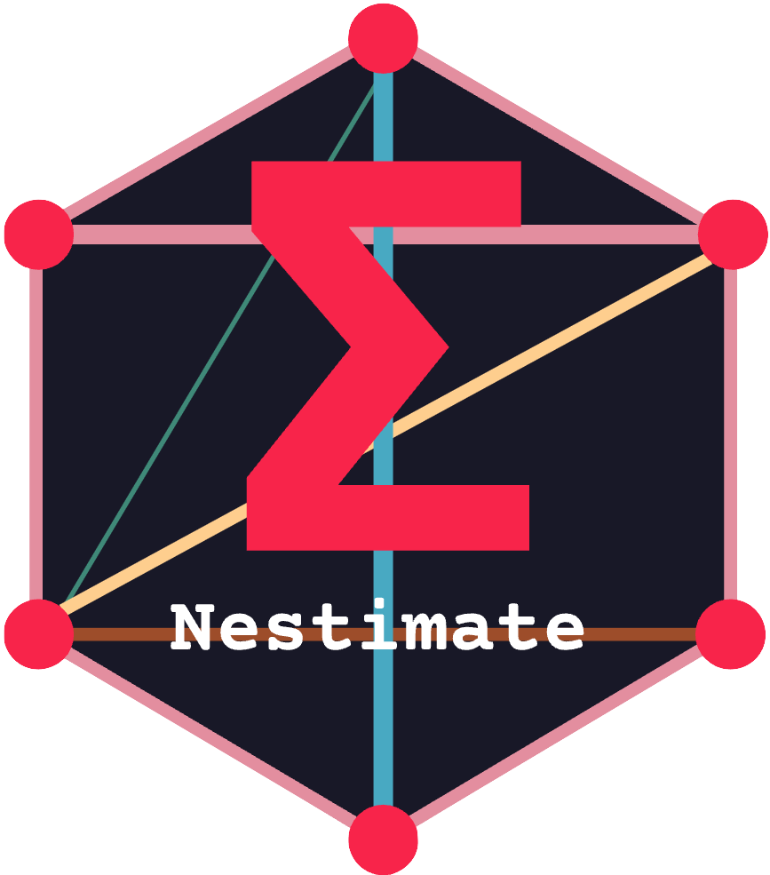

# Nestimate 

> Unified network estimation, analysis, and validation for behavioral, psychological, and panel data.

<!-- badges: start -->
[](https://github.com/mohsaqr/Nestimate/actions/workflows/R-CMD-check.yaml)
[](https://CRAN.R-project.org/package=Nestimate)
[](https://opensource.org/licenses/MIT)
<!-- badges: end -->

Nestimate is an R package for estimating, validating, and comparing networks from behavioral sequence data, psychological scales, and longitudinal panel data. A single entry point — `build_network()` — dispatches to 14 built-in estimators. Every network type shares the same validation pipeline: bootstrap confidence intervals, permutation testing, split-half reliability, and centrality stability.

### Full tutorials

- [Network Estimation & Visualization](https://pak.dynasite.org/Nestimate/articles/cograph-tutorial-nestimate.html)
- [Higher-Order & Simplicial Complexes](https://pak.dynasite.org/Nestimate/articles/cograph-tutorial-simplicial.html)
- [Model Assessment](https://pak.dynasite.org/Nestimate/articles/tutorial_model_assessment.html)
- [Permutation Tests for Nested Data](https://pak.dynasite.org/Nestimate/articles/permutation-nested-data.html)
- [Comparing Networks](https://pak.dynasite.org/Nestimate/articles/compare-networks.html)

### Quick guides

- [Transition Networks](https://pak.dynasite.org/Nestimate/articles/transition-networks.html)
- [Sequence Plots & Comparison](https://pak.dynasite.org/Nestimate/articles/sequence-plots.html)
- [Clustering & Multi-Level Analysis](https://pak.dynasite.org/Nestimate/articles/clustering.html)
- [Markov Stability](https://pak.dynasite.org/Nestimate/articles/markov-stability.html)
- [Sequence Pattern Comparison](https://pak.dynasite.org/Nestimate/articles/sequence-comparison.html)


## Installation

```r
# From CRAN
install.packages("Nestimate")

# Development version
devtools::install_github("mohsaqr/Nestimate")
```

## What Nestimate Covers

| Area | Key Functions |
|------|--------------|
| Dynamic / Transition Networks | `build_network()`, `wtna()`, `cooccurrence()` |
| Psychological Networks | `build_network(method = "glasso/pcor/cor/ising/mgm")` |
| Multilevel VAR | `build_mlvar()` |
| Idiographic Networks | `build_gimme()` |
| Cluster & Group Networks | `build_clusters()`, `build_mmm()`, `build_mcml()` |
| Higher-Order Networks | `build_hon()`, `build_honem()`, `build_hypa()`, `build_mogen()` |
| Topological Analysis | `build_simplicial()`, `persistent_homology()`, `q_analysis()` |
| Sequence Visualization | `sequence_plot()`, `distribution_plot()` |
| Sequence Pattern Comparison | `sequence_compare()` |
| Association Mining | `association_rules()` |
| Link Prediction | `predict_links()`, `evaluate_links()` |
| Markov Chain Analysis | `markov_stability()`, `passage_time()` |
| Statistical Validation | `bootstrap_network()`, `permutation()`, `nct()`, `network_reliability()`, `centrality_stability()` |

---

## Dynamic Networks

All dynamic network methods use `build_network()`. Pass an event log and name its `action`, `actor`, and `time` columns — no preprocessing needed.

### Estimation Methods

| Method | Aliases | Description |
|--------|---------|-------------|
| `"relative"` | `"tna"`, `"transition"` | Transition probabilities (directed) |
| `"frequency"` | `"ftna"`, `"counts"` | Raw transition counts (directed) |
| `"attention"` | `"atna"` | Decay-weighted transitions emphasising recent events (directed) |
| `"co_occurrence"` | `"cna"` | Co-occurrence from sequential data (undirected) |

```r
library(Nestimate)

net <- build_network(human_long, method = "tna",
                     action = "code", actor = "session_id", time = "timestamp")

# Per-group networks in one call: high vs low achievers
group_nets <- build_network(group_regulation_long, method = "tna",
                            action = "Action", actor = "Actor",
                            time = "Time", group = "Achiever")
```

Further estimators (`"ngram"`, `"gap"`, `"reverse"`, the window-based `"wtna"` family) are listed by `list_estimators()`.

### Window-Based TNA

`wtna()` builds networks from binary (one-hot) data using temporal windows — directed transitions between windows, undirected co-occurrence within windows, or a mixed network combining both.

```r
net_wtna  <- wtna(learning_activities, actor = "student",
                  method = "transition", type = "relative")
net_mixed <- wtna(learning_activities, actor = "student",
                  method = "both", type = "relative")
```

### Co-occurrence Networks

`cooccurrence()` builds undirected co-occurrence networks from 6 input formats (delimited fields, long/bipartite, binary matrix, wide sequence, lists) with 8 similarity methods (Jaccard, cosine, association strength, Dice, and more).

```r
# From a long-format data frame: codes co-occurring within a session
net_co <- cooccurrence(human_long, field = "code", by = "session_id",
                       similarity = "jaccard", threshold = 0.1)
```

---

## Psychological Networks

| Method | Description |
|--------|-------------|
| `"cor"` | Pearson correlations |
| `"pcor"` | Partial correlations (precision matrix inversion) |
| `"glasso"` | EBICglasso — sparse regularised partial correlations |
| `"ising"` | L1-regularised logistic regression for binary items |
| `"mgm"` | Mixed Graphical Model — continuous + categorical variables together |

The estimation itself (EBICglasso, Ising, MGM) is delegated to the 'psychnets' package; no igraph, qgraph, or bootnet is needed.

```r
net_gl <- build_network(srl_strategies, method = "glasso")
net_gl

predictability(net_gl)   # R-squared per node from network structure
```

---

## Multilevel VAR

`build_mlvar()` estimates three networks simultaneously from ESM/EMA diary data — the three pillars of mlVAR analysis in a single function call:

- **Temporal** (directed) — lagged fixed effects: what predicts what across time
- **Contemporaneous** (undirected) — partial correlations of within-person residuals: what moves together right now
- **Between-subjects** (undirected) — partial correlations of person means: who differs from whom

The estimates match `mlVAR::mlVAR()` with `estimator = "lmer"` and fixed temporal and contemporaneous effects. `build_mlvar()` needs a long panel with one row per beep (`id`, optional `day`, `beep`, and the variables); see `?build_mlvar` for a runnable simulated panel.

```r
# esm: one row per person-beep, columns id, day, beep, happy, calm, tired
fit <- build_mlvar(esm, vars = c("happy", "calm", "tired"),
                   id = "id", day = "day", beep = "beep")

fit           # the temporal, contemporaneous and between-person networks
summary(fit)
coefs(fit)    # tidy data.frame: beta, SE, t, p, CI for every edge
```

---

## Idiographic Networks

`build_gimme()` estimates a separate network for each person using the Group Iterative Mean Estimation (GIMME) algorithm, then aggregates to a group-level picture. Use this when between-person heterogeneity matters and a single group network would average over meaningfully different individuals.

```r
# panel: one row per person-time point, columns id, V1, ..., V4 (see ?build_gimme)
fit_g <- build_gimme(panel, vars = c("V1", "V2", "V3", "V4"), id = "id")
fit_g   # group-level paths and the per-person networks
```

---

## Cluster & Group Networks

### Sequence Clustering

`build_clusters()` partitions sequences into `k` groups using pairwise distance matrices. Supports 9 distance metrics, PAM and 8 hierarchical linkage methods. Both `build_clusters()` and `build_mmm()` results pass directly to `build_network()`, which returns one network per cluster.

```r
clust <- build_clusters(net, k = 3, dissimilarity = "hamming", method = "ward.D2")
plot(clust, type = "silhouette")
cluster_nets <- build_network(clust, method = "tna")
```

### Mixed Markov Models

`build_mmm()` discovers latent subgroups of sequences that share similar transition dynamics via EM — without pre-labelling groups. BIC/AIC/ICL model selection via `compare_mmm()`.

```r
mmm   <- build_mmm(net, k = 3)
compare_mmm(net, k = 2:4)   # BIC / AIC / ICL per k
mmm_nets <- build_network(mmm, method = "tna")
```

### MCML

`build_mcml()` decomposes a network into macro (between-cluster) and micro (within-cluster) layers when nodes belong to known groups — here the three code families of `human_long`.

```r
families <- list(Directive     = c("Command", "Request", "Specify"),
                 Evaluative    = c("Correct", "Frustrate", "Refine", "Verify"),
                 Metacognitive = c("Inquire", "Interrupt"))
mcml <- build_mcml(human_long, clusters = families, action = "code",
                   actor = "session_id", time = "timestamp")
summary(mcml)          # within and between totals per family
macro_network(mcml)    # the family-level transition network
```

---

## Higher-Order Networks

Capture dependencies beyond first-order transitions:

| Function | What it finds |
|----------|--------------|
| `build_hon()` | Variable-length memory paths |
| `build_honem()` | Higher-order network embedding |
| `build_hypa()` | Statistically anomalous paths (over/under-represented) |
| `build_mogen()` | Optimal Markov order per node |

```r
hon  <- build_hon(net, max_order = 2)
pathways(hon)                      # arrow-notation path strings
hypa <- build_hypa(net)
summary(hypa)                      # over- and under-represented paths with p-values
```

---

## Topological Analysis

Go beyond edges — find cliques, holes, and high-order connectivity using tools from algebraic topology.

```r
sc <- build_simplicial(net, type = "clique")
betti_numbers(sc)          # connected components, cycles, voids
euler_characteristic(sc)
ph <- persistent_homology(net)  # track topology across thresholds
plot(ph)
qa <- q_analysis(sc)       # Atkin's Q-connectivity structure vectors
```

---

## Sequence Visualization

Visualize raw sequence data as index plots or state distribution charts — before or after clustering.

```r
# Sequence heatmap: one row per sequence, coloured by state, sorted by similarity
sequence_plot(net)

# After clustering: faceted by cluster
clust <- build_clusters(net, k = 3)
sequence_plot(clust, type = "index")

# State distribution over time
distribution_plot(net, geom = "area")
distribution_plot(clust, geom = "bar")
```

---

## Sequence Pattern Comparison

`sequence_compare()` extracts all k-gram patterns from grouped sequences, counts per-group frequencies, and tests statistical differences via permutation — answering the question "do these groups actually behave differently, and where?"

```r
res <- sequence_compare(group_nets, sub = 2:4, test = "chisq", adjust = "fdr")
summary(res)                        # per-pattern frequencies + p-values
plot(res)                           # back-to-back pyramid chart
plot(res, style = "heatmap")        # heatmap for many patterns
```

---

## Association Rule Mining

`association_rules()` mines "if A then B" patterns from sequences or binary matrices using the Apriori algorithm. Returns support, confidence, lift, and conviction for every rule above a threshold.

```r
rules <- association_rules(net, min_support = 0.05, min_confidence = 0.6)
summary(rules)                    # tidy data.frame, sorted by lift
pathways(rules)                   # rules as arrow-notation strings
```

A binary transaction matrix (rows = transactions, columns = items) is accepted as well.

---

## Link Prediction

`predict_links()` scores all unobserved node pairs using structural similarity, identifying which missing connections are most likely to exist. `evaluate_links()` computes AUC, precision, and recall against held-out edges.

```r
# Keep only transitions with probability >= 0.1, then predict the rest
sparse <- build_network(human_long, method = "tna", action = "code",
                        actor = "session_id", time = "timestamp",
                        threshold = 0.1)
preds <- predict_links(sparse)    # common neighbours, Adamic-Adar, Katz, ...
summary(preds)

# Do the predictions recover the weaker transitions (>= 0.05) that were cut?
evaluate_links(preds, extract_edges(net, threshold = 0.05))
```

---

## Markov Chain Analysis

`markov_stability()` reports, per state, how sticky it is (persistence, sojourn time), how much of the long run it takes (stationary probability, return time) and how quickly it is reached from the other states. `passage_time()` computes the mean first-passage time between every pair of states.

```r
stab <- markov_stability(net)
summary(stab)             # one row per state
plot(stab)

pt <- passage_time(net)
pt                        # expected steps to reach state j from state i
plot(pt)
```

---

## Statistical Validation

Every network type shares the same validation pipeline.

```r
# Bootstrap confidence intervals
boot <- bootstrap_network(net, iter = 1000)
summary(boot)

# Permutation test: do high and low achievers differ?
perm <- permutation(group_nets, iter = 1000)
summary(perm)

# Network Comparison Test (NCT): formal test of structure + global strength
nct_res <- nct(head(srl_strategies, 125), tail(srl_strategies, 125), iter = 500)
nct_res                   # M (structure), S (global strength), per-edge p-values

# Split-half reliability
network_reliability(net)

# Centrality stability (CS-coefficient)
centrality_stability(net)

# Glasso-specific bootstrap (edge inclusion + centrality CIs)
boot_gl <- boot_glasso(net_gl, iter = 1000)
summary(boot_gl)
```

| Function | Purpose |
|----------|---------|
| `bootstrap_network()` | Bootstrap CIs and p-values for each edge |
| `permutation()` | Edge-level comparison between two networks |
| `nct()` | Formal Network Comparison Test (global strength + structure) |
| `network_reliability()` | Split-half reliability of edge weights |
| `centrality_stability()` | CS-coefficient via case-dropping |
| `boot_glasso()` | Edge inclusion, centrality CIs, difference tests for glasso networks |

---

## Bundled Datasets

| Dataset | Description |
|---------|-------------|
| `human_long` | 10,796 human actions across 429 human-AI coding sessions |
| `ai_long` | 8,551 AI actions from 428 of the same sessions |
| `srl_strategies` | Simulated SRL strategy frequencies — 250 students, 9 strategies |
| `chatgpt_srl` | 1,000 ChatGPT-generated responses scored on 5 SRL scales |
| `learning_activities` | Simulated binary learning activity indicators — 200 students × 30 time points, 6 activities |
| `group_regulation_long` | 27,533 group regulation actions with achievement and course covariates |
| `trajectories` | 138 students × 15 weeks of engagement states (`NA` = drop-out) |

---

## Documentation

- [Transition Networks](https://pak.dynasite.org/Nestimate/articles/transition-networks.html)
- [Clustering & Multilevel](https://pak.dynasite.org/Nestimate/articles/clustering.html)
- [Full Reference](https://pak.dynasite.org/Nestimate/reference/)

## Citation

If you use Nestimate in your research, please cite:

> Saqr, M., Lopez-Pernas, S., Tormanen, T., Kaliisa, R., Misiejuk, K., & Tikka, S. (2025). Transition Network Analysis: A Novel Framework for Modeling, Visualizing, and Identifying the Temporal Patterns of Learners and Learning. *Proceedings of the 15th Learning Analytics and Knowledge Conference*. doi: [10.1145/3706468.3706513](https://doi.org/10.1145/3706468.3706513)

> Saqr, M., Beck, E., & Lopez-Pernas, S. (2024). Psychological Networks. In M. Saqr & S. Lopez-Pernas (Eds.), *Learning Analytics Methods and Tutorials* (pp. 513–546). Springer. doi: [10.1007/978-3-031-54464-4_19](https://doi.org/10.1007/978-3-031-54464-4_19)

## License

MIT
