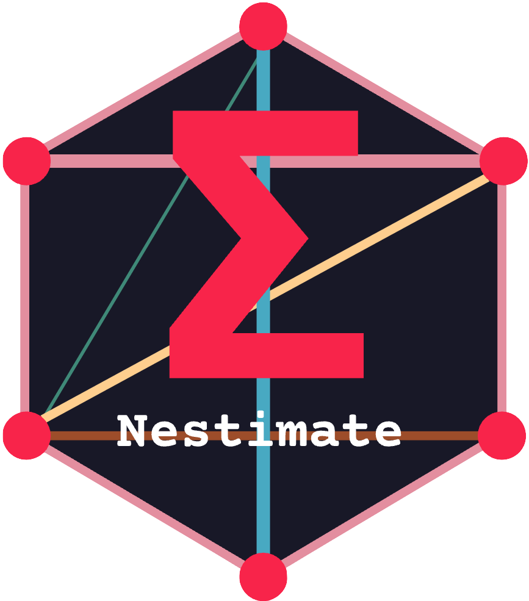

# Nestimate 

> Network estimation, comparison and testing for sequence, event-log, panel and cross-sectional data.

<!-- badges: start -->
[](https://github.com/mohsaqr/Nestimate/actions/workflows/R-CMD-check.yaml)
[](https://CRAN.R-project.org/package=Nestimate)
[](https://choosealicense.com/licenses/mit/)
<!-- badges: end -->

Nestimate estimates, compares and tests networks from sequence, event-log, panel and cross-sectional data. One function, `build_network()`, gives 15 estimators: transition, frequency, co-occurrence, attention, n-gram, gap, reply and latency networks, two window-based networks for one-hot data, and correlation, partial correlation, graphical lasso, Ising and mixed graphical models. Bootstrap intervals, permutation tests, split-half reliability and centrality stability apply to every network whose data can be resampled. Further functions cover sequence patterns and indices, transition entropy, Markov chains, stability landscapes, clustering, mixture Markov models and higher-order networks.

### Articles

- [Network estimation and analysis with Nestimate](https://pak.dynasite.org/Nestimate/articles/transition-networks.html)
- [Transition matrix entropy](https://pak.dynasite.org/Nestimate/articles/transition-entropy.html)
- [Markov stability analysis](https://pak.dynasite.org/Nestimate/articles/markov-stability.html)
- [Comparing sequences between groups](https://pak.dynasite.org/Nestimate/articles/sequence-comparison.html)
- [Sequence plots](https://pak.dynasite.org/Nestimate/articles/sequence-plots.html)
- [Sequence clustering](https://pak.dynasite.org/Nestimate/articles/clustering.html)
- [Network estimation and visualization with Nestimate + cograph](https://pak.dynasite.org/Nestimate/articles/cograph-tutorial-nestimate.html)
- [Higher-order network analysis with simplicial complexes](https://pak.dynasite.org/Nestimate/articles/cograph-tutorial-simplicial.html)
- [Model assessment for transition networks](https://pak.dynasite.org/Nestimate/articles/tutorial_model_assessment.html)
- [Nested sequences and the permutation test](https://pak.dynasite.org/Nestimate/articles/permutation-nested-data.html)
- [Comparing networks with compare_networks()](https://pak.dynasite.org/Nestimate/articles/compare-networks.html)
- [Stability of engagement: states, landscapes and students](https://pak.dynasite.org/Nestimate/articles/stability-landscapes.html)
- [Function reference](https://pak.dynasite.org/Nestimate/reference/)

## Installation

```r
# From CRAN
install.packages("Nestimate")

# Development version
devtools::install_github("mohsaqr/Nestimate")
```

## What Nestimate Covers

| Area | Key Functions |
|------|--------------|
| Transition and co-occurrence networks | `build_network()`, `build_tna()`, `build_ftna()`, `build_atna()`, `build_cna()`, `build_ngram()`, `build_gap()`, `build_reverse()`, `build_latency()`, `wtna()`, `cooccurrence()` |
| Psychological networks | `build_cor()`, `build_pcor()`, `build_glasso()`, `build_ising()`, `build_mgm()` |
| Multilevel VAR | `build_mlvar()` |
| Idiographic networks | `build_gimme()` |
| Phases and groups | `mark_phases()`, `build_network(group = )` |
| Clusters and mixtures | `build_clusters()`, `build_mmm()`, `build_mcml()`, `cluster_choice()` |
| Higher-order networks | `build_hon()`, `build_honem()`, `build_hypa()`, `build_mogen()`, `build_hypergraph()` |
| Topological analysis | `build_simplicial()`, `persistent_homology()`, `q_analysis()` |
| Sequence plots | `sequence_plot()`, `distribution_plot()`, `plot_state_frequencies()`, `mosaic_plot()` |
| Sequence patterns and indices | `extract_sequences()`, `sequence_patterns()`, `sequence_metrics()`, `pattern_outcome()`, `sequence_compare()` |
| Transition entropy | `transition_entropy()`, `entropy_network()`, `entropy_bayes()`, `entropy_trajectory()` |
| Markov chains | `markov_order_test()`, `markov_stability()`, `passage_time()`, `chain_structure()` |
| Stability landscapes | `stability_landscape()`, `landscape_surface()`, `landscape_trend()` |
| Network comparison | `compare_networks()`, `permutation()`, `bayes_compare()`, `vertex_compare()`, `nct()` |
| Counts nested in actors | `mosaic_test()`, `mosaic_analysis()` |
| Association rules | `association_rules()` |
| Link prediction | `predict_links()`, `evaluate_links()` |
| Resampling | `bootstrap_network()`, `network_reliability()`, `centrality_stability()`, `casedrop_reliability()`, `boot_glasso()` |

---

## Transition Networks

`build_network()` reads an event log when its `action`, `actor` and `time` columns are named, and wide sequences (one row per sequence, one column per position) as they are.

| Method | Aliases | Description |
|--------|---------|-------------|
| `"relative"` | `"tna"`, `"transition"` | Transition probabilities (directed) |
| `"frequency"` | `"ftna"`, `"counts"` | Transition counts (directed) |
| `"attention"` | `"atna"` | Decay-weighted transitions (directed) |
| `"co_occurrence"` | `"cna"` | Co-occurrence within sequences (undirected) |
| `"ngram"` | `"n-gram"` | Transitions between n-grams (directed) |
| `"gap"` | | Transitions across gaps, weighted by 1/distance (directed) |
| `"reverse"` | | Reply network, the transpose of `"frequency"` (directed) |
| `"latency"` | | Reply network weighted by reply speed (directed) |
| `"wtna"` | | Transitions between windows of one-hot data (directed) |
| `"wtna_cooccurrence"` | | Co-occurrence within windows of one-hot data (undirected) |

```r
library(Nestimate)

net <- build_network(human_long, method = "tna",
                     action = "code", actor = "session_id", time = "timestamp")

# One network per group: high and low achievers
group_nets <- build_network(group_regulation_long, method = "tna",
                            action = "Action", actor = "Actor",
                            time = "Time", group = "Achiever")

# Replies weighted by how fast they came
latency <- build_network(group_regulation_long, method = "latency",
                         action = "Action", actor = "Actor", time = "Time")

list_estimators()
```

### Phases

`mark_phases()` splits each actor's events into `n` phases, which `build_network(group = "phase")` turns into one network per phase.

```r
halves <- mark_phases(human_long, actor = "session_id",
                      time = "order_in_session", n = 2,
                      labels = c("early", "late"))
phase_nets <- build_network(halves, method = "relative", actor = "session_id",
                            action = "cluster", time = "order_in_session",
                            group = "phase")
```

### Window-Based Networks

`wtna()` builds networks from one-hot data in time windows: transitions between windows, co-occurrence within windows, or both.

```r
net_wtna  <- wtna(learning_activities, actor = "student",
                  method = "transition", type = "relative")
net_mixed <- wtna(learning_activities, actor = "student",
                  method = "both", type = "relative")
```

### Co-occurrence Networks

`cooccurrence()` builds undirected co-occurrence networks from six input formats (delimited fields, long, binary matrix, wide sequences, lists) with eight similarity measures (Jaccard, cosine, association strength, Dice and others; van Eck & Waltman, 2009).

```r
# Codes that occur in the same session
net_co <- cooccurrence(human_long, field = "code", by = "session_id",
                       similarity = "jaccard", threshold = 0.1)
```

---

## Psychological Networks

| Method | Description |
|--------|-------------|
| `"cor"` | Pearson correlations |
| `"pcor"` | Partial correlations |
| `"glasso"` | EBIC graphical lasso: regularised partial correlations |
| `"ising"` | L1-regularised logistic regressions for binary items |
| `"mgm"` | Mixed graphical model for continuous and categorical variables |

The graphical lasso, Ising and mixed graphical models are estimated by the 'psychnets' package.

```r
net_gl <- build_network(srl_strategies, method = "glasso")
net_gl

predictability(net_gl)   # variance of each node explained by its neighbours
```

---

## Multilevel VAR

`build_mlvar()` estimates three networks from experience-sampling data:

- **Temporal** (directed): lagged fixed effects
- **Contemporaneous** (undirected): partial correlations of within-person residuals
- **Between-person** (undirected): partial correlations of person means

The estimates equal those of `mlVAR::mlVAR()` with `estimator = "lmer"` and fixed temporal and contemporaneous effects. The data are one row per beep (`id`, optional `day`, `beep` and the variables); `?build_mlvar` has a runnable simulated panel.

```r
# esm: one row per person and beep, columns id, day, beep, happy, calm, tired
fit <- build_mlvar(esm, vars = c("happy", "calm", "tired"),
                   id = "id", day = "day", beep = "beep")

fit           # the temporal, contemporaneous and between-person networks
summary(fit)
coefs(fit)    # one row per edge: beta, SE, t, p and interval
```

---

## Idiographic Networks

`build_gimme()` estimates a network for each person with GIMME (Group Iterative Multiple Model Estimation), with paths shared by the group and paths of each person.

```r
# panel: one row per person and time point, columns id, V1, ..., V4 (see ?build_gimme)
fit_g <- build_gimme(panel, vars = c("V1", "V2", "V3", "V4"), id = "id")
fit_g   # group paths and the network of each person
```

---

## Clusters and Mixtures

### Sequence Clustering

`build_clusters()` partitions sequences into `k` groups from a distance matrix (9 distances; PAM or 8 hierarchical linkages). `cluster_choice()` compares numbers of clusters. The result of `build_clusters()` or `build_mmm()` passed to `build_network()` gives one network per cluster.

```r
clust <- build_clusters(net, k = 3, dissimilarity = "hamming", method = "ward.D2")
plot(clust, type = "silhouette")
cluster_nets <- build_network(clust, method = "tna")
```

### Mixture Markov Models

`build_mmm()` fits a mixture of Markov chains by EM; `compare_mmm()` gives BIC, AIC and ICL per number of components.

```r
mmm <- build_mmm(net, k = 3)
compare_mmm(net, k = 2:4)
mmm_nets <- build_network(mmm, method = "tna")
```

### Multi-Cluster Multi-Level Networks

`build_mcml()` splits a network into a between-cluster (macro) and within-cluster layers when the states belong to known groups, here the three code families of `human_long`.

```r
families <- list(Directive     = c("Command", "Request", "Specify"),
                 Evaluative    = c("Correct", "Frustrate", "Refine", "Verify"),
                 Metacognitive = c("Inquire", "Interrupt"))
mcml <- build_mcml(human_long, clusters = families, action = "code",
                   actor = "session_id", time = "timestamp")
summary(mcml)          # within and between totals per family
macro_network(mcml)    # the family-level transition network
```

---

## Higher-Order Networks

| Function | Estimates |
|----------|-----------|
| `build_hon()` | Higher-order network with variable-length memory |
| `build_honem()` | Embedding of a higher-order network |
| `build_hypa()` | Paths more or less frequent than a strength-preserving null |
| `build_mogen()` | Multi-order generative model and its optimal order |
| `build_hypergraph()` | Hypergraph of states that occur together |

```r
hon  <- build_hon(net, max_order = 2)
pathways(hon)                      # paths in arrow notation
hypa <- build_hypa(net)
summary(hypa)                      # over- and under-represented paths with p-values
```

---

## Topological Analysis

Simplicial complexes built from a network: Betti numbers, the Euler characteristic, persistent homology across thresholds and Atkin's Q-analysis.

```r
sc <- build_simplicial(net, type = "clique")
betti_numbers(sc)          # components, cycles, voids
euler_characteristic(sc)
ph <- persistent_homology(net)
plot(ph)
qa <- q_analysis(sc)       # Q-connectivity structure vectors
```

---

## Sequence Plots

Index plots and state distributions, for the whole data, by group or by cluster.

```r
sequence_plot(net)                       # one row per sequence, sorted by similarity
sequence_plot(clust, type = "index")     # one panel per cluster
distribution_plot(net, geom = "area")    # state distribution over positions
sequence_plot(daily_actions, actor = "student", action = "action",
              periods = "day")           # actions per day
```

---

## Sequence Patterns and Indices

`sequence_patterns()` counts contiguous, gapped and repeated patterns and tests them between groups. `sequence_metrics()` computes 23 indices per sequence (entropy, turbulence, complexity, spells and others) and compares them between groups. `sequence_compare()` tests k-gram frequencies between groups.

```r
sequence_patterns(trajectories, len = 2:3, top = 10)
sequence_patterns(group_regulation_long, actor = "Actor", action = "Action",
                  time = "Time", len = 2, group = "Achiever", top = 10)

sequence_metrics(trajectories)
sequence_metrics(phase_nets, iter = 99)     # early versus late halves

res <- sequence_compare(group_nets, sub = 2:4, test = "chisq", adjust = "fdr")
res                                 # one row per pattern and group, rounded
summary(res)                        # every row as a data frame
plot(res)                           # back-to-back pyramid
```

---

## Transition Entropy

`transition_entropy()` gives the entropy rate of a transition network and each state's share of it (Cover & Thomas, 2006; Krejtz et al., 2015). `entropy_trajectory()` follows the entropy over sliding windows, with a bootstrap band per group.

```r
traj_net <- build_network(trajectories, method = "relative")
te <- transition_entropy(traj_net)
te
summary(te)

tr <- entropy_trajectory(group_regulation_long, action = "Action",
                         actor = "Actor", time = "Time", group = "Achiever")
plot(tr)
```

---

## Markov Chains

`markov_order_test()` tests how many previous states the next one depends on. `markov_stability()` reports, per state, persistence, sojourn time, stationary probability, return time and how quickly it is reached from the other states. `passage_time()` gives the mean first-passage time between every pair of states, and `chain_structure()` the communicating classes and absorption.

```r
markov_order_test(trajectories, max_order = 2, n_perm = 99, seed = 1)

stab <- markov_stability(net)
summary(stab)             # one row per state
plot(stab)

pt <- passage_time(net)
pt                        # expected steps from state i to state j

chain_structure(traj_net)
```

---

## Stability Landscapes

`stability_landscape()` draws each state as a cup whose depth is the log of the expected stay in it, with bootstrap intervals. `landscape_trend()` follows the depths over windows of positions or along a covariate.

```r
land <- stability_landscape(traj_net,
  states = c("Disengaged", "Average", "Active"), iter = 50, seed = 1)
land
plot(land)

trend <- landscape_trend(traj_net, along = "phase",
  states = c("Disengaged", "Average", "Active"), iter = 50, seed = 1)
plot(trend)
```

---

## Comparing Networks

`compare_networks()` compares every pair of networks in a group: edge, node and global differences, with a permutation or Bayesian test. `permutation()` tests the edge differences between two networks, and `nct()` is the Network Comparison Test for psychological networks (van Borkulo et al., 2022).

```r
courses <- build_network(group_regulation_long, method = "relative",
                         actor = "Actor", action = "Action", time = "Time",
                         group = "Course")
cmp <- compare_networks(courses)
summary(cmp)
edge_differences(cmp, pair = c("A", "B"))
plot(cmp, type = "difference")

perm <- permutation(group_nets, iter = 1000)
summary(perm)

nct_res <- nct(head(srl_strategies, 125), tail(srl_strategies, 125), iter = 500)
nct_res                   # structure, global strength and edge tests
```

### Counts Nested in Actors

`mosaic_test()` tests a state-by-group table when the counts are nested in actors (Rao-Scott, Donner-Klar, CMH, GEE or a mixed model); `mosaic_plot()` draws it with residuals.

```r
counts <- build_network(group_regulation_long, method = "frequency",
                        actor = "Actor", action = "Action", time = "Time")
mosaic_test(counts, method = c("chisq", "rao_scott"), actor = "Group")
```

---

## Association Rules

`association_rules()` mines "if A then B" rules from sequences or binary matrices with the Apriori algorithm, with support, confidence, lift and conviction.

```r
rules <- association_rules(net, min_support = 0.05, min_confidence = 0.6)
summary(rules)                    # one row per rule, sorted by lift
pathways(rules)                   # rules in arrow notation
```

---

## Link Prediction

`predict_links()` scores every unobserved pair of states by structural similarity; `evaluate_links()` gives AUC, precision and recall against held-out edges.

```r
# Keep transitions with probability >= 0.1, then predict the rest
sparse <- build_network(human_long, method = "tna", action = "code",
                        actor = "session_id", time = "timestamp",
                        threshold = 0.1)
preds <- predict_links(sparse)    # common neighbours, Adamic-Adar, Katz, ...
summary(preds)

# Do the predictions recover the transitions between 0.05 and 0.1 that were cut?
evaluate_links(preds, extract_edges(net, threshold = 0.05))
```

---

## Resampling

Bootstrap intervals, split-half reliability and centrality stability resample sequences or actors. They apply to every network whose data can be resampled; latency networks take only the bootstrap, and one-hot data need an actor or session to resample.

```r
boot <- bootstrap_network(net, iter = 1000)
summary(boot)

network_reliability(net)          # split-half reliability
centrality_stability(net)         # CS-coefficient by case-dropping

boot_gl <- boot_glasso(net_gl, iter = 1000)
summary(boot_gl)                  # edge inclusion and centrality intervals
```

| Function | Purpose |
|----------|---------|
| `bootstrap_network()` | Bootstrap intervals and p-values for each edge |
| `network_reliability()` | Split-half reliability of edge weights |
| `centrality_stability()` | CS-coefficient by case-dropping (Epskamp et al., 2018) |
| `casedrop_reliability()` | Edge-weight correlation as cases are dropped |
| `boot_glasso()` | Edge inclusion, centrality intervals and difference tests for graphical lasso networks |

---

## Bundled Datasets

| Dataset | Description |
|---------|-------------|
| `human_long` | 10,796 human actions in 429 human-AI coding sessions |
| `ai_long` | 8,551 AI actions in 428 of the same sessions |
| `group_regulation_long` | 27,533 group regulation actions with achievement, group and course |
| `trajectories` | 138 students × 15 courses of engagement states (`NA` = drop-out) |
| `daily_actions` | Simulated: 2,280 learning actions of 30 students over seven days |
| `srl_strategies` | Simulated: 9 self-regulated learning strategies of 250 students |
| `chatgpt_srl` | 1,000 ChatGPT-generated responses scored on 5 self-regulated learning scales |
| `learning_activities` | Simulated: 6 binary learning activities of 200 students × 30 time points |

---

## Citation

If you use Nestimate in your research, please cite (`citation("Nestimate")`):

> Saqr, M., López-Pernas, S., & Misiejuk, K. (2026). Nestimate: An R package for dynamic, probabilistic, and high order network analysis. *Applied Psychological Measurement*. <https://doi.org/10.1177/01466216261472019>

Saqr, M., López-Pernas, S., & Misiejuk, K. (2026). *Network estimation and analysis with Nestimate*. Nestimate. <https://doi.org/10.5281/zenodo.24528510> · [HTML](https://pak.dynasite.org/Nestimate/articles/transition-networks.html) · [PDF](https://pak.dynasite.org/Nestimate/pdf/transition-networks.pdf)

Saqr, M. (2026). *Transition matrix entropy*. Nestimate. <https://doi.org/10.5281/zenodo.24528508> · [HTML](https://pak.dynasite.org/Nestimate/articles/transition-entropy.html) · [PDF](https://pak.dynasite.org/Nestimate/pdf/transition-entropy.pdf)

Saqr, M., López-Pernas, S., & Misiejuk, K. (2026). *Markov stability analysis*. Nestimate. <https://doi.org/10.5281/zenodo.24528502> · [HTML](https://pak.dynasite.org/Nestimate/articles/markov-stability.html) · [PDF](https://pak.dynasite.org/Nestimate/pdf/markov-stability.pdf)

Saqr, M., López-Pernas, S., & Misiejuk, K. (2026). *Comparing sequences between groups: Early vs late human-AI interactions*. Nestimate. <https://doi.org/10.5281/zenodo.24528504> · [HTML](https://pak.dynasite.org/Nestimate/articles/sequence-comparison.html) · [PDF](https://pak.dynasite.org/Nestimate/pdf/sequence-comparison.pdf)

Saqr, M., López-Pernas, S., & Misiejuk, K. (2026). *Sequence plots*. Nestimate. <https://doi.org/10.5281/zenodo.24528506> · [HTML](https://pak.dynasite.org/Nestimate/articles/sequence-plots.html) · [PDF](https://pak.dynasite.org/Nestimate/pdf/sequence-plots.pdf)

Saqr, M., López-Pernas, S., & Misiejuk, K. (2026). *Sequence clustering*. Nestimate. <https://doi.org/10.5281/zenodo.24528491> · [HTML](https://pak.dynasite.org/Nestimate/articles/clustering.html) · [PDF](https://pak.dynasite.org/Nestimate/pdf/clustering.pdf)

Saqr, M., López-Pernas, S., & Misiejuk, K. (2026). *Network estimation and visualization with Nestimate + cograph*. Nestimate. <https://doi.org/10.5281/zenodo.24528512> · [HTML](https://pak.dynasite.org/Nestimate/articles/cograph-tutorial-nestimate.html) · [PDF](https://pak.dynasite.org/Nestimate/pdf/cograph-tutorial-nestimate.pdf)

Saqr, M., López-Pernas, S., & Misiejuk, K. (2026). *Higher-order network analysis with simplicial complexes: From transition networks to topological analysis*. Nestimate. <https://doi.org/10.5281/zenodo.24528514> · [HTML](https://pak.dynasite.org/Nestimate/articles/cograph-tutorial-simplicial.html) · [PDF](https://pak.dynasite.org/Nestimate/pdf/cograph-tutorial-simplicial.pdf)

Saqr, M., López-Pernas, S., & Misiejuk, K. (2026). *Model assessment for transition networks*. Nestimate. <https://doi.org/10.5281/zenodo.24528522> · [HTML](https://pak.dynasite.org/Nestimate/articles/tutorial_model_assessment.html) · [PDF](https://pak.dynasite.org/Nestimate/pdf/tutorial_model_assessment.pdf)

Saqr, M., López-Pernas, S., & Misiejuk, K. (2026). *Nested sequences and the permutation test*. Nestimate. <https://doi.org/10.5281/zenodo.24528518> · [HTML](https://pak.dynasite.org/Nestimate/articles/permutation-nested-data.html) · [PDF](https://pak.dynasite.org/Nestimate/pdf/permutation-nested-data.pdf)

Saqr, M., López-Pernas, S., & Misiejuk, K. (2026). *Comparing networks with compare_networks()*. Nestimate. <https://doi.org/10.5281/zenodo.24528516> · [HTML](https://pak.dynasite.org/Nestimate/articles/compare-networks.html) · [PDF](https://pak.dynasite.org/Nestimate/pdf/compare-networks.pdf)

Saqr, M., López-Pernas, S., & Misiejuk, K. (2026). *Stability of engagement: States, landscapes and students*. Nestimate. <https://doi.org/10.5281/zenodo.24528520> · [HTML](https://pak.dynasite.org/Nestimate/articles/stability-landscapes.html) · [PDF](https://pak.dynasite.org/Nestimate/pdf/stability-landscapes.pdf)

## License

MIT
