# Sequence Clustering

A transition network estimated from all sequences describes an average
process, which may describe none of the units that produced it.
Clustering divides the sequences into groups whose members resemble each
other more than they resemble the members of other groups, and a network
can then be estimated for each group (López-Pernas, Tikka & Saqr 2025).
Nestimate (Saqr, López-Pernas & Misiejuk 2026) clusters sequences by the
dissimilarity between them or with a mixture of Markov models, and turns
either clustering into one network per cluster.

| Step | Function |
|----|----|
| Cluster by dissimilarity | [`build_clusters()`](https://pak.dynasite.org/Nestimate/reference/build_clusters.md) |
| Compare numbers of clusters, distances and methods | [`cluster_choice()`](https://pak.dynasite.org/Nestimate/reference/cluster_choice.md) |
| Check a clustering | [`cluster_diagnostics()`](https://pak.dynasite.org/Nestimate/reference/cluster_diagnostics.md) |
| Cluster with a mixture Markov model | [`build_mmm()`](https://pak.dynasite.org/Nestimate/reference/build_mmm.md), [`cluster_mmm()`](https://pak.dynasite.org/Nestimate/reference/cluster_mmm.md), [`compare_mmm()`](https://pak.dynasite.org/Nestimate/reference/compare_mmm.md) |
| One network per cluster | [`build_network()`](https://pak.dynasite.org/Nestimate/reference/build_network.md) on a clustering |
| Clustering and networks in one call | [`cluster_network()`](https://pak.dynasite.org/Nestimate/reference/cluster_network.md) |
| Compare the clusters’ networks | [`permutation()`](https://pak.dynasite.org/Nestimate/reference/permutation.md) |

## Data

`human_long` holds the coded human turns of 429 human-AI
pair-programming (“vibe coding”) sessions, one row per action, coded
into three clusters of codes: `Directive`, `Evaluative` and
`Metacognitive`. The network holds one sequence per session, ordered by
`order_in_session`; the `timestamp` column has the resolution of a day
and would split the sessions that run over two days. Sessions range from
1 to 164 actions. Vibe coding, programming by conversation with an AI
assistant (Sarkar & Drosos 2025), has been studied with transition
networks and sequence analysis (Saqr, Misiejuk & López-Pernas 2026;
Misiejuk et al. 2026).

``` r

library(Nestimate)
#> Registered S3 methods overwritten by 'Nestimate':
#>   method            from       
#>   plot.net_mlvar    idiographic
#>   print.net_mlvar   idiographic
#>   summary.net_mlvar idiographic
net <- build_network(human_long, method = "tna", action = "cluster",
                     actor = "session_id", time = "order_in_session")
#> Metadata aggregated per session: ties resolved by first occurrence in 'code' (76 sessions)
```

## Clustering by dissimilarity

[`build_clusters()`](https://pak.dynasite.org/Nestimate/reference/build_clusters.md)
computes a distance between every pair of sequences and groups the
sequences that are close (Saqr, López-Pernas, Helske, et al. 2024). It
takes the network, which stores the sequences, or the sequences
themselves. By default it uses the Hamming distance, the number of
positions at which two sequences differ (Hamming 1950), and partitions
the sequences around medoids (PAM; Kaufman & Rousseeuw 1990), each
cluster represented by its most central sequence.

``` r

clusters_hamming <- build_clusters(net, k = 3)
clusters_hamming
#> Sequence Clustering [pam]
#>   Sequences: 429  |  Clusters: 3
#>   Dissimilarity: hamming
#>   Quality: silhouette = 0.215
#> 
#>   Cluster  N            Mean within-dist  Medoid
#>   1        183 (42.7%)  7.345             111
#>   2        106 (24.7%)  52.766            282
#>   3        140 (32.6%)  14.881            265
```

The print shows each cluster’s size, mean within-cluster distance and
medoid, and the average silhouette width, which compares each sequence’s
distance to its own cluster with its distance to the nearest other one:
near 1 for well-separated clusters, near 0 for overlapping ones
(Rousseeuw 1987). The three clusters hold 183, 106 and 140 sessions,
with a silhouette of 0.22.

`dissimilarity` selects the distance (Studer & Ritschard 2016):

| Distance | What it compares |
|----|----|
| `hamming` | the states at each position |
| `lv`, `osa`, `dl` | the edits (insertions, deletions, substitutions, transpositions) that turn one sequence into the other |
| `lcs` | the longest common subsequence |
| `qgram`, `cosine`, `jaccard` | the patterns of q consecutive states the sequences contain |
| `jw` | the Jaro-Winkler similarity of the sequences as strings |

`method` selects the clustering: `"pam"` (default) or a hierarchical
clustering, which merges the closest sequences or groups step by step:
`"ward.D2"` (Ward’s criterion, Ward 1963, as implemented by Murtagh &
Legendre 2014), `"ward.D"`, `"complete"`, `"average"`, `"single"`,
`"mcquitty"` and `"centroid"`. The Hamming distance can also weight the
positions (`weighted = TRUE`, with `lambda` setting how fast the weight
decays), so that early differences count more.

### Distance and sequence length

The Hamming and edit distances count positions or edits, so for
sequences of unequal length they are driven by length.
[`sequence_metrics()`](https://pak.dynasite.org/Nestimate/reference/sequence_metrics.md)
compares the clusters of a grouped network on any index, here the number
of actions (`valid_n`).

``` r

set.seed(2026)
sequence_metrics(build_network(clusters_hamming), indices = "valid_n")
#> Sequence metrics by cluster  [1 indices | 3 groups: Cluster 1, Cluster 2, Cluster 3]
#>   permutation of the one-way F: 1000 iter (BH), within session
#> 
#>  index   group     n   mean  sd    eta_sq F      p        p_adj   
#>  valid_n Cluster 1 183  9.58  3.65 0.61   332.83 0.000999 0.000999
#>  valid_n Cluster 2 106 56.50 29.42 0.61   332.83 0.000999 0.000999
#>  valid_n Cluster 3 140 21.81  4.44 0.61   332.83 0.000999 0.000999
```

The three Hamming clusters are sessions of about 10, 57 and 22 actions:
the clustering separates short, long and medium sessions. The cosine
distance compares the profiles of the patterns two sequences contain,
normalised by their length, and groups sessions by what they contain.

## Choosing the clustering

[`cluster_choice()`](https://pak.dynasite.org/Nestimate/reference/cluster_choice.md)
fits every combination of `k`, `dissimilarity` and `method` it is given
and returns one row per configuration with the average silhouette, the
mean within-cluster distance, the cluster sizes and the ratio of the
largest to the smallest cluster; `<-- best` marks the highest
silhouette. Its [`plot()`](https://rdrr.io/r/graphics/plot.default.html)
method draws the sweep as lines (`type = "lines"`, silhouette against
`k`), bars (`"bars"`, one per configuration), a heatmap (`"heatmap"`),
the trade-off between silhouette and size ratio (`"tradeoff"`) or panels
per method (`"facet"`).

### Number of clusters and method

``` r

choice_k <- cluster_choice(net, k = 2:4, method = c("pam", "ward.D2",
                                                    "average"))
choice_k
#> Cluster Choice (sweep: k x method)
#> 
#>  k method  silhouette within_dist sizes      ratio   best    
#>  2 pam     0.497      22.993      [116, 313]   2.698         
#>  3 pam     0.215      21.027      [106, 183]   1.726         
#>  4 pam     0.256      18.870      [24, 183]    7.625         
#>  2 ward.D2 0.775      26.048      [11, 418]   38.000         
#>  3 ward.D2 0.474      20.914      [11, 303]   27.545         
#>  4 ward.D2 0.419      19.445      [11, 303]   27.545         
#>  2 average 0.783      26.365      [9, 420]    46.667 <-- best
#>  3 average 0.776      26.042      [1, 420]   420.000         
#>  4 average 0.770      25.792      [1, 420]   420.000
plot(choice_k, type = "lines")
```

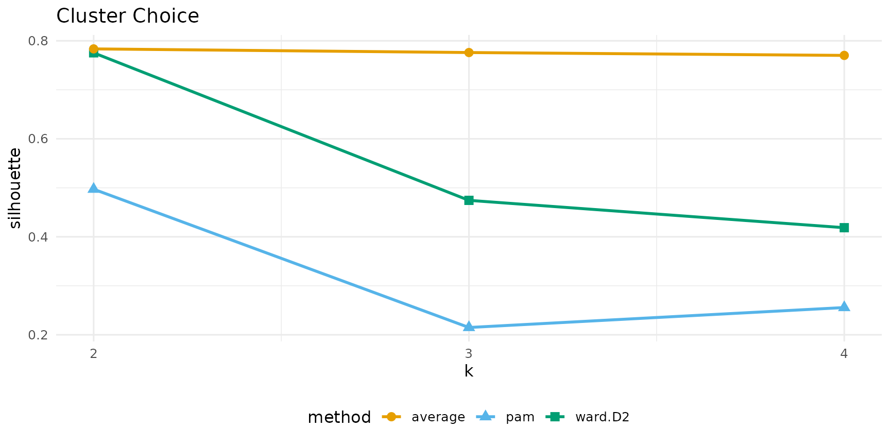

With the Hamming distance, the highest silhouettes (0.78) belong to
average linkage and Ward’s criterion, which put 9 or 11 sessions in one
cluster and the rest in the other. A small cluster of very long sessions
lies far from everything else and raises the silhouette without
describing the data, which the size ratio (up to 420) shows. PAM gives
balanced clusters with lower silhouettes.

### Distance

``` r

choice_distance <- cluster_choice(net, k = 2,
                                  dissimilarity = c("hamming", "lv", "lcs",
                                                    "qgram", "cosine",
                                                    "jaccard"),
                                  method = "pam")
choice_distance
#> Cluster Choice (sweep: dissimilarity)
#> 
#>  dissimilarity silhouette within_dist sizes      ratio best    
#>  hamming       0.497      22.993      [116, 313] 2.698 <-- best
#>  lv            0.494      17.682      [138, 291] 2.109         
#>  lcs           0.488      20.368      [115, 314] 2.730         
#>  qgram         0.470      20.136      [130, 299] 2.300         
#>  cosine        0.419       0.183      [170, 259] 1.524         
#>  jaccard       0.313       0.359      [162, 267] 1.648
plot(choice_distance, type = "bars", abbrev = TRUE)
```

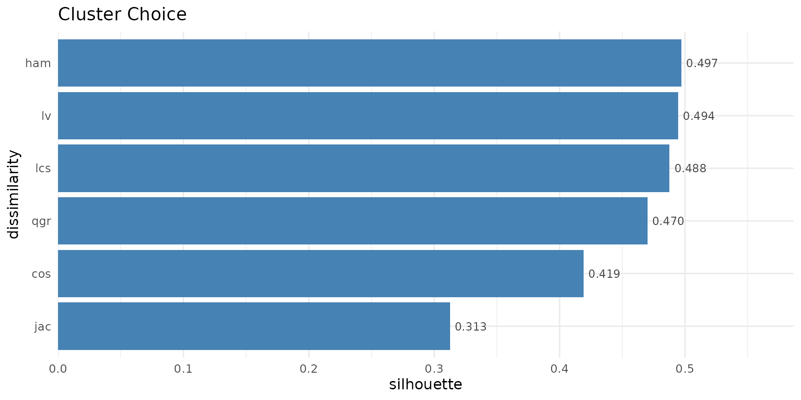

With two clusters and PAM, the Hamming, edit and
longest-common-subsequence distances have the highest silhouettes (0.49
to 0.50), and their clusters are again separated by length. The cosine
distance has a lower silhouette (0.42) and the most balanced clusters
(170 and 259 sessions).

### Cosine distance

``` r

choice_cosine <- cluster_choice(net, k = 2:4, dissimilarity = "cosine",
                                method = c("pam", "ward.D2"))
choice_cosine
#> Cluster Choice (sweep: k x method)
#> 
#>  k method  silhouette within_dist sizes      ratio  best    
#>  2 pam     0.419      0.183       [170, 259]  1.524 <-- best
#>  3 pam     0.251      0.164       [102, 169]  1.657         
#>  4 pam     0.284      0.148       [4, 169]   42.250         
#>  2 ward.D2 0.397      0.187       [172, 257]  1.494         
#>  3 ward.D2 0.416      0.170       [4, 257]   64.250         
#>  4 ward.D2 0.332      0.151       [4, 190]   47.500
plot(choice_cosine, type = "tradeoff")
```

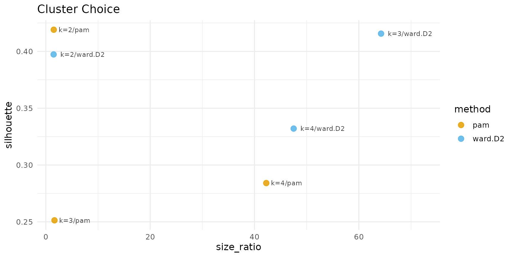

The trade-off plot places each configuration by its silhouette and its
size ratio; the preferred configurations are high and to the left. Two
clusters with PAM have the highest silhouette, 0.42, with clusters of
170 and 259 sessions. Three clusters with Ward’s criterion have a
similar silhouette (0.42), but one of their clusters holds four
sessions.

``` r

clusters <- build_clusters(net, k = 2, dissimilarity = "cosine")
clusters
#> Sequence Clustering [pam]
#>   Sequences: 429  |  Clusters: 2
#>   Dissimilarity: cosine
#>   Quality: silhouette = 0.419
#> 
#>   Cluster  N            Mean within-dist  Medoid
#>   1        170 (39.6%)  0.247             171
#>   2        259 (60.4%)  0.140             376
```

## Diagnostics

[`cluster_diagnostics()`](https://pak.dynasite.org/Nestimate/reference/cluster_diagnostics.md)
reports one row per cluster for any clustering: for a dissimilarity
clustering the size, the mean within-cluster distance and the
silhouette, for a mixture Markov model the mixing share, the average
posterior probability and the classification error.

``` r

diagnostics <- cluster_diagnostics(clusters)
diagnostics
#> Cluster Diagnostics (distance) [pam / cosine]
#>   Sequences: 429  |  Clusters: 2
#>   Quality: silhouette = 0.419
#> 
#>   Cluster  N            Mean within-dist  Silhouette
#>   1        170 (39.6%)  0.247             0.199
#>   2        259 (60.4%)  0.140             0.564
plot(diagnostics, type = "silhouette")
```

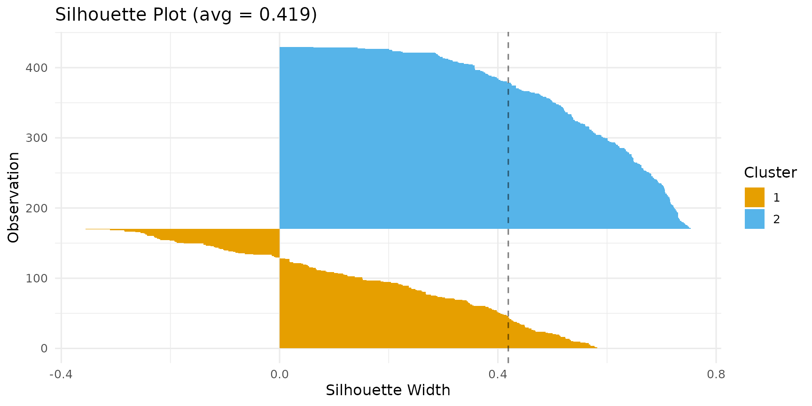

The second cluster is well separated (silhouette 0.56) and the first
less so (0.20); the silhouette plot shows some sessions of the first
cluster with negative values, closer to the other cluster than to their
own.

``` r

plot(clusters, type = "mds")
```

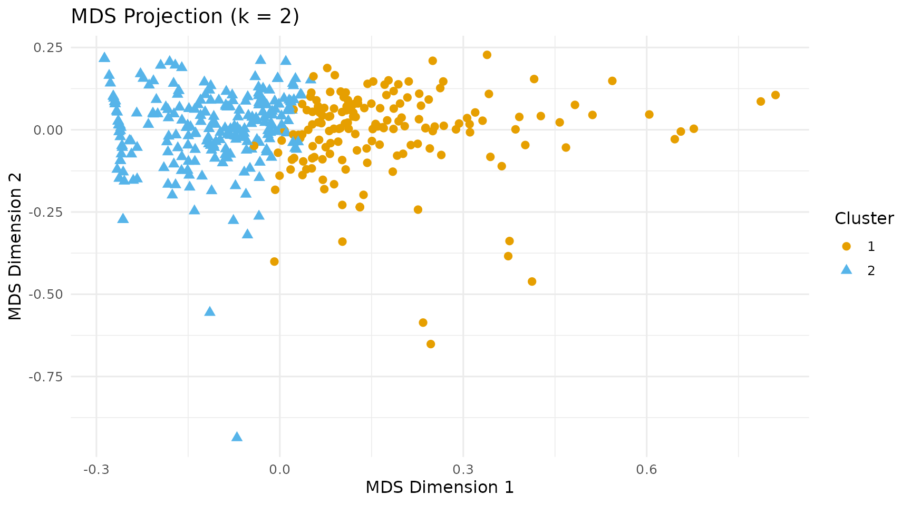

The multidimensional scaling plot places the sessions in two dimensions
so that their distances approximate the cosine distances, with a colour
and a shape per cluster. The second cluster is compact; the first
spreads widely.

## What the clusters contain

[`sequence_plot()`](https://pak.dynasite.org/Nestimate/reference/sequence_plot.md)
draws the sessions of each cluster and the share of each state at each
position; `trim = 0.9` keeps the positions that hold 90% of the actions,
since few sessions are long.

``` r

sequence_plot(clusters, type = "index", ncol = 2, nrow = 1, trim = 0.9)
```

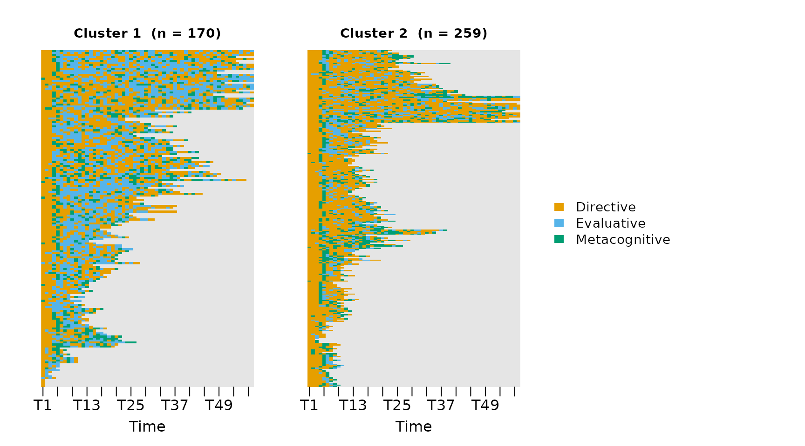

``` r

sequence_plot(clusters, type = "distribution", ncol = 2, nrow = 1,
              trim = 0.9)
```

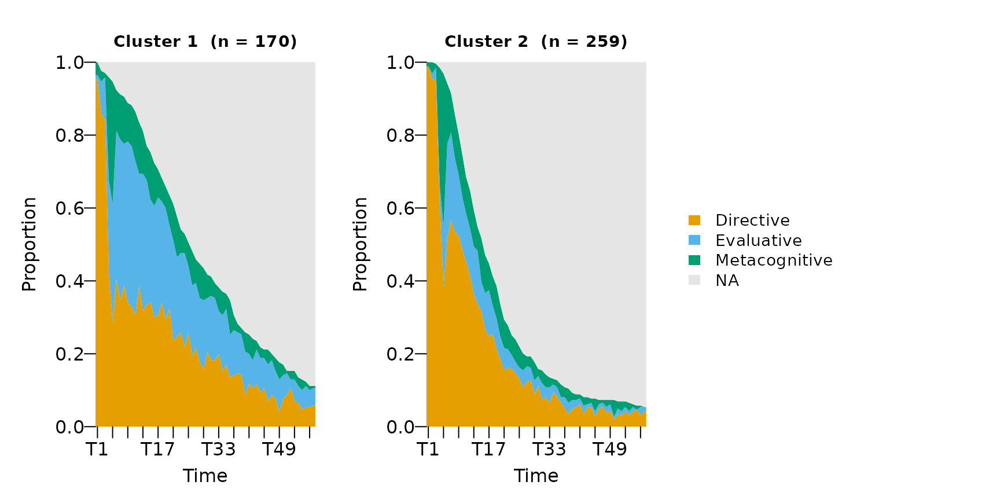

[`sequence_metrics()`](https://pak.dynasite.org/Nestimate/reference/sequence_metrics.md)
compares the clusters on the indices that describe them.

``` r

set.seed(2026)
sequence_metrics(build_network(clusters),
                 indices = c("valid_n", "transition_rate",
                             "longitudinal_entropy", "dominant_proportion"))
#> Sequence metrics by cluster  [4 indices | 2 groups: Cluster 1, Cluster 2]
#>   permutation of the one-way F: 1000 iter (BH), within session
#> 
#>  index                group     n   mean  sd    diff   g     g_lo  g_hi  eta_sq
#>  valid_n              Cluster 1 170 33.61 30.75 -13.99 -0.61 -0.80 -0.41 0.08  
#>  valid_n              Cluster 2 259 19.62 16.02 -13.99 -0.61 -0.80 -0.41 0.08  
#>  transition_rate      Cluster 1 166  0.57  0.13  -0.12 -0.90 -1.11 -0.70 0.16  
#>  transition_rate      Cluster 2 259  0.44  0.14  -0.12 -0.90 -1.11 -0.70 0.16  
#>  longitudinal_entropy Cluster 1 170  0.85  0.16  -0.15 -0.83 -1.03 -0.63 0.14  
#>  longitudinal_entropy Cluster 2 259  0.70  0.19  -0.15 -0.83 -1.03 -0.63 0.14  
#>  dominant_proportion  Cluster 1 170  0.52  0.10   0.16  1.46  1.25  1.68 0.34  
#>  dominant_proportion  Cluster 2 259  0.68  0.11   0.16  1.46  1.25  1.68 0.34  
#>  F      p        p_adj   
#>   37.95 0.000999 0.000999
#>   37.95 0.000999 0.000999
#>   82.58 0.000999 0.000999
#>   82.58 0.000999 0.000999
#>   70.85 0.000999 0.000999
#>   70.85 0.000999 0.000999
#>  220.61 0.000999 0.000999
#>  220.61 0.000999 0.000999
```

The first cluster (170 sessions) alternates between directives and
evaluations: it changes state more often (transition rate 0.57 against
0.44) and spreads its actions more evenly (entropy 0.85 against 0.70).
The second (259 sessions) is dominated by directives, which take 68% of
a session against 52% (`dominant_proportion`). The first cluster’s
sessions are also longer (34 against 20 actions, Hedges’ g = -0.61), so
the clusters differ in length as well as in content.

## Mixture Markov models

A mixture Markov model groups the sequences by their transitions: it
fits one Markov chain per cluster and assigns each sequence to the chain
that most probably generated it (Helske et al. 2024).
[`compare_mmm()`](https://pak.dynasite.org/Nestimate/reference/compare_mmm.md)
fits the model for several numbers of clusters and compares them with
the BIC (Schwarz 1978), the AIC and the ICL (Biernacki, Celeux & Govaert
2000), lower being better, and the average posterior probability of the
assigned cluster (AvePP). Each model is estimated from 50 random starts;
`seed` makes them reproducible.

``` r

mixture_choice <- compare_mmm(net, k = 2:5, seed = 2026)
mixture_choice
#> MMM Model Comparison
#> 
#>  k log_likelihood AIC      BIC      ICL      AvePP     Entropy   converged
#>  2 -10029.568     20093.14 20162.18 20375.01 0.7957056 0.6128693  TRUE    
#>  3 -10010.545     20073.09 20178.69 20517.41 0.7057432 0.5768109  TRUE    
#>  4  -9997.471     20064.94 20207.09 20658.84 0.6255671 0.6202143  TRUE    
#>  5  -9987.099     20062.20 20240.90 20746.91 0.5868660 0.6028683 FALSE    
#>  best   
#>  <-- BIC
#>         
#>         
#> 
plot(mixture_choice)
```

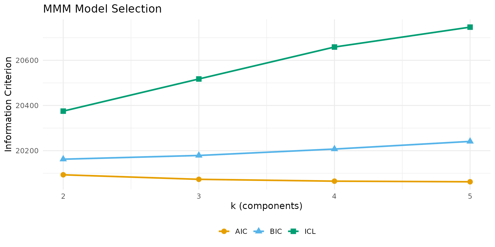

The BIC and the ICL are lowest with two clusters, which also have the
highest AvePP (0.80). The AIC keeps decreasing with more clusters, and
the five-cluster model does not converge.

``` r

mixture <- build_mmm(net, k = 2, seed = 2026)
mixture
#> Mixed Markov Model
#>   Sequences: 429  |  Clusters: 2  |  States: 3
#>   ICs: LL = -10029.568  |  BIC = 20162.181  |  AIC = 20093.136  |  ICL = 20375.009
#>   Quality: AvePP = 0.796  |  Entropy = 0.613  |  Class.Err = 20.4%
#> 
#>   Cluster  N            Mix%   AvePP
#>   1        155 (36.1%)  44.5%  0.834
#>   2        274 (63.9%)  55.5%  0.774
```

In the first cluster (155 sessions) an evaluation is followed by another
evaluation with probability 0.47 and a directive by an evaluation with
probability 0.30. In the second (274 sessions) directives follow
directives (0.65) and metacognitive actions follow metacognitive actions
(0.31) more often. The model and the cosine clustering describe a
similar division: sessions that alternate between directing and
evaluating, and sessions that mostly direct.

``` r

mixture_diagnostics <- cluster_diagnostics(mixture)
mixture_diagnostics
#> Cluster Diagnostics (mmm) [k = 2]
#>   Sequences: 429  |  Clusters: 2  |  States: 3
#>   Quality: AvePP = 0.796  |  Entropy = 0.613  |  Class.Err = 20.4%
#>   ICs: LL = -10029.568  |  BIC = 20162.181  |  AIC = 20093.136  |  ICL = 20375.009
#> 
#>   Cluster  N            Mix%   AvePP  Class.Err%
#>   1        155 (36.1%)  44.5%  0.834  16.6%
#>   2        274 (63.9%)  55.5%  0.774  22.6%
plot(mixture_diagnostics, type = "posterior")
```

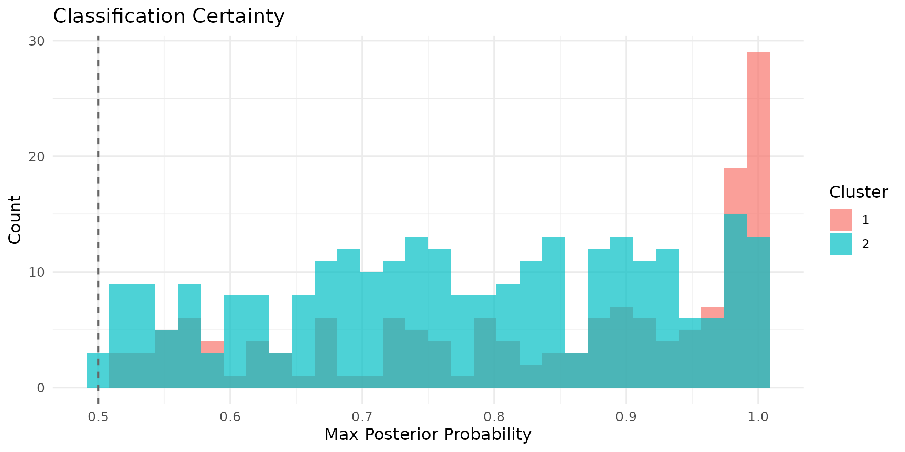

The average posterior probability is 0.83 in the first cluster and 0.77
in the second, and 20% of the sessions are expected to be misclassified.
The posterior plot shows each cluster’s distribution of the sessions’
posterior probabilities; mass near 1 means clear assignments.

``` r

sequence_plot(mixture, type = "index", ncol = 2, nrow = 1, trim = 0.9)
```

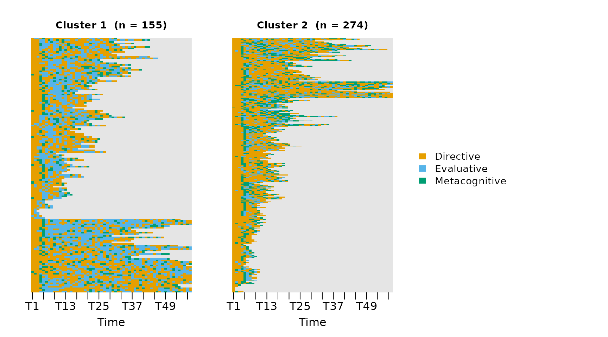

[`cluster_mmm()`](https://pak.dynasite.org/Nestimate/reference/cluster_mmm.md)
fits the same model and returns the same `net_mmm` object; it is the
name under which the mixture model is reached from
[`cluster_network()`](https://pak.dynasite.org/Nestimate/reference/cluster_network.md).

## Networks per cluster

A clustering becomes one network per cluster in two ways.
[`build_network()`](https://pak.dynasite.org/Nestimate/reference/build_network.md)
on a clustering, from
[`build_clusters()`](https://pak.dynasite.org/Nestimate/reference/build_clusters.md)
or
[`build_mmm()`](https://pak.dynasite.org/Nestimate/reference/build_mmm.md),
estimates a network for each cluster from the clustered sequences and
returns a group of networks.

``` r

cluster_networks <- build_network(clusters)
cluster_networks
#> Group Networks (2 clusters via pam / cosine)
#> 
#>   Group      Nodes  Edges  Weights         N
#>   Cluster 1  3      9      [0.105, 0.513]  170 (39.6%)
#>   Cluster 2  3      9      [0.137, 0.685]  259 (60.4%)
```

``` r

plot(cluster_networks)
```

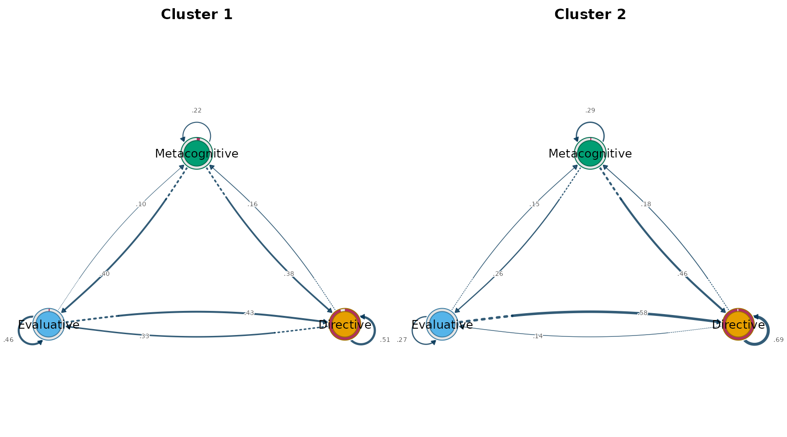

[`cluster_network()`](https://pak.dynasite.org/Nestimate/reference/cluster_network.md)
does the clustering and the networks in one call: `cluster_by` takes the
clustering method (`"pam"`, a hierarchical method, or `"mmm"` for the
mixture model) and `dissimilarity` the distance.

``` r

one_call <- cluster_network(net, k = 2, cluster_by = "pam",
                            dissimilarity = "cosine")
one_call
#> Group Networks (2 clusters via pam / cosine)
#> 
#>   Group      Nodes  Edges  Weights         N
#>   Cluster 1  3      9      [0.105, 0.513]  170 (39.6%)
#>   Cluster 2  3      9      [0.137, 0.685]  259 (60.4%)
cluster_diagnostics(one_call)
#> Cluster Diagnostics (distance) [pam / cosine]
#>   Sequences: 429  |  Clusters: 2
#>   Quality: silhouette = 0.419
#> 
#>   Cluster  N            Mean within-dist  Silhouette
#>   1        170 (39.6%)  0.247             0.199
#>   2        259 (60.4%)  0.140             0.564
```

With the same settings, the two routes give the same clusters and the
same networks, and
[`cluster_diagnostics()`](https://pak.dynasite.org/Nestimate/reference/cluster_diagnostics.md)
reads either. The two-step route keeps the clustering as its own object,
to plot its silhouettes or its MDS projection and to describe the
clusters before any network is estimated; the one-call route goes
straight to the networks.
[`cluster_network()`](https://pak.dynasite.org/Nestimate/reference/cluster_network.md)
builds the per-cluster networks afresh with the network’s method;
`inherit = TRUE` also gives them the source network’s threshold, scaling
and estimator settings. For the mixture model,
`cluster_network(net, k = 2, cluster_by = "mmm", seed = 2026)` and
`build_network(mixture)` return the fitted chains as networks.

``` r

build_network(mixture)
#> Group Networks (2 clusters from MMM)
#> 
#>   Group      Nodes  Edges  Weights         N
#>   Cluster 1  3      9      [0.092, 0.563]  155 (36.1%)
#>   Cluster 2  3      9      [0.151, 0.649]  274 (63.9%)
```

## Comparing the clusters

[`permutation()`](https://pak.dynasite.org/Nestimate/reference/permutation.md)
compares the transition probabilities of the clusters edge by edge, by
shuffling the cluster labels of the sessions.

``` r

set.seed(2026)
permutation(cluster_networks, iter = 1000)
#> Grouped Permutation Test
#> Groups: Cluster 1 vs Cluster 2 
#> 
#> -- Cluster 1 vs Cluster 2 --
#> Permutation Test: Transition Network (relative probabilities) [directed]
#>   Iterations: 1000  |  Alpha: 0.05
#>   Nodes: 3  |  Edges tested: 9  |  Significant: 8
#>   Global test (networks differ overall?): M = 1.057 (p = 0.000999)  |  S = 0.194 (p = 0.000999)
```

The clusters were formed to differ, so differences between their
networks are expected by construction; the test shows which transitions
the clusters differ in, not whether such groups exist in the population.

## How to cite this article

Saqr, M., López-Pernas, S., & Misiejuk, K. (2026). *Sequence
clustering*. Nestimate.
[HTML](https://pak.dynasite.org/Nestimate/articles/clustering.html) ·
[PDF](https://pak.dynasite.org/Nestimate/pdf/clustering.pdf)

## References

Biernacki, C., Celeux, G., & Govaert, G. (2000). Assessing a mixture
model for clustering with the integrated completed likelihood. *IEEE
Transactions on Pattern Analysis and Machine Intelligence*, 22(7),
719–725. <https://doi.org/10.1109/34.865189>

Hamming, R. W. (1950). Error detecting and error correcting codes. *Bell
System Technical Journal*, 29(2), 147–160.
<https://doi.org/10.1002/j.1538-7305.1950.tb00463.x>

Helske, J., Helske, S., Saqr, M., López-Pernas, S., & Murphy, K. (2024).
A modern approach to transition analysis and process mining with Markov
models in education. In M. Saqr & S. López-Pernas (Eds.), *Learning
analytics methods and tutorials: A practical guide using R*
(pp. 381–427). Springer. <https://doi.org/10.1007/978-3-031-54464-4_12>

Kaufman, L., & Rousseeuw, P. J. (1990). *Finding groups in data: An
introduction to cluster analysis*. Wiley.
<https://doi.org/10.1002/9780470316801>

López-Pernas, S., Tikka, S., & Saqr, M. (2025). Mining patterns and
clusters with transition network analysis: A heterogeneity approach. In
M. Saqr & S. López-Pernas (Eds.), *Advanced learning analytics methods:
AI, precision and complexity* (pp. 447–468). Springer.
<https://doi.org/10.1007/978-3-031-95365-1_17>

Misiejuk, K., López-Pernas, S., Oliveira, E., Rinja, D., & Saqr, M.
(2026). It takes two to vibe code: Profiling student-AI programming
interactions processes and their high order structure. In *Proceedings
of the 26th Koli Calling International Conference on Computing Education
Research* (pp. 1–11). ACM. <https://doi.org/10.1145/3856208.3856254>

Murtagh, F., & Legendre, P. (2014). Ward’s hierarchical agglomerative
clustering method: Which algorithms implement Ward’s criterion? *Journal
of Classification*, 31(3), 274–295.
<https://doi.org/10.1007/s00357-014-9161-z>

Rousseeuw, P. J. (1987). Silhouettes: A graphical aid to the
interpretation and validation of cluster analysis. *Journal of
Computational and Applied Mathematics*, 20, 53–65.
<https://doi.org/10.1016/0377-0427(87)90125-7>

Saqr, M., López-Pernas, S., & Misiejuk, K. (2026). Nestimate: An R
package for dynamic, probabilistic, and high order network analysis.
*Applied Psychological Measurement*.
<https://doi.org/10.1177/01466216261472019>

Saqr, M., López-Pernas, S., Helske, S., Durand, M., Murphy, K., Studer,
M., & Ritschard, G. (2024). Sequence analysis in education: Principles,
technique, and tutorial with R. In M. Saqr & S. López-Pernas (Eds.),
*Learning analytics methods and tutorials: A practical guide using R*
(pp. 321–354). Springer. <https://doi.org/10.1007/978-3-031-54464-4_10>

Saqr, M., Misiejuk, K., & López-Pernas, S. (2026). Human-AI
collaboration or obedient and often clueless AI in instruct, serve,
repeat dynamics? *The Internet and Higher Education*, 70, 101087.
<https://doi.org/10.1016/j.iheduc.2026.101087>

Sarkar, A., & Drosos, I. (2025). Vibe coding: Programming through
conversation with artificial intelligence. In *Proceedings of the 36th
Annual Conference of the Psychology of Programming Interest Group (PPIG
2025)*. <https://doi.org/10.48550/arXiv.2506.23253>

Schwarz, G. (1978). Estimating the dimension of a model. *The Annals of
Statistics*, 6(2), 461–464. <https://doi.org/10.1214/aos/1176344136>

Studer, M., & Ritschard, G. (2016). What matters in differences between
life trajectories: A comparative review of sequence dissimilarity
measures. *Journal of the Royal Statistical Society: Series A
(Statistics in Society)*, 179(2), 481–511.
<https://doi.org/10.1111/rssa.12125>

Ward, J. H. (1963). Hierarchical grouping to optimize an objective
function. *Journal of the American Statistical Association*, 58(301),
236–244. <https://doi.org/10.1080/01621459.1963.10500845>
