# Network Estimation and Visualization with Nestimate + cograph

## 1 Introduction

Nestimate (Saqr, López-Pernas, & Misiejuk, 2026) estimates networks from
sequence and panel data, and cograph draws them. The two packages divide
the work: Nestimate computes the networks, their resampling, comparisons
and clusterings, and returns objects that cograph’s
[`splot()`](https://sonsoles.me/cograph/reference/splot.html) draws
directly. This tutorial follows one dataset through the steps of a
transition network analysis (Saqr et al., 2025; Saqr, López-Pernas, &
Tikka, 2025), which has been used, for example, to map students’
self-regulated learning tactics (Peeters, Saqr, & Viberg, 2020):
estimating the network, checking the stability of its edges and
centralities, comparing groups, and grouping the states into clusters.

| Step | Nestimate | cograph |
|----|----|----|
| Estimate a network | [`build_network()`](https://pak.dynasite.org/Nestimate/reference/build_network.md) | [`splot()`](https://sonsoles.me/cograph/reference/splot.html) |
| Stability of the edges | [`bootstrap_network()`](https://pak.dynasite.org/Nestimate/reference/bootstrap_network.md) | [`splot()`](https://sonsoles.me/cograph/reference/splot.html), [`plot_bootstrap_forest()`](https://sonsoles.me/cograph/reference/plot_bootstrap_forest.html) |
| Stability of the centralities | [`centrality_stability()`](https://pak.dynasite.org/Nestimate/reference/centrality_stability.md) | [`splot()`](https://sonsoles.me/cograph/reference/splot.html) |
| Networks per group | `build_network(group = )` | [`splot()`](https://sonsoles.me/cograph/reference/splot.html) |
| Compare groups | [`permutation()`](https://pak.dynasite.org/Nestimate/reference/permutation.md) | [`splot()`](https://sonsoles.me/cograph/reference/splot.html) |
| Clusters of states | [`build_mcml()`](https://pak.dynasite.org/Nestimate/reference/build_mcml.md), [`as_tna()`](https://pak.dynasite.org/Nestimate/reference/as_tna.md) | [`splot()`](https://sonsoles.me/cograph/reference/splot.html) |

## 2 Data

`group_regulation_long` records the regulation actions of students
working in groups, one row per action, with the student (`Actor`), the
time (`Time`) and the action (`Action`). It is generated synthetically
from the `group_regulation` dataset of the tna package (Tikka,
López-Pernas, & Saqr, 2025). The nine actions, `adapt`, `cohesion`,
`consensus`, `coregulate`, `discuss`, `emotion`, `monitor`, `plan` and
`synthesis`, are the nodes of the networks below. `Achiever` marks each
student as a high or a low achiever.

``` r

library(Nestimate)
library(cograph)
head(group_regulation_long)
```

      Actor Achiever Group Course                Time    Action
    1     1     High     1      A 2025-01-01 08:27:07  cohesion
    2     1     High     1      A 2025-01-01 08:35:20 consensus
    3     1     High     1      A 2025-01-01 08:42:18   discuss
    4     1     High     1      A 2025-01-01 08:50:00 synthesis
    5     1     High     1      A 2025-01-01 08:52:25     adapt
    6     1     High     1      A 2025-01-01 08:57:31 consensus

## 3 Estimating networks

### 3.1 A transition network

[`build_network()`](https://pak.dynasite.org/Nestimate/reference/build_network.md)
estimates a network from the data. With `method = "relative"`, the
weight of the edge from one action to another is the probability that
the second follows the first, so each row of the weight matrix sums to
1.

``` r

net <- build_network(group_regulation_long, action = "Action",
                     actor = "Actor", time = "Time", method = "relative")
net
```

    Transition Network (relative probabilities) [directed]
      Weights: [0.001, 0.498]  |  mean: 0.115

      Strongest edges (10 of 78):
       from      to        weight
       cohesion  consensus 0.498
       adapt     consensus 0.477
       synthesis consensus 0.466
       consensus plan      0.396
       monitor   discuss   0.375
       plan      plan      0.374
       emotion   cohesion  0.325
       discuss   consensus 0.321
       emotion   consensus 0.320
       plan      consensus 0.290

      extract_edges(include_self = TRUE) lists every edge; extract_transition_matrix() gives the weight matrix;
      extract_initial_probs() the initial probabilities.

``` r

extract_initial_probs(net)
```

         adapt   cohesion  consensus coregulate    discuss    emotion    monitor
        0.0115     0.0605     0.2140     0.0190     0.1755     0.1515     0.1440
          plan  synthesis
        0.2045     0.0195 

The strongest transitions lead to `consensus`: from `cohesion` (0.50),
from `adapt` (0.48) and from `synthesis` (0.47). `consensus` is also the
most frequent first action (0.21), followed by `plan` (0.20). The
network is a `netobject`, which inherits from `cograph_network`, so
[`splot()`](https://sonsoles.me/cograph/reference/splot.html) draws it.

``` r

splot(net)
```

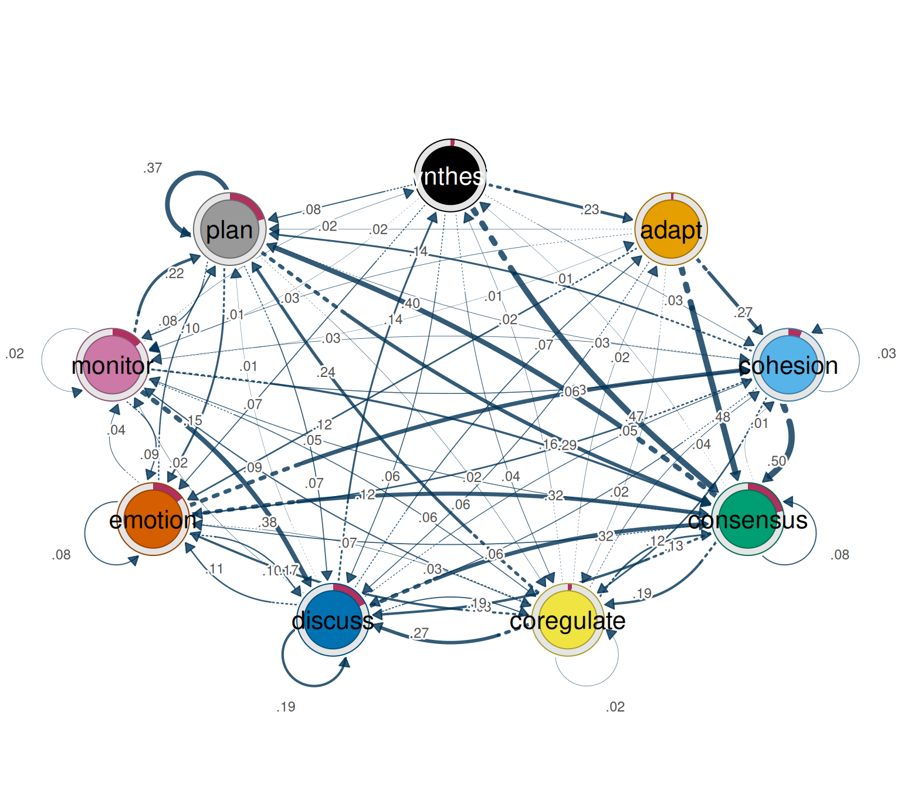

### 3.2 Other estimators

`method` selects the estimator;
[`list_estimators()`](https://pak.dynasite.org/Nestimate/reference/list_estimators.md)
lists them.

``` r

list_estimators()
```

                    name                                                description
    1          attention                       Decay-weighted attention transitions
    2      co_occurrence                             Co-occurrence within sequences
    3                cor                               Pairwise correlation network
    4          frequency                            Raw transition frequency counts
    5                gap             Gap-allowed transitions weighted by 1/distance
    6             glasso                EBICglasso regularized partial correlations
    7              ising             Ising model (L1-penalized logistic regression)
    8            latency         Reply network weighted by response speed (latency)
    9                mgm Mixed Graphical Model (nodewise lasso, EBIC, LW threshold)
    10             ngram      n-gram transitions (adjacent pairs per n-gram window)
    11              pcor                         Unregularized partial correlations
    12          relative                    Row-normalized transition probabilities
    13           reverse        Reverse (reply) transitions: transpose of frequency
    14              wtna                     Window-based TNA transitions (one-hot)
    15 wtna_cooccurrence                   Window-based TNA co-occurrence (one-hot)
       directed
    1      TRUE
    2     FALSE
    3     FALSE
    4      TRUE
    5      TRUE
    6     FALSE
    7     FALSE
    8      TRUE
    9     FALSE
    10     TRUE
    11    FALSE
    12     TRUE
    13     TRUE
    14     TRUE
    15    FALSE

Fifteen estimators are available. The directed ones (`relative`,
`frequency`, `attention`, `ngram`, `gap`, `reverse`, `latency`, `wtna`)
describe which action follows which; the undirected ones (`cor`, `pcor`,
`glasso`, `ising`, `mgm`, `co_occurrence`, `wtna_cooccurrence`) describe
which actions or variables go together (Saqr, Beck, & López-Pernas,
2024). `frequency` keeps the counts of the transitions instead of their
probabilities, and `co_occurrence` counts how often two actions occur in
the same sequence.

``` r

frequency_net <- build_network(group_regulation_long, action = "Action",
                               actor = "Actor", time = "Time",
                               method = "frequency")
splot(frequency_net)
```

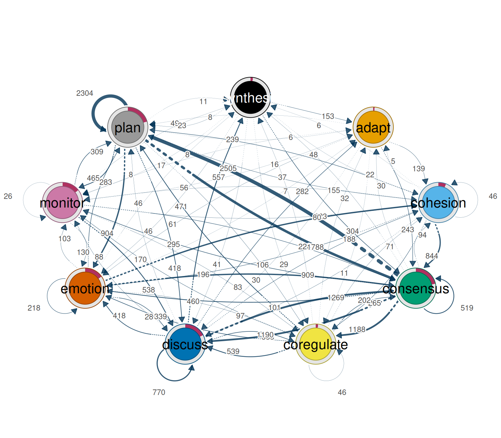

``` r

co_occurrence_net <- build_network(group_regulation_long, action = "Action",
                                   actor = "Actor", time = "Time",
                                   method = "co_occurrence")
splot(co_occurrence_net, layout = "spring")
```

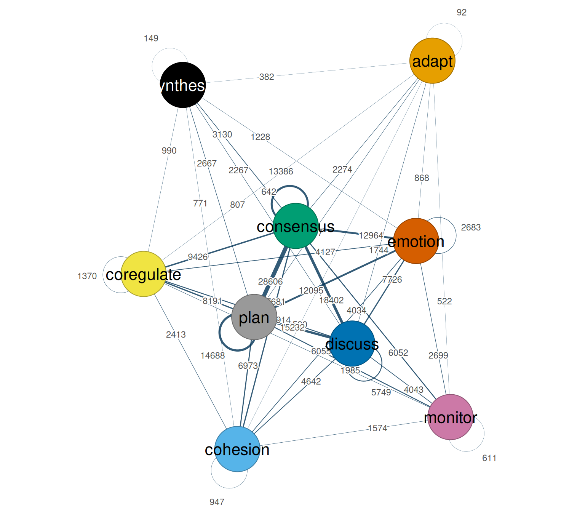

## 4 Stability of the edges

An edge estimated from one sample may not hold in another.
[`bootstrap_network()`](https://pak.dynasite.org/Nestimate/reference/bootstrap_network.md)
resamples the sequences with replacement, re-estimates the network in
each resample and reports, for each edge, its mean, its 95% interval and
a p-value (Saqr et al., 2025). By default the p-value is the share of
resamples in which the edge’s weight falls outside a consistency range
of 0.75 to 1.25 times its original weight, so an edge with a small
p-value keeps its size across resamples.

``` r

set.seed(265)
boot <- bootstrap_network(net, iter = 1000)
boot
```

      Edge                    Mean     95% CI          p
      ------------------------------------------------
      cohesion → consensus    0.498  [0.474, 0.521]  ***
      adapt → consensus       0.478  [0.430, 0.523]  ***
      synthesis → consensus   0.466  [0.427, 0.507]  ***
      consensus → plan        0.396  [0.383, 0.407]  ***
      monitor → discuss       0.375  [0.351, 0.401]  ***
      ... and 46 more significant edges

    Bootstrap Network  [Transition Network (relative) | directed]
      Iterations : 1000  |  Nodes : 9
      Edges      : 51 significant / 78 total
      CI         : 95%  |  Inference: stability  |  CR [0.75, 1.25]

Of the 78 edges, 51 are stable at the 5% level. The strongest
transitions are also the most precise: `cohesion` to `consensus` has a
mean of 0.50 and an interval of \[0.47, 0.52\].

[`splot()`](https://sonsoles.me/cograph/reference/splot.html) draws the
stable edges solid and the others dashed; `display = "significant"`
draws only the stable edges, `display = "full"` all edges alike, and
`show_stars = TRUE` or `show_ci = TRUE` add the significance stars or
the intervals to the edge labels.

``` r

splot(boot)
```

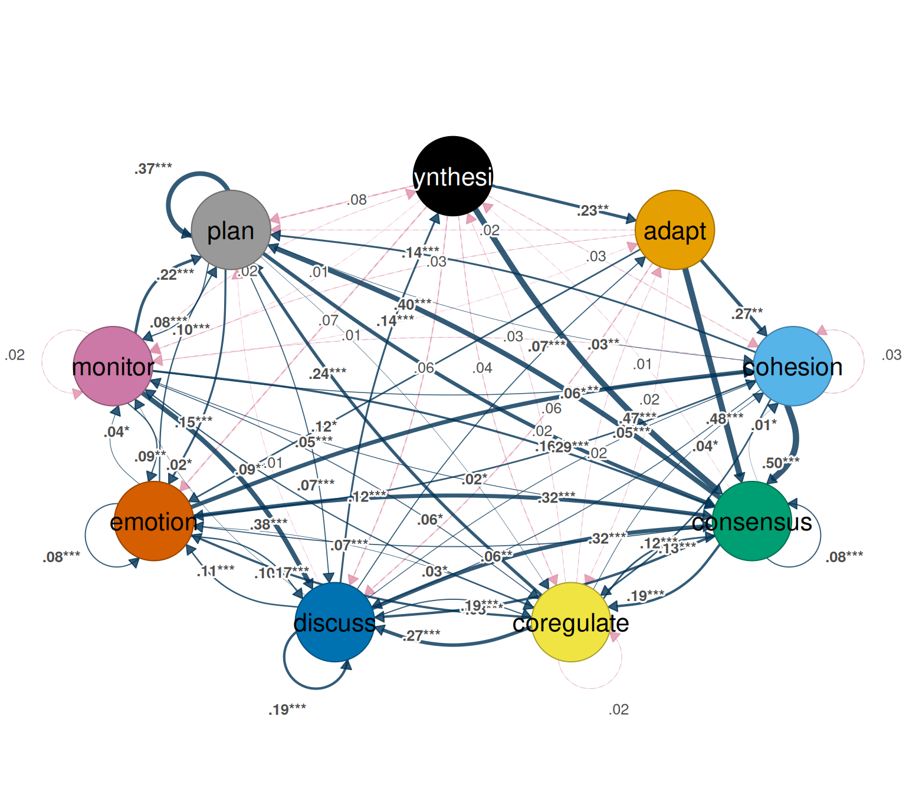

``` r

splot(boot, display = "significant")
```

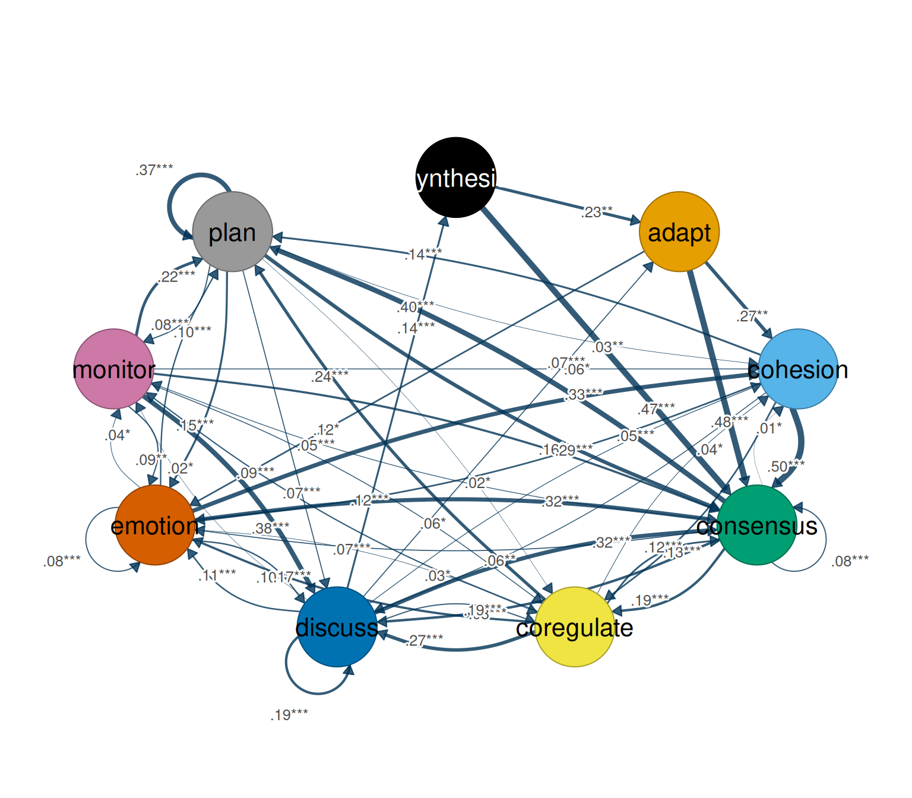

``` r

splot(boot, show_ci = TRUE)
```

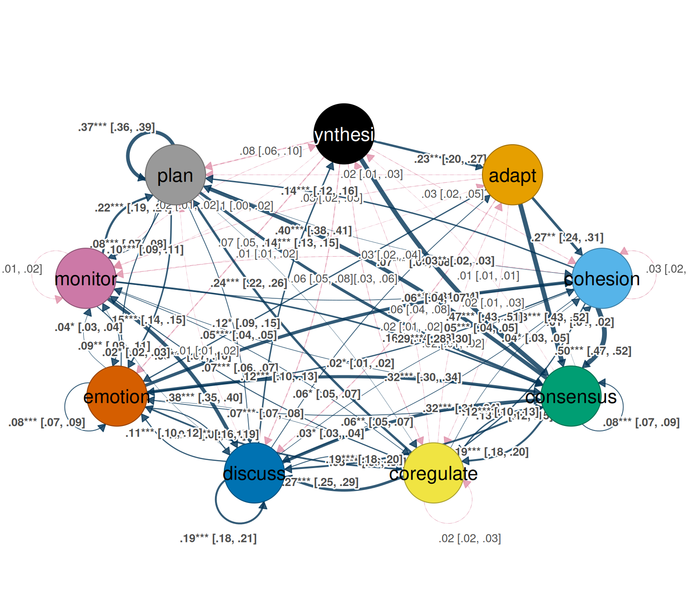

A forest plot shows the estimate and the interval of every edge;
`layout` arranges the edges in a list, a circle or groups.

``` r

plot_bootstrap_forest(boot, show_ci = TRUE)
```

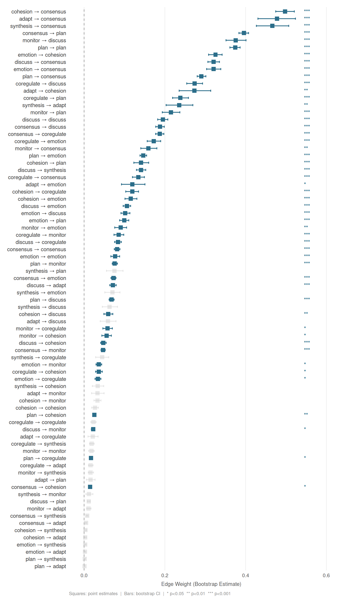

## 5 Stability of the centralities

Centrality measures summarise each node’s position in the network.
[`centrality_stability()`](https://pak.dynasite.org/Nestimate/reference/centrality_stability.md)
drops increasing proportions of the sequences, recomputes the
centralities, and correlates them with the centralities of the full data
(Epskamp, Borsboom, & Fried, 2018). The CS-coefficient is the largest
proportion of sequences that can be dropped while the correlation stays
above 0.7 in 95% of the resamples; Epskamp et al. (2018) treat values
above 0.5 as acceptable.

``` r

set.seed(265)
cs <- centrality_stability(net, iter = 500)
cs
```

    Centrality Stability (500 iterations, threshold = 0.7)
      Drop proportions: 0.1, 0.2, 0.3, 0.4, 0.5, 0.6, 0.7, 0.8, 0.9

      CS-coefficients:
        InStrength       0.90
        OutStrength      0.90
        Betweenness      0.90

``` r

splot(cs)
```

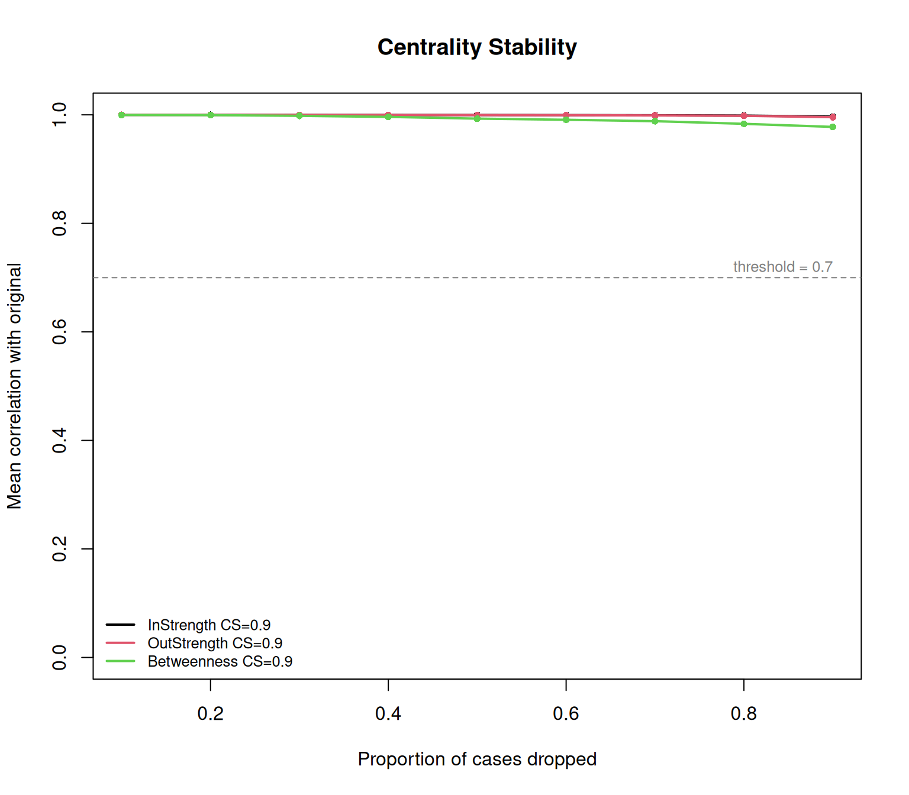

The CS-coefficients of in-strength, out-strength and betweenness are all
0.90: the ranking of the actions by these measures holds when 90% of the
sequences are removed.

## 6 Group networks

`group =` estimates one network per value of a covariate and returns a
group of networks (López-Pernas, Tikka, & Saqr, 2025).
[`splot()`](https://sonsoles.me/cograph/reference/splot.html) draws the
groups side by side on a common scale, so edge widths can be compared
across panels.

``` r

group_net <- build_network(group_regulation_long, action = "Action",
                           actor = "Actor", time = "Time",
                           method = "relative", group = "Achiever")
group_net
```

    Group Networks (2 groups, group_col: Achiever)

      Group  Nodes  Edges  Weights
      High   9      76     [0.001, 0.576]
      Low    9      75     [0.000, 0.462]

``` r

splot(group_net)
```

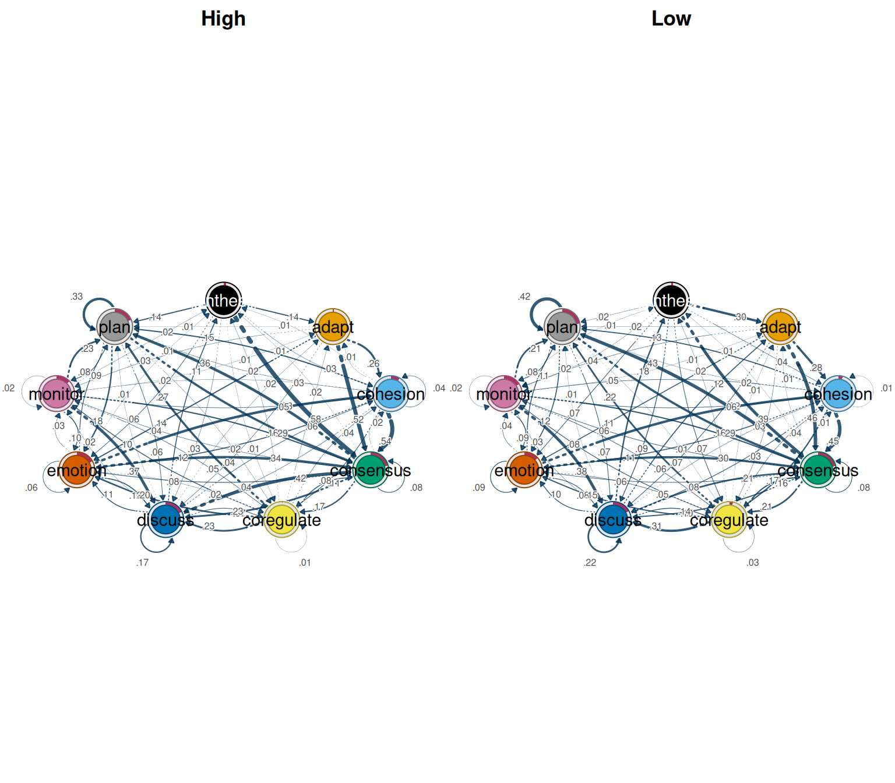

[`bootstrap_network()`](https://pak.dynasite.org/Nestimate/reference/bootstrap_network.md)
on the group resamples each group.

``` r

set.seed(265)
group_boot <- bootstrap_network(group_net, iter = 500)
splot(group_boot)
```

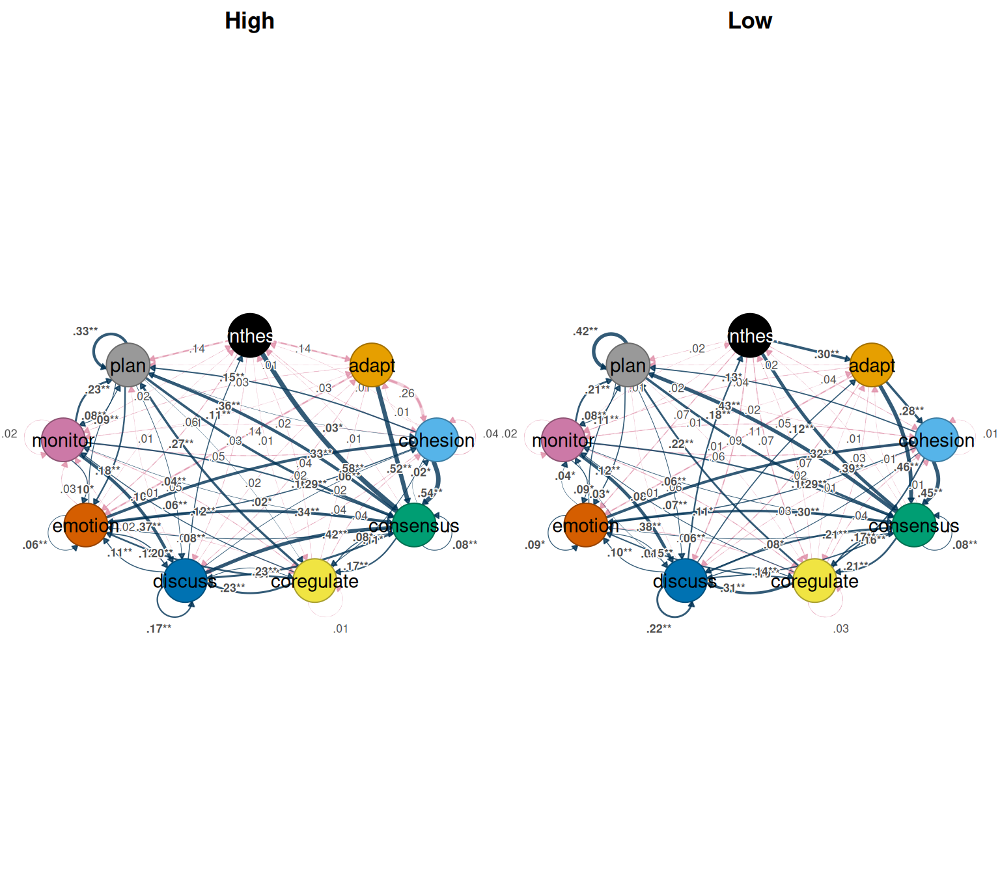

## 7 Comparing groups

[`permutation()`](https://pak.dynasite.org/Nestimate/reference/permutation.md)
compares the networks of the groups edge by edge: it shuffles the group
labels of the sequences, recomputes the difference of every edge, and
compares the observed difference with the shuffled ones (Saqr et al.,
2025). On a group of networks it compares every pair of groups.

``` r

set.seed(265)
group_perm <- permutation(group_net, iter = 1000)
group_perm
```

    Grouped Permutation Test
    Groups: High vs Low

    -- High vs Low --
    Permutation Test: Transition Network (relative probabilities) [directed]
      Iterations: 1000  |  Alpha: 0.05
      Nodes: 9  |  Edges tested: 78  |  Significant: 42
      Global test (networks differ overall?): M = 2.612 (p = 0.000999)  |  S = 0.210 (p = 0.000999)

The networks of high and low achievers differ: 42 of the 78 transitions
differ at the 5% level, and the global statistic M, the sum of the
absolute edge differences, is 2.61 (p = 0.001).

``` r

head(summary(group_perm), 10)
```

             group     from         to   weight_x   weight_y         diff
    1  High vs Low    adapt   cohesion 0.26241135 0.27717391 -0.014762566
    2  High vs Low    adapt  consensus 0.51773050 0.46195652  0.055773975
    3  High vs Low    adapt coregulate 0.00000000 0.02989130 -0.029891304
    4  High vs Low    adapt    discuss 0.03546099 0.06793478 -0.032473790
    5  High vs Low    adapt    emotion 0.14184397 0.11141304  0.030430928
    6  High vs Low    adapt    monitor 0.02836879 0.03532609 -0.006957293
    7  High vs Low    adapt       plan 0.01418440 0.01630435 -0.002119951
    8  High vs Low cohesion      adapt 0.00533049 0.00000000  0.005330490
    9  High vs Low cohesion   cohesion 0.04371002 0.00660502  0.037105002
    10 High vs Low cohesion  consensus 0.53624733 0.45046235  0.085784983
       effect_size     p_value   sig
    1   -0.3922188 0.712287712 FALSE
    2    1.2669055 0.201798202 FALSE
    3   -2.4196843 0.011988012  TRUE
    4   -1.6142325 0.103896104 FALSE
    5    1.0508991 0.300699301 FALSE
    6   -0.4479287 0.665334665 FALSE
    7   -0.1965672 0.751248751 FALSE
    8    2.0799910 0.054945055 FALSE
    9    4.4791305 0.000999001  TRUE
    10   3.5701213 0.001998002  TRUE

`weight_x` and `weight_y` are the transition probabilities of high and
low achievers, `diff` their difference, and `effect_size` the difference
in standard deviations of the permuted differences. For example, low
achievers move from `cohesion` to `coregulate` more often (0.17 against
0.08), and high achievers from `cohesion` to `consensus` (0.54 against
0.45).

[`splot()`](https://sonsoles.me/cograph/reference/splot.html) draws the
edges that differ, coloured by the group in which they are stronger.

``` r

splot(group_perm, edge_positive_color = "#4A6FE3",
      edge_negative_color = "#D33F6A")
```

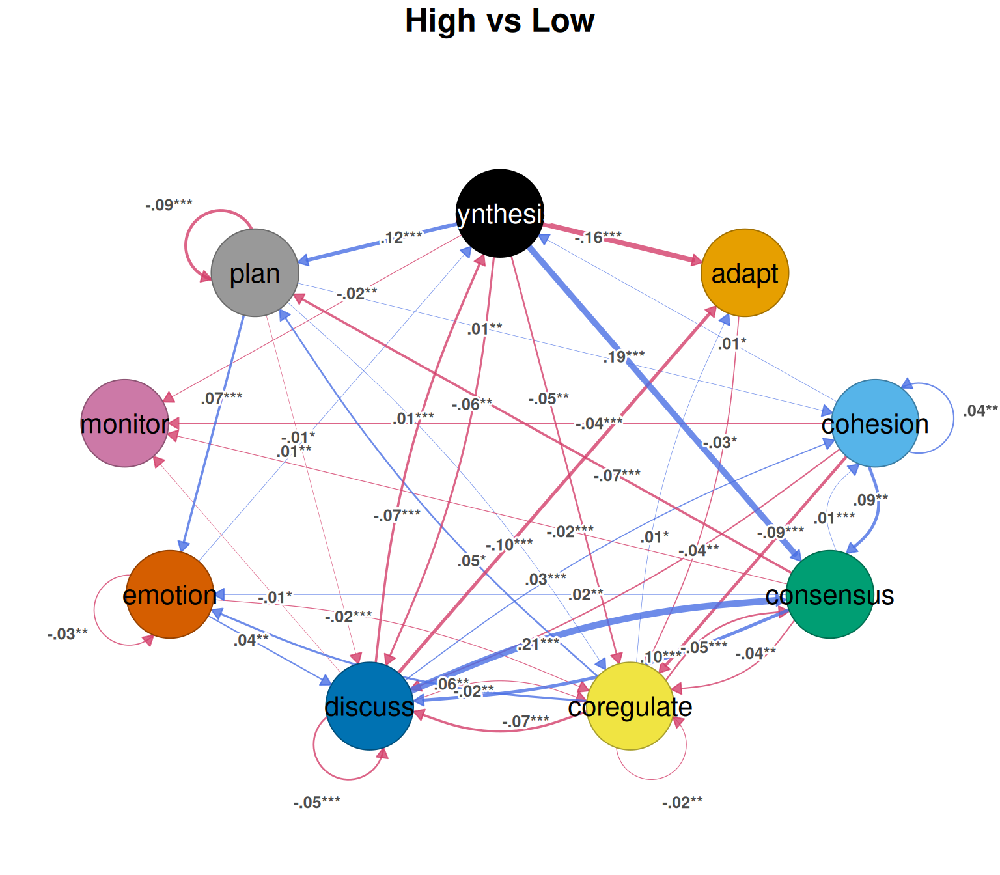

Blue edges are stronger among high achievers and red edges among low
achievers; `show_nonsig = TRUE` adds the edges that do not differ, and
`show_stars = TRUE` the significance stars.

## 8 Clusters of states

The nine actions fall into two groups of behaviour: regulation of the
task (`monitor`, `plan`, `coregulate`, `adapt`) and social interaction
(`cohesion`, `consensus`, `discuss`, `emotion`, `synthesis`).
[`build_mcml()`](https://pak.dynasite.org/Nestimate/reference/build_mcml.md)
estimates a multi-cluster, multi-level network: a network of the
clusters, and a network of the actions within each cluster (Zhang et
al., 2026).

``` r

clusters <- list(
  Regulatory = c("monitor", "plan", "coregulate", "adapt"),
  Social     = c("cohesion", "consensus", "discuss", "emotion", "synthesis")
)
cluster_net <- build_mcml(net, clusters = clusters)
cluster_net
```

    MCML Network
    ============
    Type: tna  | Method: sum
    Nodes: 9  | Clusters: 2
    Transitions: 25533
      Macro: 11997  | Per-cluster: 13536

    Clusters:
      Regulatory (4): monitor, plan, coregulate, adapt
      Social (5): cohesion, consensus, discuss, emotion, synthesis

    Macro (cluster-level) weights:
               Regulatory Social
    Regulatory     0.4042 0.5958
    Social         0.3879 0.6121

``` r

splot(cluster_net)
```

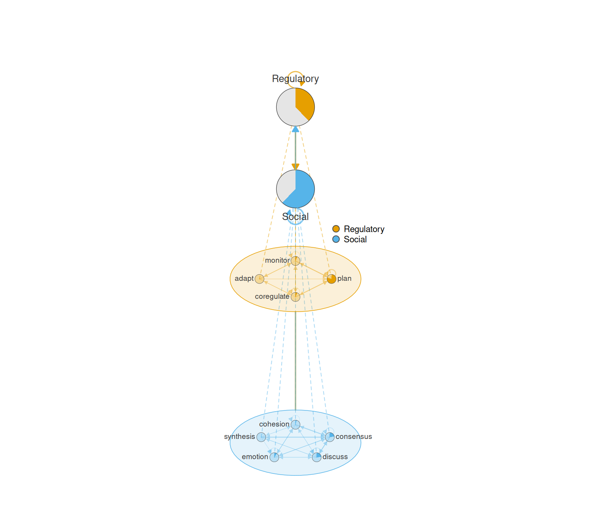

At the level of the clusters, both kinds of action are followed more
often by a social action: a regulatory action by a social one with
probability 0.60, and a social action by another social action with
probability 0.61.
[`as_tna()`](https://pak.dynasite.org/Nestimate/reference/as_tna.md)
converts the levels into transition networks, one for the clusters and
one for the actions within each cluster.

``` r

cluster_levels <- as_tna(cluster_net)
splot(cluster_levels)
```

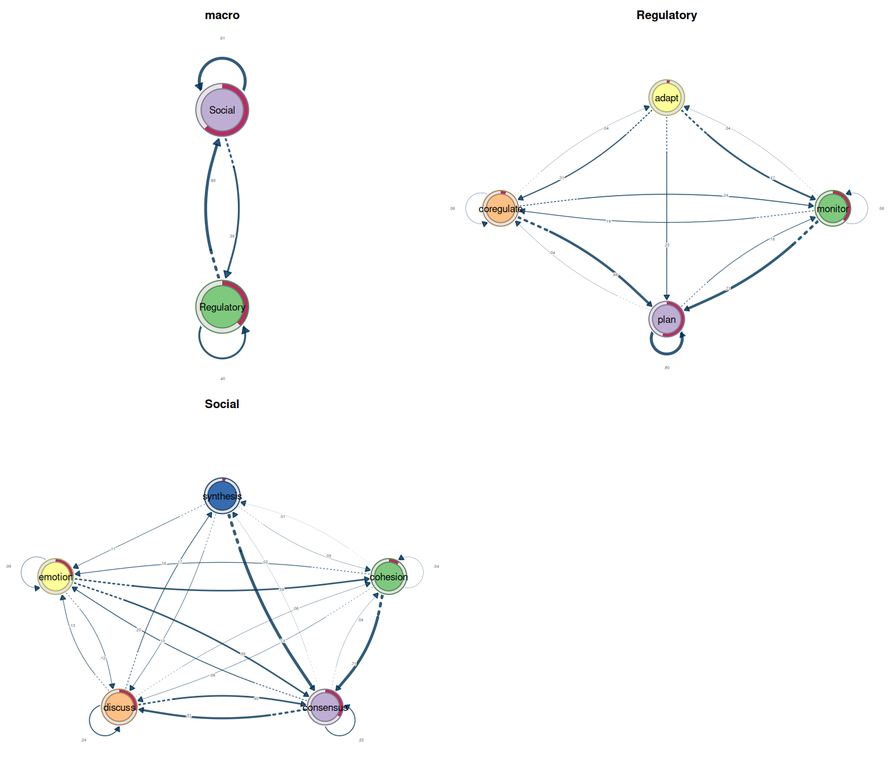

## 9 How to cite this article

Saqr, M., López-Pernas, S., & Misiejuk, K. (2026). *Network estimation
and visualization with Nestimate + cograph*. Nestimate.
[HTML](https://pak.dynasite.org/Nestimate/articles/cograph-tutorial-nestimate.html)
·
[PDF](https://pak.dynasite.org/Nestimate/pdf/cograph-tutorial-nestimate.pdf)

## 10 References

Epskamp, S., Borsboom, D., & Fried, E. I. (2018). Estimating
psychological networks and their accuracy: A tutorial paper. *Behavior
Research Methods*, 50(1), 195–212.
https://doi.org/10.3758/s13428-017-0862-1

López-Pernas, S., Tikka, S., & Saqr, M. (2025). Mining patterns and
clusters with transition network analysis: A heterogeneity approach. In
M. Saqr & S. López-Pernas (Eds.), *Advanced learning analytics methods:
AI, precision and complexity* (pp. 447–468). Springer.
https://doi.org/10.1007/978-3-031-95365-1_17

Peeters, W., Saqr, M., & Viberg, O. (2020). Applying learning analytics
to map students’ self-regulated learning tactics in an academic writing
course. In *Proceedings of the 28th International Conference on
Computers in Education (ICCE 2020)* (pp. 245–254).

Saqr, M., Beck, E., & López-Pernas, S. (2024). Psychological networks: A
modern approach to analysis of learning and complex learning processes.
In M. Saqr & S. López-Pernas (Eds.), *Learning analytics methods and
tutorials: A practical guide using R* (pp. 639–671). Springer.
https://doi.org/10.1007/978-3-031-54464-4_19

Saqr, M., López-Pernas, S., & Misiejuk, K. (2026). Nestimate: An R
package for dynamic, probabilistic, and high order network analysis.
*Applied Psychological Measurement*.
https://doi.org/10.1177/01466216261472019

Saqr, M., López-Pernas, S., & Tikka, S. (2025). Mapping relational
dynamics with transition network analysis: A primer and tutorial. In M.
Saqr & S. López-Pernas (Eds.), *Advanced learning analytics methods: AI,
precision and complexity* (pp. 371–411). Springer.
https://doi.org/10.1007/978-3-031-95365-1_15

Saqr, M., López-Pernas, S., Törmänen, T., Kaliisa, R., Misiejuk, K., &
Tikka, S. (2025). Transition network analysis: A novel framework for
modeling, visualizing, and identifying the temporal patterns of learners
and learning processes. In *Proceedings of the 15th International
Learning Analytics and Knowledge Conference (LAK25)* (pp. 351–361). ACM.
https://doi.org/10.1145/3706468.3706513

Tikka, S., López-Pernas, S., & Saqr, M. (2025). tna: An R package for
transition network analysis. *Applied Psychological Measurement*, 49(6),
326–328. https://doi.org/10.1177/01466216251348840

Zhang, C., López-Pernas, S., Wang, W., & Saqr, M. (2026). Mapping the
clinical reasoning process in medical simulations using multi-cluster
multi-layer transition network analysis. In *Mindful TEL: Learning
technologies shaped with intention* (pp. 267–272). Springer.
https://doi.org/10.1007/978-3-032-37982-5_43
