# Higher-Order Network Analysis with Simplicial Complexes

## Introduction

A transition network is a first-order Markov model: the probability of
the next state depends only on the current state (Saqr et al., 2025;
Saqr, López-Pernas, & Tikka, 2025). When the states before the current
one also change what comes next, the process has higher-order
dependencies, and a first-order network averages over them. For example,
a programmer who specifies a task after a frustrated message may
continue differently from one who specifies it after a request, while a
first-order model treats both as the same transition out of *Specify*.

This tutorial tests whether a process has higher-order dependencies,
finds the paths where they occur, and describes the shape of the network
with simplicial complexes, which represent groups of states rather than
pairs (Battiston et al., 2020). Nestimate (Saqr, López-Pernas, &
Misiejuk, 2026) estimates the models and cograph draws them.

The data come from vibe coding, programming by conversation with an AI
assistant (Sarkar & Drosos, 2025). Sarkar and Drosos describe it as a
cycle: the programmer prompts, evaluates the result quickly and edits by
hand, and prompts again, with prompts that mix vague directives and
detailed specifications. In students’ conversations with AI assistants,
direct instructions and specifications of the output dominate, and
context or iterative refinement is rare (López-Pernas et al., 2025). A
transition network analysis of student-AI problem solving found an
instructive pattern, in which students give orders and the AI follows
them rather than negotiating, and long threads in which the prompts and
the output of the AI do not match (Saqr, Misiejuk, & López-Pernas,
2026). Misiejuk et al. (2026) profiled the processes of student-AI
programming and their higher-order structure. A cycle of prompting,
checking and correcting is a pattern of several steps, and whether it is
more than a chain of single transitions is the question the methods
below answer.

| Question | Function |
|----|----|
| Is a first-order model enough? | [`build_mogen()`](https://pak.dynasite.org/Nestimate/reference/build_mogen.md), [`markov_order_test()`](https://pak.dynasite.org/Nestimate/reference/markov_order_test.md) |
| How predictable is the next state? | [`transition_entropy()`](https://pak.dynasite.org/Nestimate/reference/transition_entropy.md) |
| Where does the preceding context matter? | [`build_hon()`](https://pak.dynasite.org/Nestimate/reference/build_hon.md), [`path_counts()`](https://pak.dynasite.org/Nestimate/reference/path_counts.md) |
| Which paths are more or less frequent than expected? | [`build_hypa()`](https://pak.dynasite.org/Nestimate/reference/build_hypa.md) |
| Which groups of states are connected? | [`build_simplicial()`](https://pak.dynasite.org/Nestimate/reference/build_simplicial.md), [`simplicial_degree()`](https://pak.dynasite.org/Nestimate/reference/simplicial_degree.md) |
| Which structure holds across thresholds? | [`persistent_homology()`](https://pak.dynasite.org/Nestimate/reference/persistent_homology.md) |
| How are the groups of states connected to each other? | [`q_analysis()`](https://pak.dynasite.org/Nestimate/reference/q_analysis.md) |
| Drawing paths as groups of states | [`plot_simplicial()`](https://sonsoles.me/cograph/reference/plot_simplicial.html) (cograph) |

## Data

`human_long` holds the coded human turns of 425 human-AI
pair-programming (“vibe coding”) sessions, one row per action, coded
into nine actions: `Command`, `Correct`, `Frustrate`, `Inquire`,
`Interrupt`, `Refine`, `Request`, `Specify` and `Verify`. The network
holds one sequence per session, ordered by `order_in_session`.

``` r

library(Nestimate)
library(cograph)
net <- build_network(human_long, method = "relative", action = "code",
                     actor = "session_id", time = "order_in_session")
net
```

    Transition Network (relative probabilities) [directed]
      Weights: [0.018, 0.616]  |  mean: 0.111

      Strongest edges (10 of 81):
       from      to      weight
       Request   Specify 0.616
       Refine    Specify 0.455
       Correct   Specify 0.279
       Command   Specify 0.277
       Specify   Command 0.264
       Interrupt Command 0.261
       Command   Command 0.239
       Verify    Command 0.226
       Inquire   Command 0.200
       Inquire   Inquire 0.187

      extract_edges(include_self = TRUE) lists every edge; extract_transition_matrix() gives the weight matrix;
      extract_initial_probs() the initial probabilities.

``` r

extract_initial_probs(net)
```

        Command     Correct   Frustrate     Inquire   Interrupt      Refine
    0.128205128 0.000000000 0.002331002 0.000000000 0.020979021 0.002331002
        Request     Specify      Verify
    0.027972028 0.818181818 0.000000000 

Most sessions open with `Specify` (82%) or `Command` (13%). The
strongest transitions lead back to `Specify`: from `Request` (0.62) and
from `Refine` (0.46).

``` r

splot(net, minimum = 0.05)
```

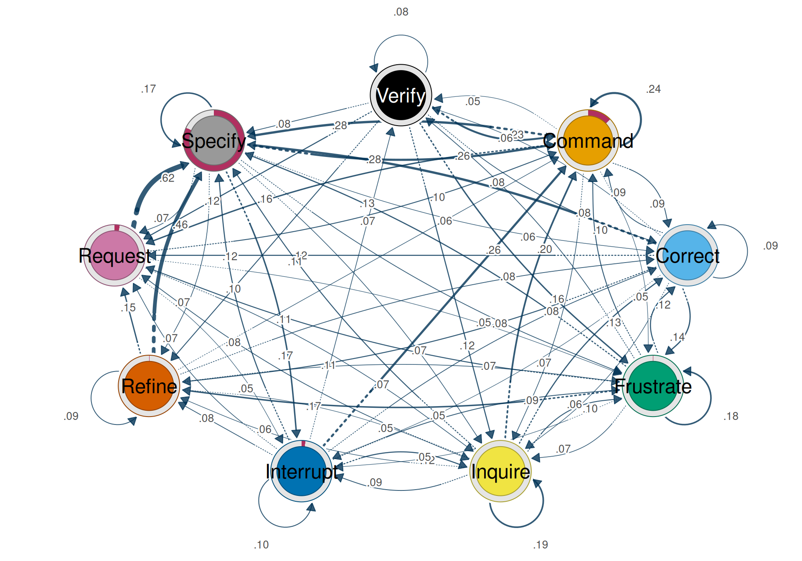

## Is a first-order model enough?

### Multi-order model

The multi-order generative model (MOGen) fits Markov models of order 0
(no memory) up to `max_order` and compares them with information
criteria (Scholtes, 2017). A higher order always fits better; the AIC
and the BIC weigh the improvement against the number of parameters,
which multiplies by nine with every order.

``` r

mogen <- build_mogen(net, max_order = 4)
summary(mogen)
```

    Multi-Order Generative Model (MOGen) Summary

      States: Command, Correct, Frustrate, Inquire, Interrupt, Refine, Request, Specify, Verify
      Paths: 425 | Observations: 10792
      Best by AIC: order 2  |  Best by BIC: order 1
      Selected:    order 2 (by aic)

            order layer_dof cum_dof    loglik       aic       bic best selected
    order_0     0         8       8 -22031.34  44078.69  44136.98
    order_1     1        72      80 -20829.39  41818.79  42401.71  BIC
    order_2     2       648     728 -19841.13  41138.25  46442.87  AIC      <--
    order_3     3      5832    6560 -17163.27  47446.54  95246.37
    order_4     4     52488   59048 -11365.83 140827.66 571084.48              

``` r

plot(mogen)
```

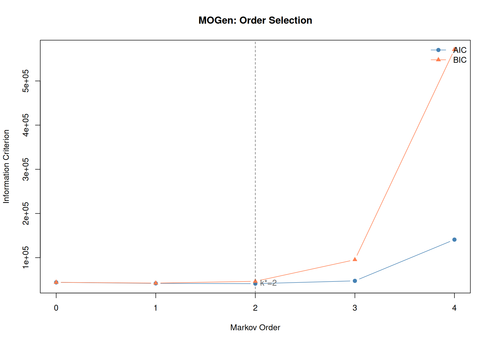

The AIC is lowest at order 2 and the BIC, which penalises parameters
more, at order 1. The order-2 model has 728 parameters against 80 for
order 1.

### Permutation test of the order

[`markov_order_test()`](https://pak.dynasite.org/Nestimate/reference/markov_order_test.md)
tests at each order *k* whether order *k* describes the sequences better
than order *k* − 1. The statistic is a likelihood ratio $`G^2`$, and its
null distribution comes from permuting the next state within each
context of the preceding *k* − 1 states. The permutation is conditional
rather than exact, because the overlapping windows of one sequence are
not independent (Besag & Mondal, 2013).

``` r

order_test <- markov_order_test(net, max_order = 3, n_perm = 200, seed = 1)
order_test
```

    Markov Order Test  [within-w permutation, n_perm = 200, alpha = 0.050]
      425 sequences / 10792 observations / 9 states

      Selected order  BIC: 1   AIC: 2   permutation-LRT: 3

     order    loglik      AIC      BIC   df      g2 p_permutation  p_asymptotic
         0 -22031.34 44078.69 44136.98   NA      NA            NA            NA
         1 -20829.39 41818.79 42401.71   64 2375.35   0.004975124  0.000000e+00
         2 -19841.13 41138.25 46442.87  576 1823.84   0.004975124 1.707029e-129
         3 -17163.27 47446.54 95246.37 4721 5191.45   0.004975124  1.324824e-06
     significant
              NA
            TRUE
            TRUE
            TRUE

``` r

plot(order_test)
```

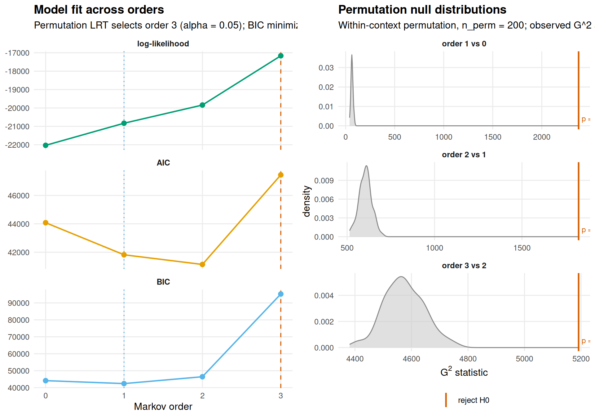

All three orders are significant: each observed $`G^2`$ (2375, 1824 and
5191) lies above all 200 permuted values, so the p-value of 0.005 is the
smallest the test can give with 200 permutations. The test selects order
3, the AIC order 2, and the BIC order 1. The criteria agree that the
previous state alone does not describe the sequences; they differ on how
much more memory is worth the parameters.

### Second-order transitions

[`mogen_transitions()`](https://pak.dynasite.org/Nestimate/reference/mogen_transitions.md)
returns the transitions of one order: the two preceding states (`from`),
the next state (`to`), the count and the conditional probability.

``` r

second_order <- mogen_transitions(mogen, order = 2)
head(second_order, 8)
```

                                 path count probability               from
    1   Specify -> Command -> Specify   284      0.3901 Specify -> Command
    2   Command -> Request -> Specify   231      0.7649 Command -> Request
    3   Specify -> Command -> Request   199      0.2734 Specify -> Command
    4 Request -> Specify -> Interrupt   189      0.3259 Request -> Specify
    5   Command -> Command -> Command   177      0.3882 Command -> Command
    6 Command -> Specify -> Interrupt   149      0.2770 Command -> Specify
    7   Specify -> Request -> Specify   128      0.6564 Specify -> Request
    8   Specify -> Specify -> Specify   123      0.2662 Specify -> Specify
             to
    1   Specify
    2   Specify
    3   Request
    4 Interrupt
    5   Command
    6 Interrupt
    7   Specify
    8   Specify

The most frequent context is `Specify -> Command`, which is followed by
`Specify` with probability 0.39 and by `Request` with probability 0.27.
`Command -> Request` is followed by `Specify` with probability 0.76:
after a command and a request, the next action is usually a new
specification.

[`plot_simplicial()`](https://sonsoles.me/cograph/reference/plot_simplicial.html)
draws the most frequent paths as shaded regions over the states they
pass through, the earlier states in blue and the last state in red.

``` r

plot_simplicial(net, pathways = second_order, max_pathways = 6)
```

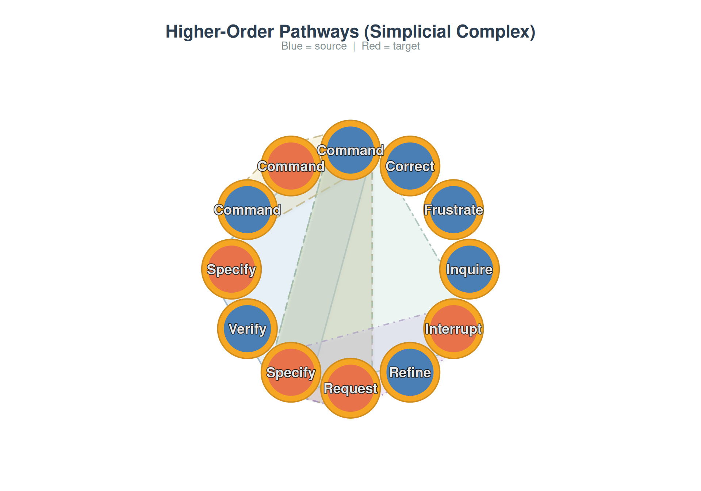

## Predictability of the next state

[`transition_entropy()`](https://pak.dynasite.org/Nestimate/reference/transition_entropy.md)
measures how uncertain the next state is (Cover & Thomas, 2006). The
entropy of a state’s row of transition probabilities is 0 bits when the
next state is certain and $`\log_2 9 = 3.17`$ bits when all nine are
equally likely; the entropy rate weights the rows by how often each
state occurs.

``` r

entropy <- transition_entropy(net)
entropy
```

    Transition Entropy (9 states, bits; ceiling = 3.170)

                              raw            normalised
      Entropy rate    h(P)  = 2.815 bits    0.888
      Stationary    H(pi)  = 2.982 bits    0.941
      Redundancy   H(pi)-h = 0.167 bits    0.056

    Normalised: h(P) and H(pi) are raw / log_2(n_states) (0 = deterministic, 1 = uniform);
      redundancy is the relative redundancy (H(pi) - h(P)) / H(pi), not raw / log_2(n_states).

``` r

plot(entropy)
```

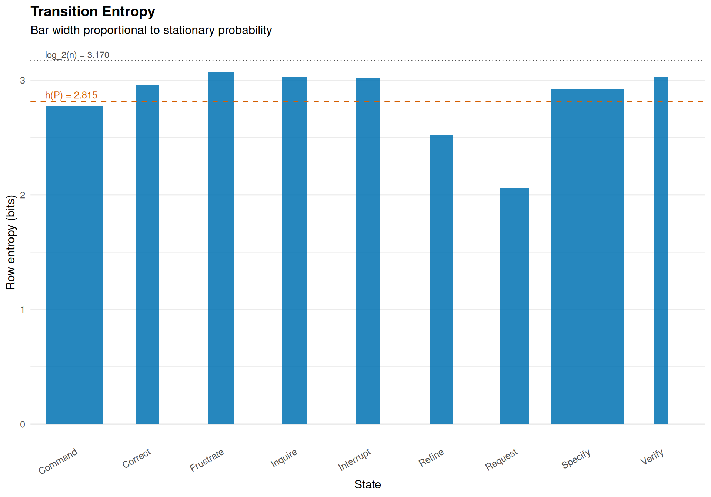

The entropy rate is 2.82 bits, 89% of the maximum: knowing the current
action reduces the uncertainty about the next one by 0.17 bits. In the
plot, each bar is one state’s entropy and its width the state’s share of
the actions.

## Where the context matters: higher-order networks

A higher-order network (HON) adds a node for a preceding context
whenever that context changes the distribution of the next state (Xu,
Wickramarathne, & Chawla, 2016);
[`build_hon()`](https://pak.dynasite.org/Nestimate/reference/build_hon.md)
uses the BuildHON+ algorithm (Saebi et al., 2020). `max_order` limits
the length of the contexts and `min_freq` the number of times a
transition must occur to be kept.

``` r

hon <- build_hon(net, max_order = 3, min_freq = 5)
hon
```

    Higher-Order Network (HON)
      Nodes:        233 (9 first-order states)
      Edges:        819
      Max order:    3 (requested 3)
      Min freq:     5
      Trajectories: 425

``` r

pathways(hon, top = 10)
```

     [1] "Specify Command -> Specify"
     [2] "Command Request -> Specify"
     [3] "Specify Command -> Request"
     [4] "Request Specify -> Interrupt"
     [5] "Specify Command Request -> Specify"
     [6] "Command Command -> Command"
     [7] "Command Specify -> Interrupt"
     [8] "Command Request Specify -> Interrupt"
     [9] "Specify Request -> Specify"
    [10] "Specify Specify -> Specify"          

The network has 233 nodes, the 9 actions and 224 contexts of two or
three actions, and 819 edges, 738 of them from a context.
[`pathways()`](https://pak.dynasite.org/Nestimate/reference/pathways.md)
lists the higher-order edges by frequency: `Specify Command -> Specify`
reads “after `Specify` then `Command`, the next action is `Specify`”.

[`path_counts()`](https://pak.dynasite.org/Nestimate/reference/path_counts.md)
counts the paths of `k` states in the sequences, whether or not they are
higher-order.

``` r

path_counts(net, k = 3, top = 10)
```

                                  path count proportion
    1    Specify -> Command -> Specify   284     0.0286
    2    Command -> Request -> Specify   231     0.0232
    3    Specify -> Command -> Request   199     0.0200
    4  Request -> Specify -> Interrupt   189     0.0190
    5    Command -> Command -> Command   177     0.0178
    6  Command -> Specify -> Interrupt   149     0.0150
    7    Specify -> Request -> Specify   128     0.0129
    8    Specify -> Specify -> Specify   123     0.0124
    9     Specify -> Refine -> Specify   122     0.0123
    10 Specify -> Interrupt -> Command   113     0.0114

`Specify -> Command -> Specify` is the most frequent three-action path
(284 times, 2.9% of all paths of three actions).

## Paths more or less frequent than expected: HYPA

HYPA compares the frequency of each path with the frequency expected
from the transitions it is made of (LaRock et al., 2020). The
expectation comes from a hypergeometric model of the network of paths
that keeps how often each shorter path starts and ends a longer one. A
path observed more often than expected is over-represented, and one
observed less often under-represented.

``` r

hypa <- build_hypa(net)
hypa
```

    HYPA: Path Anomaly Detection
      Order(s):     2
      Edges:        729
      Anomalous:    149 (alpha=0.05, p_adjust=none)
        Over-repr:  103
        Under-repr: 46

Of the 729 paths of three actions, 149 differ from the expectation at
the 5% level: 103 are over-represented and 46 under-represented. The
p-values are not adjusted for the number of paths (`p_adjust = "none"`).

``` r

summary(hypa, type = "over", order_by = "ratio", n = 8)
```

    HYPA Summary

      Order(s): 2 | Edges: 729
      Alpha: 0.05 | p_adjust: none
      Anomalous: 149 (over: 103, under: 46) | order_by: ratio

      Over-represented (top 8 ):
                                    path observed expected    ratio       p_tail
     Interrupt -> Interrupt -> Interrupt       29 5.457995 5.313307 2.428322e-13
            Request -> Request -> Verify        5 1.287834 3.882488 2.126592e-03
     Interrupt -> Frustrate -> Interrupt       12 3.114595 3.852829 2.353580e-05
          Refine -> Interrupt -> Correct        6 1.626016 3.690000 1.459766e-03
         Frustrate -> Request -> Correct        7 1.899110 3.685937 7.891460e-04
             Refine -> Inquire -> Refine        8 2.176329 3.675916 4.335950e-04
       Interrupt -> Command -> Interrupt       23 6.257631 3.675513 5.237408e-08
           Verify -> Frustrate -> Verify       22 6.063784 3.628098 1.187755e-07

Three interruptions in a row occur 29 times against 5.5 expected (ratio
5.3), and `Interrupt -> Command -> Interrupt` 23 times against 6.3.
Interruptions cluster: once a programmer interrupts the assistant,
further interruptions follow more often than the single transitions
predict.

``` r

plot_simplicial(hypa, anomaly = "over", max_pathways = 9,
                dismantled = TRUE, ncol = 3)
```

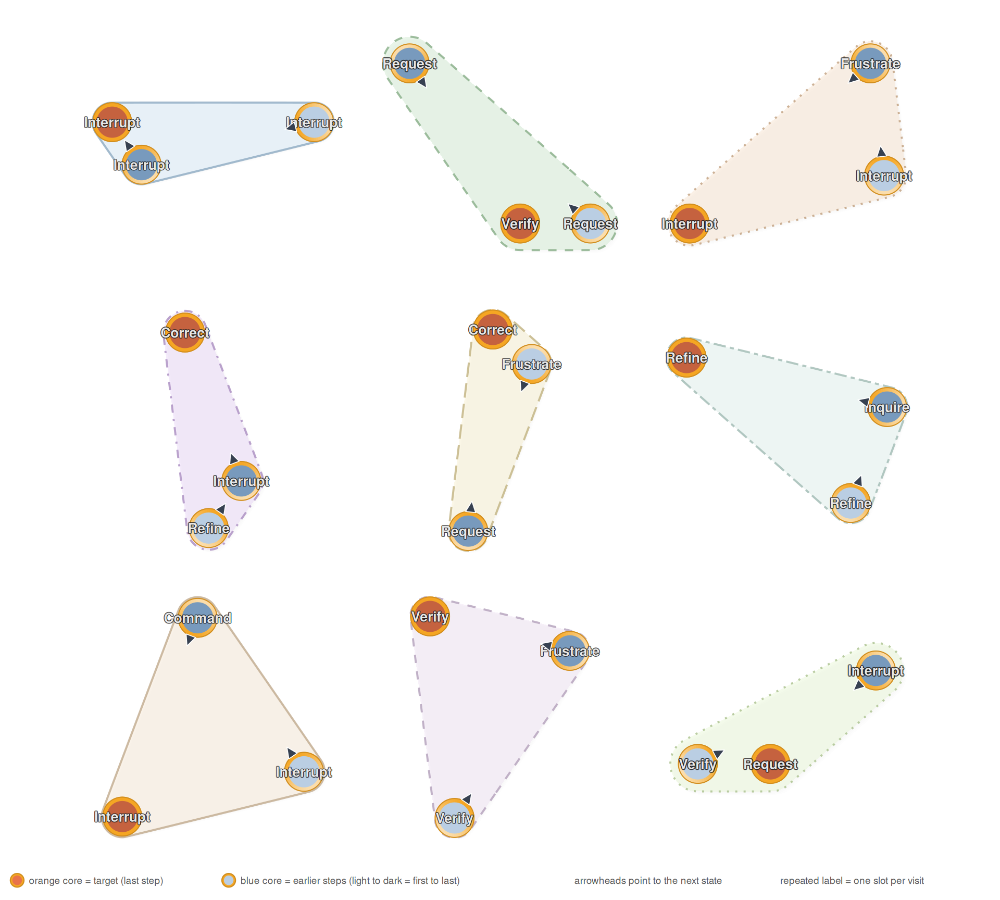

``` r

summary(hypa, type = "under", order_by = "ratio", n = 8)
```

    HYPA Summary

      Order(s): 2 | Edges: 729
      Alpha: 0.05 | p_adjust: none
      Anomalous: 149 (over: 103, under: 46) | order_by: ratio

      Under-represented (top 8 ):
                                  path observed expected     ratio      p_tail
     Interrupt -> Interrupt -> Specify        0 5.817073 0.0000000 0.002970473
       Inquire -> Specify -> Frustrate        1 7.779682 0.1285400 0.003661319
          Inquire -> Specify -> Refine        1 7.094247 0.1409593 0.006702541
        Interrupt -> Specify -> Refine        1 6.925337 0.1443973 0.007770947
         Command -> Request -> Correct        1 5.974283 0.1673841 0.017711857
        Verify -> Inquire -> Interrupt        1 5.207729 0.1920223 0.033944925
       Correct -> Frustrate -> Inquire        2 7.907027 0.2529396 0.014756758
        Verify -> Specify -> Interrupt        2 7.588739 0.2635484 0.018885541

`Interrupt -> Interrupt -> Specify` never occurs although 5.8
occurrences are expected: after two interruptions, programmers do not
return directly to specifying the task.

``` r

plot_simplicial(hypa, anomaly = "under", max_pathways = 6,
                dismantled = TRUE, ncol = 3)
```

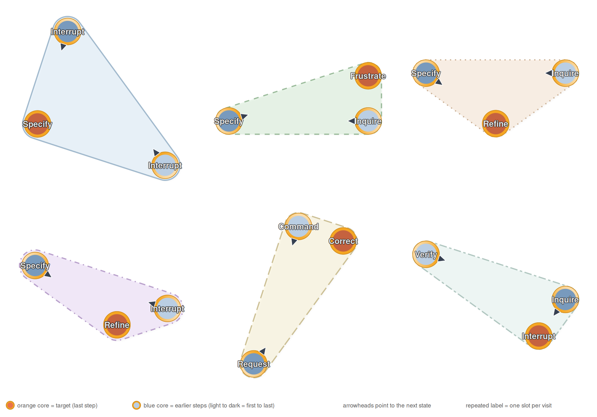

The same analysis of `group_regulation_long`, the regulation actions of
students working in groups (Tikka, López-Pernas, & Saqr, 2025), finds
fewer anomalous paths.

``` r

regulation_net <- build_network(group_regulation_long, method = "relative",
                                action = "Action", actor = "Actor",
                                time = "Time")
build_hypa(regulation_net)
```

    HYPA: Path Anomaly Detection
      Order(s):     2
      Edges:        679
      Anomalous:    29 (alpha=0.05, p_adjust=none)
        Over-repr:  22
        Under-repr: 7

29 of its 679 paths are anomalous (4%), against 149 of 729 (20%) in the
programming sessions: the regulation sequences are closer to what their
first-order transitions predict.

## Simplicial complexes

A network describes pairs of states (Saqr, López-Pernas, Conde-González,
& Hernández-García, 2024). A simplicial complex also describes groups:
two connected states form a 1-simplex (an edge), three mutually
connected states a 2-simplex (a filled triangle), and *k* + 1 mutually
connected states a *k*-simplex (Battiston et al., 2020).
[`build_simplicial()`](https://pak.dynasite.org/Nestimate/reference/build_simplicial.md)
builds the clique complex, in which every group of mutually connected
states is a simplex. Two states are connected when the transition
between them, in either direction, has a probability of at least
`threshold`.

### Building the complex

The threshold decides which transitions count. At 0.05 every pair of the
nine actions is connected and the complex is a single 8-simplex, which
describes nothing; at 0.12 the complex keeps the frequent transitions.

``` r

complex <- build_simplicial(net, threshold = 0.12)
complex
```

    Clique Complex
      9 nodes, 31 simplices, dimension 2
      Density: 24.0%  |  Mean dim: 0.90  |  Euler: -1
      f-vector: (f0=9 f1=16 f2=6)
      Betti: b0=1 b1=2
      Nodes: Command, Correct, Frustrate, Inquire, Interrupt, Refine, Request, Specify, Verify 

The complex has 9 states, 16 edges and 6 filled triangles, and no larger
groups. Its Betti numbers count its holes: $`\beta_0 = 1`$ means it is
connected, $`\beta_1 = 2`$ that it has two loops, cycles of edges that
are not filled by triangles. The Euler characteristic, 9 − 16 + 6 = −1,
equals $`\beta_0 - \beta_1`$.

``` r

simplicial_degree(complex)
```

           node d0 d1 d2 total
    8   Specify  1  6  5    11
    1   Command  1  5  3     8
    3 Frustrate  1  4  2     6
    5 Interrupt  1  3  2     5
    6    Refine  1  3  2     5
    7   Request  1  3  2     5
    2   Correct  1  3  1     4
    4   Inquire  1  3  1     4
    9    Verify  1  2  0     2

[`simplicial_degree()`](https://pak.dynasite.org/Nestimate/reference/simplicial_degree.md)
counts, for each state, the simplices of each dimension it belongs to.

``` r

plot(complex)
```

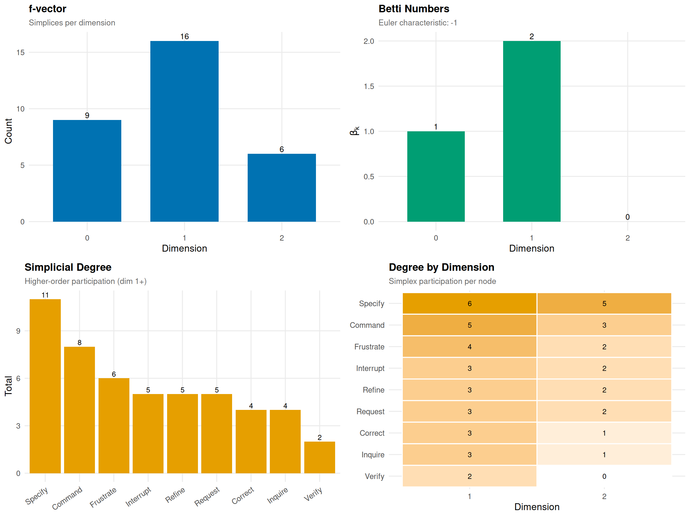

The four panels show the number of simplices per dimension (the
f-vector), the Betti numbers, each state’s number of simplices, and that
number by dimension.

### Persistent homology

A complex at one threshold depends on the threshold. Persistent homology
builds the complex at a sequence of thresholds, from the strongest edge
down, and records when each component and each loop appears and
disappears (Edelsbrunner, Letscher, & Zomorodian, 2002). A feature that
lasts over a wide range of thresholds does not depend on the choice of
one.

``` r

persistence <- persistent_homology(net, n_steps = 25)
persistence
```

    Persistent Homology
      25 filtration steps [0.6158 → 0.0062]
      Features: b0: 8 (1 persistent)  |  b1: 3 (0 persistent)
      Longest-lived:
        b0: 0.6158 → 0.0000 (life: 0.6158)
        b0: 0.6158 → 0.1706 (life: 0.4452)
        b0: 0.6158 → 0.2005 (life: 0.4154)

``` r

plot(persistence)
```

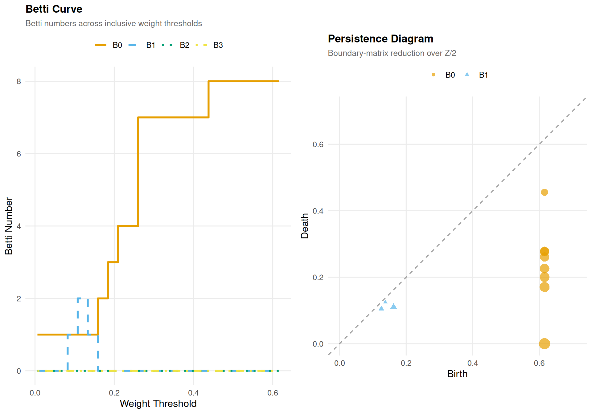

The left panel, the Betti curve, shows the number of components and
loops at each threshold. The right panel, the persistence diagram,
places each feature at the threshold where it appears and the one where
it disappears; points far from the diagonal last longest. The states
join into one component as the threshold falls below 0.17. Three loops
appear at some threshold and all are filled by triangles before the
lowest one.

### Q-analysis

Q-analysis describes how the largest simplices are connected to each
other (Atkin, 1974). Two simplices are *q*-connected when they share a
face of dimension *q* or higher: a state for *q* = 0, an edge for *q* =
1, a triangle for *q* = 2.

``` r

q_structure <- q_analysis(complex)
q_structure
```

    Q-Analysis (max q = 2)
      Components: q2:6 q1:4 q0:1
      Fragments at q = 1 (1 → 4 components)
      Structure: Command:2 Correct:2 Frustrate:2 Inquire:2 Interrupt:2 Refine:2 Request:2 Specify:2 Verify:1

``` r

plot(q_structure)
```

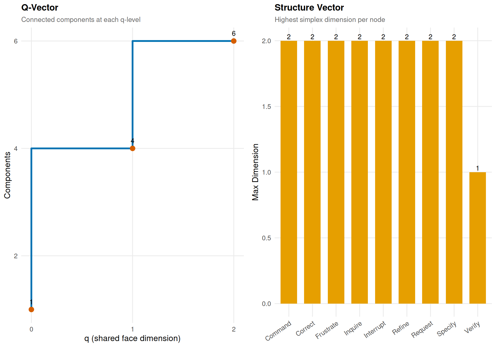

At *q* = 0 the complex is one component: every group of states shares at
least one state with another. At *q* = 1 it splits into four components,
so the triangles are joined through single states rather than through
shared edges. The structure vector gives, for each state, the dimension
of the largest simplex it belongs to: every state except `Verify`
belongs to a triangle.

### A complex from the higher-order paths

`type = "pathway"` builds the complex from the paths of the higher-order
network instead of the cliques: each frequent path is a simplex of the
states it passes through.

``` r

pathway_complex <- build_simplicial(hon, type = "pathway", max_pathways = 30)
pathway_complex
```

    Pathway Complex
      9 nodes, 34 simplices, dimension 3
      Density: 13.3%  |  Mean dim: 1.03  |  Euler: 0
      f-vector: (f0=9 f1=16 f2=8 f3=1)
      Betti: b0=1 b1=1
      Nodes: Command, Correct, Frustrate, Inquire, Interrupt, Refine, Request, Specify, Verify 

``` r

plot(pathway_complex)
```

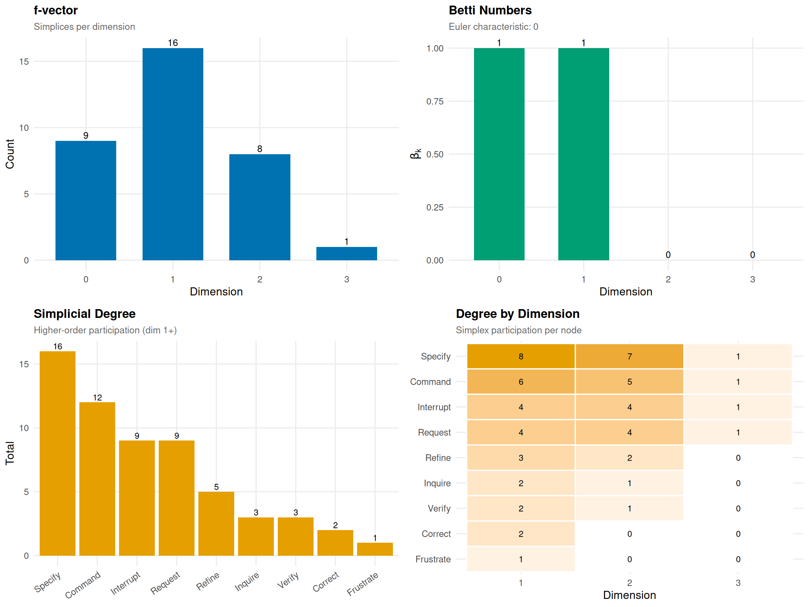

The 30 most frequent paths form a connected complex ($`\beta_0 = 1`$)
with one loop ($`\beta_1 = 1`$), of 16 edges, 8 triangles and one
3-simplex.

### Checking the computation

[`verify_simplicial()`](https://pak.dynasite.org/Nestimate/reference/verify_simplicial.md)
recomputes the cliques with igraph and checks the Euler-Poincaré
relation between the simplex counts and the Betti numbers.

``` r

verify_simplicial(net, threshold = 0.12)
```

      Cliques:  MATCH (31 simplices)
      Betti:    b0=1 b1=2 b2=0
      Euler:    -1 (Euler-Poincare: VERIFIED)

## How to cite this article

Saqr, M., López-Pernas, S., & Misiejuk, K. (2026). *Higher-order network
analysis with simplicial complexes: From transition networks to
topological analysis*. Nestimate.
<https://doi.org/10.5281/zenodo.24528514> ·
[HTML](https://pak.dynasite.org/Nestimate/articles/cograph-tutorial-simplicial.html)
·
[PDF](https://pak.dynasite.org/Nestimate/pdf/cograph-tutorial-simplicial.pdf)

## References

Atkin, R. H. (1974). *Mathematical structure in human affairs*.
Heinemann Educational.

Battiston, F., Cencetti, G., Iacopini, I., Latora, V., Lucas, M.,
Patania, A., Young, J.-G., & Petri, G. (2020). Networks beyond pairwise
interactions: Structure and dynamics. *Physics Reports*, 874, 1–92.
https://doi.org/10.1016/j.physrep.2020.05.004

Besag, J., & Mondal, D. (2013). Exact goodness-of-fit tests for Markov
chains. *Biometrics*, 69(2), 488–496. https://doi.org/10.1111/biom.12009

Cover, T. M., & Thomas, J. A. (2006). *Elements of information theory*
(2nd ed.). Wiley. https://doi.org/10.1002/047174882X

Edelsbrunner, H., Letscher, D., & Zomorodian, A. (2002). Topological
persistence and simplification. *Discrete & Computational Geometry*,
28(4), 511–533. https://doi.org/10.1007/s00454-002-2885-2

LaRock, T., Nanumyan, V., Scholtes, I., Casiraghi, G., Eliassi-Rad, T.,
& Schweitzer, F. (2020). HYPA: Efficient detection of path anomalies in
time series data on networks. In *Proceedings of the 2020 SIAM
International Conference on Data Mining* (pp. 460–468). SIAM.
https://doi.org/10.1137/1.9781611976236.52

López-Pernas, S., Misiejuk, K., Kaliisa, R., & Saqr, M. (2025).
Capturing the process of students’ AI interactions when creating and
learning complex network structures. *IEEE Transactions on Learning
Technologies*, 18, 556–568. https://doi.org/10.1109/TLT.2025.3568599

Misiejuk, K., López-Pernas, S., Oliveira, E., Rinja, D., & Saqr, M.
(2026). It takes two to vibe code: Profiling student-AI programming
interactions processes and their high order structure. In *Proceedings
of the 26th Koli Calling International Conference on Computing Education
Research* (pp. 1–11). ACM. https://doi.org/10.1145/3856208.3856254

Saebi, M., Xu, J., Kaplan, L. M., Ribeiro, B., & Chawla, N. V. (2020).
Efficient modeling of higher-order dependencies in networks: From
algorithm to application for anomaly detection. *EPJ Data Science*,
9(1), 15. https://doi.org/10.1140/epjds/s13688-020-00233-y

Saqr, M., López-Pernas, S., & Misiejuk, K. (2026). Nestimate: An R
package for dynamic, probabilistic, and high order network analysis.
*Applied Psychological Measurement*.
https://doi.org/10.1177/01466216261472019

Saqr, M., López-Pernas, S., & Tikka, S. (2025). Mapping relational
dynamics with transition network analysis: A primer and tutorial. In M.
Saqr & S. López-Pernas (Eds.), *Advanced learning analytics methods: AI,
precision and complexity* (pp. 371–411). Springer.
https://doi.org/10.1007/978-3-031-95365-1_15

Saqr, M., López-Pernas, S., Conde-González, M. Á., & Hernández-García,
Á. (2024). Social network analysis: A primer, a guide and a tutorial in
R. In M. Saqr & S. López-Pernas (Eds.), *Learning analytics methods and
tutorials: A practical guide using R* (pp. 491–518). Springer.
https://doi.org/10.1007/978-3-031-54464-4_15

Saqr, M., López-Pernas, S., Törmänen, T., Kaliisa, R., Misiejuk, K., &
Tikka, S. (2025). Transition network analysis: A novel framework for
modeling, visualizing, and identifying the temporal patterns of learners
and learning processes. In *Proceedings of the 15th International
Learning Analytics and Knowledge Conference (LAK25)* (pp. 351–361). ACM.
https://doi.org/10.1145/3706468.3706513

Saqr, M., Misiejuk, K., & López-Pernas, S. (2026). Human-AI
collaboration or obedient and often clueless AI in instruct, serve,
repeat dynamics? *The Internet and Higher Education*, 70, 101087.
https://doi.org/10.1016/j.iheduc.2026.101087

Sarkar, A., & Drosos, I. (2025). Vibe coding: Programming through
conversation with artificial intelligence. In *Proceedings of the 36th
Annual Conference of the Psychology of Programming Interest Group (PPIG
2025)*. https://doi.org/10.48550/arXiv.2506.23253

Scholtes, I. (2017). When is a network a network? Multi-order graphical
model selection in pathways and temporal networks. In *Proceedings of
the 23rd ACM SIGKDD International Conference on Knowledge Discovery and
Data Mining* (pp. 1037–1046). ACM.
https://doi.org/10.1145/3097983.3098145

Tikka, S., López-Pernas, S., & Saqr, M. (2025). tna: An R package for
transition network analysis. *Applied Psychological Measurement*, 49(6),
326–328. https://doi.org/10.1177/01466216251348840

Xu, J., Wickramarathne, T. L., & Chawla, N. V. (2016). Representing
higher-order dependencies in networks. *Science Advances*, 2(5),
e1600028. https://doi.org/10.1126/sciadv.1600028
