# Comparing networks with compare_networks()

Do two groups, or two periods, produce different networks?
[`compare_networks()`](https://pak.dynasite.org/Nestimate/reference/compare_networks.md)
in Nestimate (Saqr, López-Pernas, & Misiejuk, 2026) compares two or more
networks edge by edge, node by node and on global metrics, and returns
one object from which every table and plot is drawn. By default the
comparison is descriptive; `test` adds a permutation test, a Bayesian
comparison or a bootstrap of the network structure.

| Table | Verb |
|----|----|
| One row per pair of networks | [`summary()`](https://rdrr.io/r/base/summary.html) |
| One row per pair and edge | [`edge_differences()`](https://pak.dynasite.org/Nestimate/reference/comparison_tables.md) |
| One row per pair, node and centrality measure | [`node_differences()`](https://pak.dynasite.org/Nestimate/reference/comparison_tables.md) |
| One row per pair and global metric | [`global_differences()`](https://pak.dynasite.org/Nestimate/reference/comparison_tables.md) |
| One row per network and structural metric | [`network_metrics()`](https://pak.dynasite.org/Nestimate/reference/comparison_tables.md) |

## Data

`group_regulation_long` records the regulation actions of 2,000 students
working in 200 teams of 10, generated synthetically from the
`group_regulation` data of the tna package (Tikka, López-Pernas, & Saqr,
2025). Achievement (`Achiever`, High or Low) is recorded per team.
[`build_network()`](https://pak.dynasite.org/Nestimate/reference/build_network.md)
with `group = "Achiever"` estimates one transition network per level.

``` r

library(Nestimate)
achievers <- build_network(group_regulation_long, method = "relative",
                           actor = "Actor", action = "Action",
                           time = "Time", group = "Achiever")
achievers
```

    ## Group Networks (2 groups, group_col: Achiever)
    ## 
    ##   Group  Nodes  Edges  Weights
    ##   High   9      76     [0.001, 0.576]
    ##   Low    9      75     [0.000, 0.462]

## Describing the difference

``` r

comparison <- compare_networks(achievers)
comparison
```

    ## Network comparison (descriptive): 2 networks, 1 pairs, scaling = none
    ##   networks: High (9 nodes, directed), Low (9 nodes, directed)
    ## 
    ##  pair        pearson mean|diff| max|diff| largest change                    
    ##  High vs Low 0.92    0.03       0.21      discuss -> consensus (High higher)
    ## 
    ## Tables: summary(x), edge_differences(x), node_differences(x), global_differences(x), network_metrics(x). Plot: plot(x, type = ...)

``` r

summary(comparison)
```

    ##         pair network_a network_b n_cells n_differing share_higher_a
    ##  High vs Low      High       Low      81          78           0.51
    ##  share_higher_b mean_abs_diff max_abs_diff pearson spearman cosine jaccard
    ##            0.46          0.03         0.21    0.92     0.92   0.95    0.75
    ##              top_edge top_edge_higher
    ##  discuss -> consensus            High

The comparison takes the difference High minus Low for each of the 81
cells of the weight matrices, self-loops included. 78 cells differ; High
is higher in 51% of them and Low in 46%. The mean absolute difference is
0.03 and the largest, `discuss` to `consensus`, 0.21. The two networks
are alike overall: the edge weights correlate at 0.92 (Pearson and
Spearman), the cosine similarity is 0.95, and the Jaccard similarity of
the edges present in each network is 0.75.

``` r

global_differences(comparison)
```

    ##         pair network_a network_b             category               metric
    ##  High vs Low      High       Low    Weight Deviations      Mean Abs. Diff.
    ##  High vs Low      High       Low    Weight Deviations    Median Abs. Diff.
    ##  High vs Low      High       Low    Weight Deviations            RMS Diff.
    ##  High vs Low      High       Low    Weight Deviations       Max Abs. Diff.
    ##  High vs Low      High       Low    Weight Deviations Rel. Mean Abs. Diff.
    ##  High vs Low      High       Low    Weight Deviations             CV Ratio
    ##  High vs Low      High       Low         Correlations              Pearson
    ##  High vs Low      High       Low         Correlations             Spearman
    ##  High vs Low      High       Low         Correlations              Kendall
    ##  High vs Low      High       Low         Correlations             Distance
    ##  High vs Low      High       Low      Dissimilarities            Euclidean
    ##  High vs Low      High       Low      Dissimilarities            Manhattan
    ##  High vs Low      High       Low      Dissimilarities             Canberra
    ##  High vs Low      High       Low      Dissimilarities          Bray-Curtis
    ##  High vs Low      High       Low      Dissimilarities            Frobenius
    ##  High vs Low      High       Low         Similarities               Cosine
    ##  High vs Low      High       Low         Similarities              Jaccard
    ##  High vs Low      High       Low         Similarities                 Dice
    ##  High vs Low      High       Low         Similarities              Overlap
    ##  High vs Low      High       Low         Similarities                   RV
    ##  High vs Low      High       Low Pattern Similarities       Rank Agreement
    ##  High vs Low      High       Low Pattern Similarities       Sign Agreement
    ##              key value
    ##    mean_abs_diff  0.03
    ##  median_abs_diff  0.02
    ##         rms_diff  0.05
    ##     max_abs_diff  0.21
    ##     rel_mean_abs  0.29
    ##         cv_ratio  1.10
    ##          pearson  0.92
    ##         spearman  0.92
    ##          kendall  0.77
    ##     distance_cor  0.92
    ##        euclidean  0.47
    ##        manhattan  2.61
    ##         canberra 19.76
    ##      bray_curtis  0.15
    ##        frobenius  0.22
    ##           cosine  0.95
    ##          jaccard  0.75
    ##             dice  0.85
    ##          overlap  0.85
    ##               rv  0.90
    ##   rank_agreement  0.82
    ##   sign_agreement  0.94

[`global_differences()`](https://pak.dynasite.org/Nestimate/reference/comparison_tables.md)
reports 22 metrics in five groups: deviations of the weights (mean,
median, root mean square and largest absolute difference), correlations,
dissimilarities (Euclidean, Manhattan, Canberra, Bray-Curtis,
Frobenius), similarities (cosine, Jaccard, Dice, overlap and the RV
coefficient, a correlation between matrices; Robert & Escoufier, 1976),
and the agreement of the ranks and signs of the weights.

``` r

plot(comparison, type = "global")
```

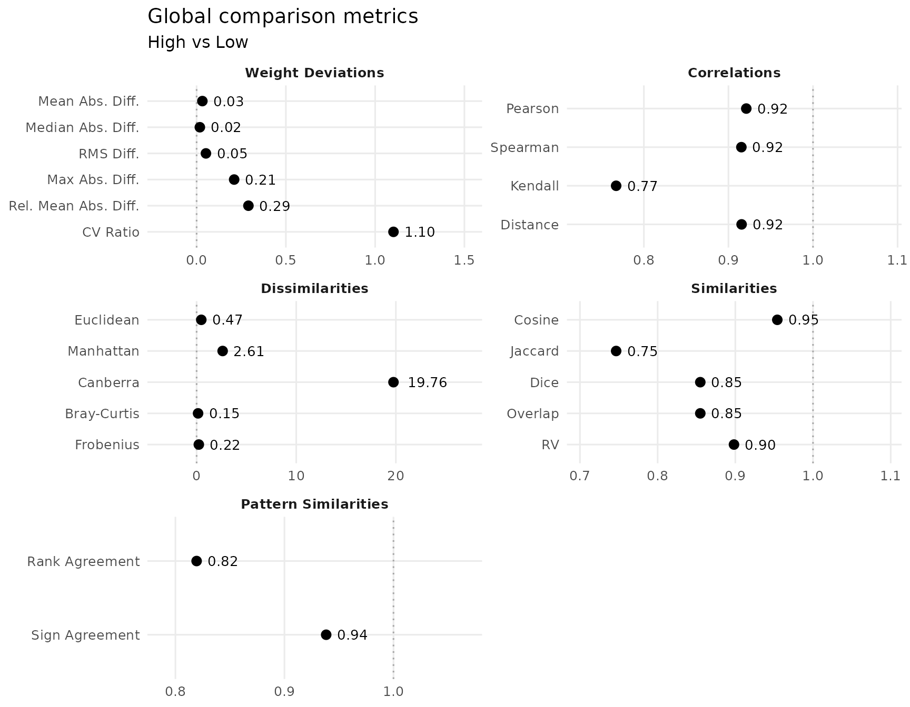

Each panel is one group of metrics, with a dotted line at the value of
identical networks: 1 for correlations and similarities, 0 for
deviations and dissimilarities.

``` r

network_metrics(comparison)
```

    ##  network                      metric value
    ##     High                  Node Count     9
    ##     High                  Edge Count    76
    ##     High             Network Density     1
    ##     High               Mean Distance  0.04
    ##     High           Mean Out-Strength     1
    ##     High             SD Out-Strength     0
    ##     High            Mean In-Strength     1
    ##     High              SD In-Strength  0.91
    ##     High             Mean Out-Degree  8.44
    ##     High               SD Out-Degree  1.13
    ##     High Centralization (Out-Degree)  0.05
    ##     High  Centralization (In-Degree)  0.05
    ##     High                 Reciprocity  0.96
    ##      Low                  Node Count     9
    ##      Low                  Edge Count    75
    ##      Low             Network Density     1
    ##      Low               Mean Distance  0.06
    ##      Low           Mean Out-Strength     1
    ##      Low             SD Out-Strength     0
    ##      Low            Mean In-Strength     1
    ##      Low              SD In-Strength  0.72
    ##      Low             Mean Out-Degree  8.33
    ##      Low               SD Out-Degree  0.87
    ##      Low Centralization (Out-Degree)  0.06
    ##      Low  Centralization (In-Degree)  0.06
    ##      Low                 Reciprocity  0.94

[`network_metrics()`](https://pak.dynasite.org/Nestimate/reference/comparison_tables.md)
describes each network on its own. Both are almost complete (76 and 75
of 81 possible edges, density 1 rounded), and their in-strengths are
spread more widely in High (SD 0.91) than in Low (0.72).

### Edges

``` r

head(edge_differences(comparison), 8)
```

    ##         pair network_a network_b  from         to weight_a weight_b  diff
    ##  High vs Low      High       Low adapt      adapt        0        0     0
    ##  High vs Low      High       Low adapt   cohesion     0.26     0.28 -0.01
    ##  High vs Low      High       Low adapt  consensus     0.52     0.46  0.06
    ##  High vs Low      High       Low adapt coregulate        0     0.03 -0.03
    ##  High vs Low      High       Low adapt    discuss     0.04     0.07 -0.03
    ##  High vs Low      High       Low adapt    emotion     0.14     0.11  0.03
    ##  High vs Low      High       Low adapt    monitor     0.03     0.04 -0.01
    ##  High vs Low      High       Low adapt       plan     0.01     0.02     0
    ##  abs_diff rel_diff ratio log_ratio rank_a rank_b rank_diff percentile_diff
    ##         0       NA    NA         0      3   3.50     -0.50           -0.01
    ##      0.01     0.03  0.95     -0.01     70     70         0               0
    ##      0.06     0.06  1.12      0.04     79     81        -2           -0.02
    ##      0.03        1     0     -0.03      3     26       -23           -0.26
    ##      0.03     0.31  0.52     -0.03     35     40        -5           -0.06
    ##      0.03     0.12  1.27      0.03     58     54         4            0.05
    ##      0.01     0.11  0.80     -0.01     29     29         0               0
    ##         0     0.07  0.87         0     17     19        -2           -0.02
    ##   status higher
    ##  neither  equal
    ##     both    Low
    ##     both   High
    ##   only_b    Low
    ##     both    Low
    ##     both   High
    ##     both    Low
    ##     both    Low

[`edge_differences()`](https://pak.dynasite.org/Nestimate/reference/comparison_tables.md)
gives one row per cell: the two weights, their difference, its absolute
value, the relative difference (`|a - b| / (|a| + |b|)`), the ratio, the
ranks of the edge in each network, `status` (present in both networks,
in one, or in neither) and `higher`, the network in which the edge is
larger. `adapt` to `coregulate` exists only in Low (0 against 0.03).

``` r

plot(comparison, type = "edges")
```

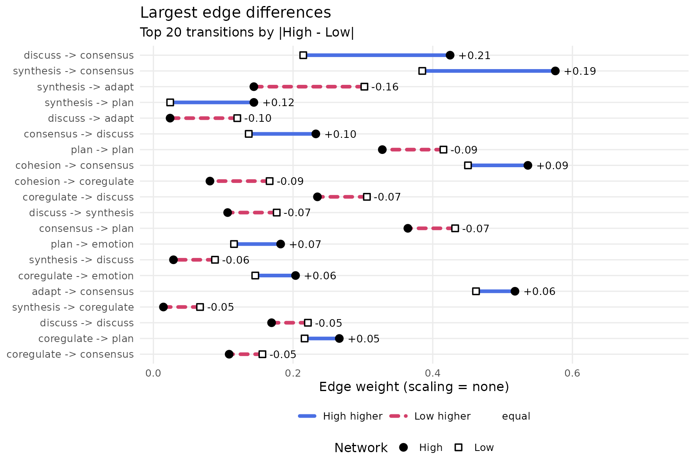

The edge view draws the 20 largest differences as a line between the two
weights, a diamond for High and a square for Low. The line is solid blue
where High is higher and dashed red where Low is higher, and is labelled
with the difference. `discuss` to `consensus` (0.42 in High, 0.21 in
Low) and `synthesis` to `consensus` (0.58 against 0.39) are the largest
differences in favour of High, and `synthesis` to `adapt` (0.14 against
0.30) in favour of Low.

``` r

plot(comparison, type = "networks")
```

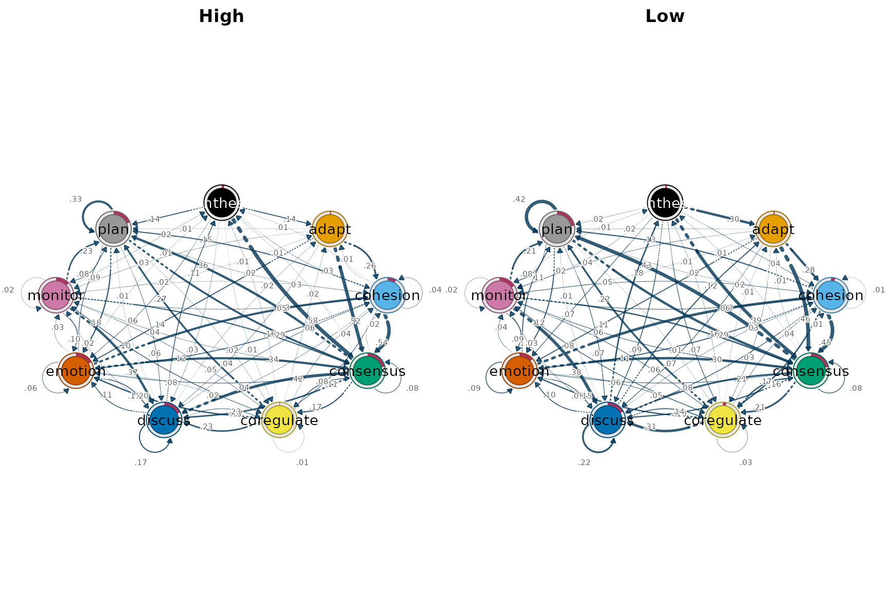

``` r

plot(comparison, type = "difference")
```

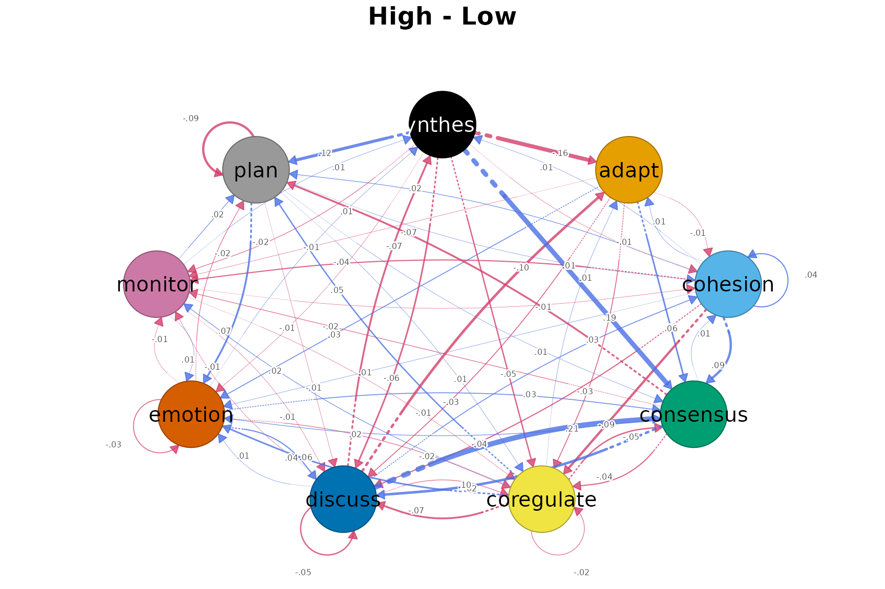

The networks view draws each network once; the difference view draws the
signed difference network, blue for transitions stronger in High and red
for transitions stronger in Low.

``` r

plot(comparison, type = "heatmap")
```

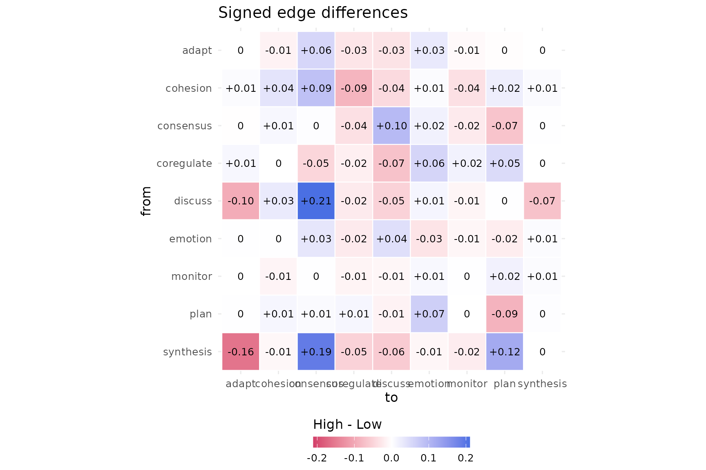

``` r

plot(comparison, type = "scatter")
```

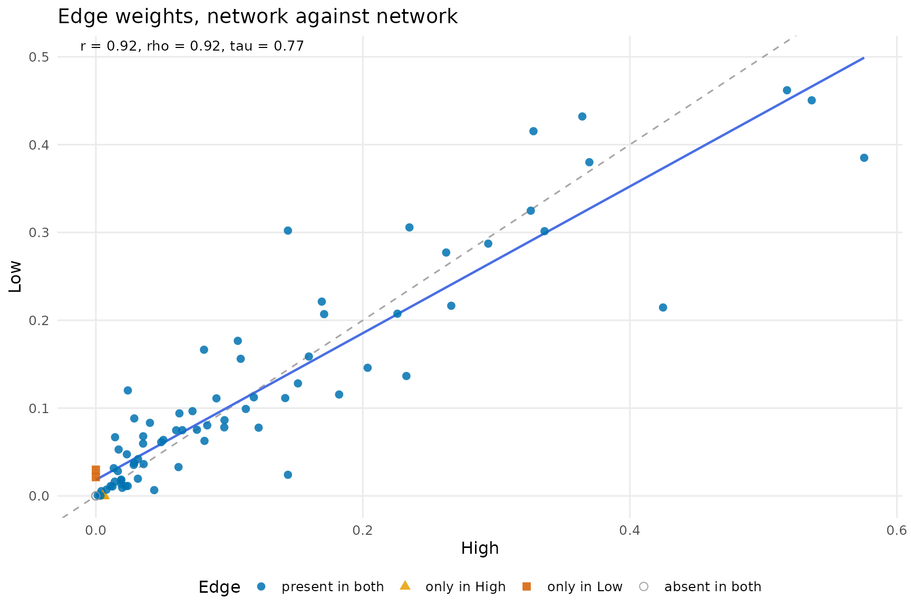

The heatmap prints every cell of the difference matrix. The scatter plot
sets each transition’s weight in High against its weight in Low; points
on the diagonal are equal in both.

### Nodes

``` r

node_differences(comparison, measure = "InStrength")
```

    ##         pair network_a network_b       node    measure value_a value_b  diff
    ##  High vs Low      High       Low      adapt InStrength    0.22    0.45 -0.24
    ##  High vs Low      High       Low   cohesion InStrength    0.81    0.80  0.02
    ##  High vs Low      High       Low  consensus InStrength    2.95    2.42  0.54
    ##  High vs Low      High       Low coregulate InStrength    0.44    0.69 -0.25
    ##  High vs Low      High       Low    discuss InStrength    1.12    1.21 -0.09
    ##  High vs Low      High       Low    emotion InStrength       1    0.81  0.19
    ##  High vs Low      High       Low    monitor InStrength    0.30    0.39 -0.09
    ##  High vs Low      High       Low       plan InStrength    1.27    1.15  0.12
    ##  High vs Low      High       Low  synthesis InStrength    0.17    0.22 -0.05
    ##  abs_diff rank_a rank_b higher
    ##      0.24      2      3    Low
    ##      0.02      5      5   High
    ##      0.54      9      9   High
    ##      0.25      4      4    Low
    ##      0.09      7      8    Low
    ##      0.19      6      6   High
    ##      0.09      3      2    Low
    ##      0.12      8      7   High
    ##      0.05      1      1    Low

[`node_differences()`](https://pak.dynasite.org/Nestimate/reference/comparison_tables.md)
compares the centralities of each state, by default in-strength,
out-strength and betweenness. `consensus` receives the most in both
networks, more in High (2.95 against 2.42), and `adapt` and `coregulate`
receive more in Low.

``` r

plot(comparison, type = "nodes")
```

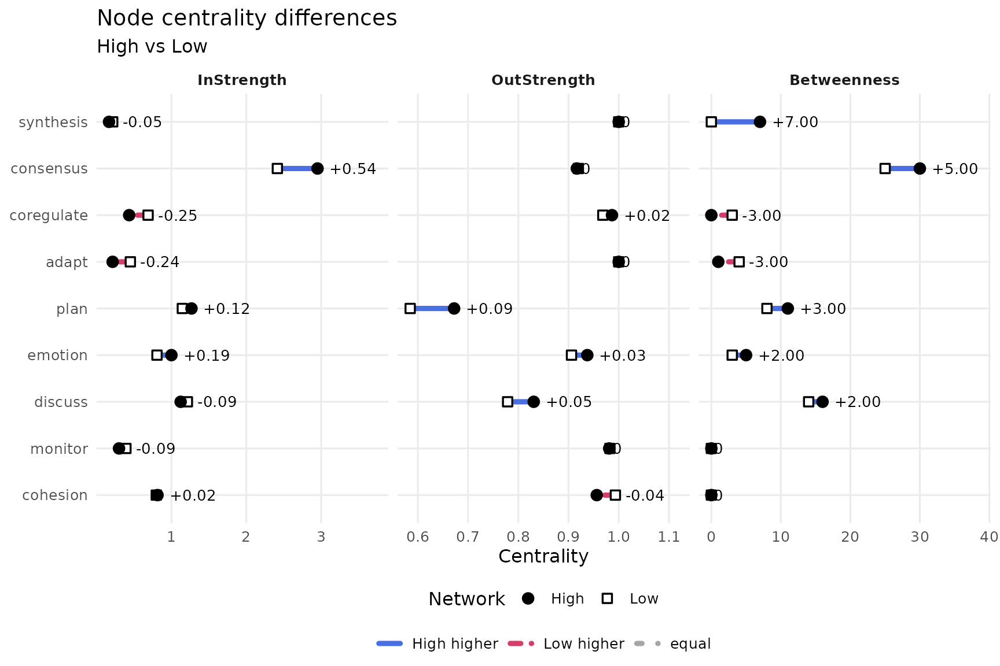

## Permutation test

The descriptive tables show where the networks differ, not whether a
difference is larger than sampling would produce. `test = "permutation"`
reassigns the sequences to the two groups 1,000 times, re-estimates both
networks each time, and compares the observed difference of each edge
and node measure with the reassigned ones (Saqr et al., 2025). Two
global statistics test whether the networks differ at all: M, the sum of
the absolute differences over all cells, and S, the largest.

``` r

tested <- compare_networks(achievers, test = "permutation", iter = 1000,
                           seed = 1)
summary(tested)
```

    ##         pair network_a network_b n_cells n_differing share_higher_a
    ##  High vs Low      High       Low      81          78           0.51
    ##  share_higher_b mean_abs_diff max_abs_diff pearson spearman cosine jaccard
    ##            0.46          0.03         0.21    0.92     0.92   0.95    0.75
    ##              top_edge top_edge_higher n_sig_edges n_sig_nodes m_stat   m_p
    ##  discuss -> consensus            High          42          16   2.61 0.001
    ##  s_stat   s_p
    ##    0.21 0.001

42 of the 78 transitions and 16 of the 27 node measures differ at the 5%
level, and both global statistics are significant (M = 2.61, S = 0.21, p
= 0.001, the smallest p-value 1,000 permutations can give). `adjust`
corrects the edge p-values for multiple testing, for example
`adjust = "BH"`.

``` r

plot(tested, type = "inference")
```

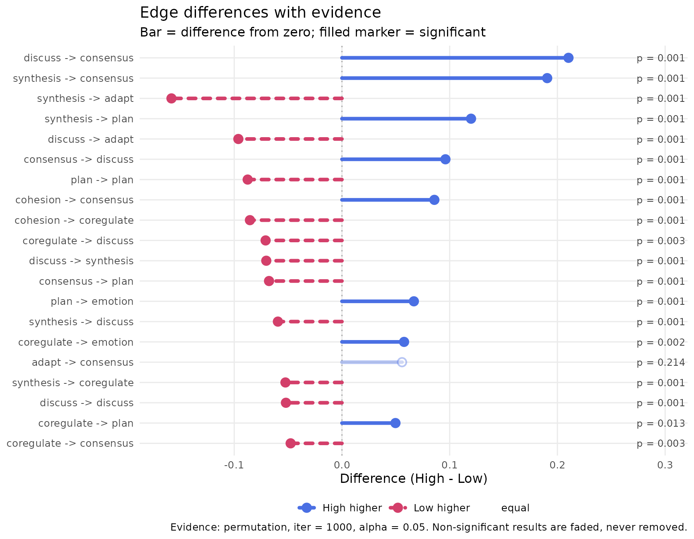

The inference view draws each edge difference as a bar from zero, with
its p-value on the right; a filled marker is significant at 0.05.

## Differences in centralities

`measures = "all"` compares nine centralities. In- and out-strength are
the sums of a state’s incoming and outgoing transition probabilities
(Opsahl, Agneessens, & Skvoretz, 2010). Closeness is the inverse of the
summed shortest-path distances to a state (`ClosenessIn`), from it
(`ClosenessOut`) or ignoring direction (`Closeness`), and betweenness
the number of shortest paths that pass through it (Freeman, 1978); a
heavier edge is a shorter step. `BetweennessRSP` counts randomised
shortest paths, which include routes slightly longer than the shortest
(Kivimäki et al., 2016). `Diffusion` sums the weights of the walks of up
to n steps that start at a state (Banerjee et al., 2013), and
`Clustering` is the weighted clustering coefficient (Onnela et al.,
2005). The permutation test gives each a p-value.

``` r

centralities <- compare_networks(achievers, measures = "all",
                                 test = "permutation", iter = 1000, seed = 1)
summary(centralities)
```

    ##         pair network_a network_b n_cells n_differing share_higher_a
    ##  High vs Low      High       Low      81          78           0.51
    ##  share_higher_b mean_abs_diff max_abs_diff pearson spearman cosine jaccard
    ##            0.46          0.03         0.21    0.92     0.92   0.95    0.75
    ##              top_edge top_edge_higher n_sig_edges n_sig_nodes m_stat   m_p
    ##  discuss -> consensus            High          42          55   2.61 0.001
    ##  s_stat   s_p
    ##    0.21 0.001

55 of the 81 node measures (nine states, nine measures) differ at the 5%
level: all nine closeness values, eight each for
randomised-shortest-path betweenness and clustering, seven each for
in-strength and in-closeness, five each for out-strength and diffusion,
four for betweenness and two for out-closeness.

``` r

node_differences(centralities, measure = "Betweenness")
```

    ##         pair network_a network_b       node     measure value_a value_b diff
    ##  High vs Low      High       Low      adapt Betweenness       1       4   -3
    ##  High vs Low      High       Low   cohesion Betweenness       0       0    0
    ##  High vs Low      High       Low  consensus Betweenness      30      25    5
    ##  High vs Low      High       Low coregulate Betweenness       0       3   -3
    ##  High vs Low      High       Low    discuss Betweenness      16      14    2
    ##  High vs Low      High       Low    emotion Betweenness       5       3    2
    ##  High vs Low      High       Low    monitor Betweenness       0       0    0
    ##  High vs Low      High       Low       plan Betweenness      11       8    3
    ##  High vs Low      High       Low  synthesis Betweenness       7       0    7
    ##  abs_diff rank_a rank_b higher perm_effect perm_p perm_sig   sig    evidence
    ##         3      4      6    Low       -6.14  0.001     TRUE  TRUE permutation
    ##         0      2      2  equal           0  1.000    FALSE FALSE permutation
    ##         5      9      9   High        6.65  0.001     TRUE  TRUE permutation
    ##         3      2   4.50    Low       -0.93  0.289    FALSE FALSE permutation
    ##         2      8      8   High        1.81  0.224    FALSE FALSE permutation
    ##         2      5   4.50   High       13.80  0.001     TRUE  TRUE permutation
    ##         0      2      2  equal          NA  1.000    FALSE FALSE permutation
    ##         3      7      7   High        0.81  0.373    FALSE FALSE permutation
    ##         7      6      2   High       22.36  0.003     TRUE  TRUE permutation

`consensus` lies on most shortest paths in both networks, more in High
(30 against 25, p = 0.001). `synthesis` lies on 7 shortest paths in High
and none in Low (p = 0.003), and `emotion` on 5 against 3 (p = 0.001);
`adapt` lies on more in Low (4 against 1, p = 0.001). `coregulate`,
`discuss` and `plan` differ by 2 or 3 paths without significance.

``` r

node_differences(centralities, measure = "BetweennessRSP")
```

    ##         pair network_a network_b       node        measure value_a value_b diff
    ##  High vs Low      High       Low      adapt BetweennessRSP       1       1    0
    ##  High vs Low      High       Low   cohesion BetweennessRSP      26      13   13
    ##  High vs Low      High       Low  consensus BetweennessRSP     121      88   33
    ##  High vs Low      High       Low coregulate BetweennessRSP      30      25    5
    ##  High vs Low      High       Low    discuss BetweennessRSP      63      45   18
    ##  High vs Low      High       Low    emotion BetweennessRSP      48      26   22
    ##  High vs Low      High       Low    monitor BetweennessRSP      13       9    4
    ##  High vs Low      High       Low       plan BetweennessRSP      69      55   14
    ##  High vs Low      High       Low  synthesis BetweennessRSP       7       1    6
    ##  abs_diff rank_a rank_b higher perm_effect perm_p perm_sig   sig    evidence
    ##         0      1   1.50  equal          NA  1.000    FALSE FALSE permutation
    ##        13      4      4   High        7.25  0.001     TRUE  TRUE permutation
    ##        33      9      9   High       11.25  0.001     TRUE  TRUE permutation
    ##         5      5      5   High        2.61  0.019     TRUE  TRUE permutation
    ##        18      7      7   High        8.46  0.001     TRUE  TRUE permutation
    ##        22      6      6   High        9.90  0.001     TRUE  TRUE permutation
    ##         4      3      3   High        2.61  0.029     TRUE  TRUE permutation
    ##        14      8      8   High        5.53  0.001     TRUE  TRUE permutation
    ##         6      2   1.50   High        4.35  0.001     TRUE  TRUE permutation

Counting near-shortest routes as well, every state except `adapt` lies
on more routes in High, and all eight differences are significant;
`consensus` has 121 against 88.

``` r

node_differences(centralities, measure = "Closeness", digits = 3)
```

    ##         pair network_a network_b       node   measure value_a value_b   diff
    ##  High vs Low      High       Low      adapt Closeness   0.026   0.024  0.002
    ##  High vs Low      High       Low   cohesion Closeness   0.028   0.025  0.003
    ##  High vs Low      High       Low  consensus Closeness   0.041   0.035  0.006
    ##  High vs Low      High       Low coregulate Closeness   0.020   0.022 -0.001
    ##  High vs Low      High       Low    discuss Closeness   0.031   0.022  0.009
    ##  High vs Low      High       Low    emotion Closeness   0.025   0.021  0.004
    ##  High vs Low      High       Low    monitor Closeness   0.021   0.018  0.003
    ##  High vs Low      High       Low       plan Closeness   0.028   0.026  0.002
    ##  High vs Low      High       Low  synthesis Closeness   0.027   0.023  0.004
    ##  abs_diff rank_a rank_b higher perm_effect perm_p perm_sig  sig    evidence
    ##     0.002      4      6   High       2.781  0.006     TRUE TRUE permutation
    ##     0.003      6      7   High       4.453  0.001     TRUE TRUE permutation
    ##     0.006      9      9   High       7.135  0.001     TRUE TRUE permutation
    ##     0.001      1      3    Low      -2.289  0.023     TRUE TRUE permutation
    ##     0.009      8      4   High      11.986  0.001     TRUE TRUE permutation
    ##     0.004      3      2   High       6.708  0.001     TRUE TRUE permutation
    ##     0.003      2      1   High       5.684  0.001     TRUE TRUE permutation
    ##     0.002      7      8   High       3.614  0.001     TRUE TRUE permutation
    ##     0.004      5      5   High       4.940  0.001     TRUE TRUE permutation

Closeness is higher in High for every state except `coregulate`.

``` r

plot(centralities, type = "nodes",
     measure = c("Betweenness", "BetweennessRSP", "Closeness", "Diffusion"))
```

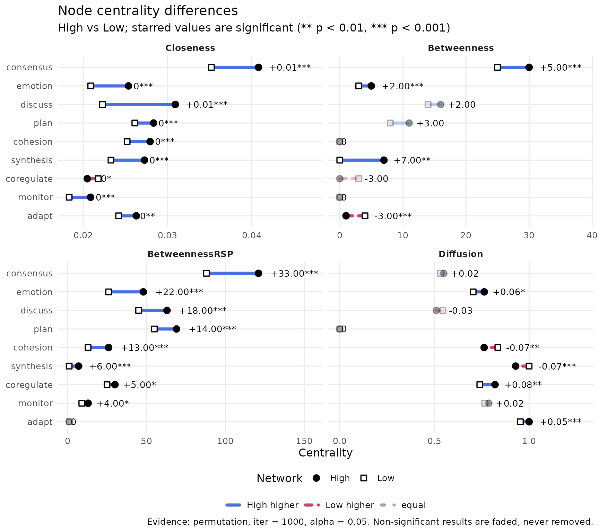

The node view draws each state’s value in both networks, a diamond for
High and a square for Low, joined by a solid blue line where High is
higher and a dashed red line where Low is higher; stars mark the
significant differences.

## Edge betweenness

Betweenness can also be computed for edges: the number of shortest paths
between states that pass through an edge (Girvan & Newman, 2002). An
edge with a high value carries many of the routes through the network.
[`net_edge_betweenness()`](https://pak.dynasite.org/Nestimate/reference/net_edge_betweenness.md)
returns one network per group whose weights are these counts, and
[`permutation()`](https://pak.dynasite.org/Nestimate/reference/permutation.md)
tests the difference of every edge: it reassigns the sequences between
the groups, re-estimates both transition networks and recomputes their
edge betweenness each time.

``` r

edge_betweenness <- net_edge_betweenness(achievers)
edge_betweenness
```

    ## Group Networks (2 groups)
    ## 
    ##   Group  Nodes  Edges  Weights
    ##   High   9      24     [1.000, 15.000]
    ##   Low    9      29     [1.000, 14.000]

``` r

routes <- permutation(edge_betweenness, iter = 1000, seed = 1)
routes
```

    ## Grouped Permutation Test
    ## Groups: High vs Low 
    ## 
    ## -- High vs Low --
    ## Permutation Test: Edge-Betweenness Network [directed]
    ##   Iterations: 1000  |  Alpha: 0.05
    ##   Nodes: 9  |  Edges tested: 29  |  Significant: 10

``` r

subset(summary(routes), sig)
```

    ##          group       from         to weight_x weight_y diff effect_size
    ## 1  High vs Low      adapt   cohesion        2        4   -2  -44.766148
    ## 4  High vs Low   cohesion  consensus        7        3    4   14.910848
    ## 5  High vs Low   cohesion coregulate        0        4   -4  -14.910848
    ## 8  High vs Low  consensus    discuss       15       12    3   11.959977
    ## 11 High vs Low coregulate    discuss        4        6   -2   -5.064736
    ## 15 High vs Low    discuss      adapt        0        9   -9  -28.749445
    ## 16 High vs Low    discuss  consensus        7        4    3    3.062634
    ## 18 High vs Low    discuss  synthesis       15        8    7   22.360680
    ## 19 High vs Low    emotion   cohesion        6        4    2   13.801640
    ## 28 High vs Low  synthesis      adapt        9        3    6   10.341155
    ##        p_value  sig
    ## 1  0.000999001 TRUE
    ## 4  0.000999001 TRUE
    ## 5  0.000999001 TRUE
    ## 8  0.007992008 TRUE
    ## 11 0.000999001 TRUE
    ## 15 0.000999001 TRUE
    ## 16 0.015984016 TRUE
    ## 18 0.002997003 TRUE
    ## 19 0.000999001 TRUE
    ## 28 0.002997003 TRUE

Shortest paths run over 24 edges in High and 29 in Low, and 10 of the 29
edges tested differ in the number of paths they carry. In Low, 9
shortest paths pass through `discuss` to `adapt` and none in High; in
High, `discuss` to `synthesis` carries 15 against 8 and `synthesis` to
`adapt` 9 against 3.

``` r

library(cograph)
splot(routes, edge_positive_color = "#4A6FE3",
      edge_negative_color = "#D33F6A")
```

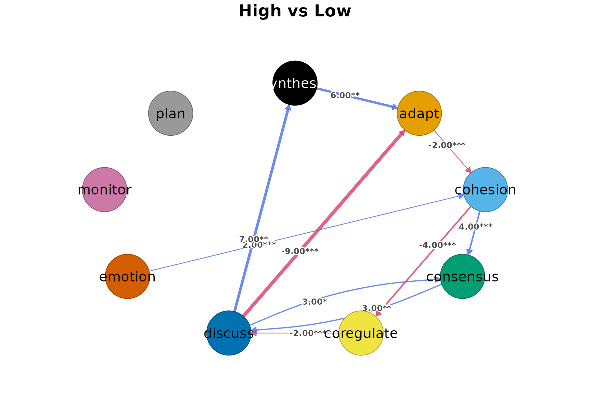

cograph draws the edges that differ, blue where High carries more paths
and red where Low does.

[`bayes_compare()`](https://pak.dynasite.org/Nestimate/reference/bayes_compare.md)
is the Bayesian route. Edge betweenness is not a simple function of
single transition probabilities, so it draws whole transition matrices
from the Dirichlet posterior of each network, with the Jeffreys prior
added to the counts, and recomputes edge betweenness on every one of
10,000 draws. `diff` is the posterior mean difference in the number of
shortest paths, with its 95% credible interval; an edge is credibly
different when the interval excludes zero.

``` r

routes_posterior <- bayes_compare(edge_betweenness, seed = 1)
routes_posterior
```

    ## Grouped Bayesian Dirichlet-Multinomial Comparison
    ## Comparisons: High vs Low 
    ## Use summary() for combined edge-level results.

``` r

head(summary(routes_posterior), 8)
```

    ##    comparison     from         to weight_x weight_y count_x count_y    diff
    ## 1 High vs Low    adapt   cohesion   1.9321   3.3765      37     102 -1.4444
    ## 2 High vs Low    adapt  consensus   6.0050   5.9339      73     170  0.0711
    ## 3 High vs Low    adapt coregulate   0.0000   0.0000       0      11  0.0000
    ## 4 High vs Low    adapt    discuss   0.0000   0.0166       5      25 -0.0166
    ## 5 High vs Low    adapt    emotion   0.9406   1.5377      20      41 -0.5971
    ## 6 High vs Low    adapt    monitor   0.0553   0.0341       4      13  0.0212
    ## 7 High vs Low    adapt       plan   0.0000   0.0000       2       6  0.0000
    ## 8 High vs Low cohesion      adapt   0.0000   0.0000       5       0  0.0000
    ##   effect_size ci_lower ci_upper ci_width p_difference p_value   sig
    ## 1 -2.00628791       -3        0        3       0.9999  0.0002 FALSE
    ## 2  0.16049834       -1        1        2       0.8894  0.2212 FALSE
    ## 3  0.00000000        0        0        0       1.0000  0.0000 FALSE
    ## 4 -0.09148479        0        0        0       1.0000  0.0000 FALSE
    ## 5 -0.98620607       -2        1        3       0.9713  0.0574 FALSE
    ## 6  0.06894516       -1        1        2       0.9472  0.1056 FALSE
    ## 7  0.00000000        0        0        0       1.0000  0.0000 FALSE
    ## 8  0.00000000        0        0        0       1.0000  0.0000 FALSE

2 of the 78 edges are credibly different: `discuss` to `consensus`
carries 2.9 more shortest paths in High (95% interval 1 to 4), and
`coregulate` to `consensus` carries one path in Low and almost none in
High. Betweenness counts whole paths, so its posterior intervals run
between whole numbers and are wide. `discuss` to `adapt`, which carries
7.1 paths in Low and none in High on average, has an interval from −9 to
0: every draw has it lower in High (`p_difference` = 1), but the
interval reaches zero, so it is not credibly different. The permutation
test found 10 edges, the Bayesian comparison 2; the two answer the
question in different ways, by reassigning whole sequences and by
drawing transition probabilities independently.

``` r

plot(routes_posterior)
```

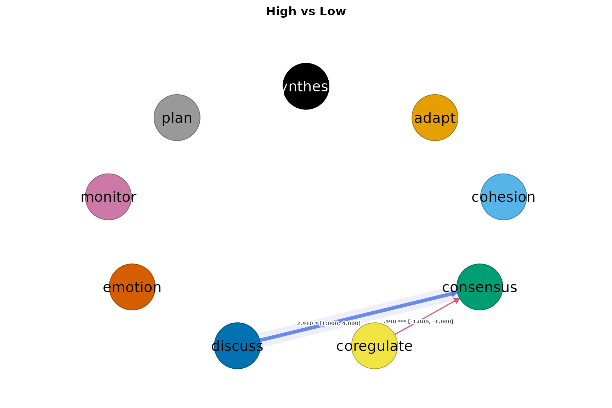

## Bayesian comparison

`test = "bayes"` models the transitions out of each state with a
Dirichlet posterior in each network, with the Jeffreys prior of 0.5
added to every count (Jeffreys, 1946; Johnston & Jendoubi, 2026), and
draws the difference of every edge from the two posteriors (Gelman et
al., 2013). It reports the posterior mean difference, its 95% credible
interval and the probability of direction, the posterior probability
that the difference has the sign of its mean (Makowski et al., 2019).
`bayes_p` is `2 * (1 - pd)`, a two-sided p-value equivalent.

``` r

bayesian <- compare_networks(achievers, test = "bayes", iter = 1000,
                             seed = 1)
summary(bayesian)
```

    ##         pair network_a network_b n_cells n_differing share_higher_a
    ##  High vs Low      High       Low      81          78           0.51
    ##  share_higher_b mean_abs_diff max_abs_diff pearson spearman cosine jaccard
    ##            0.46          0.03         0.21    0.92     0.92   0.95    0.75
    ##              top_edge top_edge_higher n_sig_edges
    ##  discuss -> consensus            High          39

39 transitions have a 95% credible interval that excludes zero, against
42 significant in the permutation test; the two agree on 76 of the 81
cells. The posterior treats the transitions as independent counts, while
the permutation test reassigns whole sequences.

``` r

plot(bayesian, type = "inference")
```

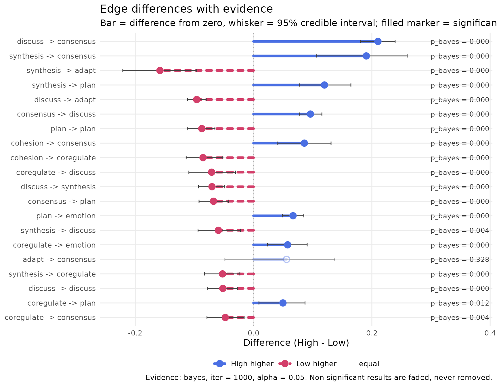

### Practical equivalence

A credible interval that excludes zero says the difference is not zero,
not that it is large enough to matter. `rope` sets a region of practical
equivalence around zero on the difference scale (Kruschke, 2018); here a
difference of up to 0.02 in a transition probability is treated as
negligible. Each edge is classed as `different` when its 95% credible
interval lies entirely outside the region, `equivalent` when it lies
entirely inside, and `undecided` otherwise.

``` r

equivalence <- compare_networks(achievers, test = "bayes", iter = 1000,
                                seed = 1, rope = 0.02)
subset(edge_differences(equivalence), bayes_decision == "different")
```

    ##         pair network_a network_b       from         to weight_a weight_b  diff
    ##  High vs Low      High       Low   cohesion   cohesion     0.04     0.01  0.04
    ##  High vs Low      High       Low   cohesion  consensus     0.54     0.45  0.09
    ##  High vs Low      High       Low   cohesion coregulate     0.08     0.17 -0.09
    ##  High vs Low      High       Low  consensus    discuss     0.23     0.14  0.10
    ##  High vs Low      High       Low  consensus       plan     0.36     0.43 -0.07
    ##  High vs Low      High       Low coregulate    discuss     0.23     0.31 -0.07
    ##  High vs Low      High       Low coregulate    emotion     0.20     0.15  0.06
    ##  High vs Low      High       Low    discuss      adapt     0.02     0.12 -0.10
    ##  High vs Low      High       Low    discuss  consensus     0.42     0.21  0.21
    ##  High vs Low      High       Low    discuss    discuss     0.17     0.22 -0.05
    ##  High vs Low      High       Low    discuss  synthesis     0.11     0.18 -0.07
    ##  High vs Low      High       Low    emotion    discuss     0.12     0.08  0.04
    ##  High vs Low      High       Low       plan    emotion     0.18     0.12  0.07
    ##  High vs Low      High       Low       plan       plan     0.33     0.42 -0.09
    ##  High vs Low      High       Low  synthesis      adapt     0.14     0.30 -0.16
    ##  High vs Low      High       Low  synthesis  consensus     0.58     0.39  0.19
    ##  High vs Low      High       Low  synthesis coregulate     0.01     0.07 -0.05
    ##  High vs Low      High       Low  synthesis    discuss     0.03     0.09 -0.06
    ##  High vs Low      High       Low  synthesis       plan     0.14     0.02  0.12
    ##  abs_diff rel_diff ratio log_ratio rank_a rank_b rank_diff percentile_diff
    ##      0.04     0.74  6.62      0.04     38     11        27            0.33
    ##      0.09     0.09  1.19      0.06     80     80         0               0
    ##      0.09     0.35  0.49     -0.08     47     63       -16           -0.20
    ##      0.10     0.26  1.70      0.08     68     59         9            0.11
    ##      0.07     0.08  0.84     -0.05     76     79        -3           -0.04
    ##      0.07     0.13  0.77     -0.06     69     74        -5           -0.06
    ##      0.06     0.17  1.40      0.05     66     60         6            0.07
    ##      0.10     0.67  0.20     -0.09     28     57       -29           -0.36
    ##      0.21     0.33  1.98      0.16     78     67        11            0.14
    ##      0.05     0.13  0.76     -0.04     63     69        -6           -0.07
    ##      0.07     0.25  0.60     -0.06     53     64       -11           -0.14
    ##      0.04     0.22  1.57      0.04     57     44        13            0.16
    ##      0.07     0.22  1.58      0.06     65     56         9            0.11
    ##      0.09     0.12  0.79     -0.06     74     78        -4           -0.05
    ##      0.16     0.35  0.48     -0.13  59.50     73    -13.50           -0.16
    ##      0.19     0.20  1.49      0.13     81     77         4            0.05
    ##      0.05     0.65  0.22     -0.05     18     39       -21           -0.26
    ##      0.06     0.51  0.33     -0.06  30.50     49    -18.50           -0.22
    ##      0.12     0.71  5.98      0.11  59.50     24     35.50            0.44
    ##  status higher bayes_diff bayes_ci_lower bayes_ci_upper bayes_pd bayes_p
    ##    both   High       0.04           0.02           0.05    1.000   0.000
    ##    both   High       0.09           0.04           0.13    1.000   0.000
    ##    both    Low      -0.08          -0.11          -0.05    1.000   0.000
    ##    both   High       0.10           0.08           0.12    1.000   0.000
    ##    both    Low      -0.07          -0.09          -0.04    1.000   0.000
    ##    both    Low      -0.07          -0.11          -0.03    1.000   0.000
    ##    both   High       0.06           0.02           0.09    1.000   0.000
    ##    both    Low      -0.10          -0.11          -0.08    1.000   0.000
    ##    both   High       0.21           0.18           0.24    1.000   0.000
    ##    both    Low      -0.05          -0.08          -0.03    1.000   0.000
    ##    both    Low      -0.07          -0.09          -0.05    1.000   0.000
    ##    both   High       0.04           0.02           0.07    1.000   0.000
    ##    both   High       0.07           0.05           0.09    1.000   0.000
    ##    both    Low      -0.09          -0.11          -0.07    1.000   0.000
    ##    both    Low      -0.16          -0.22          -0.10    1.000   0.000
    ##    both   High       0.19           0.11           0.26    1.000   0.000
    ##    both    Low      -0.05          -0.08          -0.02    1.000   0.000
    ##    both    Low      -0.06          -0.09          -0.02    0.998   0.004
    ##    both   High       0.12           0.08           0.16    1.000   0.000
    ##  bayes_sig bayes_p_rope bayes_decision  sig evidence
    ##       TRUE        0.010      different TRUE    bayes
    ##       TRUE        0.002      different TRUE    bayes
    ##       TRUE        0.000      different TRUE    bayes
    ##       TRUE        0.000      different TRUE    bayes
    ##       TRUE        0.000      different TRUE    bayes
    ##       TRUE        0.006      different TRUE    bayes
    ##       TRUE        0.015      different TRUE    bayes
    ##       TRUE        0.000      different TRUE    bayes
    ##       TRUE        0.000      different TRUE    bayes
    ##       TRUE        0.005      different TRUE    bayes
    ##       TRUE        0.000      different TRUE    bayes
    ##       TRUE        0.017      different TRUE    bayes
    ##       TRUE        0.000      different TRUE    bayes
    ##       TRUE        0.000      different TRUE    bayes
    ##       TRUE        0.000      different TRUE    bayes
    ##       TRUE        0.000      different TRUE    bayes
    ##       TRUE        0.018      different TRUE    bayes
    ##       TRUE        0.018      different TRUE    bayes
    ##       TRUE        0.000      different TRUE    bayes

19 transitions are different, 22 practically equivalent and 40
undecided. The different ones include the largest differences of the
descriptive comparison, such as `discuss` to `consensus` and `synthesis`
to `adapt`.

### `bayes_compare()`

[`bayes_compare()`](https://pak.dynasite.org/Nestimate/reference/bayes_compare.md)
runs the same model on its own, with 10,000 posterior draws by default.
An edge is credibly different when its 95% interval excludes zero, its
posterior mean difference exceeds 0.01 in absolute value, and the
interval bound nearest zero exceeds 0.001.

``` r

posterior <- bayes_compare(achievers, seed = 1)
head(summary(posterior), 8)
```

    ##    comparison     from         to    weight_x     weight_y count_x count_y
    ## 1 High vs Low    adapt   cohesion 0.257731959 0.2751677852      37     102
    ## 2 High vs Low    adapt  consensus 0.505154639 0.4577181208      73     170
    ## 3 High vs Low    adapt coregulate 0.003436426 0.0308724832       0      11
    ## 4 High vs Low    adapt    discuss 0.037800687 0.0684563758       5      25
    ## 5 High vs Low    adapt    emotion 0.140893471 0.1114093960      20      41
    ## 6 High vs Low    adapt    monitor 0.030927835 0.0362416107       4      13
    ## 7 High vs Low    adapt       plan 0.017182131 0.0174496644       2       6
    ## 8 High vs Low cohesion      adapt 0.005835544 0.0006565988       5       0
    ##            diff effect_size      ci_lower     ci_upper   ci_width p_difference
    ## 1 -0.0174358265 -0.40367227 -0.0996957548  0.069375472 0.16907123       0.6604
    ## 2  0.0474365184  0.97130014 -0.0477451105  0.141177354 0.18892246       0.8275
    ## 3 -0.0274360571 -2.65867974 -0.0485109892 -0.007643052 0.04086794       0.9922
    ## 4 -0.0306556886 -1.48677598 -0.0686210328  0.012374624 0.08099566       0.9274
    ## 5  0.0294840748  0.90266790 -0.0306187996  0.096729522 0.12734832       0.8170
    ## 6 -0.0053137757 -0.30862241 -0.0368038272  0.031956436 0.06876026       0.6535
    ## 7 -0.0002675338 -0.02069695 -0.0223225137  0.028841680 0.05116419       0.5454
    ## 8  0.0051789449  1.98117156  0.0008755307  0.011069356 0.01019383       0.9895
    ##   p_value   sig
    ## 1  0.6792 FALSE
    ## 2  0.3450 FALSE
    ## 3  0.0156  TRUE
    ## 4  0.1452 FALSE
    ## 5  0.3660 FALSE
    ## 6  0.6930 FALSE
    ## 7  0.9092 FALSE
    ## 8  0.0210 FALSE

The table gives each transition’s weight and count in both networks, the
posterior mean difference, an effect size (the difference divided by its
posterior standard deviation), the credible interval and the probability
that the difference has the sign of its mean (`p_difference`). 38
transitions are credibly different. `adapt` to `coregulate` occurs 11
times in Low and never in High; its interval, \[−0.049, −0.008\],
excludes zero.

``` r

plot(posterior)
```

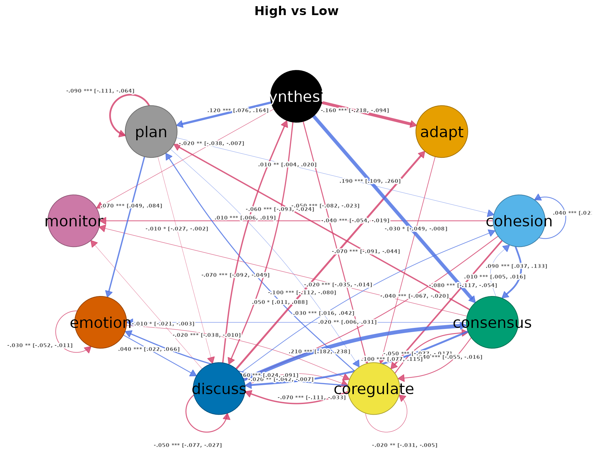

The plot draws the credibly different transitions as a difference
network, blue where High is higher and red where Low is higher, each
edge labelled with its posterior mean difference and credible interval.

## Bootstrap of the structure

`test = "bootstrap"` resamples the nodes of each network (Snijders &
Borgatti, 1999; Davison & Hinkley, 1997) and compares four structural
measures: density, mean weight, centralization and reciprocity. It reads
only the weight matrices, so it also works for matrices without data.

``` r

structural <- compare_networks(achievers, test = "bootstrap", iter = 1000,
                               seed = 1)
subset(global_differences(structural), category == "Structure (bootstrap)")
```

    ##         pair network_a network_b              category         metric
    ##  High vs Low      High       Low Structure (bootstrap)        density
    ##  High vs Low      High       Low Structure (bootstrap)    mean_weight
    ##  High vs Low      High       Low Structure (bootstrap) centralization
    ##  High vs Low      High       Low Structure (bootstrap)    reciprocity
    ##                  key value boot_observed_a boot_observed_b boot_se
    ##         boot_density  0.01            0.96            0.94    0.06
    ##     boot_mean_weight     0            0.12            0.12    0.04
    ##  boot_centralization  0.07            0.59            0.52    0.19
    ##     boot_reciprocity -0.04            0.40            0.43    0.13
    ##  boot_ci_lower boot_ci_upper boot_z boot_p boot_sig
    ##          -0.10          0.13   0.23  0.816    FALSE
    ##          -0.08          0.08   0.01  0.992    FALSE
    ##          -0.30          0.44   0.40  0.693    FALSE
    ##          -0.29          0.22  -0.28  0.783    FALSE

None of the four measures differs (p between 0.69 and 0.99): the two
networks have the same overall structure, and they differ in which
transitions carry the weight.

## Accounting for nesting

Students are nested in teams, and the achievement level is given per
team. With `actor = "Group"`, the permutation test reassigns whole teams
instead of single students, and
[`global_differences()`](https://pak.dynasite.org/Nestimate/reference/comparison_tables.md)
gains three `Nesting` rows.

``` r

nested <- compare_networks(achievers, test = "permutation", iter = 1000,
                           seed = 1, actor = "Group")
subset(global_differences(nested, digits = 3),
       category %in% c("Global Test (permutation)", "Nesting"))
```

    ##         pair network_a network_b                  category
    ##  High vs Low      High       Low Global Test (permutation)
    ##  High vs Low      High       Low Global Test (permutation)
    ##  High vs Low      High       Low                   Nesting
    ##  High vs Low      High       Low                   Nesting
    ##  High vs Low      High       Low                   Nesting
    ##                         metric         key  value perm_p perm_sig
    ##  M (total absolute difference)      perm_M  2.612  0.001     TRUE
    ##                   S (max edge)      perm_S  0.210  0.001     TRUE
    ##                            ICC         icc -0.002     NA       NA
    ##          Design effect (edges)  deff_edges  1.027     NA       NA
    ##              Design effect (M) deff_global  1.201     NA       NA

The intraclass correlation is −0.002, and the design effect is 1.03 for
the transitions and 1.20 for M. The networks still differ overall (M =
2.61, p = 0.001), and 42 transitions remain significant. The article on
nested data describes these quantities.

## More than two networks

[`mark_phases()`](https://pak.dynasite.org/Nestimate/reference/mark_phases.md)
divides each student’s actions into three phases of equal length, and
[`build_network()`](https://pak.dynasite.org/Nestimate/reference/build_network.md)
estimates one network per phase. Every student contributes to all three
phases, so with `actor = "Actor"` the permutation test reassigns each
student’s sequences between phases within the student.
`reference = "early"` compares the other two phases with the first
instead of comparing every pair.

``` r

phased <- mark_phases(group_regulation_long, actor = "Actor", time = "Time",
                      n = 3, labels = c("early", "middle", "late"))
phases <- build_network(phased, method = "relative", actor = "Actor",
                        action = "Action", time = "Time", group = "phase")
over_time <- compare_networks(phases, reference = "early",
                              test = "permutation", iter = 1000, seed = 1,
                              actor = "Actor")
summary(over_time)
```

    ##             pair network_a network_b n_cells n_differing share_higher_a
    ##  early vs middle     early    middle      81          78           0.54
    ##    early vs late     early      late      81          77           0.49
    ##  share_higher_b mean_abs_diff max_abs_diff pearson spearman cosine jaccard
    ##            0.42          0.01         0.08    0.99     0.97   0.99    0.90
    ##            0.46          0.01         0.07    0.99     0.98   0.99    0.90
    ##                top_edge top_edge_higher n_sig_edges n_sig_nodes m_stat   m_p
    ##  synthesis -> consensus          middle           6           1   0.98 0.712
    ##       adapt -> cohesion            late           4           2   0.94 0.720
    ##  s_stat   s_p
    ##    0.08 0.546
    ##    0.07 0.673

The three phases are nearly identical: the edge weights correlate at
0.99 with those of the early phase, and the largest difference is 0.08.
Neither global test is significant (p = 0.71 and 0.72 for M). Six and
four of the 78 transitions differ at the 5% level, about the four that
78 tests at that level produce by chance; `adjust = "BH"` corrects the
edge p-values for the number of tests.

``` r

plot(over_time, type = "edges", pair = "late")
```

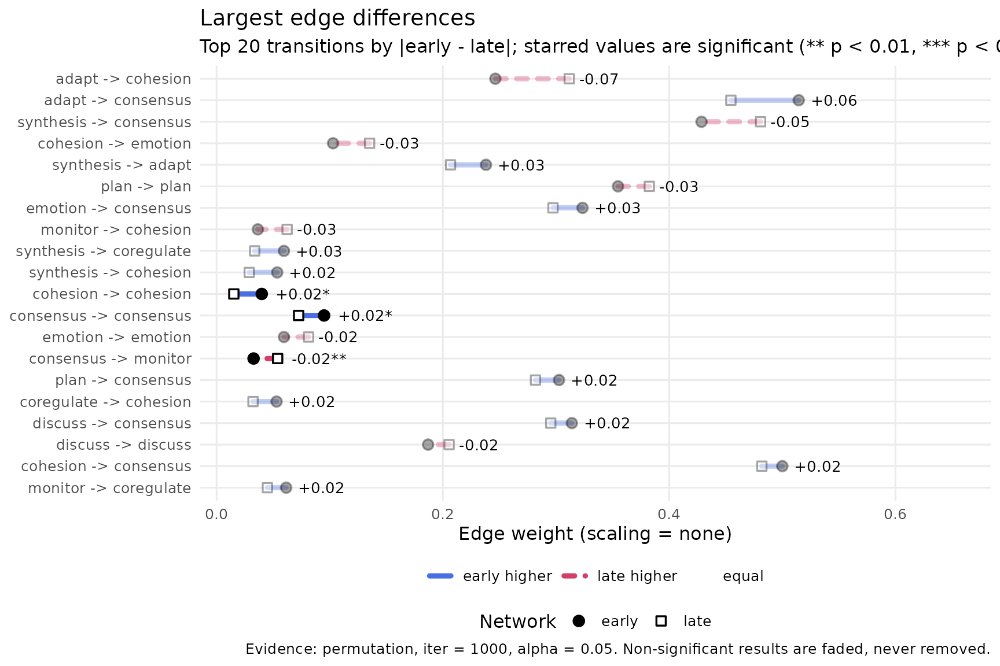

`pair` selects the comparisons a view or a table shows, by the pair
name, the two network names or one network name.

## How to cite this article

Saqr, M., López-Pernas, S., & Misiejuk, K. (2026). *Comparing networks
with compare_networks()*. Nestimate.
<https://doi.org/10.5281/zenodo.24528516> ·
[HTML](https://pak.dynasite.org/Nestimate/articles/compare-networks.html)
· [PDF](https://pak.dynasite.org/Nestimate/pdf/compare-networks.pdf)

## References

Banerjee, A., Chandrasekhar, A. G., Duflo, E., & Jackson, M. O. (2013).
The diffusion of microfinance. *Science*, 341(6144), 1236498.
<https://doi.org/10.1126/science.1236498>

Davison, A. C., & Hinkley, D. V. (1997). *Bootstrap methods and their
application*. Cambridge University Press.
<https://doi.org/10.1017/CBO9780511802843>

Freeman, L. C. (1978). Centrality in social networks: Conceptual
clarification. *Social Networks*, 1(3), 215–239.
<https://doi.org/10.1016/0378-8733(78)90021-7>

Gelman, A., Carlin, J. B., Stern, H. S., Dunson, D. B., Vehtari, A., &
Rubin, D. B. (2013). *Bayesian data analysis* (3rd ed.). CRC Press.

Girvan, M., & Newman, M. E. J. (2002). Community structure in social and
biological networks. *Proceedings of the National Academy of Sciences*,
99(12), 7821–7826. <https://doi.org/10.1073/pnas.122653799>

Jeffreys, H. (1946). An invariant form for the prior probability in
estimation problems. *Proceedings of the Royal Society of London. Series
A*, 186(1007), 453–461. <https://doi.org/10.1098/rspa.1946.0056>

Johnston, L., & Jendoubi, T. (2026). How delivery mode reshapes resource
engagement: A Bayesian differential network analysis. *TNA Workshop
2026*.

Kivimäki, I., Lebichot, B., Saramäki, J., & Saerens, M. (2016). Two
betweenness centrality measures based on randomized shortest paths.
*Scientific Reports*, 6, 19668. <https://doi.org/10.1038/srep19668>

Kruschke, J. K. (2018). Rejecting or accepting parameter values in
Bayesian estimation. *Advances in Methods and Practices in Psychological
Science*, 1(2), 270–280. <https://doi.org/10.1177/2515245918771304>

Makowski, D., Ben-Shachar, M. S., Chen, S. H. A., & Lüdecke, D. (2019).
Indices of effect existence and significance in the Bayesian framework.
*Frontiers in Psychology*, 10, 2767.
<https://doi.org/10.3389/fpsyg.2019.02767>

Onnela, J.-P., Saramäki, J., Kertész, J., & Kaski, K. (2005). Intensity
and coherence of motifs in weighted complex networks. *Physical Review
E*, 71(6), 065103. <https://doi.org/10.1103/PhysRevE.71.065103>

Opsahl, T., Agneessens, F., & Skvoretz, J. (2010). Node centrality in
weighted networks: Generalizing degree and shortest paths. *Social
Networks*, 32(3), 245–251.
<https://doi.org/10.1016/j.socnet.2010.03.006>

Robert, P., & Escoufier, Y. (1976). A unifying tool for linear
multivariate statistical methods: The RV-coefficient. *Journal of the
Royal Statistical Society: Series C (Applied Statistics)*, 25(3),
257–265. <https://doi.org/10.2307/2347233>

Saqr, M., López-Pernas, S., & Misiejuk, K. (2026). Nestimate: An R
package for dynamic, probabilistic, and high order network analysis.
*Applied Psychological Measurement*.
<https://doi.org/10.1177/01466216261472019>

Saqr, M., López-Pernas, S., Törmänen, T., Kaliisa, R., Misiejuk, K., &
Tikka, S. (2025). Transition network analysis: A novel framework for
modeling, visualizing, and identifying the temporal patterns of learners
and learning processes. In *Proceedings of the 15th International
Learning Analytics and Knowledge Conference (LAK25)* (pp. 351–361). ACM.
<https://doi.org/10.1145/3706468.3706513>

Snijders, T. A. B., & Borgatti, S. P. (1999). Non-parametric standard
errors and tests for network statistics. *Connections*, 22(2), 161–170.

Tikka, S., López-Pernas, S., & Saqr, M. (2025). tna: An R package for
transition network analysis. *Applied Psychological Measurement*, 49(6),
326–328. <https://doi.org/10.1177/01466216251348840>
