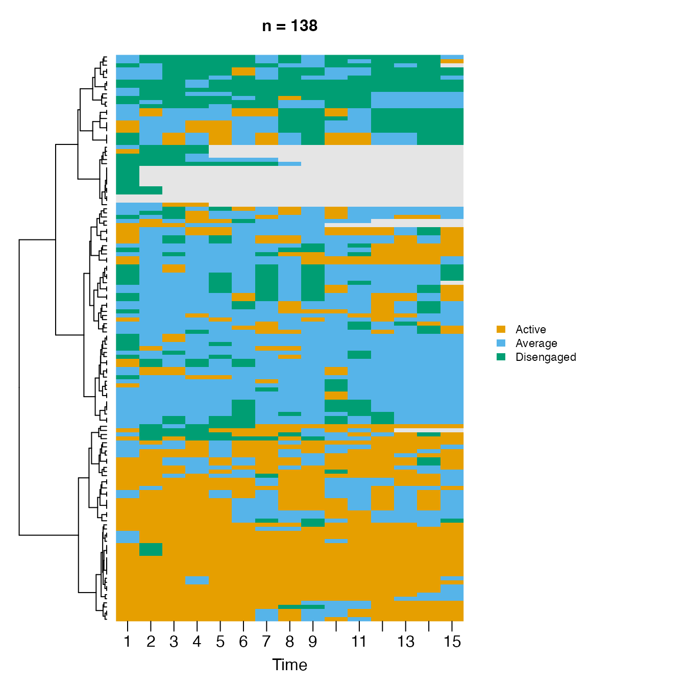
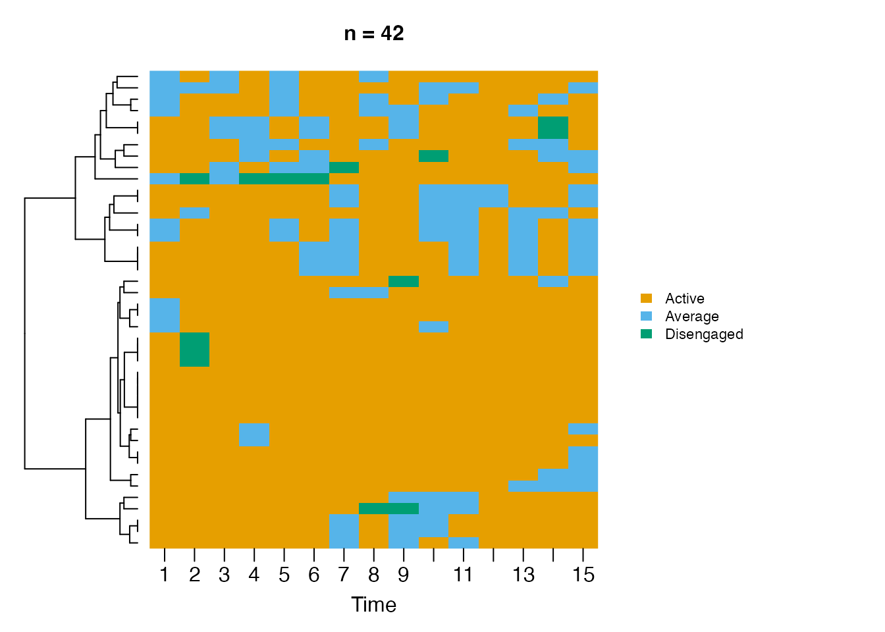
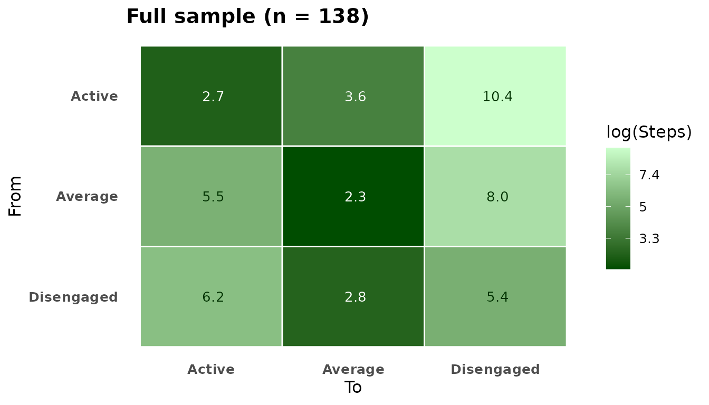
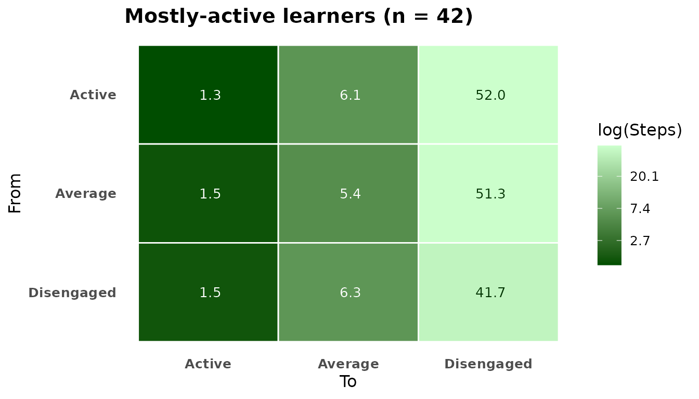
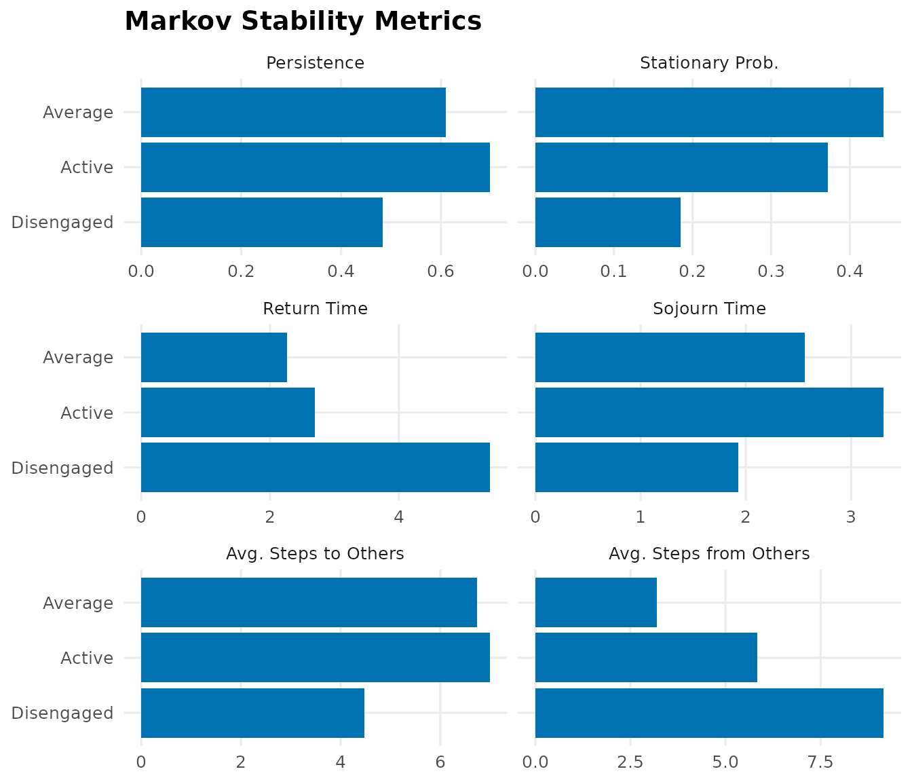
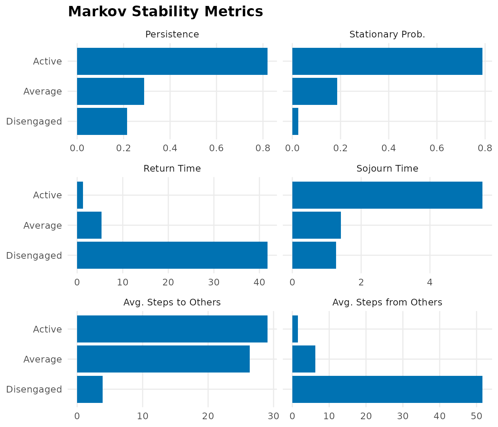

# Markov Stability Analysis

``` r

library(Nestimate)
```

Nestimate provides two functions for Markov-chain stability analysis of
transition networks:

- **[`passage_time()`](https://pak.dynasite.org/Nestimate/reference/passage_time.md)**
  – computes the full matrix of mean first passage times (MFPT). Entry
  M\[i, j\] is the expected number of steps to travel from state *i* to
  state *j* for the first time. The diagonal equals the mean recurrence
  time 1/pi.
- **[`markov_stability()`](https://pak.dynasite.org/Nestimate/reference/markov_stability.md)**
  – computes per-state stability metrics: persistence, stationary
  probability, return time, sojourn time, and mean accessibility.

Both functions accept a `netobject`, `cograph_network`, `tna` object,
row-stochastic matrix, or a raw wide sequence data frame.

------------------------------------------------------------------------

## Data

`trajectories` contains 138 learners recorded at 15 time-steps each with
three engagement states: Active, Average, and Disengaged.

``` r

dim(trajectories)
#> [1] 138  15
table(as.vector(trajectories), useNA = "always")
#> 
#>     Active    Average Disengaged       <NA> 
#>        703        813        354        200
```

------------------------------------------------------------------------

## Selecting mostly-active learners

Does a learner who is mostly engaged stay out of disengagement for
longer, or only visit it less often? To compare, we keep learners who
were Active **more than half the time** (\> 7 of 15 steps; missing weeks
do not count as Active).

``` r

sub <- subset(trajectories, rowSums(trajectories == "Active", na.rm = TRUE) > 7)
nrow(sub)
#> [1] 42
```

------------------------------------------------------------------------

## Sequence plots

``` r

sequence_plot(trajectories, type = "heatmap")
```



``` r

sequence_plot(sub, type = "heatmap")
```



------------------------------------------------------------------------

## Transition networks

``` r

net_all <- build_network(trajectories, method = "relative")
net_sub <- build_network(sub, method = "relative")

net_all
#> Transition Network (relative probabilities) [directed]
#>   Weights: [0.035, 0.698]  |  mean: 0.333
#> 
#>   Weight matrix:
#>              Active Average Disengaged
#>   Active      0.698   0.267      0.035
#>   Average     0.204   0.610      0.186
#>   Disengaged  0.120   0.397      0.483 
#> 
#>   Initial probabilities:
#>   Active        0.382  ████████████████████████████████████████
#>   Average       0.368  ██████████████████████████████████████
#>   Disengaged    0.250  ██████████████████████████
net_sub
#> Transition Network (relative probabilities) [directed]
#>   Weights: [0.017, 0.819]  |  mean: 0.333
#> 
#>   Weight matrix:
#>              Active Average Disengaged
#>   Active      0.819   0.164      0.017
#>   Average     0.683   0.288      0.029
#>   Disengaged  0.643   0.143      0.214 
#> 
#>   Initial probabilities:
#>   Active        0.762  ████████████████████████████████████████
#>   Average       0.238  ████████████
#>   Disengaged    0.000
```

In the mostly-active group nearly every state transitions predominantly
back to Active, and the probability of entering Disengaged is almost
zero.

------------------------------------------------------------------------

## Mean First Passage Times

``` r

pt_all <- passage_time(net_all)
pt_sub <- passage_time(net_sub)
```

``` r

print(pt_all, digits = 2)
#> Mean First Passage Times (3 states)
#> 
#>            Active Average Disengaged
#> Active       2.69    3.63      10.36
#> Average      5.51    2.26       7.97
#> Disengaged   6.16    2.78       5.41
#> 
#> Stationary distribution:
#>     Active    Average Disengaged 
#>     0.3719     0.4431     0.1850
```

``` r

print(pt_sub, digits = 2)
#> Mean First Passage Times (3 states)
#> 
#>            Active Average Disengaged
#> Active       1.27    6.12      51.99
#> Average      1.47    5.36      51.29
#> Disengaged   1.54    6.28      41.75
#> 
#> Stationary distribution:
#>     Active    Average Disengaged 
#>     0.7895     0.1866     0.0240
```

**Active to Disengaged** rises from 10.4 to 52.0 steps – a mostly-active
learner takes five times as long to reach disengagement. The diagonal
equals the mean recurrence time (how many steps between consecutive
visits to the same state).

``` r

plot(pt_all, title = "Full sample (n = 138)")
```



``` r

plot(pt_sub, title = "Mostly-active learners (n = 42)")
```



In the mostly-active heatmap the Active column is uniformly dark
(quickly reachable from any state) and the Disengaged column is
uniformly pale (nearly unreachable).

------------------------------------------------------------------------

## Stationary distribution

The stationary distribution is the long-run share of time spent in each
state.
[`markov_stability()`](https://pak.dynasite.org/Nestimate/reference/markov_stability.md)
reports it per state as `stationary_prob`, beside the other per-state
metrics described in the next section.

``` r

ms_all <- markov_stability(net_all)
ms_sub <- markov_stability(net_sub)

summary(ms_all)
#> Most accessible state (attractor): Average
#> Most persistent state (stickiest): Active
#>        state persistence stationary_prob return_time sojourn_time
#> 1     Active      0.6976          0.3719        2.69         3.31
#> 2    Average      0.6099          0.4431        2.26         2.56
#> 3 Disengaged      0.4831          0.1850        5.41         1.93
#>   avg_time_to_others avg_time_from_others
#> 1               6.99                 5.84
#> 2               6.74                 3.20
#> 3               4.47                 9.16
summary(ms_sub)
#> Most accessible state (attractor): Active
#> Most persistent state (stickiest): Active
#>        state persistence stationary_prob return_time sojourn_time
#> 1     Active      0.8191          0.7895        1.27         5.53
#> 2    Average      0.2885          0.1866        5.36         1.41
#> 3 Disengaged      0.2143          0.0240       41.75         1.27
#>   avg_time_to_others avg_time_from_others
#> 1              29.06                 1.50
#> 2              26.38                 6.20
#> 3               3.91                51.64
```

In the mostly-active group ~79% of long-run time is spent Active (vs 37%
in the full sample).

------------------------------------------------------------------------

## Markov Stability

The per-state table printed above contains:

| Column | Meaning |
|----|----|
| `persistence` | P\[i,i\] – probability of staying at the next step |
| `stationary_prob` | Long-run proportion of time in this state |
| `return_time` | Expected steps between consecutive visits (1/pi) |
| `sojourn_time` | Expected consecutive steps before leaving (1/(1-P\[i,i\])) |
| `avg_time_to_others` | Mean MFPT leaving this state to all others |
| `avg_time_from_others` | Mean MFPT from all other states arriving here |

``` r

plot(ms_all, title = "Full sample")
```



``` r

plot(ms_sub, title = "Mostly-active learners")
```



Among the mostly-active learners, Active leads on persistence (0.82) and
sojourn time (5.5 steps) – once a learner is active they stay active –
and it is also the most accessible state (`avg_time_from_others` 1.5
steps). Disengaged has `avg_time_from_others` of 51.6 steps –
effectively unreachable. In the full sample the most accessible state is
Average (3.2 steps), and Disengaged is reached in 9.2 steps on average.

------------------------------------------------------------------------
