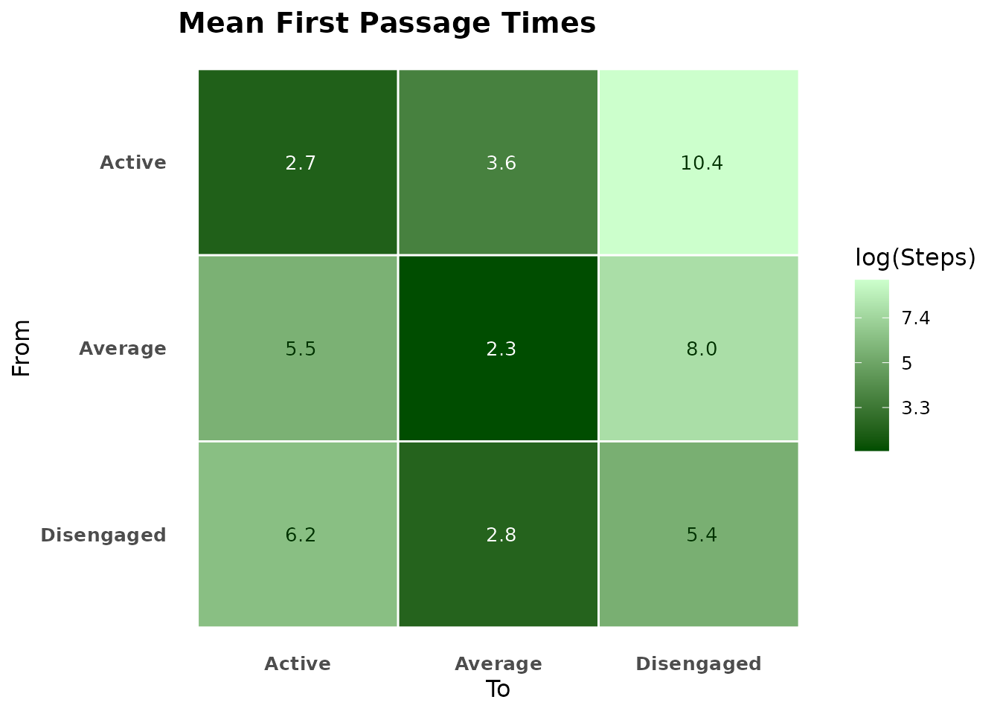
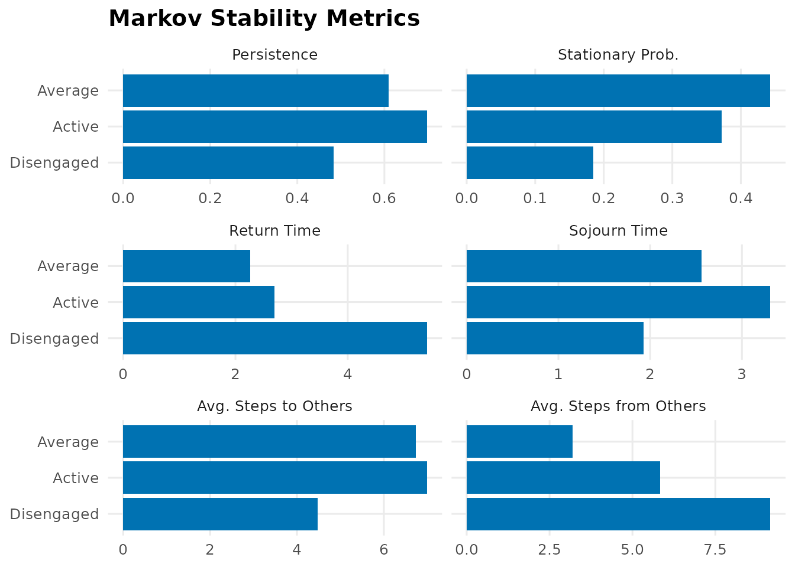
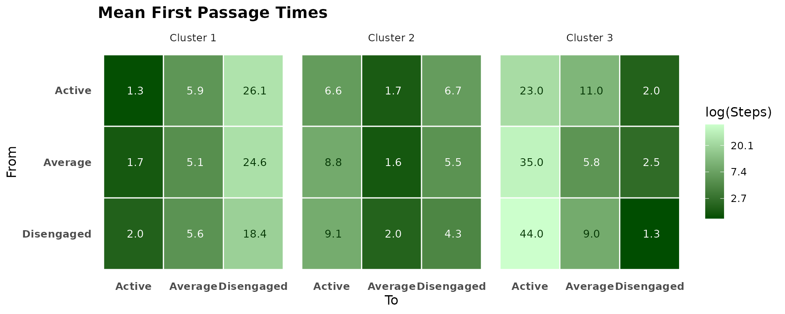
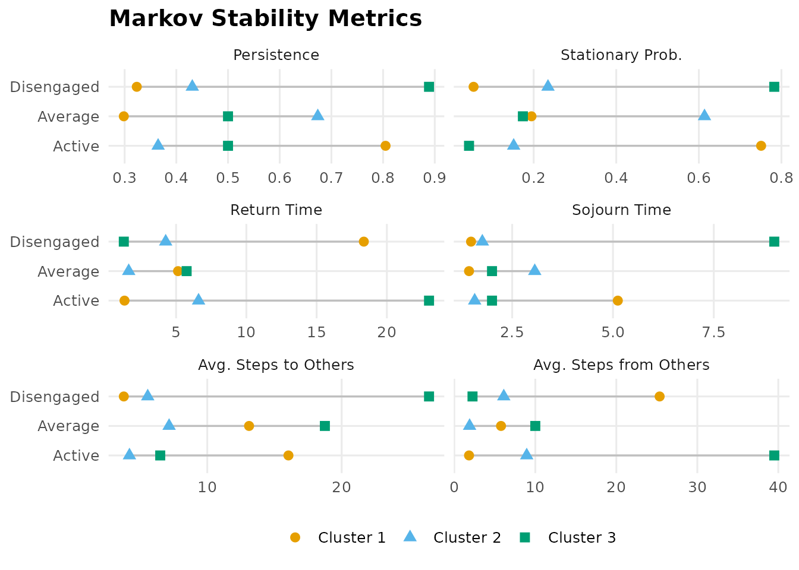

# Markov Stability Analysis

In a complex-systems view of learning, a state is stable when students
who reach it tend to remain in it and students who leave it tend to
return (Saqr, Dever, et al. 2025; Saqr, López-Pernas & Tikka 2026).
López-Pernas and Saqr (2024) described student engagement in these
terms, as the momentum of achievement and the inertia of disengagement.
Markov chain theory measures stability from a transition network (Kemeny
& Snell 1976). For a first-order chain with transition matrix $`P`$ and
stationary distribution $`\pi`$:

- the *persistence* of state $`i`$ is $`P_{ii}`$, the probability of
  remaining in it at the next step;
- the *sojourn time* is $`1 / (1 - P_{ii})`$, the expected number of
  consecutive steps spent in it once entered;
- the *stationary probability* $`\pi_i`$ is the long-run share of steps
  spent in it, and the *return time* $`1 / \pi_i`$ is the expected
  number of steps between two visits;
- the *mean first passage time* $`m_{ij}`$ is the expected number of
  steps to reach state $`j`$ for the first time from state $`i`$.

In Nestimate (Saqr, López-Pernas & Misiejuk 2026),
[`passage_time()`](https://pak.dynasite.org/Nestimate/reference/passage_time.md)
returns the matrix of mean first passage times and
[`markov_stability()`](https://pak.dynasite.org/Nestimate/reference/markov_stability.md)
the per-state measures. Both accept a network, a transition matrix, or a
group of networks.

## Data

`trajectories` records the engagement state of 138 students in each of
the 15 successive courses of a program. The states are the three
engagement states of Saqr and López-Pernas (2021): `Active`, `Average`
and `Disengaged`. Saqr and López-Pernas (2021) and Saqr, López-Pernas,
Jovanović and Gašević (2023) followed such engagement trajectories
across the courses of a full program. The data have one row per student
and one column per course; a missing value occurs only as a run at the
end of a row and marks the point at which a student left the program.

## The transition network

[`build_network()`](https://pak.dynasite.org/Nestimate/reference/build_network.md)
estimates the probability of moving from each state to each state
between consecutive courses.

``` r

library(Nestimate)
net <- build_network(trajectories, method = "relative")
net
#> Transition Network (relative probabilities) [directed]
#>   Weights: [0.035, 0.698]  |  mean: 0.333
#> 
#>   Strongest edges (9 of 9):
#>    from       to         weight
#>    Active     Active     0.698 
#>    Average    Average    0.610 
#>    Disengaged Disengaged 0.483 
#>    Disengaged Average    0.397 
#>    Active     Average    0.267 
#>    Average    Active     0.204 
#>    Average    Disengaged 0.186 
#>    Disengaged Active     0.120 
#>    Active     Disengaged 0.035  
#> 
#>   extract_edges(include_self = TRUE) lists every edge; extract_transition_matrix() gives the weight matrix;
#>   extract_initial_probs() the initial probabilities.
```

The probabilities leaving each state sum to 1. A student who is `Active`
in one course is `Active` in the next with probability 0.698, `Average`
with probability 0.267 and `Disengaged` with probability 0.035. The
measures below are computed from this matrix, so they assume that the
transition probabilities are the same in every course and that the next
state depends only on the current one.

## Mean first passage times

``` r

pt <- passage_time(net)
print(pt, digits = 2)
#> Mean First Passage Times (3 states)
#> 
#>            Active Average Disengaged
#> Active       2.69    3.63      10.36
#> Average      5.51    2.26       7.97
#> Disengaged   6.16    2.78       5.41
#> 
#> Stationary distribution:
#>     Active    Average Disengaged 
#>     0.3719     0.4431     0.1850
plot(pt)
```



Row $`i`$, column $`j`$ of the matrix is the expected number of courses
for a student in state $`i`$ to reach state $`j`$ for the first time;
the diagonal is the return time. A student in `Active` takes 3.6 courses
on average to reach `Average` and 10.4 courses to reach `Disengaged`. In
the reverse direction, a student in `Disengaged` takes 6.2 courses to
reach `Active` and 2.8 courses to reach `Average`. Decline from `Active`
to `Disengaged` is therefore slower than recovery in the opposite
direction, and both pass mostly through `Average`. The values are
expectations under the fitted chain; a value longer than the 15 courses
of the program describes the chain, not a time that was observed.

## Stability of the states

``` r

ms <- markov_stability(net)
summary(ms)
#>        state persistence stationary_prob return_time sojourn_time
#> 1     Active      0.6976          0.3719        2.69         3.31
#> 2    Average      0.6099          0.4431        2.26         2.56
#> 3 Disengaged      0.4831          0.1850        5.41         1.93
#>   avg_time_to_others avg_time_from_others
#> 1               6.99                 5.84
#> 2               6.74                 3.20
#> 3               4.47                 9.16
plot(ms)
```



`persistence`, `stationary_prob`, `return_time` and `sojourn_time` are
the measures defined above. `avg_time_to_others` is the mean passage
time from the state to the other states, and `avg_time_from_others` the
mean passage time from the other states to it; a state with a short
`avg_time_from_others` is reached quickly from anywhere.

`Active` is the most persistent state: its persistence is 0.698 and its
sojourn time 3.31 courses. `Average` is the most accessible: it is
reached from the other states in 3.20 courses on average, and it has the
largest stationary probability, 0.443. `Disengaged` is the least
persistent (0.483, a sojourn of 1.93 courses) and the least accessible
(9.16 courses), and it is the state students spend the least time in
(0.185).

## Groups of students

A single chain for all students averages over students whose engagement
develops differently. Sequence clustering groups the students by the
similarity of their sequences (Saqr, López-Pernas, Helske, et al. 2024),
and a transition network can then be estimated for each group
(López-Pernas, Tikka & Saqr 2025).
[`build_clusters()`](https://pak.dynasite.org/Nestimate/reference/build_clusters.md)
computes the Hamming distance between sequences, the number of courses
in which two students are in different states (Hamming 1950), and
partitions the students around medoids (Kaufman & Rousseeuw 1990). Three
clusters are used here as a working choice.

``` r

clusters <- build_clusters(trajectories, k = 3, seed = 2026)
clusters
#> Sequence Clustering [pam]
#>   Sequences: 138  |  Clusters: 3
#>   Dissimilarity: hamming
#>   Quality: silhouette = 0.360
#> 
#>   Cluster  N           Mean within-dist  Medoid
#>   1        47 (34.1%)  5.898             124
#>   2        74 (53.6%)  8.389             44
#>   3        17 (12.3%)  5.412             103
```

The three clusters have 47, 74 and 17 students. The average silhouette
is 0.36 (Rousseeuw 1987), a moderate separation.
[`build_network()`](https://pak.dynasite.org/Nestimate/reference/build_network.md)
on the clustering estimates one transition network per cluster, and
[`state_distribution()`](https://pak.dynasite.org/Nestimate/reference/state_distribution.md)
shows the states that make up each cluster.

``` r

cluster_networks <- build_network(clusters)
state_distribution(cluster_networks)
#>       group      state count proportion
#> 1 Cluster 1     Active   528 0.75213675
#> 2 Cluster 1    Average   139 0.19800570
#> 3 Cluster 1 Disengaged    35 0.04985755
#> 4 Cluster 2    Average   663 0.60382514
#> 5 Cluster 2 Disengaged   263 0.23952641
#> 6 Cluster 2     Active   172 0.15664845
#> 7 Cluster 3 Disengaged    56 0.80000000
#> 8 Cluster 3    Average    11 0.15714286
#> 9 Cluster 3     Active     3 0.04285714
```

Cluster 1 is mostly `Active` (75% of its observed courses), cluster 2
mostly `Average` (60%), and cluster 3 mostly `Disengaged` (80%).

[`passage_time()`](https://pak.dynasite.org/Nestimate/reference/passage_time.md)
and
[`markov_stability()`](https://pak.dynasite.org/Nestimate/reference/markov_stability.md)
accept the group of networks and compute the measures for each cluster.
[`summary()`](https://rdrr.io/r/base/summary.html) returns one table
with a row for each cluster and state.

``` r

cluster_pt <- passage_time(cluster_networks)
summary(cluster_pt)
#>       group      state return_time stationary mean_out mean_in
#> 1 Cluster 1     Active        1.33     0.7508    16.04    1.82
#> 2 Cluster 1    Average        5.14     0.1947    13.11    5.77
#> 3 Cluster 1 Disengaged       18.36     0.0545     3.79   25.35
#> 4 Cluster 2     Active        6.60     0.1516     4.21    8.94
#> 5 Cluster 2    Average        1.63     0.6137     7.16    1.89
#> 6 Cluster 2 Disengaged        4.26     0.2347     5.57    6.11
#> 7 Cluster 3     Active       23.00     0.0435     6.50   39.50
#> 8 Cluster 3    Average        5.75     0.1739    18.75   10.00
#> 9 Cluster 3 Disengaged        1.28     0.7826    26.50    2.25
plot(cluster_pt)
```



``` r

cluster_ms <- markov_stability(cluster_networks)
summary(cluster_ms)
#>       group      state persistence stationary_prob return_time sojourn_time
#> 1 Cluster 1     Active      0.8048          0.7508        1.33         5.12
#> 2 Cluster 1    Average      0.2984          0.1947        5.14         1.43
#> 3 Cluster 1 Disengaged      0.3235          0.0545       18.36         1.48
#> 4 Cluster 2     Active      0.3648          0.1516        6.60         1.57
#> 5 Cluster 2    Average      0.6737          0.6137        1.63         3.06
#> 6 Cluster 2 Disengaged      0.4309          0.2347        4.26         1.76
#> 7 Cluster 3     Active      0.5000          0.0435       23.00         2.00
#> 8 Cluster 3    Average      0.5000          0.1739        5.75         2.00
#> 9 Cluster 3 Disengaged      0.8889          0.7826        1.28         9.00
#>   avg_time_to_others avg_time_from_others
#> 1              16.04                 1.82
#> 2              13.11                 5.77
#> 3               3.79                25.35
#> 4               4.21                 8.94
#> 5               7.16                 1.89
#> 6               5.57                 6.11
#> 7               6.50                39.50
#> 8              18.75                10.00
#> 9              26.50                 2.25
plot(cluster_ms)
```



In cluster 1, `Active` has persistence 0.805 and a sojourn time of 5.12
courses, and it is reached from the other states in 1.82 courses on
average. `Disengaged` is reached from the other states in 25.35 courses
on average, longer than the program: under this cluster’s chain,
students rarely reach it. In cluster 2, `Average` is the most persistent
state (0.674, a sojourn of 3.06 courses) and the most accessible (1.89
courses), and `Active` takes 8.94 courses to reach. In cluster 3,
`Disengaged` has persistence 0.889 and a sojourn time of 9.00 courses.

The estimates of cluster 3 rest on few observations. Its 17 students
contribute 2 transitions out of `Active` and 8 out of `Average`, so the
persistence of those two states (0.500 each) and the long passage times
to `Active` (39.50 courses from the other states) are not reliable. The
number of transitions out of each state can be checked with
`build_network(clusters, method = "frequency")` before the measures are
interpreted.

## How to cite this article

Saqr, M., López-Pernas, S., & Misiejuk, K. (2026). *Markov stability
analysis*. Nestimate.
[HTML](https://pak.dynasite.org/Nestimate/articles/markov-stability.html)
· [PDF](https://pak.dynasite.org/Nestimate/pdf/markov-stability.pdf)

## References

Hamming, R. W. (1950). Error detecting and error correcting codes. *Bell
System Technical Journal*, 29(2), 147–160.
<https://doi.org/10.1002/j.1538-7305.1950.tb00463.x>

Kaufman, L., & Rousseeuw, P. J. (1990). *Finding groups in data: An
introduction to cluster analysis*. Wiley.
<https://doi.org/10.1002/9780470316801>

Kemeny, J. G., & Snell, J. L. (1976). *Finite Markov chains*. Springer.

López-Pernas, S., & Saqr, M. (2024). How the dynamics of engagement
explain the momentum of achievement and the inertia of disengagement: A
complex systems theory approach. *Computers in Human Behavior*, 153,
108126. <https://doi.org/10.1016/j.chb.2023.108126>

López-Pernas, S., Tikka, S., & Saqr, M. (2025). Mining patterns and
clusters with transition network analysis: A heterogeneity approach. In
M. Saqr & S. López-Pernas (Eds.), *Advanced learning analytics methods:
AI, precision and complexity* (pp. 447–468). Springer.
<https://doi.org/10.1007/978-3-031-95365-1_17>

Rousseeuw, P. J. (1987). Silhouettes: A graphical aid to the
interpretation and validation of cluster analysis. *Journal of
Computational and Applied Mathematics*, 20, 53–65.
<https://doi.org/10.1016/0377-0427(87)90125-7>

Saqr, M., & López-Pernas, S. (2021). The longitudinal trajectories of
online engagement over a full program. *Computers & Education*, 175,
104325. <https://doi.org/10.1016/j.compedu.2021.104325>

Saqr, M., Dever, D., López-Pernas, S., Gernigon, C., Marchand, G., &
Kaplan, A. (2025). Complex dynamic systems in education: Beyond the
static, the linear and the causal reductionism. In M. Saqr & S.
López-Pernas (Eds.), *Advanced learning analytics methods: AI, precision
and complexity* (pp. 289–311). Springer.
<https://doi.org/10.1007/978-3-031-95365-1_12>

Saqr, M., López-Pernas, S., Helske, S., Durand, M., Murphy, K., Studer,
M., & Ritschard, G. (2024). Sequence analysis in education: Principles,
technique, and tutorial with R. In M. Saqr & S. López-Pernas (Eds.),
*Learning analytics methods and tutorials: A practical guide using R*
(pp. 321–354). Springer. <https://doi.org/10.1007/978-3-031-54464-4_10>

Saqr, M., López-Pernas, S., Jovanović, J., & Gašević, D. (2023).
Intense, turbulent, or wallowing in the mire: A longitudinal study of
cross-course online tactics, strategies, and trajectories. *The Internet
and Higher Education*, 57, 100902.
<https://doi.org/10.1016/j.iheduc.2022.100902>

Saqr, M., López-Pernas, S., & Misiejuk, K. (2026). Nestimate: An R
package for dynamic, probabilistic, and high order network analysis.
*Applied Psychological Measurement*.
<https://doi.org/10.1177/01466216261472019>

Saqr, M., López-Pernas, S., & Tikka, S. (2026). Modeling stability and
change from a complex systems perspective. In M. Saqr, K. Misiejuk, & S.
López-Pernas (Eds.), *Innovations in analytics of learning dynamics*
(pp. 51–61). Springer. <https://doi.org/10.1007/978-3-032-34157-0_4>
