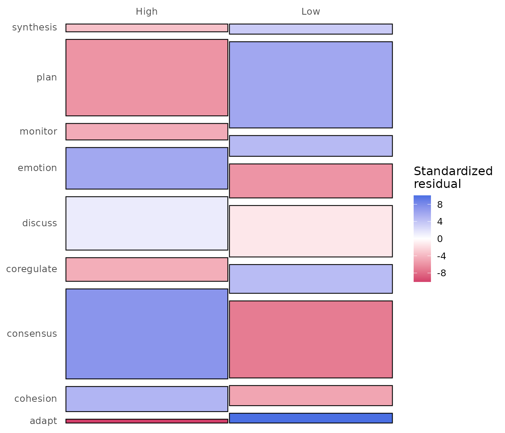
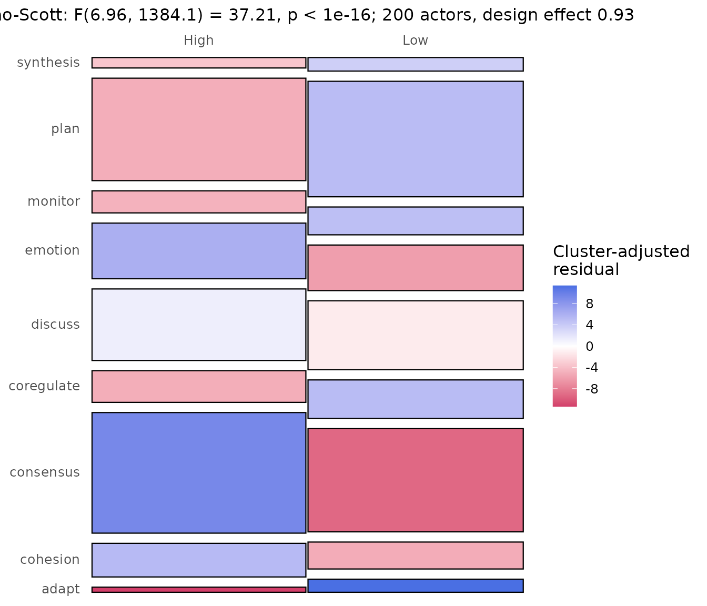
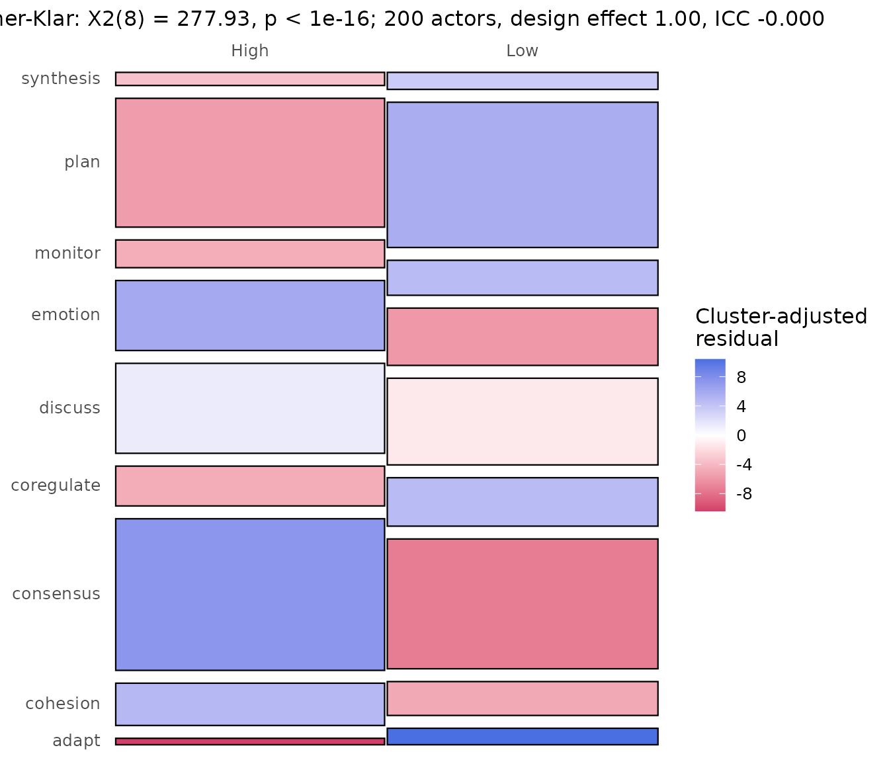
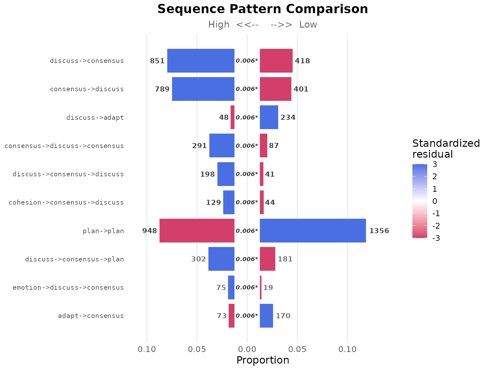

# Nested sequences and the permutation test

Do high and low achievers regulate their group work differently, or do
their teams? In `group_regulation_long`, a synthetic dataset generated
from the `group_regulation` data of the tna package (Tikka, López-Pernas
& Saqr 2025), 2,000 students work in 200 teams of 10, and the
achievement level is given to the team, not to the student. A comparison
of High and Low is therefore a comparison of teams. The students are
nested in teams. The permutation test treats each student’s sequence as
an independent unit, so a nesting effect, teammates behaving alike,
would enter the comparison. The arguments for nested data in Nestimate
(Saqr, López-Pernas & Misiejuk 2026) are `actor` in
[`permutation()`](https://pak.dynasite.org/Nestimate/reference/permutation.md),
[`sequence_compare()`](https://pak.dynasite.org/Nestimate/reference/sequence_compare.md)
and
[`bootstrap_network()`](https://pak.dynasite.org/Nestimate/reference/bootstrap_network.md),
and `nested` with `actor` in
[`mosaic_plot()`](https://pak.dynasite.org/Nestimate/reference/mosaic_plot.md),
[`mosaic_analysis()`](https://pak.dynasite.org/Nestimate/reference/mosaic_analysis.md)
and
[`mosaic_test()`](https://pak.dynasite.org/Nestimate/reference/mosaic_test.md).
Their defaults treat every sequence as an independent unit.

``` r

achievers <- build_network(group_regulation_long, method = "relative",
                           actor = "Actor", action = "Action",
                           time = "Time", group = "Achiever")
achievers
```

    ## Group Networks (2 groups, group_col: Achiever)
    ## 
    ##   Group  Nodes  Edges  Weights
    ##   High   9      76     [0.001, 0.576]
    ##   Low    9      75     [0.000, 0.462]

[`build_network()`](https://pak.dynasite.org/Nestimate/reference/build_network.md)
builds one transition network per achievement level from the students’
action sequences. Both networks have the same nine regulation actions
and 75 to 76 non-zero transitions.

## The ordinary test

``` r

permutation(achievers, iter = 1000, seed = 1)
```

    ## Grouped Permutation Test
    ## Groups: High vs Low 
    ## 
    ## -- High vs Low --
    ## Permutation Test: Transition Network (relative probabilities) [directed]
    ##   Iterations: 1000  |  Alpha: 0.05
    ##   Nodes: 9  |  Edges tested: 78  |  Significant: 42
    ##   Global test (networks differ overall?): M = 2.612 (p = 0.000999)  |  S = 0.210 (p = 0.000999)

[`permutation()`](https://pak.dynasite.org/Nestimate/reference/permutation.md)
pools the 2,000 sequences, reassigns them to High and Low 1,000 times,
and compares the observed differences with the reassigned ones, as in
the permutation test of transition network analysis (Saqr et al. 2025).
Two kinds of result are reported. The edge tests ask, for each
transition, whether the High minus Low difference is larger than the
reassignments produce: 42 of 78 transitions are. The global test asks
whether the two networks differ at all, with two statistics: M, the sum
of all absolute edge differences, and S, the largest one. (These letters
follow
[`permutation()`](https://pak.dynasite.org/Nestimate/reference/permutation.md)’s
convention; in the Network Comparison Test and in
[`nct()`](https://pak.dynasite.org/Nestimate/reference/nct.md), M is the
largest edge difference and S the difference in global strength.) Both
have p = 0.000999, the smallest value 1,000 reassignments can give: no
reassignment produced a difference as large as the observed one.

The test assumes that any student could have been in either group. In
this design only whole teams could, so the next step accounts for the
nesting.

## Reassigning whole teams

``` r

permutation(achievers, iter = 1000, seed = 1, actor = "Group")
```

    ## Grouped Permutation Test
    ## Groups: High vs Low 
    ## 
    ## -- High vs Low --
    ## Permutation Test: Transition Network (relative probabilities) [directed]
    ##   Iterations: 1000  |  Alpha: 0.05  |  Actor: Group (200 actors)
    ##   Nodes: 9  |  Edges tested: 78  |  Significant: 42
    ##   Global test (networks differ overall?): M = 2.612 (p = 0.000999)  |  S = 0.210 (p = 0.000999)
    ##   Nesting in Group: ICC = -0.002 [95% CI -0.006, 0.002]  |  between design
    ##   Design effect (1 = nesting does not matter): edges 1.03  |  global 1.20

`actor = "Group"` tells the test that the sequences are nested in teams.
Each reassignment now moves all ten students of a team together, which
is how the achievement levels were actually given. The observed
differences are the same; only the reference distribution changes.

The edge tests and the global test give the same result as with
student-level reassignment: 42 significant transitions, p = 0.000999 for
M and S. The output also reports the intraclass correlation, ICC =
−0.002 (95% CI −0.006 to 0.002), and the design effect, 1.03 for the
transitions and 1.20 for M. Both are defined and interpreted in the next
section.

A low ICC means that sequences from the same team are about as different
from each other as sequences from different teams: the observations are
close to independent, and an analysis that ignores the nesting gives
nearly the same results as one that accounts for it. Accounting for
nesting becomes necessary when the ICC is not negligible, and more so
when units are large, because the design effect grows with both: Kish’s
(1965) approximation is 1 + (m − 1) × ICC for units of size m. A
commonly cited rule of thumb (Muthén & Satorra 1995) is that design
effects below 2 do not lead to seriously misleading inferences. Here the
ICC is −0.002 and the design effect 1.03, so accounting for the nesting
was not necessary, and the results with and without it were almost the
same.

## The nesting diagnostics

The intraclass correlation (ICC) is the proportion of the total variance
that lies between units rather than within them:

``` math
\text{ICC} = \frac{\sigma^2_{\text{between}}}{\sigma^2_{\text{between}} + \sigma^2_{\text{within}}}.
```

An ICC of 0 means that members of the same unit are no more alike than
members of different units; an ICC of 1 means that all members of a unit
are identical and all variation lies between units. A value in between
is the proportion of variation due to the unit. In
[`permutation()`](https://pak.dynasite.org/Nestimate/reference/permutation.md)
the ICC is computed for each transition: for every student, the share of
their transitions that is, for example, `plan` to `monitor`; the one-way
ANOVA ICC of that share across teams is computed within High and within
Low. The transition ICCs are averaged with weights equal to transition
frequency. The 95% interval comes from the jackknife, leaving out one
team at a time.

The design effect is the ratio of the variance of an estimate under the
nested design to its variance had the units been sampled independently.
Here it is the variance of the reassigned differences when whole teams
move, divided by the variance when single students move. A value of 1
means both reassignments give the same chance variation.

[`permutation_diagnostics()`](https://pak.dynasite.org/Nestimate/reference/permutation_diagnostics.md)
runs the ordinary and the team-level test on the same data and reports
both with these two quantities, one row per compared pair:

``` r

permutation_diagnostics(achievers, actor = "Group", iter = 1000, seed = 1)
```

    ##          pair n_sequences n_actors  design          icc icc_ci_lower
    ## 1 High vs Low        2000      200 between -0.001697397 -0.005641197
    ##   icc_ci_upper deff_edges deff_global p_global_sequence p_global_actor
    ## 1  0.002246402   1.026921    1.200797       0.000999001    0.000999001
    ##   sig_edges_sequence sig_edges_actor edges_changed min_p_actor
    ## 1                 42              42             2 0.000999001

The comparison involves 2,000 sequences in 200 teams. The design is
`between`: every team belongs to one achievement level (`within` would
mean units in both groups, as in repeated measures; `mixed`, some of
each). The ICC is −0.002 with a 95% interval from −0.006 to 0.002, which
indicates little evidence of a nesting effect; a value slightly below
zero is sampling variation around zero. The design effect is 1.03 for
the transitions (median over edges) and 1.20 for the global statistic M.
The global test has p = 0.000999 under both reassignments, and 42
transitions are significant under both. Two transitions change their
conclusion. The smallest p-value the team-level test can produce,
`min_p_actor`, is 0.000999: with 200 teams the number of iterations sets
the limit, not the number of teams.

With `level = "edges"` the same comparison is reported per transition:

``` r

head(permutation_diagnostics(achievers, actor = "Group", iter = 1000,
                             level = "edges", seed = 1), 6)
```

    ##          pair  from         to         diff          icc null_sd_sequence
    ## 1 High vs Low adapt   cohesion -0.014762566  0.010118088       0.03863244
    ## 2 High vs Low adapt  consensus  0.055773975 -0.003796296       0.04560409
    ## 3 High vs Low adapt coregulate -0.029891304  0.002498496       0.01294589
    ## 4 High vs Low adapt    discuss -0.032473790 -0.009052931       0.02104505
    ## 5 High vs Low adapt    emotion  0.030430928 -0.007376103       0.02877059
    ## 6 High vs Low adapt    monitor -0.006957293 -0.003562251       0.01591287
    ##   null_sd_actor      deff p_sequence    p_actor changed
    ## 1    0.04129895 1.1428088 0.68831169 0.72927073   FALSE
    ## 2    0.04255012 0.8705504 0.21378621 0.18981019   FALSE
    ## 3    0.01383698 1.1424014 0.01498501 0.02397602   FALSE
    ## 4    0.01902641 0.8173606 0.11588412 0.09190809   FALSE
    ## 5    0.02727781 0.8989211 0.32267732 0.26373626   FALSE
    ## 6    0.01553230 0.9527393 0.66633367 0.66733267   FALSE

`diff` is the High minus Low transition probability and is the same
under both tests. `icc` is the ICC of that transition.
`null_sd_sequence` and `null_sd_actor` are the spread of the reassigned
differences under student-level and team-level reassignment, and `deff`
is the squared ratio of the two. `p_sequence` and `p_actor` are the two
edge p-values, and `changed` marks a transition that is significant at
0.05 under one test but not the other. In the six rows shown, the ICCs
lie between −0.009 and 0.010 and the design effects between 0.82 and
1.14; the two spreads are close, so the two p-values are close. `adapt`
to `coregulate` has p = 0.015 and p = 0.024 and is significant under
both.

Over all 78 transitions, two change at this seed (`coregulate` to
`adapt`, `emotion` to `plan`), with p-values between 0.047 and 0.072
under both tests. With seeds 2 to 4 a different set of two or three
transitions changes, all with p-values between 0.038 and 0.068. These
changes come from the finite number of reassignments, not from the
nesting. The ICC indicates little evidence of a nesting effect, and the
High–Low difference does not depend on the nesting of students in teams.

## Mosaic plots of nested counts

[`mosaic_plot()`](https://pak.dynasite.org/Nestimate/reference/mosaic_plot.md)
computes the residuals of a group-by-action table. With `nested = TRUE`
the counts are taken team by team (`actor = "Group"`), and the residuals
allow for the dependence of actions within a team. `nested_method`
selects the method: `"rao_scott"` (default), the chi-square corrected
for the design effect of the cluster sample (Rao & Scott, 1984);
`"donner_klar"`, the chi-square adjusted by the intracluster correlation
(Donner & Klar, 1994); `"cmh"`, the Cochran-Mantel-Haenszel test
stratified by team (Landis, Heyman, & Koch, 1978); `"gee"`, a
generalized estimating equation with a cluster-robust covariance (Liang
& Zeger, 1986); and `"glmm"`, a generalized linear mixed model with a
random effect per team (Breslow & Clayton, 1993). `report = TRUE` prints
the overall test and adds it to the plot as a subtitle.

``` r

mosaic_plot(achievers, seed = 1, left_angle = 0)
```



``` r

mosaic_plot(achievers, nested = TRUE, actor = "Group", report = TRUE,
            left_angle = 0)
```

    ##     method      test statistic       df      df2      p_value     n clusters
    ##  rao_scott Rao-Scott  37.21183 6.955041 1384.053 1.065954e-47 27533      200
    ##  design_effect icc
    ##      0.9335922  NA



``` r

mosaic_plot(achievers, nested = TRUE, nested_method = "donner_klar",
            actor = "Group", report = TRUE, left_angle = 0)
```

    ##       method        test statistic df df2      p_value     n clusters
    ##  donner_klar Donner-Klar  277.9254  8  NA 2.038053e-55 27533      200
    ##  design_effect           icc
    ##              1 -0.0002752021



The subtitle and the printed row give the test statistic, its degrees of
freedom, the p-value, the number of teams, and the design effect or the
intracluster correlation where the method estimates one.

The three plots show the same pattern. Low achievers use `adapt` more
often than expected under independence (residual 11.3 with the Rao-Scott
method) and High achievers `consensus` (9.2) and `cohesion` (5.2). The
Rao-Scott design effect is 0.93 and the Donner-Klar intracluster
correlation −0.0003, so counting team by team leaves the residuals and
the test close to those of the pooled counts.

## Tests of association for nested counts

``` r

mosaic_test(achievers, actor = "Group")
```

    ##        method                    test statistic       df      df2      p_value
    ## 1       chisq                 Pearson 277.92541 8.000000       NA 2.038053e-55
    ## 2   rao_scott               Rao-Scott  37.21183 6.955041 1384.053 1.065954e-47
    ## 3 donner_klar             Donner-Klar 277.92541 8.000000       NA 2.038053e-55
    ## 4         cmh Cochran-Mantel-Haenszel        NA       NA       NA           NA
    ## 5         gee                GEE Wald 358.60471 8.000000       NA 1.317864e-72
    ## 6        glmm               GLMM Wald 269.91201 8.000000       NA 1.026755e-53
    ##       n clusters design_effect           icc
    ## 1 27533       NA            NA            NA
    ## 2 27533      200     0.9335922            NA
    ## 3 27533      200     1.0000000 -0.0002752021
    ## 4 27533       NA            NA            NA
    ## 5 27533      200            NA            NA
    ## 6 27533      200            NA            NA
    ##                                                                                                                                       note
    ## 1                                                                                                                                     <NA>
    ## 2                                                                                                                                     <NA>
    ## 3                                                                                                                                     <NA>
    ## 4                                               Cochran-Mantel-Haenszel stratifies by cluster, so both variables must vary within clusters
    ## 5 Wald test with a cluster-robust covariance; liberal unless the actors are many relative to the degrees of freedom (see ?mosaic_analysis)
    ## 6                                                                                                                                     <NA>

[`mosaic_test()`](https://pak.dynasite.org/Nestimate/reference/mosaic_test.md)
returns one row per test: Pearson’s chi-square on the pooled counts and
the five tests for nested counts. A test that the design does not admit
returns `NA` with the reason in `note`. The Cochran-Mantel-Haenszel test
stratifies by team, and the achievement level is constant within each
team, so it cannot be computed here and returns `NA`. `method` selects
tests, and `level = "cells"` returns the residual of every cell.

Every test that can be computed rejects independence: Pearson’s
chi-square is 277.9 (8 df, p \< $`10^{-54}`$), the Rao-Scott F is 37.2
(6.96 and 1,384 df, p \< $`10^{-46}`$), the GEE Wald statistic 358.6 and
the GLMM Wald statistic 269.9 (8 df each). The note to the GEE test
states that its cluster-robust covariance is liberal unless the teams
are many relative to the degrees of freedom; here there are 200 teams
for 8 degrees of freedom.

``` r

head(mosaic_test(achievers, method = "rao_scott", actor = "Group",
                 level = "cells"))
```

    ##      method group     state observed   residual
    ## 1 rao_scott  High     adapt      155 -11.349878
    ## 2 rao_scott   Low     adapt      399  11.349878
    ## 3 rao_scott  High  cohesion     1018   5.193551
    ## 4 rao_scott   Low  cohesion      821  -5.193551
    ## 5 rao_scott  High consensus     3651   9.233770
    ## 6 rao_scott   Low consensus     3146  -9.233770

## Sequence patterns

``` r

set.seed(1)
sequence_compare(achievers, sub = 2:3, iter = 1000, actor = "Group")
```

    ## Sequence Comparison  [322 patterns | 2 groups: High, Low]
    ##   Lengths: 2, 3  |  min_freq: 5  |  permutation: 1000 iter (fdr), actor: Group (200 actors, between)
    ## 
    ##  pattern                       group count prop resid  effect p      
    ##  discuss->consensus            High   851  0.07  12.60 14.71  0.00564
    ##  discuss->consensus            Low    418  0.03 -12.60 14.71  0.00564
    ##  consensus->discuss            High   789  0.06  11.65 14.27  0.00564
    ##  consensus->discuss            Low    401  0.03 -11.65 14.27  0.00564
    ##  discuss->adapt                High    48  0.00 -11.08 12.94  0.00564
    ##  discuss->adapt                Low    234  0.02  11.08 12.94  0.00564
    ##  consensus->discuss->consensus High   291  0.02  10.65 12.61  0.00564
    ##  consensus->discuss->consensus Low     87  0.01 -10.65 12.61  0.00564
    ##  discuss->consensus->discuss   High   198  0.02  10.27 12.08  0.00564
    ##  discuss->consensus->discuss   Low     41  0.00 -10.27 12.08  0.00564
    ##  cohesion->consensus->discuss  High   129  0.01   6.54  9.27  0.00564
    ##  cohesion->consensus->discuss  Low     44  0.00  -6.54  9.27  0.00564
    ##  plan->plan                    High   948  0.07  -8.73  9.01  0.00564
    ##  plan->plan                    Low   1356  0.11   8.73  9.01  0.00564
    ##  discuss->consensus->plan      High   302  0.03   5.65  8.35  0.00564
    ##  discuss->consensus->plan      Low    181  0.02  -5.65  8.35  0.00564
    ##  emotion->discuss->consensus   High    75  0.01   5.83  8.30  0.00564
    ##  emotion->discuss->consensus   Low     19  0.00  -5.83  8.30  0.00564
    ##  adapt->consensus              High    73  0.01  -6.20  8.26  0.00564
    ##  adapt->consensus              Low    170  0.01   6.20  8.26  0.00564
    ##   ... and 312 more patterns (624 rows); summary() returns them all

With `actor = "Group"`, the permutation test of each pattern reassigns
whole teams. The header reports the actor column, the number of actors
and the design: `between` when each team belongs to one group, `within`
when every team has sequences in both groups, `mixed` otherwise.

99 of the 322 patterns of two and three actions differ between High and
Low at an FDR-adjusted p below 0.05. `discuss -> consensus` makes up
6.7% of the patterns of High achievers and 3.3% of those of Low
achievers, and `discuss -> adapt` 0.4% against 1.8%. With 1,000
reassignments and the FDR adjustment over 322 patterns, the smallest
adjusted p-value is 0.0056.

``` r

set.seed(1)
plot(sequence_compare(achievers, sub = 2:3, iter = 1000, actor = "Group"))
```



The plot shows the ten patterns with the largest differences. Each bar
is the pattern’s proportion in one group, labelled with its count, and
its colour is the standardized residual: blue where the group uses the
pattern more often than expected, red where less. `discuss -> consensus`
and `consensus -> discuss` are blue for High achievers; `plan -> plan`
and `discuss -> adapt` are blue for Low achievers.

## Bootstrap

``` r

pooled <- build_network(group_regulation_long, method = "relative",
                        actor = "Actor", action = "Action", time = "Time")
bootstrap_network(pooled, iter = 1000, seed = 1, actor = "Group")
```

    ##   Edge                    Mean     95% CI          p
    ##   ------------------------------------------------
    ##   cohesion → consensus    0.498  [0.474, 0.522]  ***
    ##   adapt → consensus       0.477  [0.437, 0.520]  ***
    ##   synthesis → consensus   0.466  [0.423, 0.506]  ***
    ##   consensus → plan        0.396  [0.384, 0.408]  ***
    ##   monitor → discuss       0.376  [0.353, 0.400]  ***
    ##   ... and 46 more significant edges
    ## 
    ## Bootstrap Network  [Transition Network (relative) | directed]
    ##   Iterations : 1000  |  Nodes : 9
    ##   Edges      : 51 significant / 78 total
    ##   CI         : 95%  |  Inference: stability  |  CR [0.75, 1.25]
    ##   Actor      : Group (200 actors)
    ##   Nesting    : ICC = 0.006 [95% CI 0.002, 0.011]  |  Design effect (edges) = 1.03

With `actor = "Group"`,
[`bootstrap_network()`](https://pak.dynasite.org/Nestimate/reference/bootstrap_network.md)
resamples whole teams, and a resampled team contributes all of its
sequences. The output adds the intracluster correlation and the design
effect of the edges. 51 of the 78 edges keep their size, the ICC is
0.006 (95% CI 0.002 to 0.011) and the design effect 1.03. The ICC is
larger than in the permutation test because it is computed on the pooled
network, where the difference between High and Low teams is part of the
variance between teams.

## Reporting

> Because the data were nested (students in teams; with repeated
> measurements, sessions in students), the two groups were compared with
> a permutation test that accounted for the nesting: in each of 1,000
> permutations, whole teams rather than single sequences were reassigned
> between the groups, so that sequences from the same team stayed
> together. Units that belonged to one group were reassigned as a whole,
> and units that contributed to both groups, as in a repeated-measures
> design, had their sequences reassigned within the unit. The nesting
> effect was quantified with the intraclass correlation (ICC) and the
> design effect, the ratio of the variance under the nested design to
> the variance under independent sampling (ICC = −0.002, 95% CI −0.006
> to 0.002; design effect 1.03 across 200 teams). The networks of high
> and low achievers differed overall (M = 2.61, p \< .001), and 42 of 78
> transitions differed at p \< .05.

## Arguments for nested data

| Function | Argument | Effect |
|----|----|----|
| [`permutation()`](https://pak.dynasite.org/Nestimate/reference/permutation.md) | `actor` | Reassigns whole actors when each actor belongs to one group; reassigns sequences within each actor that has sequences in both groups |
| [`permutation_diagnostics()`](https://pak.dynasite.org/Nestimate/reference/permutation_diagnostics.md) | `actor` | Reports the test with and without the actor-level reassignment, with the ICC and the design effect |
| [`sequence_compare()`](https://pak.dynasite.org/Nestimate/reference/sequence_compare.md) | `actor` | The reassignment scheme of [`permutation()`](https://pak.dynasite.org/Nestimate/reference/permutation.md), applied to the test of each pattern |
| [`bootstrap_network()`](https://pak.dynasite.org/Nestimate/reference/bootstrap_network.md) | `actor` | Resamples whole actors |
| [`mosaic_plot()`](https://pak.dynasite.org/Nestimate/reference/mosaic_plot.md), [`mosaic_analysis()`](https://pak.dynasite.org/Nestimate/reference/mosaic_analysis.md) | `nested`, `nested_method`, `actor`, `report` | Residuals and overall test from the counts of each actor |
| [`mosaic_test()`](https://pak.dynasite.org/Nestimate/reference/mosaic_test.md) | `method`, `actor`, `level` | Pearson’s test and the five nested tests in one table |

The design effect is the ratio of the variance of an estimate under the
nested design to its variance under independent sampling. Kish’s
approximation is 1 + (m − 1) × ICC for m observations per actor. `actor`
applies to transition networks (`relative`, `frequency`,
`co_occurrence`).

## How to cite this article

Saqr, M., López-Pernas, S., & Misiejuk, K. (2026). *Nested sequences and
the permutation test*. Nestimate.
<https://doi.org/10.5281/zenodo.24528518> ·
[HTML](https://pak.dynasite.org/Nestimate/articles/permutation-nested-data.html)
·
[PDF](https://pak.dynasite.org/Nestimate/pdf/permutation-nested-data.pdf)

## References

Breslow, N. E., & Clayton, D. G. (1993). Approximate inference in
generalized linear mixed models. *Journal of the American Statistical
Association*, 88(421), 9–25.
<https://doi.org/10.1080/01621459.1993.10594284>

Donner, A., & Klar, N. (1994). Methods for comparing event rates in
intervention studies when the unit of allocation is a cluster. *American
Journal of Epidemiology*, 140(3), 279–289.
<https://doi.org/10.1093/oxfordjournals.aje.a117247>

Kish, L. (1965). *Survey sampling*. Wiley.

Landis, J. R., Heyman, E. R., & Koch, G. G. (1978). Average partial
association in three-way contingency tables: A review and discussion of
alternative tests. *International Statistical Review*, 46(3), 237–254.
<https://doi.org/10.2307/1402373>

Liang, K.-Y., & Zeger, S. L. (1986). Longitudinal data analysis using
generalized linear models. *Biometrika*, 73(1), 13–22.
<https://doi.org/10.1093/biomet/73.1.13>

Muthén, B. O., & Satorra, A. (1995). Complex sample data in structural
equation modeling. *Sociological Methodology*, 25, 267–316.
<https://doi.org/10.2307/271070>

Rao, J. N. K., & Scott, A. J. (1984). On chi-squared tests for multiway
contingency tables with cell proportions estimated from survey data.
*The Annals of Statistics*, 12(1), 46–60.
<https://doi.org/10.1214/aos/1176346391>

Saqr, M., López-Pernas, S., & Misiejuk, K. (2026). Nestimate: An R
package for dynamic, probabilistic, and high order network analysis.
*Applied Psychological Measurement*.
<https://doi.org/10.1177/01466216261472019>

Saqr, M., López-Pernas, S., Törmänen, T., Kaliisa, R., Misiejuk, K., &
Tikka, S. (2025). Transition network analysis: A novel framework for
modeling, visualizing, and identifying the temporal patterns of learners
and learning processes. In *Proceedings of the 15th International
Learning Analytics and Knowledge Conference (LAK25)* (pp. 351–361). ACM.
<https://doi.org/10.1145/3706468.3706513>

Tikka, S., López-Pernas, S., & Saqr, M. (2025). tna: An R package for
transition network analysis. *Applied Psychological Measurement*, 49(6),
326–328. <https://doi.org/10.1177/01466216251348840>
