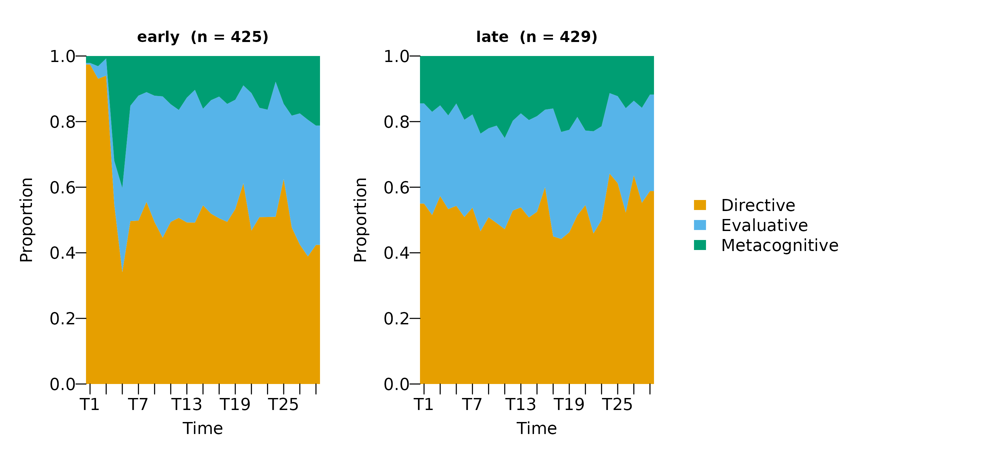
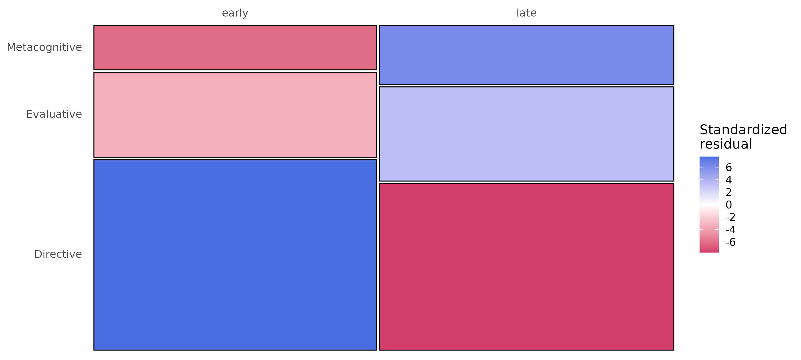
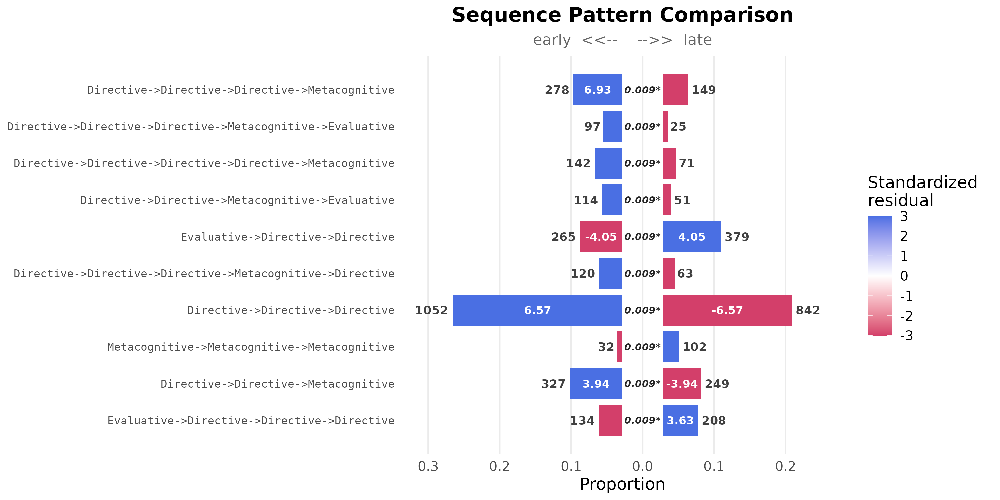
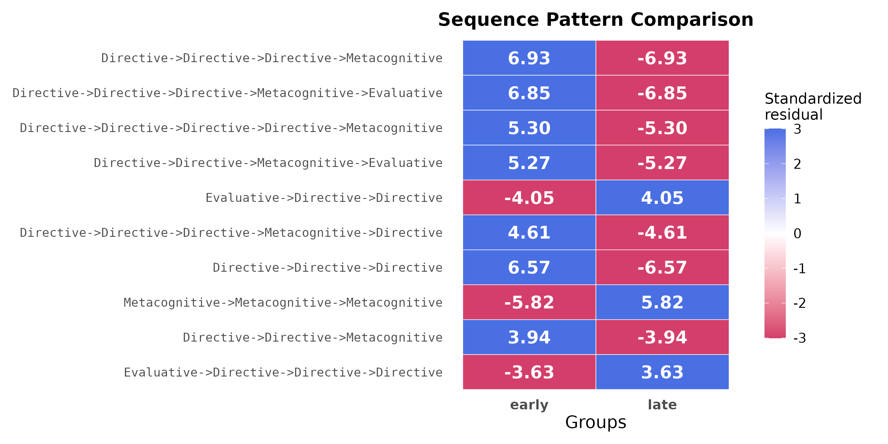
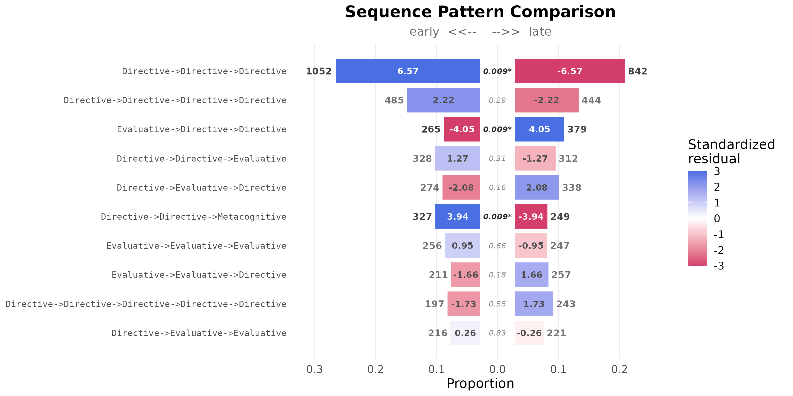
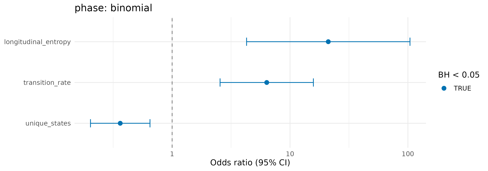

# Comparing Sequences Between Groups: Early vs Late Human-AI Interactions

Two groups of sequences can differ at several levels: in how often each
state occurs, in which state follows which, in summary indices of each
sequence, and in the patterns of states they contain. Nestimate (Saqr,
López-Pernas & Misiejuk 2026) compares sequences at each of these
levels. This vignette applies them to one question: whether people
direct an AI coding assistant differently in the first and the second
half of a session. Temporal patterns within a learning episode have been
used to study how students’ interactions and self-regulation develop
over time (Saqr, Nouri & Fors 2019).

| Question | Function |
|----|----|
| States: are they used in different proportions? | [`mosaic_test()`](https://pak.dynasite.org/Nestimate/reference/mosaic_test.md) |
| Transitions: do their probabilities differ? | [`permutation()`](https://pak.dynasite.org/Nestimate/reference/permutation.md) |
| Sequences: do their summary indices differ? | `sequence_metrics(group = )` |
| Patterns: does a pattern occur more often? | [`sequence_compare()`](https://pak.dynasite.org/Nestimate/reference/sequence_compare.md) |
| Patterns: does a pattern occur in more sequences? | [`sequence_patterns()`](https://pak.dynasite.org/Nestimate/reference/sequence_patterns.md) |
| Jointly: which patterns or indices distinguish the groups? | [`pattern_outcome()`](https://pak.dynasite.org/Nestimate/reference/pattern_outcome.md), [`outcome_model()`](https://pak.dynasite.org/Nestimate/reference/outcome_model.md) |

## Data

`human_long` holds the coded human turns of 429 human-AI
pair-programming (“vibe coding”) sessions across 34 projects, one row
per coded action (Saqr, Misiejuk & López-Pernas 2026; Misiejuk et
al. 2026). The nine action codes are grouped into three clusters,
`Directive`, `Evaluative` and `Metacognitive`, in the column `cluster`,
which is the state used here. `order_in_session` gives the position of
each action within its session.

[`mark_phases()`](https://pak.dynasite.org/Nestimate/reference/mark_phases.md)
orders the actions of each session by `order_in_session` and divides
them into consecutive phases of nearly equal length. With `n = 2`, the
first half of each session is labelled `early` and the second half
`late`; with an odd number of actions, the middle one belongs to the
second half.

``` r

library(Nestimate)
halves <- mark_phases(human_long, actor = "session_id",
                      time = "order_in_session", n = 2,
                      labels = c("early", "late"))
```

[`build_network()`](https://pak.dynasite.org/Nestimate/reference/build_network.md)
with `group = "phase"` estimates one transition network per half and
keeps the half-session sequences, which every function below reads.

``` r

net <- build_network(halves, actor = "session_id", action = "cluster",
                     group = "phase", method = "relative")
net
#> Group Networks (2 groups, group_col: phase)
#> 
#>   Group  Nodes  Edges  Weights
#>   early  3      9      [0.105, 0.637]
#>   late   3      9      [0.131, 0.575]
```

There are 425 early and 429 late half-sessions; the four sessions with a
single action have no early half.

### Nested data

Every session contributes one early and one late half, and the actions
of a session come from the same person, project and AI assistant. The
observations are therefore nested in sessions, and a test that treats
the actions or the half-sessions as independent overstates the evidence
when sessions differ from each other. Each function below has an
argument for the nesting: `actor` for the tests based on counts and
permutations, which then correct for the clustering or shuffle the
labels only within a session (Anderson & ter Braak 2003; Good 2005), and
`group` for the regression models, which then include a random intercept
for each session (Bates et al. 2015).

## States

The first comparison concerns the share of each state, ignoring order.
[`sequence_plot()`](https://pak.dynasite.org/Nestimate/reference/sequence_plot.md)
with `type = "distribution"` shows the share of each state at each
position of the half-sessions. With `na = FALSE` the shares are taken
among the observed actions, and `trim = 0.9` keeps the positions that
hold 90% of the actions, since few half-sessions are longer.

``` r

sequence_plot(net, type = "distribution", na = FALSE, trim = 0.9)
```



Early halves start almost entirely with directives; late halves start
with all three states, and metacognitive actions take a larger share of
the late halves.

[`mosaic_test()`](https://pak.dynasite.org/Nestimate/reference/mosaic_test.md)
cross-tabulates the half against the state and tests the association
with every method for clustered counts. With `actor = "session_id"`, the
sessions are the clusters.

``` r

mosaic_test(net, actor = "session_id")
#>        method                    test statistic       df      df2      p_value
#> 1       chisq                 Pearson  69.78883 2.000000       NA 7.007264e-16
#> 2   rao_scott               Rao-Scott  28.72328 1.973638 844.7172 1.156606e-12
#> 3 donner_klar             Donner-Klar        NA       NA       NA           NA
#> 4         cmh Cochran-Mantel-Haenszel  74.24399 2.000000       NA 7.553064e-17
#> 5         gee                GEE Wald  58.16751 2.000000       NA 2.339297e-13
#> 6        glmm               GLMM Wald  69.33653 2.000000       NA 8.785453e-16
#>       n clusters design_effect icc
#> 1 10796       NA            NA  NA
#> 2 10796      429      1.214848  NA
#> 3 10796       NA            NA  NA
#> 4 10796      421            NA  NA
#> 5 10796      429            NA  NA
#> 6 10796      429            NA  NA
#>                                                                                                                                       note
#> 1                                                                                                                                     <NA>
#> 2                                                                                                                                     <NA>
#> 3                                                                     Donner-Klar needs one variable that is constant within every cluster
#> 4                                                                                                                                     <NA>
#> 5 Wald test with a cluster-robust covariance; liberal unless the actors are many relative to the degrees of freedom (see ?mosaic_analysis)
#> 6                                                                                                                                     <NA>
```

The Pearson chi-square test treats the 10,796 actions as independent.
The Rao-Scott test corrects it for the clustering with a second-order
adjustment (Rao & Scott 1984); the design effect, 1.21, is the factor by
which the clustering inflates the variance. The Cochran-Mantel-Haenszel
test stratifies by session and compares the halves within each of the
421 sessions that have both (Landis, Heyman & Koch 1978). The GEE test
uses a cluster-robust covariance (Liang & Zeger 1986), and the GLMM test
a mixed model with a random intercept per session. The Donner-Klar test
needs one variable that is constant within each cluster (Donner & Klar
1994), and the half varies within every session, so it is not computed.
The four tests that apply all reject independence (Rao-Scott F(1.97,
844.7) = 28.72, CMH = 74.24, GEE = 58.17, GLMM = 69.34; every p \<
0.001).

``` r

mosaic_plot(net)
```



In the mosaic plot, the width of a column is the share of actions in
each half and the height of a tile the share of each state within the
half. The fill is the standardised residual: blue tiles hold more
actions than independence predicts and red tiles fewer. Directives are
over-represented early; evaluations and metacognitive actions late.

## Transitions

The second comparison concerns the transition probabilities, the
probability of each state following each state.
[`permutation()`](https://pak.dynasite.org/Nestimate/reference/permutation.md)
compares the two networks edge by edge and as a whole by shuffling the
`early` and `late` labels and recomputing the differences, which is the
comparison used in transition network analysis (Saqr et al. 2025). With
`actor = "session_id"`, the labels are shuffled only within each
session.

``` r

set.seed(2026)
transitions <- permutation(net, iter = 1000, actor = "session_id")
summary(transitions)
#>           group          from            to  weight_x  weight_y        diff
#> 1 early vs late     Directive     Directive 0.6368638 0.5752445  0.06161928
#> 2 early vs late     Directive    Evaluative 0.2032325 0.2449210 -0.04168853
#> 3 early vs late     Directive Metacognitive 0.1599037 0.1798345 -0.01993075
#> 4 early vs late    Evaluative     Directive 0.4547582 0.4901712 -0.03541302
#> 5 early vs late    Evaluative    Evaluative 0.4407176 0.3792010  0.06151661
#> 6 early vs late    Evaluative Metacognitive 0.1045242 0.1306278 -0.02610359
#> 7 early vs late Metacognitive     Directive 0.4494048 0.3964497  0.05295506
#> 8 early vs late Metacognitive    Evaluative 0.3690476 0.2875740  0.08147365
#> 9 early vs late Metacognitive Metacognitive 0.1815476 0.3159763 -0.13442871
#>   effect_size     p_value   sig
#> 1    4.767254 0.000999001  TRUE
#> 2   -3.424018 0.000999001  TRUE
#> 3   -2.005723 0.046953047  TRUE
#> 4   -1.813544 0.062937063 FALSE
#> 5    3.231657 0.002997003  TRUE
#> 6   -2.159258 0.027972028  TRUE
#> 7    2.060593 0.033966034  TRUE
#> 8    3.324027 0.002997003  TRUE
#> 9   -4.926942 0.000999001  TRUE
```

`weight_x` and `weight_y` are the transition probabilities of the early
and the late half, `diff` their difference, and `effect_size` the
difference divided by the standard deviation of the permuted
differences. Eight of the nine transitions differ. The global statistic
M, the sum of the absolute edge differences, is 0.515, and no
permutation reached it (p = 0.001, the smallest value 1,000 permutations
can give). The largest difference concerns a metacognitive action
followed by another: its probability is 0.18 in the first half and 0.32
in the second.

## Sequence indices

The third comparison summarises each half-session with indices of its
composition and dynamics, such as the number of distinct states, the
evenness of the states (longitudinal entropy), the share of consecutive
actions that change state (transition rate) and the mean length of a
spell in one state (Gabadinho et al. 2011).
[`sequence_metrics()`](https://pak.dynasite.org/Nestimate/reference/sequence_metrics.md)
computes them for every sequence; for a grouped network it compares each
index between the groups. For each index it reports the number of
half-sessions, the mean and the standard deviation of each half; the
difference between the means (late minus early); Hedges’ g, the
standardised difference corrected for small samples, with its 95%
interval (Hedges 1981); eta squared, the share of the index’s variance
between the halves; and a permutation p-value of the one-way F
statistic, adjusted with the Benjamini-Hochberg method. The network was
built with `actor = "session_id"`, so the labels are shuffled within
each session.

``` r

set.seed(2026)
sequence_metrics(net)
#> Sequence metrics by phase  [19 indices | 2 groups: early, late]
#>   permutation of the one-way F: 1000 iter (BH), within session
#> 
#>  index                 group n   mean  sd    diff  g     g_lo  g_hi  eta_sq
#>  valid_n               early 425 12.44 12.00  0.40  0.03 -0.10  0.17 0.00  
#>  valid_n               late  429 12.84 11.98  0.40  0.03 -0.10  0.17 0.00  
#>  valid_proportion      early 425  1.00  0.00  0.00    NA    NA    NA   NA  
#>  valid_proportion      late  429  1.00  0.00  0.00    NA    NA    NA   NA  
#>  unique_states         early 425  2.42  0.74  0.20  0.31  0.17  0.44 0.02  
#>  unique_states         late  429  2.62  0.58  0.20  0.31  0.17  0.44 0.02  
#>  mean_spell_duration   early 425  2.21  0.93 -0.36 -0.41 -0.54 -0.27 0.04  
#>  mean_spell_duration   late  429  1.85  0.84 -0.36 -0.41 -0.54 -0.27 0.04  
#>  max_spell_duration    early 425  3.97  1.75 -0.28 -0.14 -0.28 -0.01 0.01  
#>  max_spell_duration    late  429  3.69  2.16 -0.28 -0.14 -0.28 -0.01 0.01  
#>  longitudinal_entropy  early 425  0.61  0.30  0.13  0.47  0.33  0.60 0.05  
#>  longitudinal_entropy  late  429  0.73  0.24  0.13  0.47  0.33  0.60 0.05  
#>  simpson_diversity     early 425  0.41  0.20  0.09  0.50  0.36  0.63 0.06  
#>  simpson_diversity     late  429  0.50  0.16  0.09  0.50  0.36  0.63 0.06  
#>  self_loop_tendency    early 418  0.59  0.23 -0.14 -0.60 -0.74 -0.46 0.08  
#>  self_loop_tendency    late  423  0.45  0.22 -0.14 -0.60 -0.74 -0.46 0.08  
#>  transition_rate       early 418  0.41  0.23  0.14  0.60  0.46  0.74 0.08  
#>  transition_rate       late  423  0.55  0.22  0.14  0.60  0.46  0.74 0.08  
#>  transition_complexity early 425  0.47  0.31  0.06  0.20  0.07  0.34 0.01  
#>  transition_complexity late  429  0.53  0.27  0.06  0.20  0.07  0.34 0.01  
#>  F     p        p_adj 
#>   0.24 0.000999 0.0015
#>   0.24 0.000999 0.0015
#>     NA NA       NA    
#>     NA NA       NA    
#>  20.03 0.000999 0.0015
#>  20.03 0.000999 0.0015
#>  35.24 0.000999 0.0015
#>  35.24 0.000999 0.0015
#>   4.38 0.00999  0.012 
#>   4.38 0.00999  0.012 
#>  46.76 0.000999 0.0015
#>  46.76 0.000999 0.0015
#>  52.75 0.000999 0.0015
#>  52.75 0.000999 0.0015
#>  75.70 0.000999 0.0015
#>  75.70 0.000999 0.0015
#>  75.70 0.000999 0.0015
#>  75.70 0.000999 0.0015
#>   8.65 0.000999 0.0015
#>   8.65 0.000999 0.0015
#>   ... and 9 more indices (18 rows); summary() returns them all
```

Most indices differ between the halves. The largest differences concern
the opening state: in the late halves it holds a smaller share of the
half-session (`initial_state_proportion`, 0.67 against 0.51, g = -0.78
\[-0.92, -0.64\]) and is left sooner (`initial_state_persistence`, g =
-0.70). Late halves change state more often (`transition_rate`, 0.41
against 0.55, g = 0.60 \[0.46, 0.74\]), spend less time in their
dominant state (`dominant_proportion`, g = -0.53) and in each spell
(`mean_spell_duration`, 2.22 against 1.86 actions, g = -0.41), and
spread their actions more evenly (`longitudinal_entropy`, 0.61 against
0.74, g = 0.47; `simpson_diversity`, g = 0.50). `self_loop_tendency` is
one minus the transition rate, so its test is the same. Three rows need
no interpretation. The late half is never shorter than the early half,
because
[`mark_phases()`](https://pak.dynasite.org/Nestimate/reference/mark_phases.md)
puts the middle action of an odd-length session in the second half, so
`valid_n` differs although the means are almost equal (12.4 against
12.8, g = 0.03). `valid_proportion` is 1 for every half-session and
cannot be compared. The two indices of the emergent state are defined
only for the half-sessions that have one (161 early, 240 late) and do
not differ.

## Patterns

A pattern is a sequence of consecutive states, such as
`Directive->Directive->Evaluative`, a k-gram of length 3. The halves can
differ in how often a pattern occurs, which weighs each half-session by
how often it repeats the pattern, and in how many half-sessions contain
it, which counts each half-session once.

### How often a pattern occurs

For each pattern length in `sub` (3 to 5 by default),
[`sequence_compare()`](https://pak.dynasite.org/Nestimate/reference/sequence_compare.md)
counts every pattern in each half and keeps the patterns that occur at
least `min_freq` times in both. The standardised residual compares a
half’s count with the count expected if pattern and half were
independent, in approximately standard-normal units (Haberman 1973). The
permutation test shuffles the labels within sessions (`actor`), and the
p-values are adjusted with the false discovery rate (Benjamini &
Hochberg 1995).

``` r

set.seed(20260413)
counts <- sequence_compare(net, min_freq = 25L, test = "permutation",
                           iter = 1000L, actor = "session_id")
counts
#> Sequence Comparison  [100 patterns | 2 groups: early, late]
#>   Lengths: 3, 4, 5  |  min_freq: 25  |  permutation: 1000 iter (fdr), actor: session_id (429 actors, mixed)
#> 
#>  pattern                                                    group count prop
#>  Directive->Directive->Directive->Metacognitive             early  278  0.07
#>  Directive->Directive->Directive->Metacognitive             late   149  0.04
#>  Directive->Directive->Directive->Metacognitive->Evaluative early   97  0.03
#>  Directive->Directive->Directive->Metacognitive->Evaluative late    25  0.01
#>  Directive->Directive->Directive->Directive->Metacognitive  early  142  0.04
#>  Directive->Directive->Directive->Directive->Metacognitive  late    71  0.02
#>  Directive->Directive->Metacognitive->Evaluative            early  114  0.03
#>  Directive->Directive->Metacognitive->Evaluative            late    51  0.01
#>  Evaluative->Directive->Directive                           early  265  0.06
#>  Evaluative->Directive->Directive                           late   379  0.08
#>  Directive->Directive->Directive->Metacognitive->Directive  early  120  0.03
#>  Directive->Directive->Directive->Metacognitive->Directive  late    63  0.02
#>  Directive->Directive->Directive                            early 1052  0.24
#>  Directive->Directive->Directive                            late   842  0.18
#>  Metacognitive->Metacognitive->Metacognitive                early   32  0.01
#>  Metacognitive->Metacognitive->Metacognitive                late   102  0.02
#>  Directive->Directive->Metacognitive                        early  327  0.07
#>  Directive->Directive->Metacognitive                        late   249  0.05
#>  Evaluative->Directive->Directive->Directive                early  134  0.03
#>  Evaluative->Directive->Directive->Directive                late   208  0.05
#>  resid effect p      
#>   6.93 11.31  0.00908
#>  -6.93 11.31  0.00908
#>   6.85 10.81  0.00908
#>  -6.85 10.81  0.00908
#>   5.30  8.39  0.00908
#>  -5.30  8.39  0.00908
#>   5.27  7.23  0.00908
#>  -5.27  7.23  0.00908
#>  -4.05  7.12  0.00908
#>   4.05  7.12  0.00908
#>   4.61  6.46  0.00908
#>  -4.61  6.46  0.00908
#>   6.57  6.25  0.00908
#>  -6.57  6.25  0.00908
#>  -5.82  5.73  0.00908
#>   5.82  5.73  0.00908
#>   3.94  5.66  0.00908
#>  -3.94  5.66  0.00908
#>  -3.63  5.24  0.00908
#>   3.63  5.24  0.00908
#>   ... and 90 more patterns (180 rows); summary() returns them all
```

The printout shows one row per pattern and half: `count` is how often
the pattern occurs in the half, `prop` its share of the half’s patterns
of that length, `resid` the standardised residual, and `effect` the
number of standard deviations by which the observed statistic exceeds
the mean of the permuted ones; `effect` and `p` belong to the pattern
and repeat on its two rows. `summary(counts, format = "long")` returns
that table for every pattern, and `summary(counts)` one row per pattern.
Of the 100 patterns tested, 18 differ at a false discovery rate of 0.05:
11 are more frequent early and 7 late. Directives followed by a
metacognitive action are more frequent early
(`Directive->Directive->Directive->Metacognitive`, 278 against 149), and
patterns that start with an evaluation and continue with directives are
more frequent late (`Evaluative->Directive->Directive`, 265 against
379).

``` r

plot(counts, style = "pyramid", show_residuals = TRUE)
```



The pyramid shows the patterns with the largest differences, the first
half on the left and the second on the right, each pattern’s count
beside its bar, its residual inside the bar when the bar is wide enough,
and its p-value in the middle. The heatmap shows the same residuals as a
grid of patterns by halves, the layout used for more than two groups.

``` r

plot(counts, style = "heatmap")
```



By default the patterns are ranked by the test statistic;
`sort = "frequency"` ranks them by their total count instead, which
shows the most common patterns whatever their difference.

``` r

plot(counts, style = "pyramid", sort = "frequency", show_residuals = TRUE)
```



### How many sequences contain a pattern

Support is the share of sequences that contain a pattern at least once
(Agrawal & Srikant 1995).
[`sequence_patterns()`](https://pak.dynasite.org/Nestimate/reference/sequence_patterns.md)
reports the support of each pattern and, for a group of networks,
compares it between the groups with Fisher’s exact test and an odds
ratio with its 95% interval; the odds ratios are those of the late half,
and `p_adj` is adjusted with the Benjamini-Hochberg method. Fisher’s
test treats the half-sessions as independent samples, so these p-values
do not take the sessions into account. Four kinds of pattern are
compared.

#### Contiguous patterns

``` r

ngrams <- sequence_patterns(net, type = "ngram", len = 3:4, min_freq = 25)
ngrams
#> Sequence patterns by phase  [95 patterns | 2 groups: early, late]
#>   presence test: Fisher's exact, odds ratio against early (BH)
#> 
#>  pattern                                         n_sequences support group
#>  Directive->Directive->Directive                 630         0.74    early
#>  Directive->Directive->Directive                 630         0.74    late 
#>  Directive->Directive->Directive->Metacognitive  362         0.42    early
#>  Directive->Directive->Directive->Metacognitive  362         0.42    late 
#>  Directive->Directive->Directive->Directive      385         0.45    early
#>  Directive->Directive->Directive->Directive      385         0.45    late 
#>  Directive->Directive->Metacognitive             435         0.51    early
#>  Directive->Directive->Metacognitive             435         0.51    late 
#>  Directive->Directive->Metacognitive->Evaluative 150         0.18    early
#>  Directive->Directive->Metacognitive->Evaluative 150         0.18    late 
#>  Evaluative->Directive->Directive                389         0.46    early
#>  Evaluative->Directive->Directive                389         0.46    late 
#>  Evaluative->Directive->Directive->Directive     250         0.29    early
#>  Evaluative->Directive->Directive->Directive     250         0.29    late 
#>  Metacognitive->Metacognitive->Metacognitive      65         0.08    early
#>  Metacognitive->Metacognitive->Metacognitive      65         0.08    late 
#>  Directive->Directive->Metacognitive->Directive  197         0.23    early
#>  Directive->Directive->Metacognitive->Directive  197         0.23    late 
#>  Directive->Metacognitive->Directive->Evaluative  70         0.08    early
#>  Directive->Metacognitive->Directive->Evaluative  70         0.08    late 
#>  group_support odds_ratio or_lower or_upper p_value  p_adj   
#>  0.88          0.20       0.13     0.28     1.92e-22 1.82e-20
#>  0.59          0.20       0.13     0.28     1.92e-22 1.82e-20
#>  0.57          0.29       0.21     0.39     2.67e-18 1.27e-16
#>  0.28          0.29       0.21     0.39     2.67e-18 1.27e-16
#>  0.55          0.46       0.35     0.61     3.43e-08 1.09e-06
#>  0.36          0.46       0.35     0.61     3.43e-08 1.09e-06
#>  0.60          0.48       0.36     0.64     1.34e-07 3.18e-06
#>  0.42          0.48       0.36     0.64     1.34e-07 3.18e-06
#>  0.24          0.39       0.26     0.57     3.71e-07 7.05e-06
#>  0.11          0.39       0.26     0.57     3.71e-07 7.05e-06
#>  0.37          2.01       1.51     2.67     5.16e-07 8.17e-06
#>  0.54          2.01       1.51     2.67     5.16e-07 8.17e-06
#>  0.22          2.11       1.54     2.89     1.35e-06 1.83e-05
#>  0.37          2.11       1.54     2.89     1.35e-06 1.83e-05
#>  0.04          2.56       1.44     4.72     0.000692 0.00822 
#>  0.11          2.56       1.44     4.72     0.000692 0.00822 
#>  0.28          0.57       0.41     0.80     0.00084  0.00887 
#>  0.18          0.57       0.41     0.80     0.00084  0.00887 
#>  0.11          0.42       0.24     0.73     0.0011   0.0104  
#>  0.05          0.42       0.24     0.73     0.0011   0.0104  
#>   ... and 85 more patterns (170 rows); summary() returns them all
```

Of the 95 patterns, 20 differ in support at an adjusted level of 0.05: 8
occur in a larger share of early halves and 12 in a larger share of late
halves. `Directive->Directive->Directive` occurs in 88% of the early
halves and 59% of the late halves (odds ratio 0.20 \[0.13, 0.28\]), and
`Evaluative->Directive->Directive` in 37% and 54% (2.01 \[1.51, 2.67\]).

#### Two states with others between them

A gapped pattern fixes two states and allows any states between them:
`Evaluative->*->Directive` is an evaluation followed by a directive two
positions later, `Evaluative->**->Directive` three positions later.

``` r

gaps <- sequence_patterns(net, type = "gapped", gap = 1:2, min_freq = 25)
gaps
#> Sequence patterns by phase  [18 patterns | 2 groups: early, late]
#>   presence test: Fisher's exact, odds ratio against early (BH)
#> 
#>  pattern                          n_sequences support group group_support
#>  Directive->*->Directive          723         0.85    early 0.92         
#>  Directive->*->Directive          723         0.85    late  0.77         
#>  Evaluative->**->Directive        421         0.49    early 0.39         
#>  Evaluative->**->Directive        421         0.49    late  0.60         
#>  Evaluative->*->Directive         477         0.56    early 0.47         
#>  Evaluative->*->Directive         477         0.56    late  0.65         
#>  Directive->**->Metacognitive     507         0.59    early 0.67         
#>  Directive->**->Metacognitive     507         0.59    late  0.52         
#>  Evaluative->*->Metacognitive     251         0.29    early 0.22         
#>  Evaluative->*->Metacognitive     251         0.29    late  0.37         
#>  Evaluative->**->Metacognitive    212         0.25    early 0.19         
#>  Evaluative->**->Metacognitive    212         0.25    late  0.31         
#>  Metacognitive->**->Metacognitive 150         0.18    early 0.12         
#>  Metacognitive->**->Metacognitive 150         0.18    late  0.23         
#>  Directive->*->Metacognitive      501         0.59    early 0.64         
#>  Directive->*->Metacognitive      501         0.59    late  0.53         
#>  Metacognitive->*->Metacognitive  183         0.21    early 0.17         
#>  Metacognitive->*->Metacognitive  183         0.21    late  0.26         
#>  Directive->**->Directive         634         0.74    early 0.78         
#>  Directive->**->Directive         634         0.74    late  0.71         
#>  odds_ratio or_lower or_upper p_value  p_adj   
#>  0.27       0.17     0.42     1.79e-10 3.22e-09
#>  0.27       0.17     0.42     1.79e-10 3.22e-09
#>  2.33       1.76     3.10     1.06e-09 9.54e-09
#>  2.33       1.76     3.10     1.06e-09 9.54e-09
#>  2.05       1.54     2.72     3.18e-07 1.91e-06
#>  2.05       1.54     2.72     3.18e-07 1.91e-06
#>  0.52       0.39     0.69     2.94e-06 1.32e-05
#>  0.52       0.39     0.69     2.94e-06 1.32e-05
#>  2.03       1.49     2.78     4.26e-06 1.53e-05
#>  2.03       1.49     2.78     4.26e-06 1.53e-05
#>  1.97       1.41     2.75     2.65e-05 7.94e-05
#>  1.97       1.41     2.75     2.65e-05 7.94e-05
#>  2.05       1.40     3.02     0.000104 0.000268
#>  2.05       1.40     3.02     0.000104 0.000268
#>  0.64       0.48     0.86     0.00177  0.00397 
#>  0.64       0.48     0.86     0.00177  0.00397 
#>  1.66       1.18     2.35     0.00269  0.00537 
#>  1.66       1.18     2.35     0.00269  0.00537 
#>  0.68       0.49     0.94     0.0188   0.0338  
#>  0.68       0.49     0.94     0.0188   0.0338  
#>   ... and 8 more patterns (16 rows); summary() returns them all
```

Of the 18 gapped patterns, 10 differ. An evaluation is followed by a
directive two or three positions later in more late halves (47% against
65%, odds ratio 2.05 \[1.54, 2.72\]; 39% against 60%, 2.33 \[1.76,
3.10\]), and a directive by a directive two positions later in more
early halves (92% against 77%, 0.27 \[0.17, 0.42\]).

#### Repetitions of one state

A repeated pattern is a repetition of one state. Comparing repetitions
of increasing length shows whether a group persists in a state for
longer.

``` r

repeats <- sequence_patterns(net, type = "repeated", len = 2:5,
                             min_freq = 10)
repeats
#> Sequence patterns by phase  [12 patterns | 2 groups: early, late]
#>   presence test: Fisher's exact, odds ratio against early (BH)
#> 
#>  pattern                                                                  
#>  Directive->Directive->Directive                                          
#>  Directive->Directive->Directive                                          
#>  Directive->Directive                                                     
#>  Directive->Directive                                                     
#>  Directive->Directive->Directive->Directive                               
#>  Directive->Directive->Directive->Directive                               
#>  Metacognitive->Metacognitive                                             
#>  Metacognitive->Metacognitive                                             
#>  Metacognitive->Metacognitive->Metacognitive                              
#>  Metacognitive->Metacognitive->Metacognitive                              
#>  Metacognitive->Metacognitive->Metacognitive->Metacognitive               
#>  Metacognitive->Metacognitive->Metacognitive->Metacognitive               
#>  Metacognitive->Metacognitive->Metacognitive->Metacognitive->Metacognitive
#>  Metacognitive->Metacognitive->Metacognitive->Metacognitive->Metacognitive
#>  Evaluative->Evaluative                                                   
#>  Evaluative->Evaluative                                                   
#>  Directive->Directive->Directive->Directive->Directive                    
#>  Directive->Directive->Directive->Directive->Directive                    
#>  Evaluative->Evaluative->Evaluative                                       
#>  Evaluative->Evaluative->Evaluative                                       
#>  n_sequences support group group_support odds_ratio or_lower or_upper p_value 
#>  630         0.74    early 0.88           0.20      0.13       0.28   1.92e-22
#>  630         0.74    late  0.59           0.20      0.13       0.28   1.92e-22
#>  751         0.88    early 0.95           0.25      0.15       0.41   1.78e-09
#>  751         0.88    late  0.81           0.25      0.15       0.41   1.78e-09
#>  385         0.45    early 0.55           0.46      0.35       0.61   3.43e-08
#>  385         0.45    late  0.36           0.46      0.35       0.61   3.43e-08
#>  196         0.23    early 0.17           1.94      1.38       2.73   6.55e-05
#>  196         0.23    late  0.29           1.94      1.38       2.73   6.55e-05
#>   65         0.08    early 0.04           2.56      1.44       4.72   0.000692
#>   65         0.08    late  0.11           2.56      1.44       4.72   0.000692
#>   28         0.03    early 0.01           3.77      1.46      11.48   0.00321 
#>   28         0.03    late  0.05           3.77      1.46      11.48   0.00321 
#>   11         0.01    early 0.00          10.10      1.43     439.30   0.0112  
#>   11         0.01    late  0.02          10.10      1.43     439.30   0.0112  
#>  373         0.44    early 0.41           1.27      0.96       1.68   0.0849  
#>  373         0.44    late  0.47           1.27      0.96       1.68   0.0849  
#>  162         0.19    early 0.18           1.15      0.81       1.65   0.433   
#>  162         0.19    late  0.20           1.15      0.81       1.65   0.433   
#>  189         0.22    early 0.21           1.09      0.78       1.52   0.622   
#>  189         0.22    late  0.23           1.09      0.78       1.52   0.622   
#>  p_adj   
#>  2.3e-21 
#>  2.3e-21 
#>  1.07e-08
#>  1.07e-08
#>  1.37e-07
#>  1.37e-07
#>  0.000196
#>  0.000196
#>  0.00166 
#>  0.00166 
#>  0.00642 
#>  0.00642 
#>  0.0193  
#>  0.0193  
#>  0.127   
#>  0.127   
#>  0.578   
#>  0.578   
#>  0.746   
#>  0.746   
#>   ... and 2 more patterns (4 rows); summary() returns them all
```

Of the 12 repetitions, 7 differ. Repetitions of two to four directives
occur in a larger share of early halves. Repetitions of metacognitive
actions occur in a larger share of late halves, and the odds ratio grows
with the length of the repetition: 1.94 for two, 2.56 for three, 3.77
for four and 10.10 for five. The repetition of five occurs in 1 early
and 10 late half-sessions, so its interval is wide (\[1.43, 439.30\]).
Repetitions of evaluations do not differ.

#### The instances of one template

`pattern =` searches for the instances of one template, in which `*`
matches any one state, and `start`, `end` and `contain` restrict the
search to patterns that begin, end or include given states.

``` r

sequence_patterns(net, pattern = "Evaluative->*->Directive")
#> Sequence patterns by phase  [3 patterns | 2 groups: early, late]
#>   presence test: Fisher's exact, odds ratio against early (BH)
#> 
#>  pattern                              n_sequences support group group_support
#>  Evaluative->Directive->Directive     389         0.46    early 0.37         
#>  Evaluative->Directive->Directive     389         0.46    late  0.54         
#>  Evaluative->Evaluative->Directive    268         0.31    early 0.27         
#>  Evaluative->Evaluative->Directive    268         0.31    late  0.35         
#>  Evaluative->Metacognitive->Directive 102         0.12    early 0.10         
#>  Evaluative->Metacognitive->Directive 102         0.12    late  0.14         
#>  odds_ratio or_lower or_upper p_value  p_adj   
#>  2.01       1.51     2.67     5.16e-07 1.55e-06
#>  2.01       1.51     2.67     5.16e-07 1.55e-06
#>  1.46       1.08     1.98     0.0121   0.0182  
#>  1.46       1.08     1.98     0.0121   0.0182  
#>  1.55       1.00     2.43     0.0448   0.0448  
#>  1.55       1.00     2.43     0.0448   0.0448
```

All three instances of `Evaluative->*->Directive` occur in a larger
share of late halves: an evaluation followed by a directive and another
directive (37% against 54%), by another evaluation and a directive (27%
against 35%), and by a metacognitive action and a directive (10% against
14%).

## Joint models

The comparisons above test each pattern on its own, and patterns
overlap: every half that contains `Directive->Directive->Directive` also
contains `Directive->Directive`.
[`pattern_outcome()`](https://pak.dynasite.org/Nestimate/reference/pattern_outcome.md)
fits one logistic regression in which the half is the outcome and the
presence of each selected pattern is a predictor, so each pattern’s odds
ratio is adjusted for the others, with a random intercept per session
(`group = "session_id"`). It follows `analyze_outcome()` in codyna
(Tikka, López-Pernas & Saqr 2026): the `n` patterns with the largest
chi-square statistic are selected and entered together.

``` r

joint <- pattern_outcome(net, outcome = "phase", len = 2:3, n = 8,
                         group = "session_id")
joint
#>                                       pattern length occurrences n_sequences
#> 1             Directive->Directive->Directive      3        1894         630
#> 2         Directive->Directive->Metacognitive      3         576         435
#> 3                       Evaluative->Directive      2        1356         536
#> 4            Evaluative->Directive->Directive      3         644         389
#> 5        Evaluative->Directive->Metacognitive      3         202         154
#> 6                   Evaluative->Metacognitive      2         340         240
#> 7                Metacognitive->Metacognitive      2         389         196
#> 8 Metacognitive->Metacognitive->Metacognitive      3         134          65
#>      support      lift support_early support_late     chisq    estimate
#> 1 0.73770492 0.7534748    0.88235294    0.5944056 22.857143 -1.79008650
#> 2 0.50936768 0.6808294    0.60000000    0.4195804 12.931034 -0.63381015
#> 3 0.62763466 0.8191084    0.53411765    0.7202797 12.544776  0.28653813
#> 4 0.45550351 0.5986710    0.36941176    0.5407925 14.460154  0.88355145
#> 5 0.18032787 0.3101560    0.13882353    0.2214452  8.415584  0.07908042
#> 6 0.28103044 0.4799640    0.22352941    0.3379953 10.416667  0.29296608
#> 7 0.22950820 0.3986244    0.17176471    0.2867133 12.755102  0.75480402
#> 8 0.07611241 0.1742224    0.04470588    0.1072261 11.215385  0.29676937
#>   std_error    ci_lower   ci_upper      p_value odds_ratio  or_lower  or_upper
#> 1 0.2047132 -2.19131698 -1.3888560 2.242767e-18  0.1669457 0.1117695 0.2493604
#> 2 0.1710063 -0.96897627 -0.2986440 2.102625e-04  0.5305664 0.3794713 0.7418234
#> 3 0.2492882 -0.20205779  0.7751341 2.503807e-01  1.3318090 0.8170477 2.1708831
#> 4 0.2323100  0.42823222  1.3388707 1.427643e-04  2.4194771 1.5345424 3.8147330
#> 5 0.2222660 -0.35655296  0.5147138 7.219965e-01  1.0822914 0.7000854 1.6731596
#> 6 0.1796603 -0.05916158  0.6450937 1.029606e-01  1.3403973 0.9425545 1.9061657
#> 7 0.2246475  0.31450294  1.1951051 7.795716e-04  2.1271946 1.3695784 3.3039050
#> 8 0.3532853 -0.39565712  0.9891959 4.008930e-01  1.3455049 0.6732375 2.6890712
```

`estimate` is the log odds ratio of the late half, adjusted for the
other patterns, and `odds_ratio` with `or_lower` and `or_upper` its
exponent and 95% Wald interval. Four of the eight patterns remain
associated with the half. A half that contains
`Directive->Directive->Directive` (odds ratio 0.17 \[0.11, 0.25\]) or
`Directive->Directive->Metacognitive` (0.53 \[0.38, 0.74\]) is less
likely to be a late half; a half with `Evaluative->Directive->Directive`
(2.42 \[1.53, 3.81\]) or `Metacognitive->Metacognitive` (2.13 \[1.37,
3.30\]) is more likely to be one. The other four have intervals that
include 1 once the patterns above are in the model. The session variance
is again estimated as zero. The patterns were selected by their
association with the outcome before the model was fitted, so the
p-values overstate the evidence.

The same kind of model relates the half to several sequence indices at
once.
[`outcome_model()`](https://pak.dynasite.org/Nestimate/reference/outcome_model.md)
fits a logistic regression of the half on the indices returned by
[`sequence_metrics()`](https://pak.dynasite.org/Nestimate/reference/sequence_metrics.md)
with `meta = TRUE`, which keeps the half and the session of each
sequence, with a random intercept per session (`group = "session_id"`;
Bates et al. 2015). Three indices are entered: `unique_states`,
`longitudinal_entropy` and `transition_rate`.

``` r

indices <- sequence_metrics(net, meta = TRUE)
index_model <- outcome_model(indices, outcome = "phase",
                             predictors = c("unique_states",
                                            "longitudinal_entropy",
                                            "transition_rate"),
                             group = "session_id")
index_model
#> Outcome Model
#> =============
#> Outcome  : phase | binomial 
#> Units    : 841 in 423 groups 
#> Terms    : 3  
#> p-values : BH corrected
#> 
#>                   term estimate std_error statistic ci_lower ci_upper
#> 1        unique_states   -1.013     0.296    -3.422   -1.593   -0.433
#> 2 longitudinal_entropy    3.050     0.814     3.746    1.454    4.646
#> 3      transition_rate    1.848     0.465     3.974    0.936    2.759
#>        p_value        p_adj odds_ratio or_lower or_upper
#> 1 6.212835e-04 0.0006212835      0.363    0.203    0.649
#> 2 1.797093e-04 0.0002695639     21.114    4.281  104.142
#> 3 7.068437e-05 0.0002120531      6.346    2.551   15.787
```

The model uses 841 half-sessions from 423 sessions; the 13 half-sessions
with a single action have no transition rate. The odds ratios are those
of a late half per unit of each index, each adjusted for the other two.
A half with a higher entropy (odds ratio 21.1 per unit, 95% interval
\[4.3, 104.1\]) or a higher transition rate (6.35 \[2.55, 15.79\]) is
more likely to be a late half: late halves spread their actions more
evenly over the states and switch between them more often. For the same
entropy and transition rate, a half with more distinct states is less
likely to be a late half (0.36 \[0.20, 0.65\]). The variance of the
session intercepts is estimated as zero (a singular fit), so the halves
of one session are no more alike than halves of different sessions once
the indices are known.

``` r

plot(index_model)
```



## Summary

The levels agree. Early in a session, people give more directives, in
long repetitions that stay in the opening state; later, they change
state more often, spread their actions more evenly over the states,
follow an evaluation with a directive more often and repeat
metacognitive actions more often. The state tests, the permutation tests
of the transitions, indices and pattern counts, and the mixed models
take the sessions into account; the Fisher tests of pattern support do
not.

## How to cite this article

Saqr, M., López-Pernas, S., & Misiejuk, K. (2026). *Comparing sequences
between groups: Early vs late human-AI interactions*. Nestimate.
[HTML](https://pak.dynasite.org/Nestimate/articles/sequence-comparison.html)
· [PDF](https://pak.dynasite.org/Nestimate/pdf/sequence-comparison.pdf)

## References

Agrawal, R., & Srikant, R. (1995). Mining sequential patterns. In
*Proceedings of the Eleventh International Conference on Data
Engineering* (pp. 3–14). IEEE.
<https://doi.org/10.1109/ICDE.1995.380415>

Anderson, M. J., & ter Braak, C. J. F. (2003). Permutation tests for
multi-factorial analysis of variance. *Journal of Statistical
Computation and Simulation*, 73(2), 85–113.
<https://doi.org/10.1080/00949650215733>

Bates, D., Mächler, M., Bolker, B., & Walker, S. (2015). Fitting linear
mixed-effects models using lme4. *Journal of Statistical Software*,
67(1). <https://doi.org/10.18637/jss.v067.i01>

Benjamini, Y., & Hochberg, Y. (1995). Controlling the false discovery
rate: A practical and powerful approach to multiple testing. *Journal of
the Royal Statistical Society: Series B (Methodological)*, 57(1),
289–300. <https://doi.org/10.1111/j.2517-6161.1995.tb02031.x>

Donner, A., & Klar, N. (1994). Methods for comparing event rates in
intervention studies when the unit of allocation is a cluster. *American
Journal of Epidemiology*, 140(3), 279–289.
<https://doi.org/10.1093/oxfordjournals.aje.a117247>

Gabadinho, A., Ritschard, G., Müller, N. S., & Studer, M. (2011).
Analyzing and visualizing state sequences in R with TraMineR. *Journal
of Statistical Software*, 40(4). <https://doi.org/10.18637/jss.v040.i04>

Good, P. (2005). *Permutation, parametric and bootstrap tests of
hypotheses*. Springer. <https://doi.org/10.1007/b138696>

Haberman, S. J. (1973). The analysis of residuals in cross-classified
tables. *Biometrics*, 29(1), 205–220. <https://doi.org/10.2307/2529686>

Hedges, L. V. (1981). Distribution theory for Glass’s estimator of
effect size and related estimators. *Journal of Educational Statistics*,
6(2), 107–128. <https://doi.org/10.3102/10769986006002107>

Landis, J. R., Heyman, E. R., & Koch, G. G. (1978). Average partial
association in three-way contingency tables: A review and discussion of
alternative tests. *International Statistical Review*, 46(3), 237–254.
<https://doi.org/10.2307/1402373>

Liang, K.-Y., & Zeger, S. L. (1986). Longitudinal data analysis using
generalized linear models. *Biometrika*, 73(1), 13–22.
<https://doi.org/10.1093/biomet/73.1.13>

Misiejuk, K., López-Pernas, S., Oliveira, E., Rinja, D., & Saqr, M.
(2026). It takes two to vibe code: Profiling student-AI programming
interactions processes and their high order structure. In *Proceedings
of the 26th Koli Calling International Conference on Computing Education
Research* (pp. 1–11). ACM. <https://doi.org/10.1145/3856208.3856254>

Rao, J. N. K., & Scott, A. J. (1984). On chi-squared tests for multiway
contingency tables with cell proportions estimated from survey data.
*The Annals of Statistics*, 12(1), 46–60.
<https://doi.org/10.1214/aos/1176346391>

Saqr, M., López-Pernas, S., & Misiejuk, K. (2026). Nestimate: An R
package for dynamic, probabilistic, and high order network analysis.
*Applied Psychological Measurement*.
<https://doi.org/10.1177/01466216261472019>

Saqr, M., López-Pernas, S., Törmänen, T., Kaliisa, R., Misiejuk, K., &
Tikka, S. (2025). Transition network analysis: A novel framework for
modeling, visualizing, and identifying the temporal patterns of learners
and learning processes. In *Proceedings of the 15th International
Learning Analytics and Knowledge Conference (LAK25)* (pp. 351–361). ACM.
<https://doi.org/10.1145/3706468.3706513>

Saqr, M., Misiejuk, K., & López-Pernas, S. (2026). Human-AI
collaboration or obedient and often clueless AI in instruct, serve,
repeat dynamics? *The Internet and Higher Education*, 70, 101087.
<https://doi.org/10.1016/j.iheduc.2026.101087>

Saqr, M., Nouri, J., & Fors, U. (2019). Time to focus on the temporal
dimension of learning: A learning analytics study of the temporal
patterns of students’ interactions and self-regulation. *International
Journal of Technology Enhanced Learning*, 11(4), 398–412.
<https://doi.org/10.1504/IJTEL.2019.102549>

Tikka, S., López-Pernas, S., & Saqr, M. (2026). *Analyzing complex
dynamic systems with the R package codyna* \[Preprint\].
<https://doi.org/10.13140/RG.2.2.19126.56646>
