# Sequence Plots

A transition network summarises sequences in one matrix and, in doing
so, leaves out who was in which state and when. Sequence plots keep
every sequence visible (Gabadinho et al. 2011; Saqr, López-Pernas,
Helske, et al. 2024). They show whether the transitions of a network
come from most sequences or from a few, whether states cluster in time,
and where sequences end. In Nestimate (Saqr, López-Pernas & Misiejuk
2026),
[`sequence_plot()`](https://pak.dynasite.org/Nestimate/reference/sequence_plot.md)
draws three kinds of sequence plot, selected with `type`:

| `type` | What it shows |
|----|----|
| `"heatmap"` (default) | one row per sequence, sorted by similarity, with a dendrogram |
| `"index"` | one row per sequence, in panels by group |
| `"distribution"` | the share of each state at each position |

The same three views read sequences of different lengths from an event
log, divide each actor’s actions into periods such as days, and draw
several channels at once for states grouped into clusters.

## Data

`trajectories` records the engagement state of 138 students in each of
the 15 successive courses of a program, coded with the three engagement
states of Saqr and López-Pernas (2021): `Active`, `Average` and
`Disengaged`. Saqr and López-Pernas (2021) and Saqr, López-Pernas,
Jovanović and Gašević (2023) followed such engagement trajectories
across the courses of a full program. The data have one row per student
and one column per course; a missing value occurs only as a run at the
end of a row and marks the point at which a student left the program.

``` r

library(Nestimate)
#> Registered S3 methods overwritten by 'Nestimate':
#>   method            from       
#>   plot.net_mlvar    idiographic
#>   print.net_mlvar   idiographic
#>   summary.net_mlvar idiographic
head(trajectories)
#>      1         2            3            4            5            6           
#> [1,] "Active"  "Disengaged" "Disengaged" "Disengaged" "Active"     "Active"    
#> [2,] "Average" "Average"    "Average"    "Average"    "Average"    "Average"   
#> [3,] "Average" "Active"     "Active"     "Active"     "Active"     "Active"    
#> [4,] "Active"  "Active"     "Active"     "Active"     "Active"     "Average"   
#> [5,] "Active"  "Active"     "Active"     "Average"    "Active"     "Average"   
#> [6,] "Average" "Average"    "Disengaged" "Average"    "Disengaged" "Disengaged"
#>      7         8         9         10           11        12          
#> [1,] "Active"  "Active"  "Average" "Active"     "Average" "Active"    
#> [2,] "Average" "Average" "Average" "Active"     "Average" "Average"   
#> [3,] "Active"  "Active"  "Active"  "Average"    "Active"  "Active"    
#> [4,] "Average" "Active"  "Active"  "Active"     "Average" "Active"    
#> [5,] "Active"  "Active"  "Active"  "Disengaged" "Active"  "Active"    
#> [6,] "Average" "Average" "Average" "Disengaged" "Average" "Disengaged"
#>      13        14        15       
#> [1,] NA        NA        NA       
#> [2,] "Average" "Average" "Average"
#> [3,] "Active"  "Active"  "Active" 
#> [4,] "Average" "Active"  "Average"
#> [5,] "Active"  "Average" "Average"
#> [6,] "Average" "Average" "Average"
```

## Sequences sorted by similarity

A sequence index plot draws each sequence as a row of cells, one cell
per position, coloured by state. With `type = "heatmap"`, the default,
the rows are sorted so that similar sequences are next to each other.
The dissimilarity between two sequences is computed with a sequence
distance (Studer & Ritschard 2016), by default the longest common
subsequence (`sort = "lcs"`), and the sequences are ordered by a
hierarchical clustering with Ward’s criterion (Ward 1963), as
implemented in `ward.D2` (Murtagh & Legendre 2014). The dendrogram on
the left shows the clustering.

``` r

sequence_plot(trajectories)
```

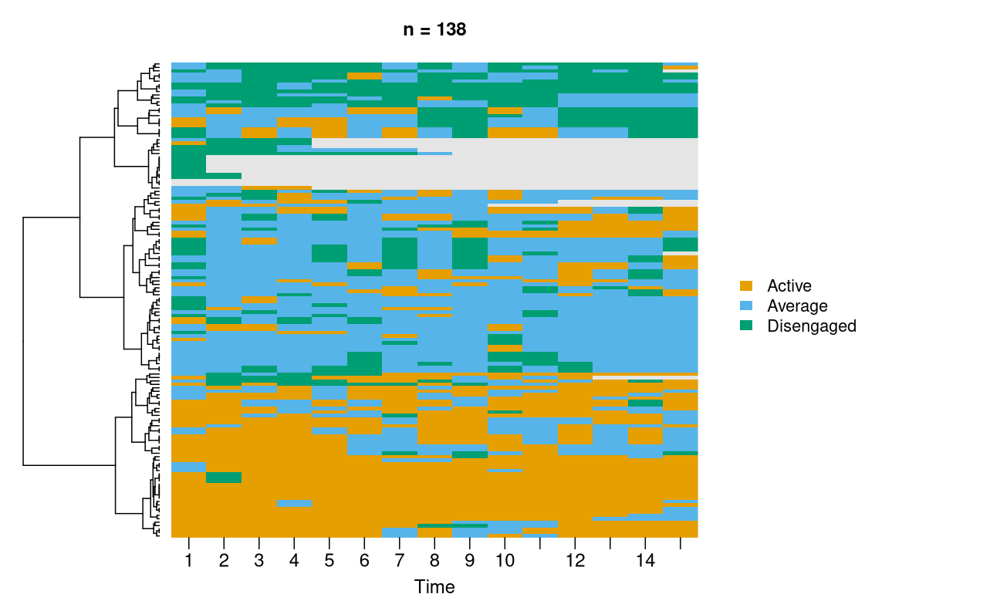

Each row is one student and each column one course; grey cells are the
courses after a student left. Three bands are visible. A small band at
the top holds students who are mostly disengaged and leave the program
early. A large band in the middle holds students who are mostly average,
with spells of disengagement. A band at the bottom holds students who
are mostly active.

`sort` selects the distance or the order. `sort = "hamming"` counts the
positions in which two sequences differ (Hamming 1950), and the other
distances of
[`build_clusters()`](https://pak.dynasite.org/Nestimate/reference/build_clusters.md)
are available (`osa`, `lv`, `dl`, `qgram`, `cosine`, `jaccard`, `jw`).
`sort = "frequency"`, `"start"` and `"end"` order the rows without a
dendrogram: by how common the sequence is, or by its first or last
state.

``` r

sequence_plot(trajectories, sort = "start")
```

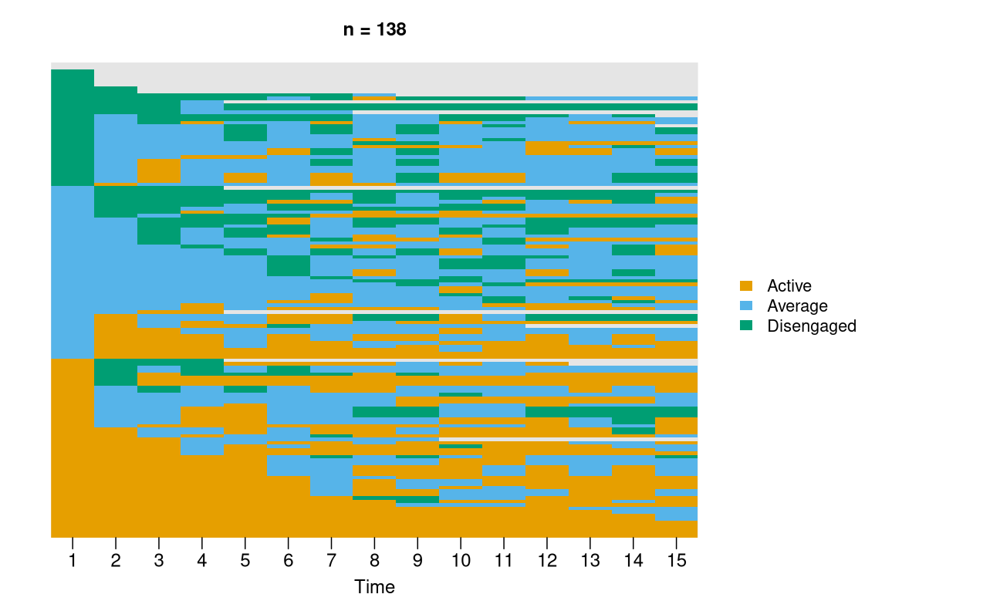

Sorted by the first state, the plot shows how the students who start in
each state continue: many students who start active remain active for
the first few courses, and many students who start disengaged move to
the average state within one or two courses, while some leave.

`k` cuts the dendrogram into `k` groups and draws a line between them.

``` r

sequence_plot(trajectories, k = 3)
```

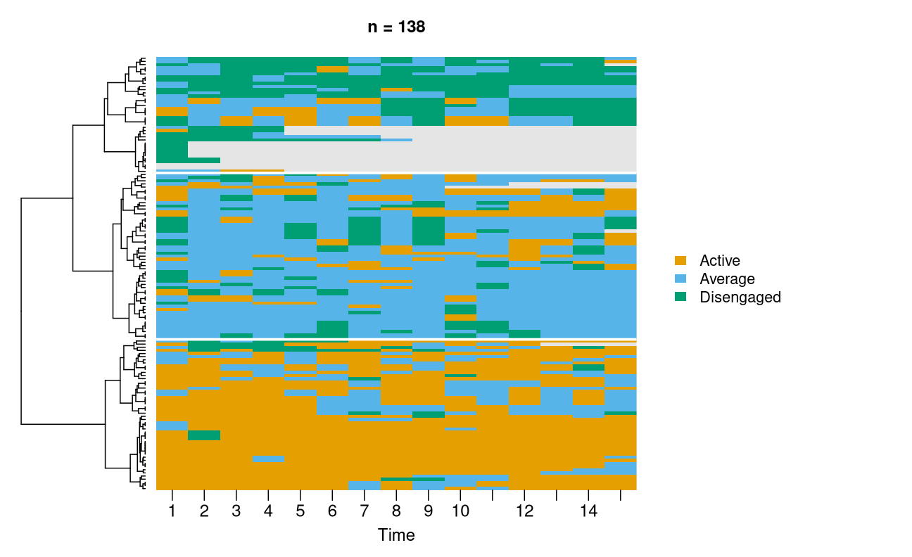

## Sequences by group

When the sequences belong to known groups (clusters, conditions,
cohorts), `type = "index"` draws one panel per group, so the groups are
compared side by side.
[`build_clusters()`](https://pak.dynasite.org/Nestimate/reference/build_clusters.md)
groups the sequences, here by the Hamming distance and Ward’s criterion
into three clusters, and
[`sequence_plot()`](https://pak.dynasite.org/Nestimate/reference/sequence_plot.md)
reads the clustering directly.

``` r

clusters <- build_clusters(trajectories, k = 3,
                           dissimilarity = "hamming", method = "ward.D2")
clusters
#> Sequence Clustering [ward.D2]
#>   Sequences: 138  |  Clusters: 3
#>   Dissimilarity: hamming
#>   Quality: silhouette = 0.364
#> 
#>   Cluster  N           Mean within-dist
#>   1        18 (13.0%)  5.333
#>   2        72 (52.2%)  8.521
#>   3        48 (34.8%)  5.776
```

The three clusters hold 18, 72 and 48 students, with an average
silhouette of 0.36, a moderate separation.

``` r

sequence_plot(clusters, type = "index", ncol = 3, nrow = 1)
```

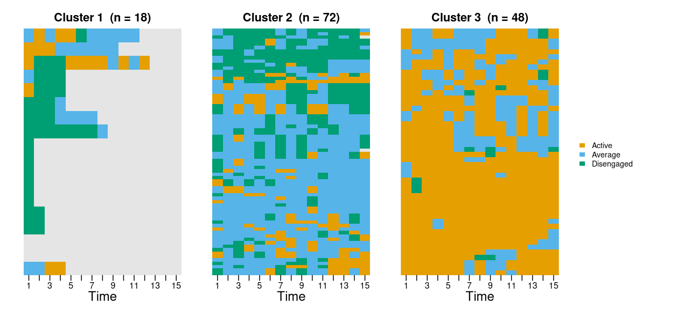

Cluster 1 holds the students who are mostly disengaged and leave the
program after a few courses. Cluster 2 holds students who are mostly
average, with frequent spells of disengagement. Cluster 3 holds students
who are mostly active throughout the program.

## The distribution of states over time

`type = "distribution"` draws the share of each state at each position
as a stacked area. It shows when states are common, which a transition
network pooled over time does not.

``` r

sequence_plot(trajectories, type = "distribution")
```

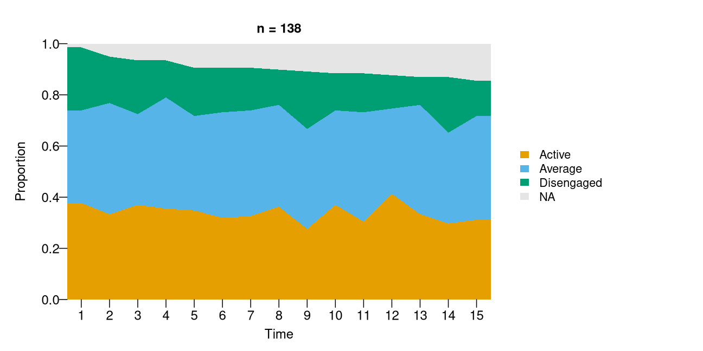

With `na = TRUE`, the default, the grey band is the share of students
who have left, and it grows in the later courses. With `na = FALSE`, the
shares are taken among the students who remain.

``` r

sequence_plot(trajectories, type = "distribution", na = FALSE)
```

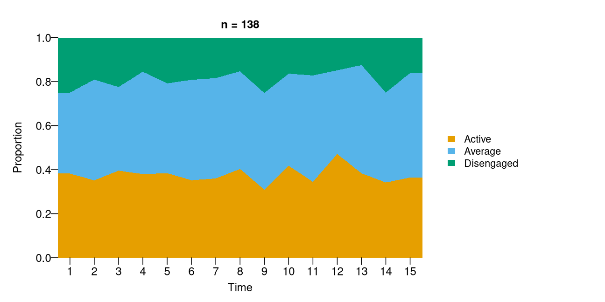

Among the students who remain, the shares of the three states are
similar in every course: about a third to a half are active, about two
fifths average, and the rest disengaged. `geom = "bar"` draws bars
instead of an area, and `scale = "count"` draws counts instead of
shares.

``` r

sequence_plot(clusters, type = "distribution", ncol = 3, nrow = 1)
```

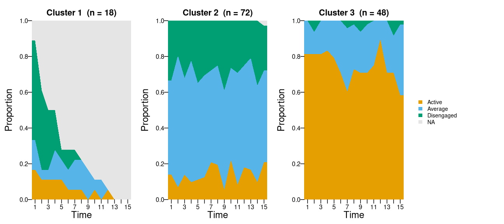

By cluster, the distribution plot shows the composition of each cluster
over the program. Most students of cluster 1 have left by the fifth
course. Cluster 2 is mostly average throughout, with roughly a fifth to
a third of its students disengaged in each course, and in cluster 3 the
share of active students stays between about 0.6 and 0.9.

## Sequences of different lengths

An event log holds sequences of different lengths.
[`sequence_plot()`](https://pak.dynasite.org/Nestimate/reference/sequence_plot.md)
reads it with `actor` (whose actions form one sequence), `action` and
`time`, as
[`build_network()`](https://pak.dynasite.org/Nestimate/reference/build_network.md)
does. `human_long` holds the coded human turns of 429 human-AI
pair-programming (“vibe coding”) sessions (Saqr, Misiejuk & López-Pernas
2026; Misiejuk et al. 2026); each session is one sequence of the three
clusters of codes, `Directive`, `Evaluative` and `Metacognitive`. A few
long sessions would stretch the time axis, so `trim = 0.9` keeps the
positions that hold 90% of the actions.

``` r

sequence_plot(human_long, actor = "session_id", action = "cluster",
              time = "order_in_session", trim = 0.9)
```

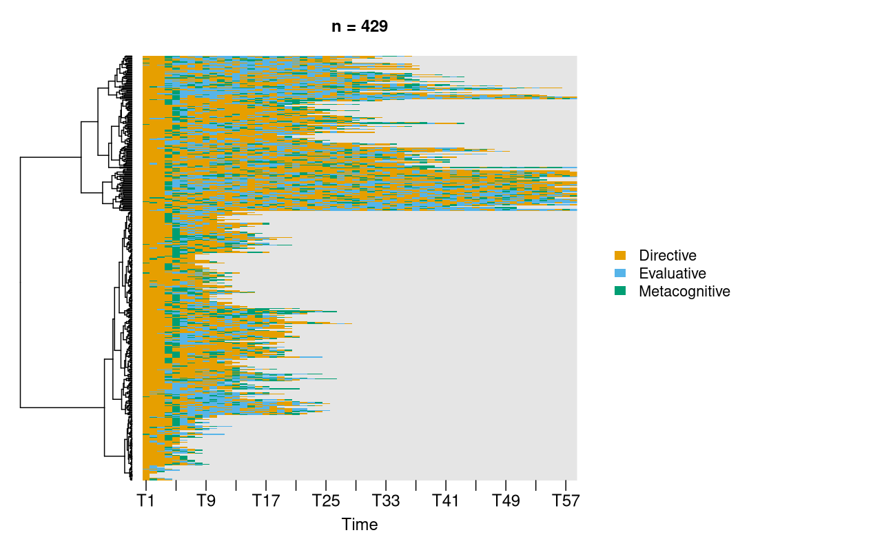

The sorted rows separate a group of long sessions from many short ones,
and grey cells mark the positions after a session ended. Almost every
session opens with a directive.

## Periods

Learning activity can be examined at several time scales, and patterns
that are invisible in one long sequence appear when the activity is
organised by day, week or course (Saqr, Nouri & Fors 2019). Sequence
analysis treats such data as sequences of states and plots them period
by period (Saqr, López-Pernas, Helske, et al. 2024). When the actors do
different numbers of actions in each period, however, a column of a
sequence index plot no longer refers to one point in time.
`daily_actions` records seven days of learning actions by 30 students:
`plan`, `read`, `write`, `discuss` and `review`. A student acts between
1 and 41 times on one day (median 9), and a student’s busiest day has
between 2 and 31 times as many actions as the quietest.

``` r

head(daily_actions)
#>   student   day  action
#> 1     s01 day 1  review
#> 2     s01 day 1  review
#> 3     s01 day 1   write
#> 4     s01 day 1   write
#> 5     s01 day 1 discuss
#> 6     s01 day 1   write
```

Drawn on one time axis, each student’s week is one sequence, with the
*t*-th action in column *t*.

``` r

sequence_plot(daily_actions, actor = "student", action = "action",
              type = "index")
```

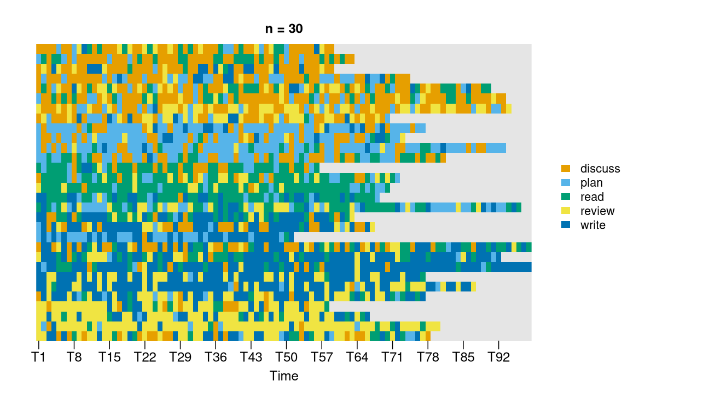

Students did between 12 and 59 actions on days 1 to 3, so day 4 begins
anywhere from column 13 to column 60. A column mixes days, and the
horizontal axis says nothing about when an action happened.

`periods = "day"` divides the axis into seven blocks of equal width, one
per day, with one row per student.

``` r

sequence_plot(daily_actions, actor = "student", action = "action",
              periods = "day")
```


With `fill = "stretch"`, the default, a student’s actions on one day
fill that day’s block in equal shares: one action fills it, three take a
third each, so the cells of a quiet day are wide and those of a busy day
narrow. With the days aligned, each row reads as one student’s week.
Most rows are dominated by one or two colours in every block: a
student’s most frequent action accounts for 32% to 78% of their actions,
and that preference holds from day to day. The students differ more from
each other than a student’s days differ from one another. Stretching
gives every day the same width whatever its volume, so the figure shows
what a student did each day, not how much.

Consecutive actions in the same state merge into one bar; 39% of
consecutive actions here repeat the previous one.
`cell_border = "white"` outlines every action, so each action is visible
as its own share of the day.

``` r

sequence_plot(daily_actions, actor = "student", action = "action",
              periods = "day", type = "index", row_gap = 0.15,
              cell_border = "white")
```

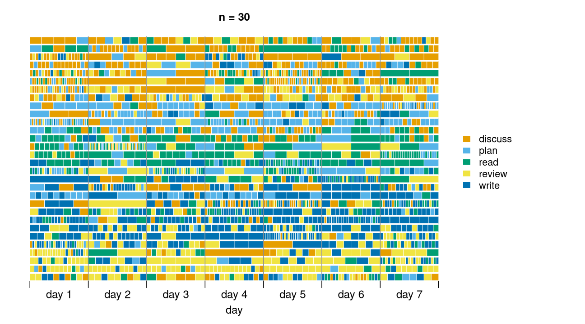

`fill = "pad"` gives every block as many slots as the busiest
student-day, 41 here, and leaves the unused slots white. A slot is then
the same position in the day for every student: the fifth slot is the
fifth action of that day.

``` r

sequence_plot(daily_actions, actor = "student", action = "action",
              periods = "day", type = "index", row_gap = 0.15,
              fill = "pad")
```

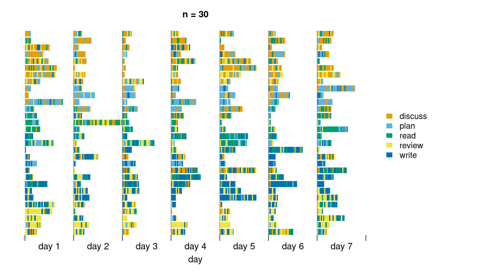

The padded plot shows the volume that stretching hides. With a median of
9 actions per day against 41 slots, most blocks are largely white, and
the few long bars mark the busiest student-days. Padding shows how much
each student did per day; stretching shows what it consisted of.

The rows are ordered by clustering each student’s whole week, all days
joined in order, with the longest-common-subsequence distance, and `k`
cuts the dendrogram into groups.

``` r

sequence_plot(daily_actions, actor = "student", action = "action",
              periods = "day", k = 3, k_color = "black")
```

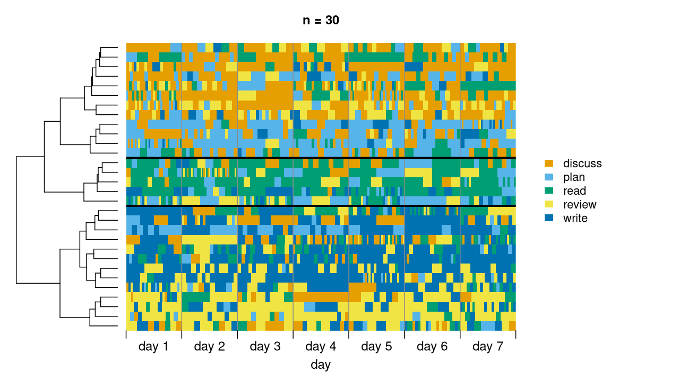

The three groups follow the students’ preferred actions: the students at
the top mostly discuss and plan, a small group in the middle mostly
reads, and the students at the bottom mostly write and review.

A network built with `session = "day"` holds one sequence per student
and day, and `sequence_plot(net, periods = "day")` draws the same figure
from the network.

``` r

daily_net <- build_network(daily_actions, method = "relative",
                           actor = "student", action = "action",
                           session = "day")
sequence_plot(daily_net, periods = "day")
```

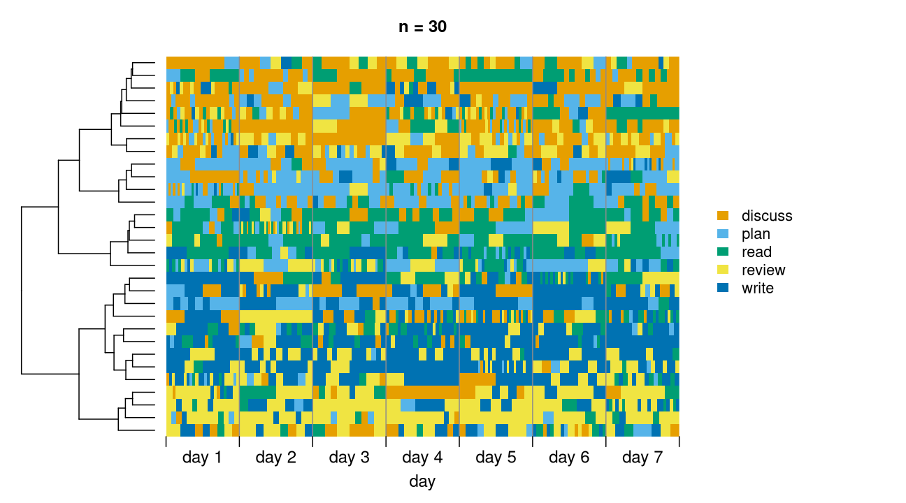

For dates, `period_unit = "week"` or `"month"` groups a date column into
weeks or months, one block each.

## Several channels

When the states are grouped into clusters,
[`build_mcml()`](https://pak.dynasite.org/Nestimate/reference/build_mcml.md)
estimates a network of the clusters and of the states within each
cluster, and
[`sequence_plot()`](https://pak.dynasite.org/Nestimate/reference/sequence_plot.md)
draws its sequences as several channels: a `Summary` channel coloured by
cluster and one channel per cluster coloured by that cluster’s states,
with the time spent in other clusters faded. The example groups the nine
regulation actions of `group_regulation_long`, which is synthetically
generated from the `group_regulation` data of the tna package (Tikka,
López-Pernas & Saqr 2025), into three clusters.

``` r

fit <- build_mcml(
  group_regulation_long,
  clusters = list(Cognitive  = c("discuss", "synthesis", "consensus",
                                 "cohesion"),
                  Regulation = c("plan", "monitor", "adapt", "coregulate"),
                  Affective  = "emotion"),
  actor = "Actor", action = "Action", time = "Time")
sequence_plot(fit, type = "distribution")
```

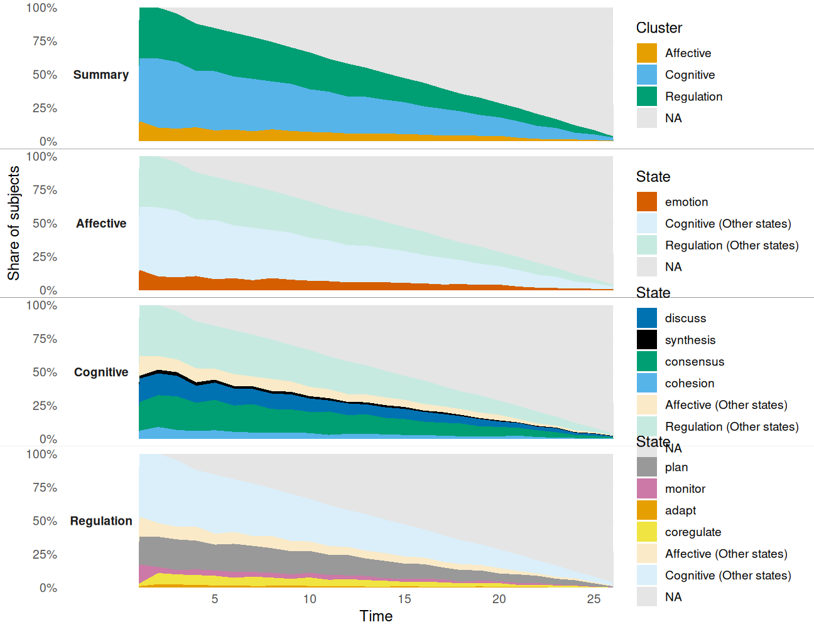

The `Summary` channel shows that cognitive actions take the largest
share at every position, followed by regulation and then affective
actions; the grey band grows as sequences end. Each cluster’s channel
shows which of its states carry that share. `combine` merges clusters
into one channel, `expand` shows the states of a cluster in the
`Summary` channel, and `rest = "none"` leaves out the other clusters.

## Appearance

The legend position and title, the colours of the states, cell borders,
the spacing of the axis ticks and an outer frame are set with arguments.

``` r

sequence_plot(trajectories, k = 3,
              state_colors = c("#009E73", "#E69F00", "#D55E00"),
              legend = "bottom", legend_title = "Engagement",
              cell_border = "grey70", tick = 3,
              main = "Student engagement trajectories")
```

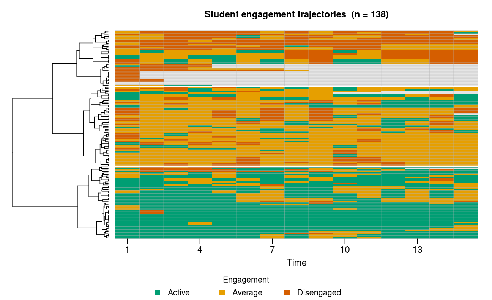

## Colours

The states are drawn in the Okabe-Ito colours, dealt in the alphabetical
order of the states, so a state has the same colour in every figure.
[`set_state_colors()`](https://pak.dynasite.org/Nestimate/reference/set_state_colors.md)
sets other colours once, on the network; every object computed from it
(clusters, groups, bootstraps, permutation tests, landscapes) and every
figure of them,
[`cograph::splot()`](https://sonsoles.me/cograph/reference/splot.html)
included, uses them.
[`state_colors()`](https://pak.dynasite.org/Nestimate/reference/state_colors.md)
lists the colours in use.

``` r

engagement <- build_network(trajectories, method = "relative")
engagement <- set_state_colors(engagement, c(Active = "#009E73",
                                             Average = "#56B4E9",
                                             Disengaged = "#D55E00"))
state_colors(engagement)
#>        state   color source
#> 1     Active #009E73    set
#> 2    Average #56B4E9    set
#> 3 Disengaged #D55E00    set
sequence_plot(engagement, k = 3)
```

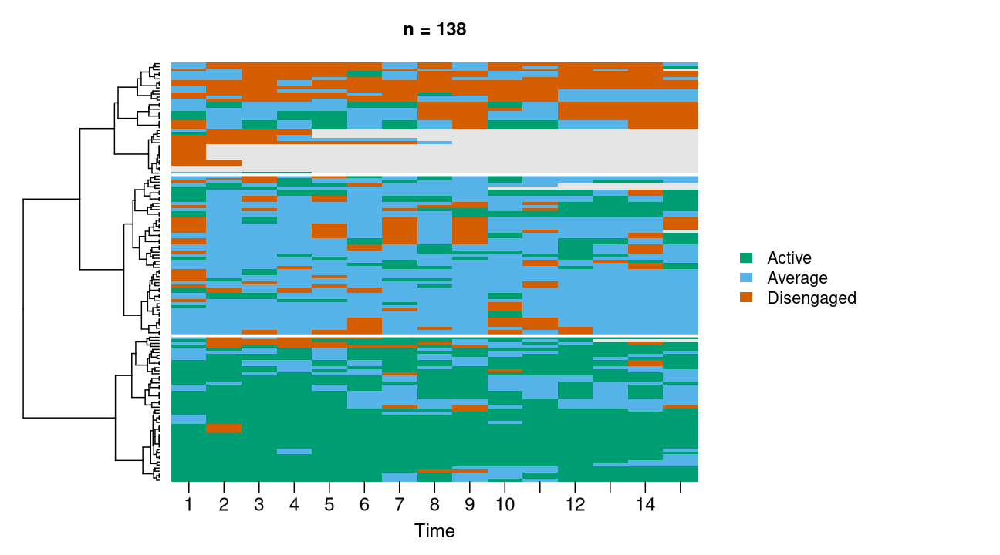

`state_colors =` in a single call, as in the previous section, changes
that figure only.

## How to cite this article

Saqr, M., López-Pernas, S., & Misiejuk, K. (2026). *Sequence plots*.
Nestimate.
[HTML](https://pak.dynasite.org/Nestimate/articles/sequence-plots.html)
· [PDF](https://pak.dynasite.org/Nestimate/pdf/sequence-plots.pdf)

## References

Gabadinho, A., Ritschard, G., Müller, N. S., & Studer, M. (2011).
Analyzing and visualizing state sequences in R with TraMineR. *Journal
of Statistical Software*, 40(4). <https://doi.org/10.18637/jss.v040.i04>

Hamming, R. W. (1950). Error detecting and error correcting codes. *Bell
System Technical Journal*, 29(2), 147–160.
<https://doi.org/10.1002/j.1538-7305.1950.tb00463.x>

Misiejuk, K., López-Pernas, S., Oliveira, E., Rinja, D., & Saqr, M.
(2026). It takes two to vibe code: Profiling student-AI programming
interactions processes and their high order structure. In *Proceedings
of the 26th Koli Calling International Conference on Computing Education
Research* (pp. 1–11). ACM. <https://doi.org/10.1145/3856208.3856254>

Murtagh, F., & Legendre, P. (2014). Ward’s hierarchical agglomerative
clustering method: Which algorithms implement Ward’s criterion? *Journal
of Classification*, 31(3), 274–295.
<https://doi.org/10.1007/s00357-014-9161-z>

Saqr, M., & López-Pernas, S. (2021). The longitudinal trajectories of
online engagement over a full program. *Computers & Education*, 175,
104325. <https://doi.org/10.1016/j.compedu.2021.104325>

Saqr, M., López-Pernas, S., & Misiejuk, K. (2026). Nestimate: An R
package for dynamic, probabilistic, and high order network analysis.
*Applied Psychological Measurement*.
<https://doi.org/10.1177/01466216261472019>

Saqr, M., López-Pernas, S., Helske, S., Durand, M., Murphy, K., Studer,
M., & Ritschard, G. (2024). Sequence analysis in education: Principles,
technique, and tutorial with R. In M. Saqr & S. López-Pernas (Eds.),
*Learning analytics methods and tutorials: A practical guide using R*
(pp. 321–354). Springer. <https://doi.org/10.1007/978-3-031-54464-4_10>

Saqr, M., López-Pernas, S., Jovanović, J., & Gašević, D. (2023).
Intense, turbulent, or wallowing in the mire: A longitudinal study of
cross-course online tactics, strategies, and trajectories. *The Internet
and Higher Education*, 57, 100902.
<https://doi.org/10.1016/j.iheduc.2022.100902>

Saqr, M., Misiejuk, K., & López-Pernas, S. (2026). Human-AI
collaboration or obedient and often clueless AI in instruct, serve,
repeat dynamics? *The Internet and Higher Education*, 70, 101087.
<https://doi.org/10.1016/j.iheduc.2026.101087>

Saqr, M., Nouri, J., & Fors, U. (2019). Time to focus on the temporal
dimension of learning: A learning analytics study of the temporal
patterns of students’ interactions and self-regulation. *International
Journal of Technology Enhanced Learning*, 11(4), 398–412.
<https://doi.org/10.1504/IJTEL.2019.102549>

Studer, M., & Ritschard, G. (2016). What matters in differences between
life trajectories: A comparative review of sequence dissimilarity
measures. *Journal of the Royal Statistical Society: Series A
(Statistics in Society)*, 179(2), 481–511.
<https://doi.org/10.1111/rssa.12125>

Tikka, S., López-Pernas, S., & Saqr, M. (2025). tna: An R package for
transition network analysis. *Applied Psychological Measurement*, 49(6),
326–328. <https://doi.org/10.1177/01466216251348840>

Ward, J. H. (1963). Hierarchical grouping to optimize an objective
function. *Journal of the American Statistical Association*, 58(301),
236–244. <https://doi.org/10.1080/01621459.1963.10500845>
