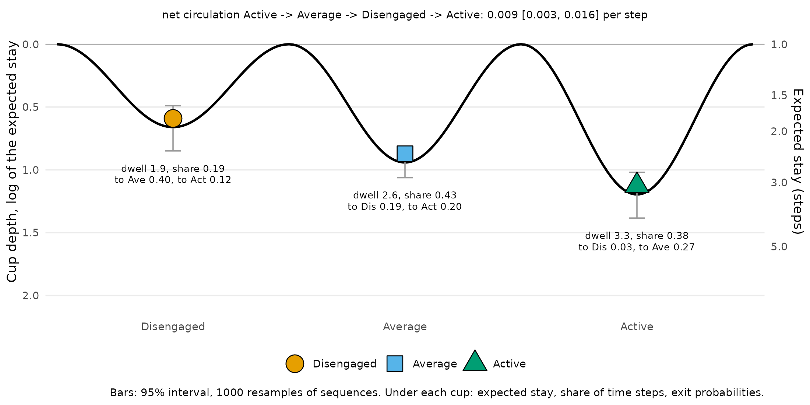
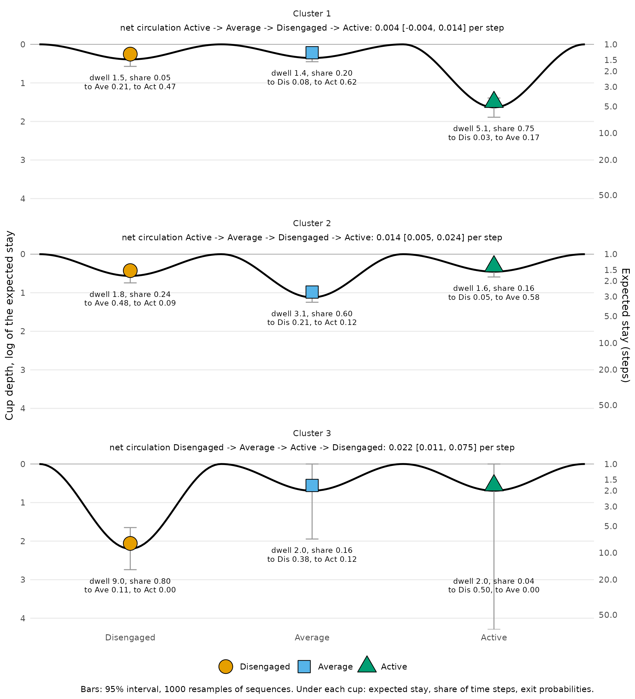
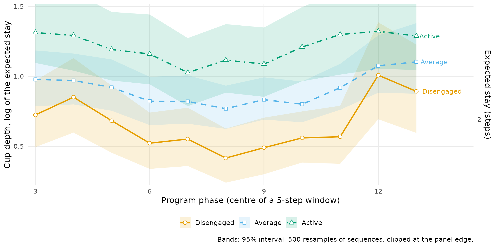
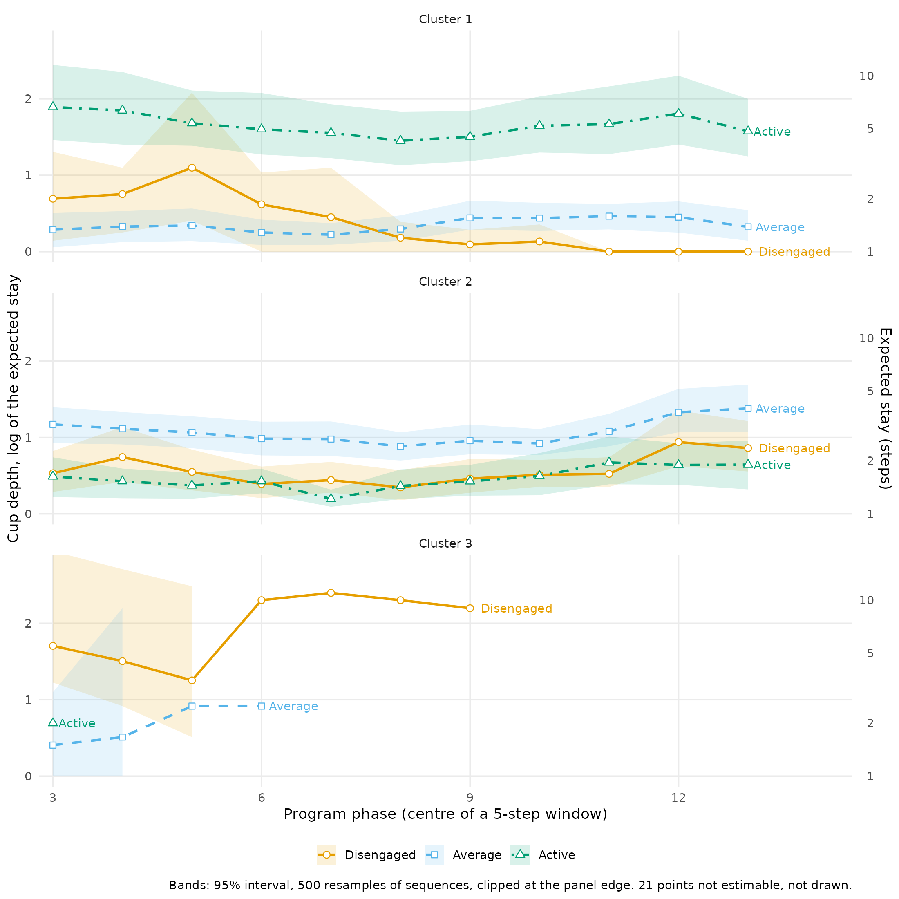
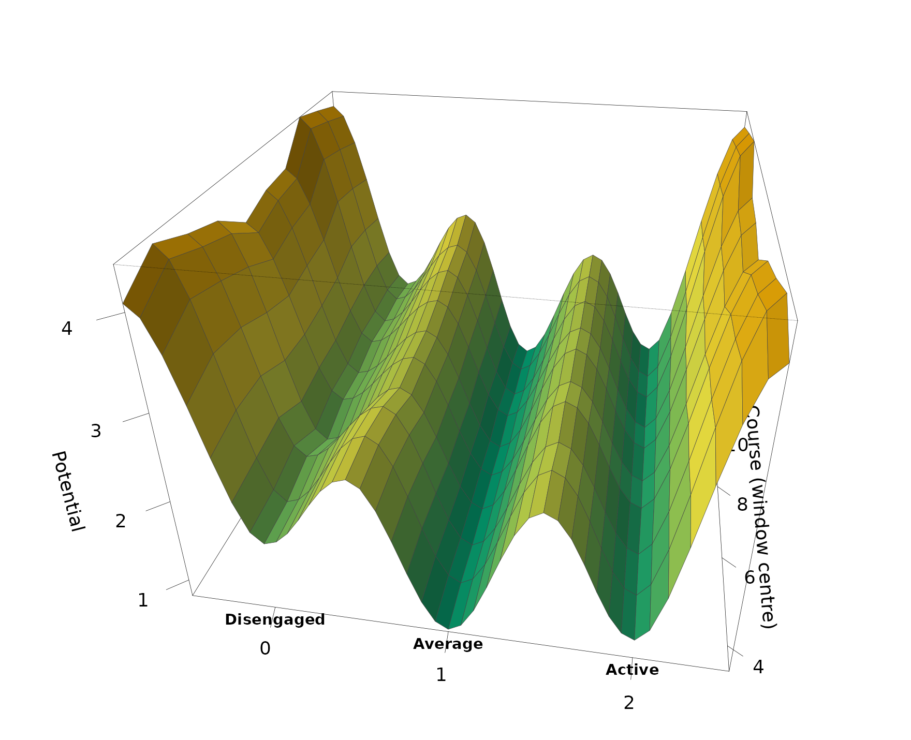
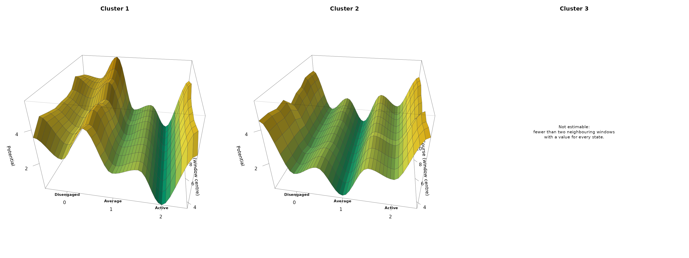
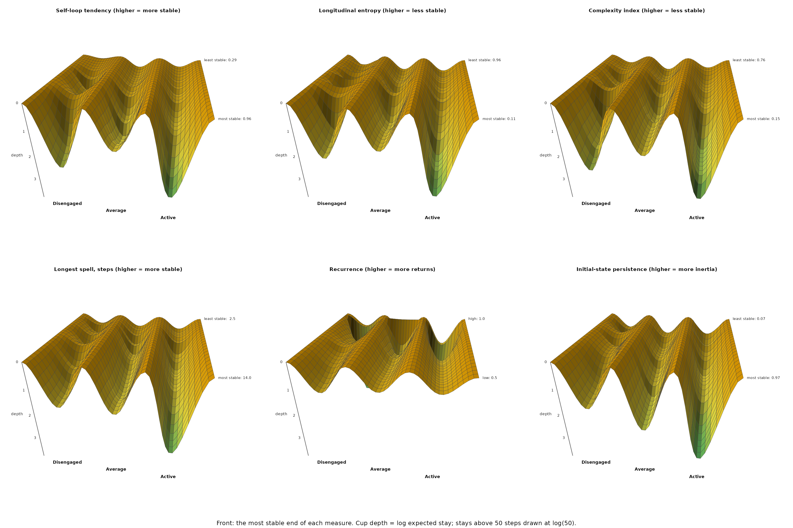
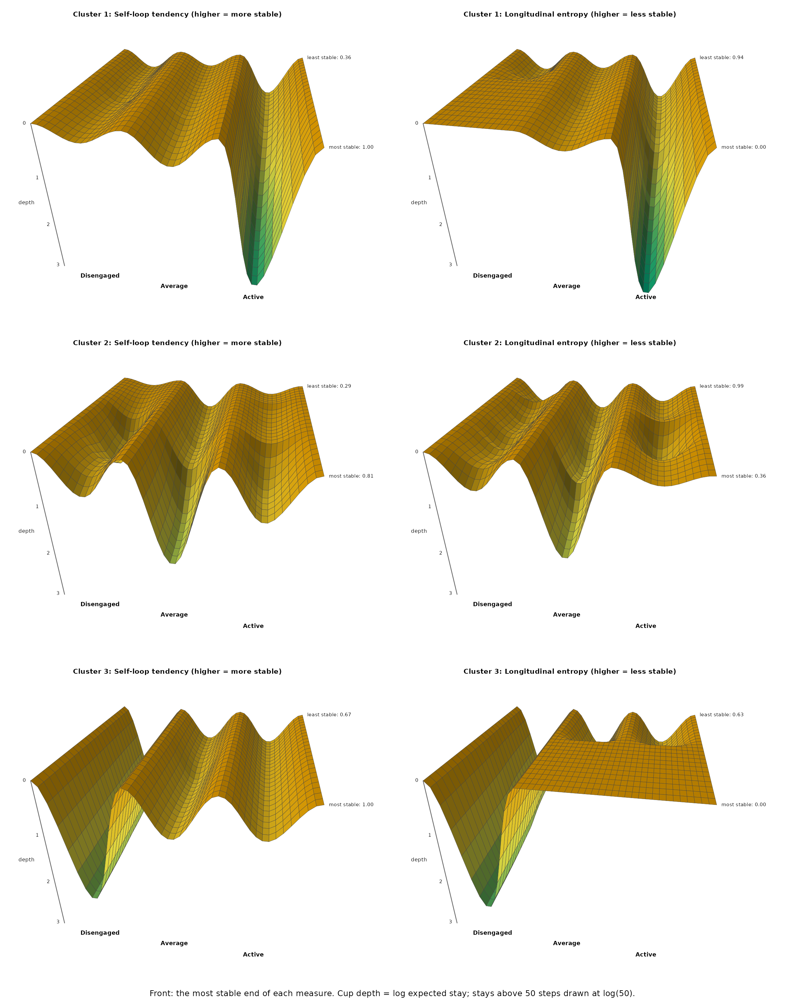

# Stability landscapes of engagement (experimental)

*Experimental.*
[`stability_landscape()`](https://pak.dynasite.org/Nestimate/reference/stability_landscape.md),
[`landscape_trend()`](https://pak.dynasite.org/Nestimate/reference/landscape_trend.md)
and
[`landscape_surface()`](https://pak.dynasite.org/Nestimate/reference/landscape_surface.md)
are new in Nestimate 1.0.1; their arguments and output may change in
later releases.

Which engagement states are stable, which are easy to leave, and do
students with different trajectories live in different landscapes? A
stability landscape answers these questions by drawing the transition
network as a ball in a set of cups (Scheffer et al. 2009). The depth of
a cup is how long students stay in the state once they are there: a deep
cup holds the ball, a shallow one lets it roll out at the next step.

The data are `trajectories`: the engagement state of 138 students in
each of 15 consecutive courses, coded `Disengaged`, `Average` or
`Active`. A missing value marks a course the student did not take; most
missing values are trailing runs, students who left the program.

``` r

head(trajectories)
```

    #>      1         2            3            4            5            6            7         8        
    #> [1,] "Active"  "Disengaged" "Disengaged" "Disengaged" "Active"     "Active"     "Active"  "Active" 
    #> [2,] "Average" "Average"    "Average"    "Average"    "Average"    "Average"    "Average" "Average"
    #> [3,] "Average" "Active"     "Active"     "Active"     "Active"     "Active"     "Active"  "Active" 
    #> [4,] "Active"  "Active"     "Active"     "Active"     "Active"     "Average"    "Average" "Active" 
    #> [5,] "Active"  "Active"     "Active"     "Average"    "Active"     "Average"    "Active"  "Active" 
    #> [6,] "Average" "Average"    "Disengaged" "Average"    "Disengaged" "Disengaged" "Average" "Average"
    #>      9         10           11        12           13        14        15       
    #> [1,] "Average" "Active"     "Average" "Active"     NA        NA        NA       
    #> [2,] "Average" "Active"     "Average" "Average"    "Average" "Average" "Average"
    #> [3,] "Active"  "Average"    "Active"  "Active"     "Active"  "Active"  "Active" 
    #> [4,] "Active"  "Active"     "Average" "Active"     "Average" "Active"  "Average"
    #> [5,] "Active"  "Disengaged" "Active"  "Active"     "Active"  "Average" "Average"
    #> [6,] "Average" "Disengaged" "Average" "Disengaged" "Average" "Average" "Average"

The three states have a natural order, and the landscapes below are
drawn in it.

``` r

engagement <- c("Disengaged", "Average", "Active")
```

## The landscape of all students

### How stable is each engagement state?

[`build_network()`](https://pak.dynasite.org/Nestimate/reference/build_network.md)
estimates the transition network, the probability of moving from each
state to each other state between consecutive courses.
[`stability_landscape()`](https://pak.dynasite.org/Nestimate/reference/stability_landscape.md)
turns it into a landscape. A state that is followed by itself with
probability $`P_{ii}`$ is left after $`1 / (1 - P_{ii})`$ courses on
average, its expected stay, and the depth of its cup is the log of that
stay, $`-\log(1 - P_{ii})`$. Expected stay is then $`e^{\text{depth}}`$,
the escape-time law of a particle in a potential well (Kramers 1940); a
state that is always left at once has depth 0. The intervals come from
1000 resamples of students.

``` r

network <- build_network(trajectories, method = "relative")
landscape <- stability_landscape(network, states = engagement, iter = 1000,
                                 seed = 2026)
landscape
```

    #> Stability landscape: 3 states, 1 network, 1000 resamples
    #> 
    #> Cups (depth = log of the expected stay; deeper = more stable):
    #>       state depth ci_lower ci_upper dwell stay share
    #>  Disengaged  0.66     0.49     0.85  1.93 0.48  0.19
    #>     Average  0.94     0.83     1.06  2.56 0.61  0.43
    #>      Active  1.20     1.02     1.38  3.31 0.70  0.38
    #> 
    #> Net circulation (per step):
    #>   Active -> Average -> Disengaged -> Active: 0.0092 [0.0031, 0.016]
    #> 
    #> Exit probabilities: summary(x, table = "exits")

The table gives each cup’s depth with its interval, the expected stay
(`dwell`), the stay probability and the share of observed courses spent
in the state. Active is the deepest cup (depth 1.20 \[1.02, 1.38\]):
students stay 3.3 courses on average once they are active. Average
follows (0.94, 2.6 courses) and Disengaged is the shallowest (0.66, 1.9
courses). The intervals of Active and Disengaged do not overlap. How
deep a cup is and how much time is spent in it are different things:
Average holds 43% of the courses against 38% for Active, because
students enter Average more often, but they leave it sooner.

With three states the chain also has a net circulation, the part of the
dynamics a landscape cannot show (Schnakenberg 1976): 0.009 per course
\[0.003, 0.016\], running Active to Average to Disengaged and back to
Active. Students decline one step at a time and recover by the direct
jump more often than the reverse.

``` r

plot(landscape)
```



The ball sits at the bottom of each cup; the grey bars are the 95%
intervals, and the right axis reads the depth as an expected stay. Under
each cup are its expected stay, its share of courses and where students
go when they leave it. Disengaged is shallow and drains towards Average
(40% of disengaged courses are followed by an average one, 12% by an
active one). Active is deep and, when left, is left for Average (27%)
rather than for Disengaged (3%).

## Trajectory clusters

### Do the students follow distinct trajectories?

[`build_clusters()`](https://pak.dynasite.org/Nestimate/reference/build_clusters.md)
groups the sequences by their Hamming distance with partitioning around
medoids, here into three clusters.

``` r

clusters <- build_clusters(trajectories, k = 3, seed = 2026)
clusters
```

    #> Sequence Clustering [pam]
    #>   Sequences: 138  |  Clusters: 3
    #>   Dissimilarity: hamming
    #>   Quality: silhouette = 0.360
    #> 
    #>   Cluster  N           Mean within-dist  Medoid
    #>   1        47 (34.1%)  5.898             124
    #>   2        74 (53.6%)  8.389             44
    #>   3        17 (12.3%)  5.412             103

The three clusters hold 47, 74 and 17 students, with an average
silhouette of 0.36, a moderate separation.
[`build_network()`](https://pak.dynasite.org/Nestimate/reference/build_network.md)
on the clustering gives one transition network per cluster, and
[`state_distribution()`](https://pak.dynasite.org/Nestimate/reference/state_distribution.md)
describes what each cluster consists of.

``` r

cluster_networks <- build_network(clusters)
state_distribution(cluster_networks)
```

    #>       group      state count proportion
    #> 1 Cluster 1     Active   528 0.75213675
    #> 2 Cluster 1    Average   139 0.19800570
    #> 3 Cluster 1 Disengaged    35 0.04985755
    #> 4 Cluster 2    Average   663 0.60382514
    #> 5 Cluster 2 Disengaged   263 0.23952641
    #> 6 Cluster 2     Active   172 0.15664845
    #> 7 Cluster 3 Disengaged    56 0.80000000
    #> 8 Cluster 3    Average    11 0.15714286
    #> 9 Cluster 3     Active     3 0.04285714

Cluster 1 is mostly active (75% of its observed courses), cluster 2
mostly average (60%, with 24% disengaged), and cluster 3 mostly
disengaged (80%). Cluster 3 also has little data: 70 observed courses
for 17 students, out of 255 possible, because most of its students left
the program early.

### What landscape does each cluster live in?

The same call on the grouped networks gives one landscape per cluster.

``` r

cluster_landscape <- stability_landscape(cluster_networks, states = engagement,
                                         iter = 1000, seed = 2026)
cluster_landscape
```

    #> Stability landscape: 3 states, 3 networks, 1000 resamples
    #> 
    #> Cups (depth = log of the expected stay; deeper = more stable):
    #>      group      state depth ci_lower ci_upper dwell stay share
    #>  Cluster 1 Disengaged  0.39     0.15     0.57  1.48 0.32  0.05
    #>  Cluster 1    Average  0.35     0.27     0.45  1.43 0.30  0.20
    #>  Cluster 1     Active  1.63     1.39     1.89  5.12 0.80  0.75
    #>  Cluster 2 Disengaged  0.56     0.39     0.74  1.76 0.43  0.24
    #>  Cluster 2    Average  1.12     0.98     1.25  3.06 0.67  0.60
    #>  Cluster 2     Active  0.45     0.33     0.59  1.57 0.36  0.16
    #>  Cluster 3 Disengaged  2.20     1.65     2.74  9.00 0.89  0.80
    #>  Cluster 3    Average  0.69     0.00     1.95  2.00 0.50  0.16
    #>  Cluster 3     Active  0.69     0.00      Inf  2.00 0.50  0.04
    #> 
    #> Net circulation (per step):
    #>   Cluster 1, Active -> Average -> Disengaged -> Active: 0.0045 [-0.0035, 0.014]
    #>   Cluster 2, Active -> Average -> Disengaged -> Active: 0.0143 [0.0051, 0.0237]
    #>   Cluster 3, Disengaged -> Average -> Active -> Disengaged: 0.0217 [0.0105, 0.0755] (401 of 1000 resamples have a stationary distribution)
    #> 
    #> Exit probabilities: summary(x, table = "exits")

``` r

plot(cluster_landscape)
```



The three clusters live in three different landscapes, each with one
deep cup.

- **Cluster 1** has its deep cup at Active (depth 1.63 \[1.39, 1.89\],
  5.1 courses per stay). Average and Disengaged are equally shallow
  (0.35 and 0.39, under 1.5 courses per stay), and both drain towards
  Active: 62% of average courses and 47% of disengaged courses are
  followed by an active one. The net circulation is indistinguishable
  from zero (0.004 \[-0.004, 0.014\]).
- **Cluster 2** has its deep cup at Average (1.12 \[0.98, 1.25\], 3.1
  courses per stay). Active is as shallow as Disengaged (0.45 and 0.56),
  and 58% of active courses are followed by an average one. The
  circulation is clear of zero (0.014 \[0.005, 0.024\]): decline one
  step at a time, recovery by the direct jump.
- **Cluster 3** has its deep cup at Disengaged (2.20 \[1.65, 2.74\], 9.0
  courses per stay). Its other cups rest on very few transitions, 2 of
  them out of Active, so their intervals are wide: \[0.00, 1.95\] for
  Average and \[0.00, Inf\] for Active, an upper limit that is unbounded
  because Active is never left in some resamples. Only the Disengaged
  cup of this cluster is estimated with any precision.

### How long does it take to reach engagement in each cluster?

The landscape shows how stable each state is. The mean first passage
time from
[`passage_time()`](https://pak.dynasite.org/Nestimate/reference/passage_time.md)
turns this into time: the expected number of courses to reach one state
from another for the first time (Kemeny and Snell 1976).

``` r

passage_time(cluster_networks, states = engagement)
```

    #> Mean First Passage Times -- 3 groups: Cluster 1, Cluster 2, Cluster 3
    #> 
    #> --- Cluster 1 ---
    #> Mean First Passage Times (3 states)
    #> 
    #>            Disengaged Average Active
    #> Disengaged       18.4     5.6    2.0
    #> Average          24.6     5.1    1.7
    #> Active           26.1     5.9    1.3
    #> 
    #> Stationary distribution:
    #> Disengaged    Average     Active 
    #>     0.0545     0.1947     0.7508 
    #> 
    #> --- Cluster 2 ---
    #> Mean First Passage Times (3 states)
    #> 
    #>            Disengaged Average Active
    #> Disengaged        4.3     2.0    9.1
    #> Average           5.5     1.6    8.8
    #> Active            6.7     1.7    6.6
    #> 
    #> Stationary distribution:
    #> Disengaged    Average     Active 
    #>     0.2347     0.6137     0.1516 
    #> 
    #> --- Cluster 3 ---
    #> Mean First Passage Times (3 states)
    #> 
    #>            Disengaged Average Active
    #> Disengaged        1.3     9.0     44
    #> Average           2.5     5.7     35
    #> Active            2.0    11.0     23
    #> 
    #> Stationary distribution:
    #> Disengaged    Average     Active 
    #>     0.7826     0.1739     0.0435

From Disengaged, a cluster 1 student reaches Active in 2.0 courses on
average, a cluster 2 student in 9.1 and a cluster 3 student in 44, far
beyond the 15 courses of the program. In the other direction, Active to
Disengaged takes 26.1 courses in cluster 1, 6.7 in cluster 2 and 2.0 in
cluster 3. The cups of the landscape are the reason: in cluster 1 every
road leads back to Active, in cluster 3 every road leads to Disengaged.

## The landscape across the program

### Does the stability of each state change over the program?

[`landscape_trend()`](https://pak.dynasite.org/Nestimate/reference/landscape_trend.md)
estimates the cup depths in a sliding window of five courses (courses
1-5, 2-6, …, 11-15) and draws one line per state, with intervals from
resampling students. The program phase is not derived from the
transitions, so the line shows how stability changes over time, not who
was selected.

``` r

phase_trend <- landscape_trend(network, along = "phase", states = engagement,
                               iter = 500, seed = 2026)
phase_trend
```

    #> Stability landscape along program phase (5-step windows): 3 states, 1 network, 500 resamples
    #> 
    #> Cup depth (log of the expected stay; higher = more stable) at the two ends and its range:
    #>       state first at_first  last at_last  min  max
    #>  Disengaged   1-5     0.72 11-15    0.89 0.42 1.01
    #>     Average   1-5     0.98 11-15    1.10 0.77 1.10
    #>      Active   1-5     1.31 11-15    1.29 1.03 1.32

``` r

plot(phase_trend)
```



The order of the cups holds over the whole program: Active is the
deepest in every window (between 1.03 and 1.32, a stay of about three
courses), Average is second and Disengaged the shallowest. Disengaged
changes the most: its depth falls from 0.72 in courses 1-5 to 0.42 in
courses 6-10 and rises to 1.01 in courses 10-14, so disengagement holds
students longest near the end of the program.

### Does it change differently in each cluster?

``` r

cluster_trend <- landscape_trend(cluster_networks, along = "phase",
                                 states = engagement, iter = 500, seed = 2026)
cluster_trend
```

    #> Stability landscape along program phase (5-step windows): 3 states, 3 networks, 500 resamples
    #> 
    #> Cup depth (log of the expected stay; higher = more stable) at the two ends and its range:
    #>      group      state first at_first  last at_last  min  max
    #>  Cluster 1 Disengaged   1-5     0.69 11-15    0.00 0.00 1.10
    #>  Cluster 1    Average   1-5     0.29 11-15    0.33 0.22 0.47
    #>  Cluster 1     Active   1-5     1.89 11-15    1.58 1.45 1.89
    #>  Cluster 2 Disengaged   1-5     0.53 11-15    0.86 0.35 0.94
    #>  Cluster 2    Average   1-5     1.17 11-15    1.38 0.88 1.38
    #>  Cluster 2     Active   1-5     0.49 11-15    0.64 0.20 0.67
    #>  Cluster 3 Disengaged   1-5     1.70 11-15     Inf 1.25 2.40
    #>  Cluster 3    Average   1-5     0.41 11-15      NA 0.41 0.92
    #>  Cluster 3     Active   1-5     0.69 11-15      NA 0.69 0.69
    #> 
    #> 21 values not estimable (state never left, absent, or no stationary distribution).

``` r

plot(cluster_trend)
```



In cluster 1, Active is the deep cup in every window (1.45 to 1.89), and
the Disengaged cup disappears over the program: from 0.69 in courses 1-5
to 0 in the last windows, where every disengaged course is followed by a
different state. In cluster 2, Average stays the deep cup and deepens at
the end (1.17 to 1.38), and Disengaged becomes stickier (0.53 to 0.86).
Cluster 3 runs out of data: its students leave the program, so its later
windows have no Average or Active courses, and in some windows its
Disengaged cup is never left (21 such points across the three clusters,
left out of the lines).

### How does the landscape itself move over the program?

The same windows, with the cups and ridges of the stationary
distribution (`depth = "occupancy"`), drawn as a 3D landscape: the
states run across, the program runs into the picture, and each cup
becomes a channel. Here a cup sits at $`-\log \pi`$, lower when students
spend more of the window in the state, and a ridge at $`-\log`$ of the
probability flux between two states, higher when the switch is rarer
(Wang et al. 2008). The windows are six courses long.

``` r

occupancy_trend <- landscape_trend(network, along = "phase",
                                   depth = "occupancy", window = 6,
                                   states = engagement, iter = 500,
                                   seed = 2026)
occupancy_trend
```

    #> Stability landscape along program phase (6-step windows): 3 states, 1 network, 500 resamples
    #> 
    #> Cup potential (-log pi; lower = more time in the state) at the two ends and its range:
    #>       state first at_first  last at_last  min  max
    #>  Disengaged   1-6     1.62 10-15    1.73 1.54 1.79
    #>     Average   1-6     0.82 10-15    0.79 0.79 0.86
    #>      Active   1-6     1.02 10-15    1.00 0.89 1.08

``` r

plot(occupancy_trend, type = "surface")
```



For all students the landscape barely moves over the program. Average is
the lowest channel in every window (0.79 to 0.86), Active a little
higher (0.89 to 1.08) and Disengaged the highest (1.54 to 1.79).

``` r

cluster_occupancy <- landscape_trend(cluster_networks, along = "phase",
                                     depth = "occupancy", window = 6,
                                     states = engagement, iter = 500,
                                     seed = 2026)
cluster_occupancy
```

    #> Stability landscape along program phase (6-step windows): 3 states, 3 networks, 500 resamples
    #> 
    #> Cup potential (-log pi; lower = more time in the state) at the two ends and its range:
    #>      group      state first at_first  last at_last  min  max
    #>  Cluster 1 Disengaged   1-6     2.44 10-15    3.84 2.44 3.84
    #>  Cluster 1    Average   1-6     1.95 10-15    1.52 1.42 1.95
    #>  Cluster 1     Active   1-6     0.26 10-15    0.27 0.26 0.35
    #>  Cluster 2 Disengaged   1-6     1.52 10-15    1.36 1.32 1.52
    #>  Cluster 2    Average   1-6     0.45 10-15    0.49 0.45 0.54
    #>  Cluster 2     Active   1-6     1.95 10-15    2.01 1.76 2.09
    #>  Cluster 3 Disengaged   1-6     0.31 10-15      NA 0.31 0.31
    #>  Cluster 3    Average   1-6     1.58 10-15      NA 1.58 1.58
    #>  Cluster 3     Active   1-6     2.83 10-15      NA 2.83 2.83
    #> 
    #> 54 values not estimable (state never left, absent, or no stationary distribution).

``` r

plot(cluster_occupancy, type = "surface")
```



The clusters’ channels are steady too, but at different states. In
cluster 1 the Active channel stays low throughout (0.26 to 0.35) while
the Disengaged ground rises from 2.44 to 3.84: disengagement becomes
rarer as the program goes on. In cluster 2 the Average channel stays low
(0.45 to 0.54) and Active stays high (1.76 to 2.09). Cluster 3 can be
drawn only in its first window: after that its students are disengaged
or gone, and the chain of a window has no stationary distribution.

## Landscapes across stability measures

### Which cup deepens as students become more stable?

[`landscape_surface()`](https://pak.dynasite.org/Nestimate/reference/landscape_surface.md)
adds a second axis: a per-student stability measure from
[`sequence_metrics()`](https://pak.dynasite.org/Nestimate/reference/sequence_metrics.md).
At each value of the measure it computes the cup depths from the 30
students closest to that value, weighted by a tricube kernel (Cleveland
1979), so the surface runs from the most stable students to the most
volatile; the plot puts the most stable end in front. Six measures are
used: self-loop tendency (the share of courses that repeat the previous
state), longitudinal entropy, the complexity index, the longest spell,
cyclic feedback (how often a state recurs two or more courses later) and
initial-state persistence (the length of the opening spell).

``` r

surface <- landscape_surface(network, states = engagement,
                             measure = c("self_loop_tendency",
                                         "longitudinal_entropy",
                                         "complexity_index",
                                         "max_spell_duration",
                                         "cyclic_feedback_strength",
                                         "initial_state_persistence"))
surface
```

    #> Landscape surface: 3 states, 1 network x 6 measures, 30 nearest sequences per slice
    #> 
    #> Cup depth (log of the expected stay) at the low and the high end of each measure:
    #>                    measure      state  low depth_at_low  high depth_at_high
    #>         self_loop_tendency Disengaged 0.29         0.14  0.96          2.34
    #>         self_loop_tendency    Average 0.29         0.46  0.96          1.43
    #>         self_loop_tendency     Active 0.29         0.35  0.96          3.08
    #>       longitudinal_entropy Disengaged 0.11         1.95  0.96          0.57
    #>       longitudinal_entropy    Average 0.11         1.42  0.96          0.57
    #>       longitudinal_entropy     Active 0.11         3.03  0.96          0.54
    #>           complexity_index Disengaged 0.15         2.46  0.76          0.33
    #>           complexity_index    Average 0.15         1.59  0.76          0.57
    #>           complexity_index     Active 0.15         3.14  0.76          0.39
    #>         max_spell_duration Disengaged 2.50         0.42 14.00          1.56
    #>         max_spell_duration    Average 2.50         0.47 14.00          1.59
    #>         max_spell_duration     Active 2.50         0.51 14.00          2.94
    #>   cyclic_feedback_strength Disengaged 0.50         0.99  1.00          0.54
    #>   cyclic_feedback_strength    Average 0.50         0.77  1.00          0.89
    #>   cyclic_feedback_strength     Active 0.50         0.63  1.00          1.23
    #>  initial_state_persistence Disengaged 0.07         0.62  0.97          1.61
    #>  initial_state_persistence    Average 0.07         0.88  0.97          2.23
    #>  initial_state_persistence     Active 0.07         0.90  0.97          3.18
    #> 
    #> Effective sequences per slice: network 5.1-73.0

``` r

plot(surface, ncol = 3)
```



Five of the six measures give the same answer. At the stable end every
cup deepens and Active is the deepest, between 2.94 and 3.18 on all five
measures, an expected stay of about 20 courses. Disengaged is the second
deepest for self-loop tendency, entropy and complexity (1.95 to 2.46, 7
to 12 courses): the most stable students are either stably active or,
fewer of them, stably disengaged. At the volatile end all three cups are
shallow and of similar depth (0.14 to 0.90), so no state holds the most
volatile students for more than about two and a half courses. Cyclic
feedback differs: as recurrence rises, the Active cup deepens (0.63 to
1.23) and the Disengaged cup becomes shallower (0.99 to 0.54).

These measures come from the same sequences as the depths, so the cups
of the most stable students are deep by construction, self-loop tendency
most of all. What the surface adds is which cup deepens as stability
rises: Active first, Disengaged second.

### Does the same hold inside each cluster?

The same call on the clusters, with two measures: self-loop tendency and
longitudinal entropy.

``` r

cluster_surface <- landscape_surface(cluster_networks, states = engagement,
                                     measure = c("self_loop_tendency",
                                                 "longitudinal_entropy"))
```

    #> Warning: 4 of 150 slices rest on fewer than 5 effective sequences (minimum 4.0), often because many
    #> sequences share one value of the measure; their depths are unstable.

``` r

cluster_surface
```

    #> Landscape surface: 3 states, 3 networks x 2 measures, 30 nearest sequences per slice
    #> 
    #> Cup depth (log of the expected stay) at the low and the high end of each measure:
    #>      group              measure      state  low depth_at_low high depth_at_high
    #>  Cluster 1   self_loop_tendency Disengaged 0.36         0.42 1.00          0.27
    #>  Cluster 1   self_loop_tendency    Average 0.36         0.30 1.00          0.54
    #>  Cluster 1   self_loop_tendency     Active 0.36         0.91 1.00          2.86
    #>  Cluster 1 longitudinal_entropy Disengaged 0.00         0.00 0.94          0.47
    #>  Cluster 1 longitudinal_entropy    Average 0.00         0.27 0.94          0.36
    #>  Cluster 1 longitudinal_entropy     Active 0.00         3.05 0.94          1.01
    #>  Cluster 2   self_loop_tendency Disengaged 0.29         0.15 0.81          0.73
    #>  Cluster 2   self_loop_tendency    Average 0.29         0.62 0.81          1.92
    #>  Cluster 2   self_loop_tendency     Active 0.29         0.22 0.81          0.88
    #>  Cluster 2 longitudinal_entropy Disengaged 0.36         0.62 0.99          0.57
    #>  Cluster 2 longitudinal_entropy    Average 0.36         1.79 0.99          0.64
    #>  Cluster 2 longitudinal_entropy     Active 0.36         0.23 0.99          0.40
    #>  Cluster 3   self_loop_tendency Disengaged 0.67         2.10 1.00          2.29
    #>  Cluster 3   self_loop_tendency    Average 0.67         0.68 1.00          0.83
    #>  Cluster 3   self_loop_tendency     Active 0.67         0.69 1.00          0.69
    #>  Cluster 3 longitudinal_entropy Disengaged 0.00         2.49 0.63          1.98
    #>  Cluster 3 longitudinal_entropy    Average 0.00         0.00 0.63          0.89
    #>  Cluster 3 longitudinal_entropy     Active 0.00         0.00 0.63          0.70
    #> 
    #> Effective sequences per slice: Cluster 1 16.0-26.6, Cluster 2 11.8-27.8, Cluster 3 4.0-8.0

``` r

plot(cluster_surface)
```



Within clusters, stability deepens the cluster’s own cup. In cluster 1
the Active cup deepens from 0.91 for the students with the lowest
self-loop tendency to 2.86 for the highest, and it is the deepest cup in
every slice of both measures. In cluster 2 the Average cup deepens from
0.62 to 1.92: the most stable cluster 2 students are stably average, not
stably active. Cluster 3 has 4 to 8 effective students per slice, so its
surfaces show no more than its deep Disengaged cup.

## When to use which

| Question | Method |
|----|----|
| How long do students stay in each state, and where do they go when they leave? | [`stability_landscape()`](https://pak.dynasite.org/Nestimate/reference/stability_landscape.md) on a transition network |
| Do subgroups live in different landscapes? | [`stability_landscape()`](https://pak.dynasite.org/Nestimate/reference/stability_landscape.md) on a grouped network ([`build_network()`](https://pak.dynasite.org/Nestimate/reference/build_network.md) of [`build_clusters()`](https://pak.dynasite.org/Nestimate/reference/build_clusters.md), or `group =`) |
| How long does it take to reach a state? | [`passage_time()`](https://pak.dynasite.org/Nestimate/reference/passage_time.md) |
| Does the stability of each state change over the program, or with a covariate such as a grade? | [`landscape_trend()`](https://pak.dynasite.org/Nestimate/reference/landscape_trend.md) (`along = "phase"` or a covariate) |
| Which state becomes the attractor as sequences become more stable? | [`landscape_surface()`](https://pak.dynasite.org/Nestimate/reference/landscape_surface.md) with a [`sequence_metrics()`](https://pak.dynasite.org/Nestimate/reference/sequence_metrics.md) measure |

Run
[`stability_landscape()`](https://pak.dynasite.org/Nestimate/reference/stability_landscape.md)
first: it gives each state’s depth with an interval, its exits, and the
net circulation, the part of the dynamics a landscape leaves out. Add
[`passage_time()`](https://pak.dynasite.org/Nestimate/reference/passage_time.md)
when the question is about time. Use
[`landscape_surface()`](https://pak.dynasite.org/Nestimate/reference/landscape_surface.md)
to ask which cup the stable sequences fall into, with the full sample or
large clusters; a cluster whose slices rest on fewer than about ten
effective sequences is too small for it.

## References

Cleveland, W. S. (1979). Robust locally weighted regression and
smoothing scatterplots. *Journal of the American Statistical
Association*, 74, 829–836.

Kemeny, J. G., & Snell, J. L. (1976). *Finite Markov chains*. Springer.

Kramers, H. A. (1940). Brownian motion in a field of force and the
diffusion model of chemical reactions. *Physica*, 7, 284–304.

Scheffer, M., Bascompte, J., Brock, W. A., et al. (2009). Early-warning
signals for critical transitions. *Nature*, 461, 53–59.

Schnakenberg, J. (1976). Network theory of microscopic and macroscopic
behavior of master equation systems. *Reviews of Modern Physics*, 48,
571–585.

Wang, J., Xu, L., & Wang, E. (2008). Potential landscape and flux
framework of nonequilibrium networks. *PNAS*, 105, 12271–12276.
