# Stability of engagement: states, landscapes and students

*Experimental.*
[`stability_landscape()`](https://pak.dynasite.org/Nestimate/reference/stability_landscape.md),
[`landscape_trend()`](https://pak.dynasite.org/Nestimate/reference/landscape_trend.md)
and
[`landscape_surface()`](https://pak.dynasite.org/Nestimate/reference/landscape_surface.md)
are new in Nestimate 1.0.1; their arguments and output may change in
later releases.

Which engagement states hold students, how long does it take to move
between them, and how stable is each student’s own sequence? This
article answers these questions with Nestimate (Saqr, López-Pernas, &
Misiejuk, 2026) for the states of a whole cohort, for groups of students
with different trajectories, over the program, and for each student.

The questions come from longitudinal research on student engagement.
Saqr and López-Pernas (2021) followed the engagement state of students
in every course of a full program and found trajectories that stayed
engaged, stayed in between, or were troubled; Saqr, López-Pernas,
Jovanović and Gašević (2023) traced the trajectories of students’ online
tactics and strategies in the same way. A single snapshot of engagement
does not forecast achievement, while sustained engagement marks a stable
academic trajectory (Saqr, López-Pernas, Helske, & Hrastinski, 2023).
López-Pernas and Saqr (2024a) read the same dynamics as properties of a
complex system, the momentum of achievement and the inertia of
disengagement, and Vemuri et al. (2026) traced how disengagement
persists among first-year students.

In the complex-systems view of these studies (Saqr, Schreuder, &
López-Pernas, 2024; Saqr, Dever, et al., 2025), a stable state is an
attractor that holds students and draws them back, and a stable student
is one whose sequence stays in few states for long spells (Saqr,
López-Pernas, & Tikka, 2026). A stable average can hide change within
students (López-Pernas, Conde, Raspopović Milić, & Saqr, 2026), so
stability is measured here for the states and for each student.

| Question | Function |
|----|----|
| How long do students stay in each state, and where do they go when they leave? | [`stability_landscape()`](https://pak.dynasite.org/Nestimate/reference/stability_landscape.md) |
| What are the persistence, return and sojourn times of each state? | [`markov_stability()`](https://pak.dynasite.org/Nestimate/reference/markov_stability.md) |
| How long does it take to reach one state from another? | [`passage_time()`](https://pak.dynasite.org/Nestimate/reference/passage_time.md) |
| Is the chain one connected process? | [`chain_structure()`](https://pak.dynasite.org/Nestimate/reference/chain_structure.md) |
| Do groups of students live in different landscapes? | [`stability_landscape()`](https://pak.dynasite.org/Nestimate/reference/stability_landscape.md) on a grouped network |
| Does the stability of each state change over the program? | [`landscape_trend()`](https://pak.dynasite.org/Nestimate/reference/landscape_trend.md) |
| Which state holds the students whose sequences are most stable? | [`landscape_surface()`](https://pak.dynasite.org/Nestimate/reference/landscape_surface.md) |
| How stable is each student’s sequence? | [`sequence_metrics()`](https://pak.dynasite.org/Nestimate/reference/sequence_metrics.md) |

### Data

`trajectories` records the engagement state of 138 students in each of
15 consecutive courses, coded with the three engagement states of Saqr
and López-Pernas (2021): `Disengaged`, `Average` or `Active`. A missing
value marks a course the student did not take; most missing values are
trailing runs, students who left the program.

``` r

library(Nestimate)
head(trajectories, 3)
```

    #>      1         2            3            4            5         6         7         8        
    #> [1,] "Active"  "Disengaged" "Disengaged" "Disengaged" "Active"  "Active"  "Active"  "Active" 
    #> [2,] "Average" "Average"    "Average"    "Average"    "Average" "Average" "Average" "Average"
    #> [3,] "Average" "Active"     "Active"     "Active"     "Active"  "Active"  "Active"  "Active" 
    #>      9         10        11        12        13        14        15       
    #> [1,] "Average" "Active"  "Average" "Active"  NA        NA        NA       
    #> [2,] "Average" "Active"  "Average" "Average" "Average" "Average" "Average"
    #> [3,] "Active"  "Average" "Active"  "Active"  "Active"  "Active"  "Active"

The transition network (Saqr, López-Pernas, Törmänen, et al., 2025;
Saqr, López-Pernas, & Tikka, 2025) gives the probability of each state
in the next course given the state in the current one. The three states
have a natural order, and the landscapes are drawn in it.

``` r

network <- build_network(trajectories, method = "relative")
network
```

    #> Transition Network (relative probabilities) [directed]
    #>   Weights: [0.035, 0.698]  |  mean: 0.333
    #> 
    #>   Strongest edges (9 of 9):
    #>    from       to         weight
    #>    Active     Active     0.698 
    #>    Average    Average    0.610 
    #>    Disengaged Disengaged 0.483 
    #>    Disengaged Average    0.397 
    #>    Active     Average    0.267 
    #>    Average    Active     0.204 
    #>    Average    Disengaged 0.186 
    #>    Disengaged Active     0.120 
    #>    Active     Disengaged 0.035  
    #> 
    #>   extract_edges(include_self = TRUE) lists every edge; extract_transition_matrix() gives the weight matrix;
    #>   extract_initial_probs() the initial probabilities.

``` r

engagement <- c("Disengaged", "Average", "Active")
```

Active students stay Active with probability 0.70, Average students stay
Average with 0.61, and Disengaged students stay Disengaged with 0.48; a
Disengaged student moves to Average more often (0.40) than to Active
(0.12).

## The states

### How long do students stay in each state?

[`stability_landscape()`](https://pak.dynasite.org/Nestimate/reference/stability_landscape.md)
draws the network as a ball in a set of cups (Scheffer et al., 2009),
the basins of attraction of the complex-systems reading of engagement
(López-Pernas & Saqr, 2024a; Saqr, López-Pernas, & Tikka, 2026). The
warning signals that precede a shift between basins have been traced in
students’ engagement long before drop-out (Saqr, López-Pernas, Tikka, &
Spitzer, 2026). A state that is followed by itself with probability
$`P_{ii}`$ is left after $`1 / (1 - P_{ii})`$ courses on average, its
expected stay, and the depth of its cup is the log of that stay,
$`-\log(1 - P_{ii})`$. Expected stay is then $`e^{\text{depth}}`$, the
escape-time law of a particle in a potential well (Kramers, 1940); a
state that is always left at once has depth 0. The intervals come from
1,000 resamples of students.

``` r

landscape <- stability_landscape(network, states = engagement, iter = 1000,
                                 seed = 2026)
landscape
```

    #> Stability landscape: 3 states, 1 network, 1000 resamples
    #> 
    #> Cups (depth = log of the expected stay; deeper = more stable):
    #>       state depth ci_lower ci_upper dwell stay share
    #>  Disengaged  0.66     0.49     0.85  1.93 0.48  0.19
    #>     Average  0.94     0.83     1.06  2.56 0.61  0.43
    #>      Active  1.20     1.02     1.38  3.31 0.70  0.38
    #> 
    #> Net circulation (per step):
    #>   Active -> Average -> Disengaged -> Active: 0.0092 [0.0031, 0.016]
    #> 
    #> Exit probabilities: summary(x, table = "exits")

The table gives each cup’s depth with its interval, the expected stay
(`dwell`), the stay probability and the share of observed courses spent
in the state. Active is the deepest cup (depth 1.20 \[1.02, 1.38\]):
students stay 3.3 courses on average once they are active. Average
follows (0.94, 2.6 courses) and Disengaged is the shallowest (0.66, 1.9
courses). The intervals of Active and Disengaged do not overlap. How
deep a cup is and how much time is spent in it are different things:
Average holds 43% of the courses against 38% for Active, because
students enter Average more often, but they leave it sooner.

With three states the chain also has a net circulation, the part of the
dynamics a landscape cannot show (Schnakenberg, 1976): 0.009 per course
\[0.003, 0.016\], running Active to Average to Disengaged and back to
Active. Students decline one step at a time and recover by the direct
jump more often than the reverse.

``` r

plot(landscape)
```

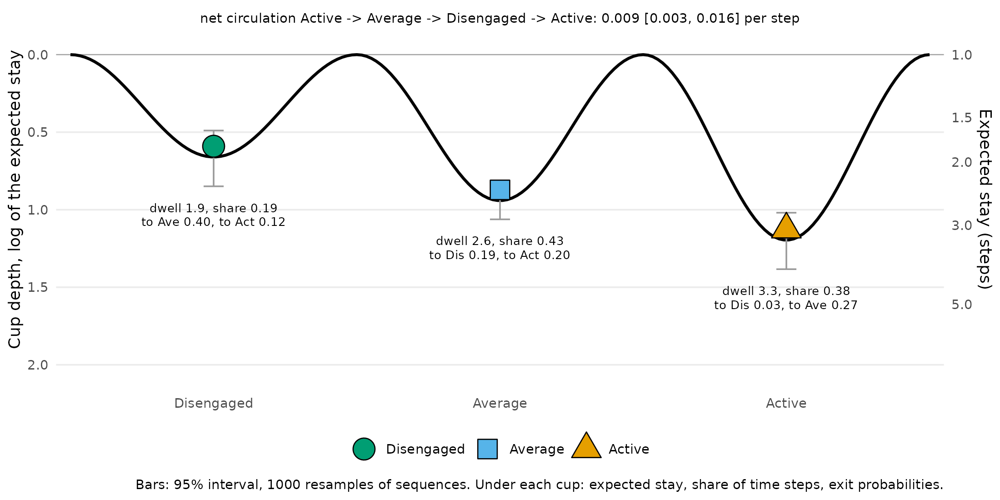

The ball sits at the bottom of each cup; the grey bars are the 95%
intervals, and the right axis reads the depth as an expected stay. Under
each cup are its expected stay, its share of courses and where students
go when they leave it.

``` r

summary(landscape, table = "exits")
```

    #>     group       from         to probability count
    #> 1 network Disengaged    Average  0.39692308   129
    #> 2 network Disengaged     Active  0.12000000    39
    #> 3 network    Average Disengaged  0.18641811   140
    #> 4 network    Average     Active  0.20372836   153
    #> 5 network     Active Disengaged  0.03495441    23
    #> 6 network     Active    Average  0.26747720   176

Students who leave Disengaged go to Average three times as often as to
Active (0.40 against 0.12), and students who leave Active almost never
drop straight to Disengaged (0.035, 23 transitions in the whole data).
Re-engagement and disengagement both pass through Average.

### How stable is each state as a Markov chain?

[`markov_stability()`](https://pak.dynasite.org/Nestimate/reference/markov_stability.md)
reports the Markov quantities behind the landscape for each state
(Kemeny & Snell, 1976; Helske et al., 2024): persistence (the
probability of staying, $`P_{ii}`$), the stationary probability (the
long-run share of time in the state), the return time (the expected
number of steps to come back after leaving, $`1/\pi_i`$), the sojourn
time (the expected length of a stay, $`1 / (1 - P_{ii})`$), and the mean
time to and from the other states.

``` r

markov <- markov_stability(network)
markov
```

    #> Markov Stability Analysis (3 states) | attractor: Average | stickiest: Active
    #> 
    #>       state persistence stationary_prob return_time sojourn_time avg_time_to_others
    #>      Active      0.6976          0.3719        2.69         3.31               6.99
    #>     Average      0.6099          0.4431        2.26         2.56               6.74
    #>  Disengaged      0.4831          0.1850        5.41         1.93               4.47
    #>  avg_time_from_others
    #>                  5.84
    #>                  3.20
    #>                  9.16

``` r

plot(markov)
```

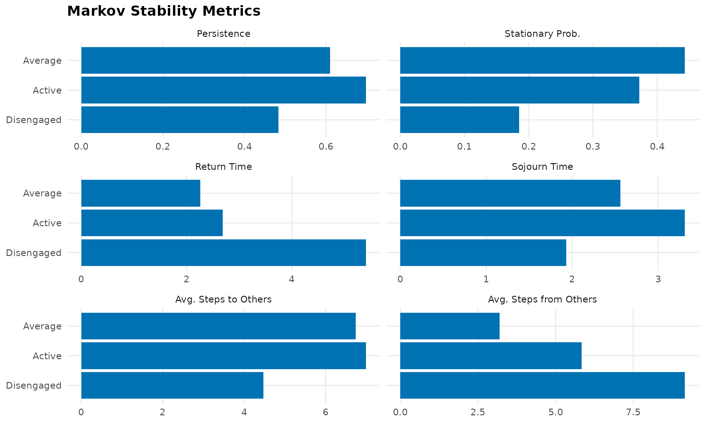

The long run splits the time 0.44 Average, 0.37 Active and 0.19
Disengaged. Disengaged is the least visited state and the slowest to
return to (5.4 courses), and the other states are far from it: reaching
Disengaged takes 9.2 courses on average from the other two states, while
leaving it to reach them takes 4.5. Average is reached from the other
states in 3.2 courses.

### How long does it take to reach a state?

[`passage_time()`](https://pak.dynasite.org/Nestimate/reference/passage_time.md)
gives the full matrix of mean first passage times: the expected number
of courses to reach the column state from the row state for the first
time (Kemeny & Snell, 1976). The diagonal is the return time.

``` r

passage <- passage_time(network, states = engagement)
passage
```

    #> Mean First Passage Times (3 states)
    #> 
    #>            Disengaged Average Active
    #> Disengaged        5.4     2.8    6.2
    #> Average           8.0     2.3    5.5
    #> Active           10.4     3.6    2.7
    #> 
    #> Stationary distribution:
    #> Disengaged    Average     Active 
    #>     0.1850     0.4431     0.3719

``` r

plot(passage)
```

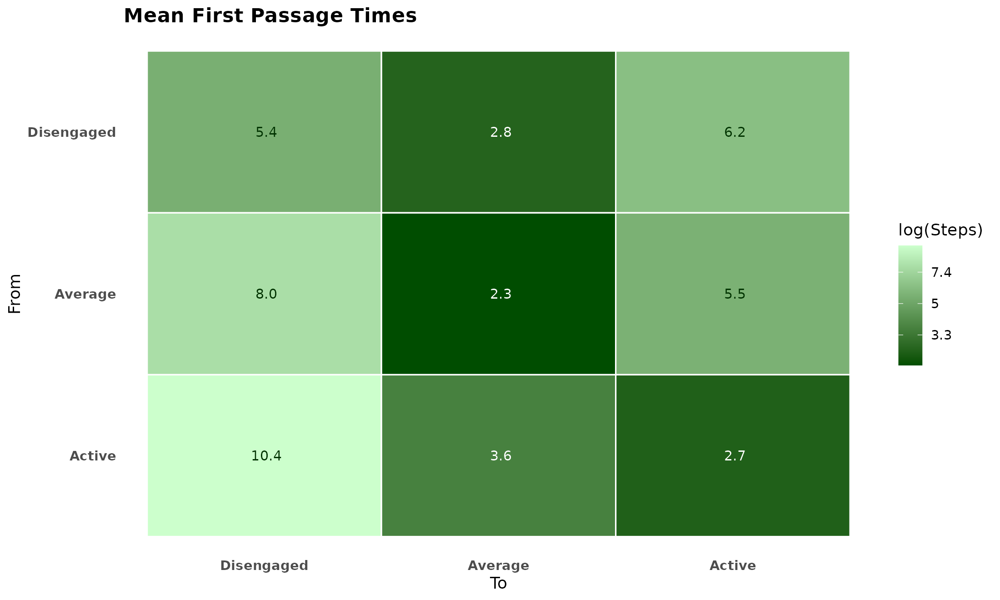

A Disengaged student reaches Average in 2.8 courses and Active in 6.2.
An Active student reaches Disengaged only after 10.4 courses on average,
the longest passage in the matrix, and almost always through Average
(8.0 courses from Average). Re-engagement from Disengaged is faster than
disengagement from Active. Saqr, López-Pernas and Tikka (2026) read this
asymmetry, slow decline and faster recovery, as resilience: the system
returns to its attractor more readily than it leaves it.

### Is the chain one connected process?

[`chain_structure()`](https://pak.dynasite.org/Nestimate/reference/chain_structure.md)
classifies the states of the chain: which states communicate, which are
recurrent or transient, whether any are absorbing, and whether the chain
is irreducible, aperiodic and reversible (Kemeny & Snell, 1976). The
stationary distribution and the passage times above assume an
irreducible chain.

``` r

chain <- chain_structure(network)
chain
```

    #> Chain structure  [3 states, 1 communicating classes]
    #>   irreducible: TRUE   aperiodic: TRUE   regular: TRUE   reversible: FALSE
    #>   recurrent classes: 1   transient classes: 0
    #> 
    #> Use summary(x) for the per-state table, plot(x) for the heatmap.

``` r

plot(chain)
```

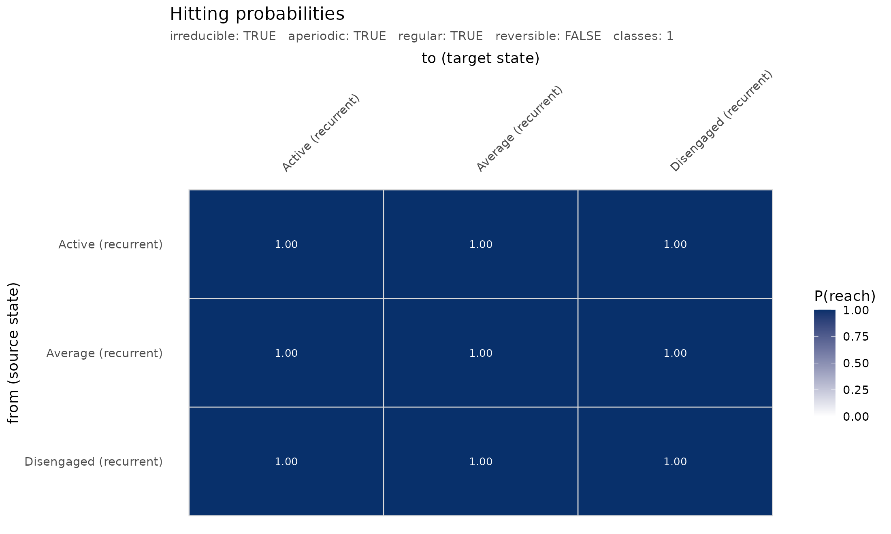

The three states form one communicating class, so every state can be
reached from every other and nothing is absorbing. The chain is regular
(some power of the matrix is positive everywhere) and not reversible:
the flow from Active to Average to Disengaged and back to Active does
not balance its reverse, which is the circulation the landscape
reported.

## Trajectory clusters

### Do the students follow distinct trajectories?

Engagement over a full program follows a small number of distinct
trajectories (Saqr & López-Pernas, 2021; Saqr, López-Pernas, Jovanović,
& Gašević, 2023). The VaSSTra method finds them by turning indicators
into states and clustering the sequences of states (López-Pernas & Saqr,
2024b).
[`build_clusters()`](https://pak.dynasite.org/Nestimate/reference/build_clusters.md)
groups the sequences by their Hamming distance with partitioning around
medoids (Saqr, López-Pernas, Helske, et al., 2024), here into three
clusters.

``` r

clusters <- build_clusters(trajectories, k = 3, seed = 2026)
clusters
```

    #> Sequence Clustering [pam]
    #>   Sequences: 138  |  Clusters: 3
    #>   Dissimilarity: hamming
    #>   Quality: silhouette = 0.360
    #> 
    #>   Cluster  N           Mean within-dist  Medoid
    #>   1        47 (34.1%)  5.898             124
    #>   2        74 (53.6%)  8.389             44
    #>   3        17 (12.3%)  5.412             103

``` r

cluster_networks <- build_network(clusters)
state_distribution(cluster_networks)
```

    #>       group      state count proportion
    #> 1 Cluster 1     Active   528 0.75213675
    #> 2 Cluster 1    Average   139 0.19800570
    #> 3 Cluster 1 Disengaged    35 0.04985755
    #> 4 Cluster 2    Average   663 0.60382514
    #> 5 Cluster 2 Disengaged   263 0.23952641
    #> 6 Cluster 2     Active   172 0.15664845
    #> 7 Cluster 3 Disengaged    56 0.80000000
    #> 8 Cluster 3    Average    11 0.15714286
    #> 9 Cluster 3     Active     3 0.04285714

The three clusters hold 47, 74 and 17 students, with an average
silhouette of 0.36, a moderate separation. Cluster 1 is mostly active
(75% of its observed courses), cluster 2 mostly average (60%, with 24%
disengaged), and cluster 3 mostly disengaged (80%). Cluster 3 also has
little data: 70 observed courses for 17 students, out of 255 possible,
because most of its students left the program early.

``` r

sequence_plot(clusters, type = "index", ncol = 3, nrow = 1)
```

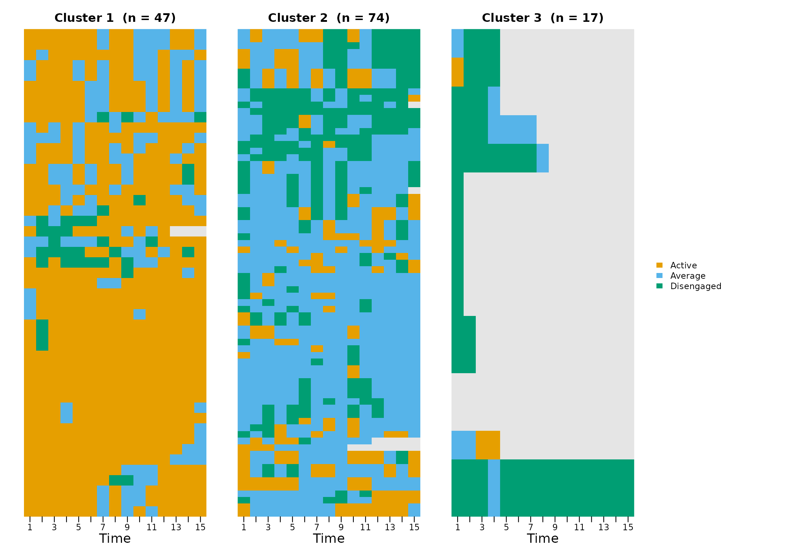

Each row is one student and each column one course. Cluster 1 is mostly
Active and cluster 2 mostly Average, with runs of Disengaged; most rows
of cluster 3 end within the first courses, and the grey is the part of
the program those students did not take.

### What landscape does each cluster live in?

The same call on the grouped networks gives one landscape per cluster.

``` r

cluster_landscape <- stability_landscape(cluster_networks, states = engagement,
                                         iter = 1000, seed = 2026)
cluster_landscape
```

    #> Stability landscape: 3 states, 3 networks, 1000 resamples
    #> 
    #> Cups (depth = log of the expected stay; deeper = more stable):
    #>      group      state depth ci_lower ci_upper dwell stay share
    #>  Cluster 1 Disengaged  0.39     0.15     0.57  1.48 0.32  0.05
    #>  Cluster 1    Average  0.35     0.27     0.45  1.43 0.30  0.20
    #>  Cluster 1     Active  1.63     1.39     1.89  5.12 0.80  0.75
    #>  Cluster 2 Disengaged  0.56     0.39     0.74  1.76 0.43  0.24
    #>  Cluster 2    Average  1.12     0.98     1.25  3.06 0.67  0.60
    #>  Cluster 2     Active  0.45     0.33     0.59  1.57 0.36  0.16
    #>  Cluster 3 Disengaged  2.20     1.65     2.74  9.00 0.89  0.80
    #>  Cluster 3    Average  0.69     0.00     1.95  2.00 0.50  0.16
    #>  Cluster 3     Active  0.69     0.00      Inf  2.00 0.50  0.04
    #> 
    #> Net circulation (per step):
    #>   Cluster 1, Active -> Average -> Disengaged -> Active: 0.0045 [-0.0035, 0.014]
    #>   Cluster 2, Active -> Average -> Disengaged -> Active: 0.0143 [0.0051, 0.0237]
    #>   Cluster 3, Disengaged -> Average -> Active -> Disengaged: 0.0217 [0, 0.0639] (877 of 1000 resamples have a stationary distribution)
    #> 
    #> Exit probabilities: summary(x, table = "exits")

``` r

plot(cluster_landscape)
```

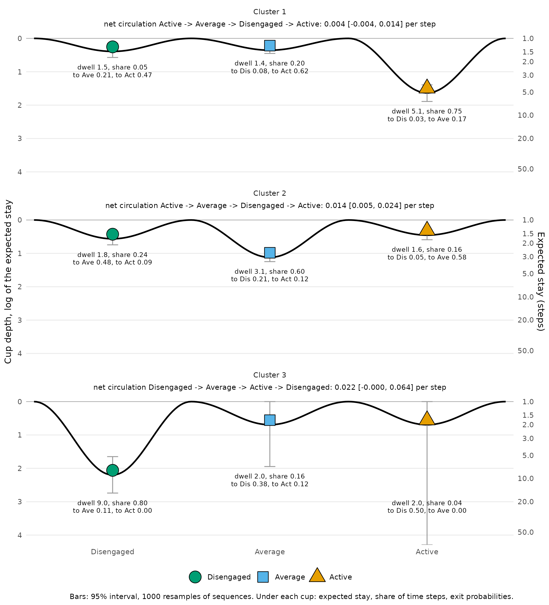

The three clusters live in three different landscapes, each with one
deep cup.

- **Cluster 1** has its deep cup at Active (depth 1.63 \[1.39, 1.89\],
  5.1 courses per stay). Average and Disengaged are equally shallow
  (0.35 and 0.39, under 1.5 courses per stay), and both drain towards
  Active: 62% of average courses and 47% of disengaged courses are
  followed by an active one. The net circulation is indistinguishable
  from zero (0.004 \[-0.004, 0.014\]).
- **Cluster 2** has its deep cup at Average (1.12 \[0.98, 1.25\], 3.1
  courses per stay). Active is as shallow as Disengaged (0.45 and 0.56),
  and 58% of active courses are followed by an average one. The
  circulation is clear of zero (0.014 \[0.005, 0.024\]).
- **Cluster 3** has its deep cup at Disengaged (2.20 \[1.65, 2.74\], 9.0
  courses per stay). Its other cups rest on very few transitions, 2 of
  them out of Active, so their intervals are wide: \[0.00, 1.95\] for
  Average and \[0.00, Inf\] for Active, an upper limit that is unbounded
  because Active is never left in some resamples.

### How long does it take to reach engagement in each cluster?

``` r

passage_time(cluster_networks, states = engagement)
```

    #> Mean First Passage Times -- 3 groups: Cluster 1, Cluster 2, Cluster 3
    #> 
    #> --- Cluster 1 ---
    #> Mean First Passage Times (3 states)
    #> 
    #>            Disengaged Average Active
    #> Disengaged       18.4     5.6    2.0
    #> Average          24.6     5.1    1.7
    #> Active           26.1     5.9    1.3
    #> 
    #> Stationary distribution:
    #> Disengaged    Average     Active 
    #>     0.0545     0.1947     0.7508 
    #> 
    #> --- Cluster 2 ---
    #> Mean First Passage Times (3 states)
    #> 
    #>            Disengaged Average Active
    #> Disengaged        4.3     2.0    9.1
    #> Average           5.5     1.6    8.8
    #> Active            6.7     1.7    6.6
    #> 
    #> Stationary distribution:
    #> Disengaged    Average     Active 
    #>     0.2347     0.6137     0.1516 
    #> 
    #> --- Cluster 3 ---
    #> Mean First Passage Times (3 states)
    #> 
    #>            Disengaged Average Active
    #> Disengaged        1.3     9.0     44
    #> Average           2.5     5.8     35
    #> Active            2.0    11.0     23
    #> 
    #> Stationary distribution:
    #> Disengaged    Average     Active 
    #>     0.7826     0.1739     0.0435

From Disengaged, a cluster 1 student reaches Active in 2.0 courses on
average, a cluster 2 student in 9.1 and a cluster 3 student in 44, far
beyond the 15 courses of the program. In the other direction, Active to
Disengaged takes 26.1 courses in cluster 1, 6.7 in cluster 2 and 2.0 in
cluster 3.

## The landscape across the program

### Does the stability of each state change over the program?

[`landscape_trend()`](https://pak.dynasite.org/Nestimate/reference/landscape_trend.md)
estimates the cup depths in a sliding window of five courses (courses
1-5, 2-6, …, 11-15) and draws one line per state, with intervals from
resampling students across all windows at once.

``` r

phase_trend <- landscape_trend(network, along = "phase", states = engagement,
                               iter = 500, seed = 2026)
phase_trend
```

    #> Stability landscape along time (5-step windows): 3 states, 1 network, 500 resamples
    #> 
    #> Cup depth (log of the expected stay; higher = more stable) at the two ends and its range:
    #>       state first at_first  last at_last  min  max
    #>  Disengaged   1-5     0.72 11-15    0.89 0.42 1.01
    #>     Average   1-5     0.98 11-15    1.10 0.77 1.10
    #>      Active   1-5     1.31 11-15    1.29 1.03 1.32

``` r

plot(phase_trend)
```

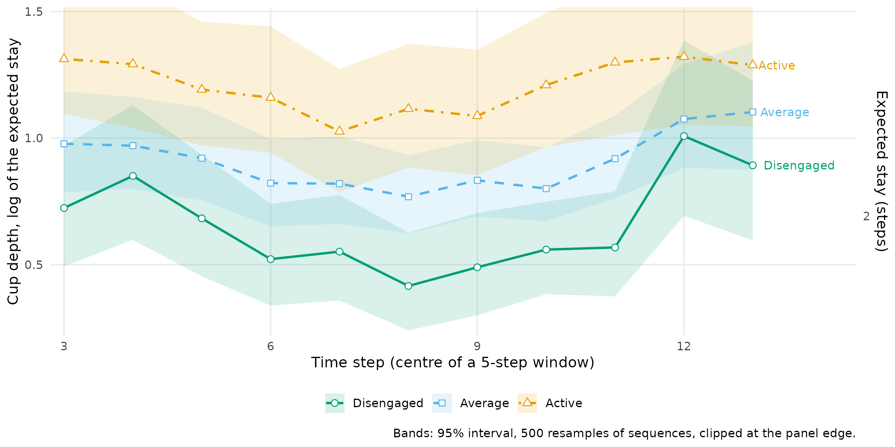

The order of the cups holds over the whole program: Active is the
deepest in every window (between 1.03 and 1.32, a stay of about three
courses), Average is second and Disengaged the shallowest. Disengaged
changes the most: its depth falls from 0.72 in courses 1-5 to 0.42 in
courses 6-10 and rises to 1.01 in courses 10-14, so disengagement holds
students longest near the end of the program.

### Does it change differently in each cluster?

``` r

cluster_trend <- landscape_trend(cluster_networks, along = "phase",
                                 states = engagement, iter = 500, seed = 2026)
cluster_trend
```

    #> Stability landscape along time (5-step windows): 3 states, 3 networks, 500 resamples
    #> 
    #> Cup depth (log of the expected stay; higher = more stable) at the two ends and its range:
    #>      group      state first at_first  last at_last  min  max
    #>  Cluster 1 Disengaged   1-5     0.69 11-15    0.00 0.00 1.10
    #>  Cluster 1    Average   1-5     0.29 11-15    0.33 0.22 0.47
    #>  Cluster 1     Active   1-5     1.89 11-15    1.58 1.45 1.89
    #>  Cluster 2 Disengaged   1-5     0.53 11-15    0.86 0.35 0.94
    #>  Cluster 2    Average   1-5     1.17 11-15    1.38 0.88 1.38
    #>  Cluster 2     Active   1-5     0.49 11-15    0.64 0.20 0.67
    #>  Cluster 3 Disengaged   1-5     1.70 11-15     Inf 1.25 2.40
    #>  Cluster 3    Average   1-5     0.41 11-15      NA 0.41 0.92
    #>  Cluster 3     Active   1-5     0.69 11-15      NA 0.69 0.69
    #> 
    #> 21 values not estimable (state never left, absent, or no stationary distribution).

``` r

plot(cluster_trend)
```

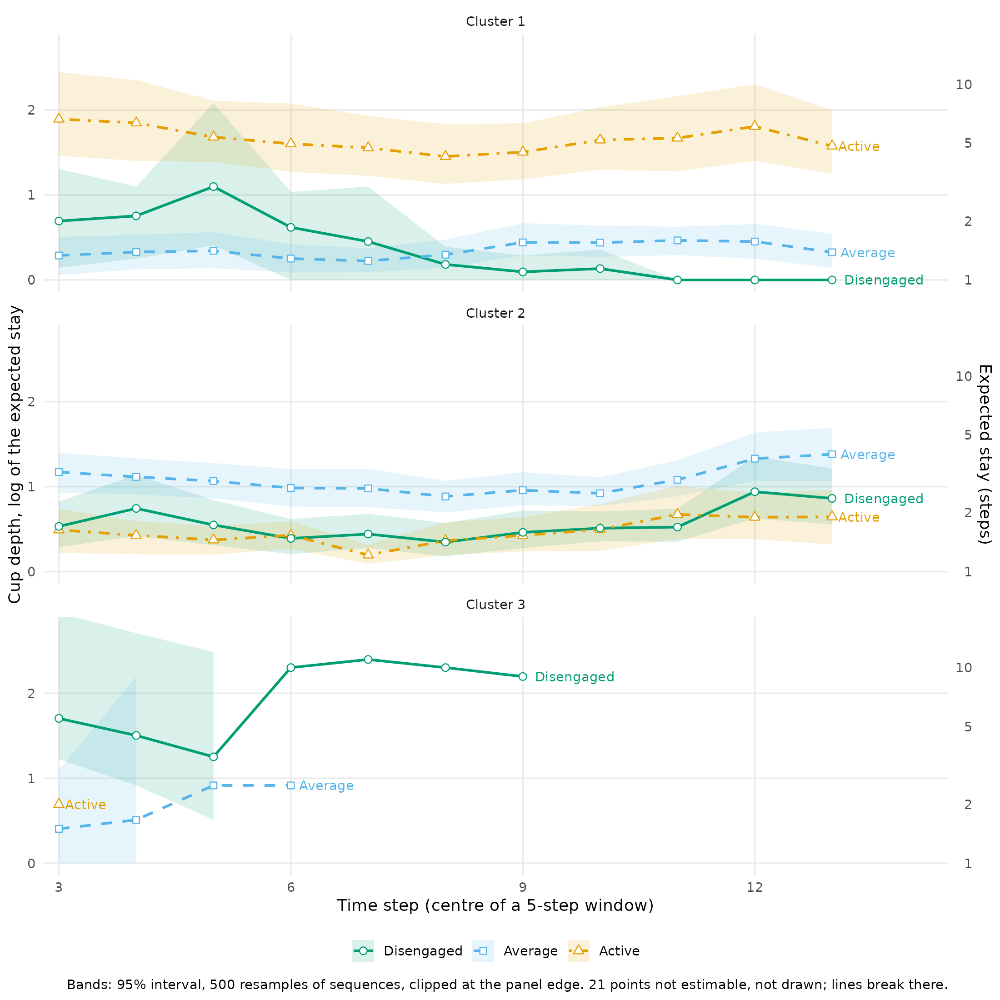

In cluster 1, Active is the deep cup in every window (1.45 to 1.89), and
the Disengaged cup disappears over the program: from 0.69 in courses 1-5
to 0 in the last windows, where every disengaged course is followed by a
different state. In cluster 2, Average stays the deep cup and deepens at
the end (1.17 to 1.38), and Disengaged becomes stickier (0.53 to 0.86).
Cluster 3 runs out of data: its students leave the program, so its later
windows have no Average or Active courses, and in some windows its
Disengaged cup is never left (21 such points across the three clusters,
left out of the lines).

### How does the landscape itself move over the program?

The same windows, with the cups and ridges of the stationary
distribution (`depth = "occupancy"`), drawn as a 3D landscape: the
states run across, the program runs into the picture, and each cup
becomes a channel. Here a cup sits at $`-\log \pi`$, lower when students
spend more of the window in the state, and a ridge at $`-\log`$ of the
probability flux between two states, higher when the switch is rarer
(Wang, Xu, & Wang, 2008). The windows are six courses long.

``` r

occupancy_trend <- landscape_trend(network, along = "phase",
                                   depth = "occupancy", window = 6,
                                   states = engagement, iter = 500,
                                   seed = 2026)
occupancy_trend
```

    #> Stability landscape along time (6-step windows): 3 states, 1 network, 500 resamples
    #> 
    #> Cup potential (-log pi; lower = more time in the state) at the two ends and its range:
    #>       state first at_first  last at_last  min  max
    #>  Disengaged   1-6     1.62 10-15    1.73 1.54 1.79
    #>     Average   1-6     0.82 10-15    0.79 0.79 0.86
    #>      Active   1-6     1.02 10-15    1.00 0.89 1.08

``` r

plot(occupancy_trend, type = "surface")
```

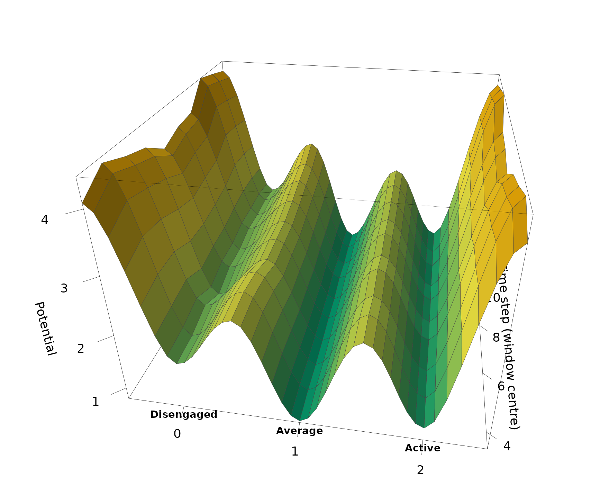

For all students the landscape barely moves over the program. Average is
the lowest channel in every window (0.79 to 0.86), Active a little
higher (0.89 to 1.08) and Disengaged the highest (1.54 to 1.79).

``` r

cluster_occupancy <- landscape_trend(cluster_networks, along = "phase",
                                     depth = "occupancy", window = 6,
                                     states = engagement, iter = 500,
                                     seed = 2026)
cluster_occupancy
```

    #> Stability landscape along time (6-step windows): 3 states, 3 networks, 500 resamples
    #> 
    #> Cup potential (-log pi; lower = more time in the state) at the two ends and its range:
    #>      group      state first at_first  last at_last  min  max
    #>  Cluster 1 Disengaged   1-6     2.44 10-15    3.84 2.44 3.84
    #>  Cluster 1    Average   1-6     1.95 10-15    1.52 1.42 1.95
    #>  Cluster 1     Active   1-6     0.26 10-15    0.27 0.26 0.35
    #>  Cluster 2 Disengaged   1-6     1.52 10-15    1.36 1.32 1.52
    #>  Cluster 2    Average   1-6     0.45 10-15    0.49 0.45 0.54
    #>  Cluster 2     Active   1-6     1.95 10-15    2.01 1.76 2.09
    #>  Cluster 3 Disengaged   1-6     0.31 10-15      NA 0.31 0.31
    #>  Cluster 3    Average   1-6     1.58 10-15      NA 1.58 1.58
    #>  Cluster 3     Active   1-6     2.83 10-15      NA 0.00 2.83
    #> 
    #> 53 values not estimable (state never left, absent, or no stationary distribution).

``` r

plot(cluster_occupancy, type = "surface")
```

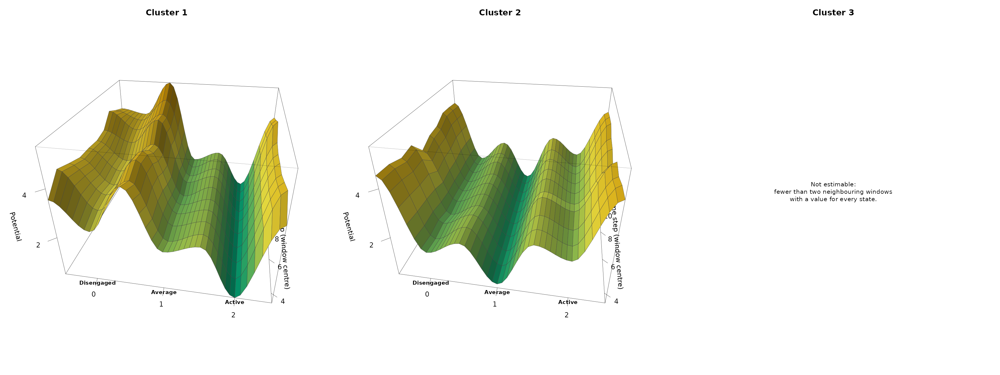

The clusters’ channels are steady too, but at different states. In
cluster 1 the Active channel stays low throughout (0.26 to 0.35) while
the Disengaged ground rises from 2.44 to 3.84: disengagement becomes
rarer as the program goes on. In cluster 2 the Average channel stays low
(0.45 to 0.54) and Active stays high (1.76 to 2.09). Cluster 3 can be
drawn only in its first window: after that its students are disengaged
or gone, and the chain of a window has no stationary distribution.

## Landscapes across stability measures

### Which cup deepens as students become more stable?

[`landscape_surface()`](https://pak.dynasite.org/Nestimate/reference/landscape_surface.md)
adds a second axis: a per-student stability measure from
[`sequence_metrics()`](https://pak.dynasite.org/Nestimate/reference/sequence_metrics.md).
At each value of the measure it computes the cup depths from the 30
students closest to that value, weighted by a tricube kernel (Cleveland,
1979), so the surface runs from the most stable students to the most
volatile; the plot puts the most stable end in front. Six measures are
used: self-loop tendency (the share of courses that repeat the previous
state), longitudinal entropy, the complexity index, the longest spell,
cyclic feedback (how often a state recurs two or more courses later) and
initial-state persistence (the length of the opening spell). The last
section defines them.

``` r

surface <- landscape_surface(network, states = engagement,
                             measure = c("self_loop_tendency",
                                         "longitudinal_entropy",
                                         "complexity_index",
                                         "max_spell_duration",
                                         "cyclic_feedback_strength",
                                         "initial_state_persistence"))
surface
```

    #> Landscape surface: 3 states, 1 network x 6 measures, 30 nearest sequences per slice
    #> 
    #> Cup depth (log of the expected stay) at the low and the high end of each measure:
    #>                    measure      state  low depth_at_low  high depth_at_high
    #>         self_loop_tendency Disengaged 0.29         0.14  0.96          2.35
    #>         self_loop_tendency    Average 0.29         0.46  0.96          1.43
    #>         self_loop_tendency     Active 0.29         0.35  0.96          3.09
    #>       longitudinal_entropy Disengaged 0.11         1.96  0.96          0.58
    #>       longitudinal_entropy    Average 0.11         1.42  0.96          0.57
    #>       longitudinal_entropy     Active 0.11         3.03  0.96          0.53
    #>           complexity_index Disengaged 0.15         2.49  0.76          0.33
    #>           complexity_index    Average 0.15         1.60  0.76          0.57
    #>           complexity_index     Active 0.15         3.15  0.76          0.39
    #>         max_spell_duration Disengaged 2.50         0.42 14.00          1.56
    #>         max_spell_duration    Average 2.50         0.47 14.00          1.58
    #>         max_spell_duration     Active 2.50         0.51 14.00          2.94
    #>   cyclic_feedback_strength Disengaged 0.50         0.99  1.00          0.54
    #>   cyclic_feedback_strength    Average 0.50         0.77  1.00          0.89
    #>   cyclic_feedback_strength     Active 0.50         0.63  1.00          1.23
    #>  initial_state_persistence Disengaged 0.07         0.62  0.97          1.63
    #>  initial_state_persistence    Average 0.07         0.88  0.97          2.26
    #>  initial_state_persistence     Active 0.07         0.90  0.97          3.19
    #> 
    #> Effective sequences per slice: network 5.0-73.0

``` r

plot(surface, ncol = 3)
```

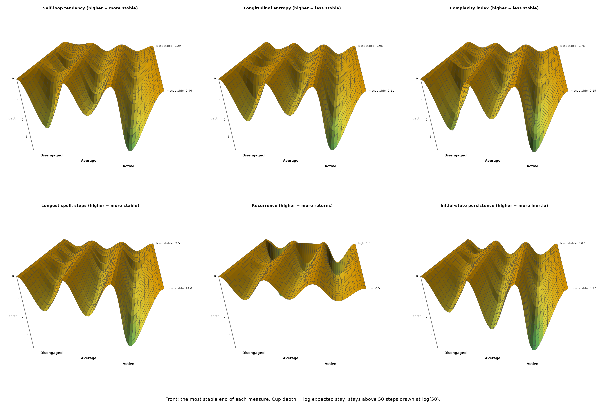

Five of the six measures give the same answer. At the stable end every
cup deepens and Active is the deepest, between 2.94 and 3.19 on all five
measures, an expected stay of about 20 courses. Disengaged is the second
deepest for self-loop tendency, entropy and complexity (1.96 to 2.49, 7
to 12 courses): the most stable students are either stably active or,
fewer of them, stably disengaged. At the volatile end all three cups are
shallow and of similar depth (0.14 to 0.90). Cyclic feedback differs: as
recurrence rises, the Active cup deepens (0.63 to 1.23) and the
Disengaged cup becomes shallower (0.99 to 0.54).

The measures come from the same sequences as the depths, so the cups of
the most stable students are deep by construction, self-loop tendency
most of all, and the depths at the stable end exceed any stay the
15-course program can show. What the surface adds is which cup deepens
as stability rises: Active first, Disengaged second.

### Does the same hold inside each cluster?

``` r

cluster_surface <- landscape_surface(cluster_networks, states = engagement,
                                     measure = c("self_loop_tendency",
                                                 "longitudinal_entropy"))
cluster_surface
```

    #> Landscape surface: 3 states, 3 networks x 2 measures, 30 nearest sequences per slice
    #> 
    #> Cup depth (log of the expected stay) at the low and the high end of each measure:
    #>      group              measure      state  low depth_at_low high depth_at_high
    #>  Cluster 1   self_loop_tendency Disengaged 0.36         0.42 1.00          0.27
    #>  Cluster 1   self_loop_tendency    Average 0.36         0.30 1.00          0.55
    #>  Cluster 1   self_loop_tendency     Active 0.36         0.91 1.00          2.86
    #>  Cluster 1 longitudinal_entropy Disengaged 0.00         0.00 0.94          0.47
    #>  Cluster 1 longitudinal_entropy    Average 0.00         0.27 0.94          0.36
    #>  Cluster 1 longitudinal_entropy     Active 0.00         3.07 0.94          1.01
    #>  Cluster 2   self_loop_tendency Disengaged 0.29         0.15 0.81          0.73
    #>  Cluster 2   self_loop_tendency    Average 0.29         0.61 0.81          1.92
    #>  Cluster 2   self_loop_tendency     Active 0.29         0.22 0.81          0.88
    #>  Cluster 2 longitudinal_entropy Disengaged 0.36         0.62 0.99          0.57
    #>  Cluster 2 longitudinal_entropy    Average 0.36         1.80 0.99          0.64
    #>  Cluster 2 longitudinal_entropy     Active 0.36         0.23 0.99          0.40
    #>  Cluster 3   self_loop_tendency Disengaged 0.67         2.10 1.00          2.29
    #>  Cluster 3   self_loop_tendency    Average 0.67         0.68 1.00          0.83
    #>  Cluster 3   self_loop_tendency     Active 0.67         0.69 1.00            NA
    #>  Cluster 3 longitudinal_entropy Disengaged 0.00         2.49 0.63          1.97
    #>  Cluster 3 longitudinal_entropy    Average 0.00         0.00 0.63          0.89
    #>  Cluster 3 longitudinal_entropy     Active 0.00         0.00 0.63          0.70
    #> 
    #> Effective sequences per slice: Cluster 1 15.8-26.5, Cluster 2 11.6-27.8, Cluster 3 4.0-8.0

``` r

plot(cluster_surface)
```

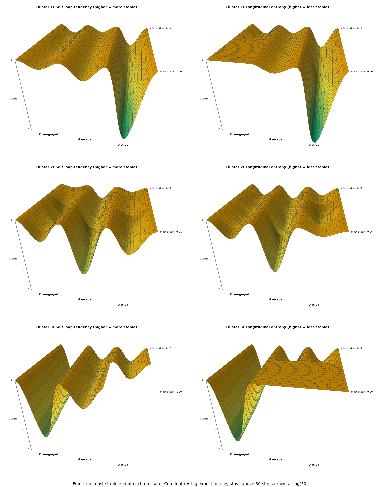

Within clusters, stability deepens the cluster’s own cup. In cluster 1
the Active cup deepens from 0.91 for the students with the lowest
self-loop tendency to 2.86 for the highest, and it is the deepest cup at
both ends of both measures. In cluster 2 the Average cup deepens from
0.61 to 1.92: the most stable cluster 2 students are stably average, not
stably active. Cluster 3 has 4 to 8 effective students per slice, so its
surfaces show no more than its deep Disengaged cup.

## The students

The network and the landscapes describe the states of a group, and a
group-level description can misrepresent the students in it (Saqr, 2024;
Saqr, Vogelsmeier, & López-Pernas, 2024); in self-regulated learning,
the average process does not reflect the process of individual students
(Saqr & López-Pernas, 2024). Saqr, López-Pernas and Tikka (2026) read
stability from each student’s own sequence: a stable student visits few
states, stays long in each, returns to the same state, and spends most
of the program in one state that acts as their attractor. They group the
sequence indices into three families, diversity of states, resistance to
change and structural dynamics.
[`sequence_metrics()`](https://pak.dynasite.org/Nestimate/reference/sequence_metrics.md)
computes the indices, as `sequence_indices()` in codyna does (Tikka,
López-Pernas, & Saqr, 2026); most are also defined in TraMineR
(Gabadinho et al., 2011). `indices` selects the ones returned.

### How varied is each student’s sequence?

The first family measures the diversity of states. `unique_states`
counts the distinct states a student visits. `longitudinal_entropy` is
the Shannon entropy of the student’s state proportions $`p_s`$, divided
by the log of the number of states $`S`$ so that it runs from 0 to 1:
$`-\sum_{s=1}^{S} p_s \log p_s / \log S`$. `simpson_diversity` is the
probability that two courses drawn from the sequence are in different
states, $`1 - \sum_{s=1}^{S} p_s^2`$. Low values mean a sequence
concentrated in one state, the mark of a strong attractor (Saqr,
López-Pernas, & Tikka, 2026).

``` r

diversity <- sequence_metrics(trajectories,
                              indices = c("valid_n", "unique_states",
                                          "longitudinal_entropy",
                                          "simpson_diversity"))
summary(diversity)
```

    #>     valid_n      unique_states   longitudinal_entropy simpson_diversity
    #>  Min.   : 0.00   Min.   :0.000   Min.   :0.0000       Min.   :0.0000   
    #>  1st Qu.:15.00   1st Qu.:2.000   1st Qu.:0.4416       1st Qu.:0.2400   
    #>  Median :15.00   Median :2.000   Median :0.5794       Median :0.4444   
    #>  Mean   :13.55   Mean   :2.283   Mean   :0.5583       Mean   :0.3821   
    #>  3rd Qu.:15.00   3rd Qu.:3.000   3rd Qu.:0.7426       3rd Qu.:0.4978   
    #>  Max.   :15.00   Max.   :3.000   Max.   :0.9878       Max.   :0.6578   
    #>                                  NAs    :2            NAs    :2

Two students have no observed course and get `NA` in every index, and 20
are observed for fewer than 15 courses: a sequence ends at its last
observed course. The typical student visits two of the three states. The
mean entropy is 0.56 and the mean Simpson diversity 0.38: the cohort is
more varied than the mostly engaged students Saqr, López-Pernas and
Tikka (2026) analysed (0.38 and 0.27).

``` r

subset(sequence_metrics(trajectories,
                        indices = c("first_state", "valid_n",
                                    "unique_states")),
       unique_states == 1)
```

    #>     first_state valid_n unique_states
    #> 30   Disengaged       2             1
    #> 32       Active      15             1
    #> 33   Disengaged       1             1
    #> 82       Active      15             1
    #> 86       Active      15             1
    #> 94       Active      15             1
    #> 97   Disengaged       1             1
    #> 98   Disengaged       1             1
    #> 102  Disengaged       1             1
    #> 103  Disengaged       2             1
    #> 106  Disengaged       1             1
    #> 124      Active      15             1

The students who visit a single state are of two kinds. Five are Active
in all 15 courses: a single attractor that held for the whole program.
Seven are Disengaged and are observed for one or two courses only: their
sequences are stable because they ended, not because they resisted
change. A diversity of 0 needs `valid_n` beside it before it can be read
as stability.

### How strongly does each student resist change?

The second family measures resistance to change. `self_loop_tendency` is
the share of a student’s transitions that stay in the same state and
`transition_rate` the share that change it; the two sum to 1.
`mean_spell_duration` and `max_spell_duration` are the mean and the
longest run of one state, in courses. `initial_state_persistence` is the
length of the opening spell as a share of the sequence,
`initial_state_proportion` the share of the sequence spent in the first
state, and `initial_state_influence_decay` the share of the first third
spent in the first state minus the share of the last third, positive
when the first state fades.

``` r

summary(sequence_metrics(trajectories,
                         indices = c("self_loop_tendency", "transition_rate",
                                     "mean_spell_duration",
                                     "max_spell_duration",
                                     "initial_state_persistence",
                                     "initial_state_proportion",
                                     "initial_state_influence_decay")))
```

    #>  self_loop_tendency transition_rate  mean_spell_duration max_spell_duration
    #>  Min.   :0.2143     Min.   :0.0000   Min.   : 1.000      Min.   : 1.000    
    #>  1st Qu.:0.5000     1st Qu.:0.2143   1st Qu.: 1.667      1st Qu.: 4.000    
    #>  Median :0.5714     Median :0.4286   Median : 2.143      Median : 5.000    
    #>  Mean   :0.6278     Mean   :0.3722   Mean   : 3.189      Mean   : 6.169    
    #>  3rd Qu.:0.7857     3rd Qu.:0.5000   3rd Qu.: 3.750      3rd Qu.: 7.000    
    #>  Max.   :1.0000     Max.   :0.7857   Max.   :15.000      Max.   :15.000    
    #>  NAs    :7          NAs    :7        NAs    :2           NAs    :2         
    #>  initial_state_persistence initial_state_proportion initial_state_influence_decay
    #>  Min.   :0.06667           Min.   :0.06667          Min.   :-0.63333             
    #>  1st Qu.:0.06667           1st Qu.:0.31667          1st Qu.:-0.03333             
    #>  Median :0.13333           Median :0.60000          Median : 0.18333             
    #>  Mean   :0.28557           Mean   :0.55793          Mean   : 0.17439             
    #>  3rd Qu.:0.40000           3rd Qu.:0.80000          3rd Qu.: 0.33333             
    #>  Max.   :1.00000           Max.   :1.00000          Max.   : 1.00000             
    #>  NAs    :2                 NAs    :2                NAs    :2

Students repeat their state in 63% of transitions on average (median
57%, range 21% to 100%), and change it in the other 37%. The median
spell lasts 2.1 courses and the median longest spell 5 courses. The
median opening spell covers 13% of the sequence, two courses of fifteen,
although the first state takes 56% of the sequence on average, because
students come back to it. The mean influence decay is 0.17: for most
students the first state weakens over the program. The cohort resists
change less than the mostly engaged students of Saqr, López-Pernas and
Tikka (2026), whose mean self-loop tendency was 0.75 and initial-state
persistence 0.45.

### Where does each student’s sequence settle?

The third family describes the structure of a sequence.
`cyclic_feedback_strength` is the largest share, over lags of two or
more courses, of positions whose state recurs that many courses later.
`dominant_state` is the student’s most frequent state, their attractor;
`dominant_proportion` its share of the sequence and `dominant_max_spell`
its longest spell. `transition_complexity` is the share of the six
possible changes of state that the student makes at least once.
`emergent_state` is a state that settles in later in the program and
outlasts the opening.

``` r

structure_indices <- sequence_metrics(trajectories,
                                      indices = c("dominant_state",
                                                  "dominant_proportion",
                                                  "dominant_max_spell",
                                                  "cyclic_feedback_strength",
                                                  "transition_complexity",
                                                  "emergent_state"))
summary(structure_indices)
```

    #>    dominant_state dominant_proportion dominant_max_spell cyclic_feedback_strength
    #>  Length   :138    Min.   :0.4000      Min.   : 1.000     Min.   :0.0000          
    #>  N.unique :  3    1st Qu.:0.5804      1st Qu.: 4.000     1st Qu.:0.6981          
    #>  N.blank  :  0    Median :0.6667      Median : 5.000     Median :1.0000          
    #>  Min.nchar:  6    Mean   :0.7091      Mean   : 6.096     Mean   :0.8267          
    #>  Max.nchar: 10    3rd Qu.:0.8667      3rd Qu.: 7.000     3rd Qu.:1.0000          
    #>  NAs      :  2    Max.   :1.0000      Max.   :15.000     Max.   :1.0000          
    #>                   NAs    :2           NAs    :2          NAs    :2               
    #>  transition_complexity   emergent_state
    #>  Min.   :0.0000        Length   :138   
    #>  1st Qu.:0.3333        N.unique :  3   
    #>  Median :0.3333        N.blank  :  0   
    #>  Mean   :0.4240        Min.nchar:  6   
    #>  3rd Qu.:0.6667        Max.nchar: 10   
    #>  Max.   :1.0000        NAs      : 33   
    #>  NAs    :2

The dominant state takes 71% of a student’s sequence on average and
never less than 40%: every student has an attractor that holds at least
two courses in five. Students use a third of the possible changes
(median 0.33, two of six).

``` r

aggregate(cbind(self_loop_tendency, dominant_proportion,
                longitudinal_entropy, mean_spell_duration) ~ dominant_state,
          data = sequence_metrics(trajectories), FUN = median)
```

    #>   dominant_state self_loop_tendency dominant_proportion longitudinal_entropy mean_spell_duration
    #> 1         Active          0.6666667           0.7333333            0.5793802            2.500000
    #> 2        Average          0.5714286           0.6666667            0.6289055            2.142857
    #> 3     Disengaged          0.6428571           0.7142857            0.5445684            2.000000

The attractors differ in how firmly they hold their students. Students
whose attractor is Active are the most stable: the median student
repeats their state in 67% of transitions, spends 73% of the program in
Active and stays 2.5 courses at a time. Students whose attractor is
Average are the least stable on three of the four indices; Disengaged
students have the shortest spells (2.0 courses). The deepest cup of the
landscape, Active, holds its individual students most firmly too.

### Do students end where they started?

A complex system is sensitive to its initial conditions (Saqr,
López-Pernas, & Tikka, 2026): the state a student starts in may shape
the state they end in.

``` r

first_last <- table(sequence_metrics(trajectories,
                                     indices = c("first_state",
                                                 "last_state")))
first_last
```

    #>             last_state
    #> first_state  Active Average Disengaged
    #>   Active         26      21          5
    #>   Average        16      27          7
    #>   Disengaged      3      14         17

``` r

mosaic_plot(first_last, xlab = "First state", ylab = "Last state", seed = 1)
```

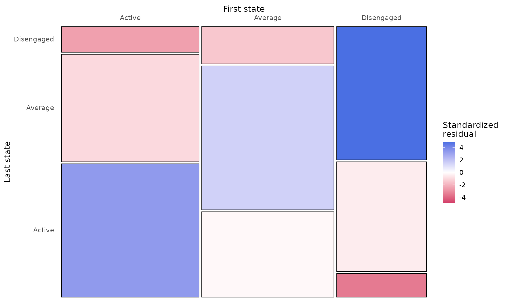

Half the students (70 of 136) end in the state they started in. The
start carries most at the extremes: 26 of the 52 students who start
Active end Active and only 5 end Disengaged, and 17 of the 34 who start
Disengaged end Disengaged and only 3 end Active. The mosaic marks these
cells by their standardised residuals: Active to Active and Disengaged
to Disengaged occur more often than independence predicts, and the
crossings between the extremes less often.

### How much of each sequence is spent in the favourable state?

`integrative_potential` weights each course by its position, so that
time in Active late in the program counts more than time in Active at
the start (Brzinsky-Fay, 2018); `favorable` names the favourable state.

``` r

summary(sequence_metrics(trajectories, favorable = "Active",
                         indices = c("integrative_potential",
                                     "complexity_index")))
```

    #>  integrative_potential complexity_index
    #>  Min.   :0.000000      Min.   :0.0000  
    #>  1st Qu.:0.008333      1st Qu.:0.4019  
    #>  Median :0.220833      Median :0.5243  
    #>  Mean   :0.346837      Mean   :0.4994  
    #>  3rd Qu.:0.613301      3rd Qu.:0.6411  
    #>  Max.   :1.000000      Max.   :0.7824  
    #>  NAs    :2             NAs    :2

The median student spends a position-weighted 22% of the program in
Active (mean 0.35), and a quarter of the students spend almost none. The
complexity index combines the families into one number per student:
$`0.4 \times`$ entropy $`+ 0.4 \times`$ transition rate $`+ 0.2 \times`$
the coefficient of variation of the spell lengths (capped at 1), 0 for a
student who never changes state. Its mean is 0.50 (range 0 to 0.78);
built from entropy and the transition rate, it ranks the students much
as those two do.

## Related articles

The predictability of the process (transition entropy, whether the next
state depends on more than the current one, which histories change it)
is covered in the transition-entropy vignette and the higher-order
network article. The stability of the estimates (bootstrap, Bayesian
certainty, split-half reliability, case-dropping of edges and
centralities) is covered in the model assessment article.

## How to cite this article

Saqr, M., López-Pernas, S., & Misiejuk, K. (2026). *Stability of
engagement: States, landscapes and students*. Nestimate.
<https://doi.org/10.5281/zenodo.24528520> ·
[HTML](https://pak.dynasite.org/Nestimate/articles/stability-landscapes.html)
· [PDF](https://pak.dynasite.org/Nestimate/pdf/stability-landscapes.pdf)

## References

Brzinsky-Fay, C. (2018). Unused resources: Sequence and trajectory
indicators. *International Symposium on Sequence Analysis and Related
Methods*, Monte Verità.

Cleveland, W. S. (1979). Robust locally weighted regression and
smoothing scatterplots. *Journal of the American Statistical
Association*, 74(368), 829–836.
<https://doi.org/10.1080/01621459.1979.10481038>

Gabadinho, A., Ritschard, G., Müller, N. S., & Studer, M. (2011).
Analyzing and visualizing state sequences in R with TraMineR. *Journal
of Statistical Software*, 40(4), 1–37.
<https://doi.org/10.18637/jss.v040.i04>

Helske, J., Helske, S., Saqr, M., López-Pernas, S., & Murphy, K. (2024).
A modern approach to transition analysis and process mining with Markov
models in education. In M. Saqr & S. López-Pernas (Eds.), *Learning
analytics methods and tutorials* (pp. 381–427). Springer.
<https://doi.org/10.1007/978-3-031-54464-4_12>

Kemeny, J. G., & Snell, J. L. (1976). *Finite Markov chains*. Springer.

Kramers, H. A. (1940). Brownian motion in a field of force and the
diffusion model of chemical reactions. *Physica*, 7(4), 284–304.
<https://doi.org/10.1016/S0031-8914(40)90098-2>

López-Pernas, S., Conde, M. Á., Raspopović Milić, M., & Saqr, M. (2026).
Stable means, shifting patterns: Examining SRL through a complex dynamic
systems lens. *Computers in Human Behavior Reports*, 22, 101038.
<https://doi.org/10.1016/j.chbr.2026.101038>

López-Pernas, S., & Saqr, M. (2024a). How the dynamics of engagement
explain the momentum of achievement and the inertia of disengagement: A
complex systems theory approach. *Computers in Human Behavior*, 153,
108126. <https://doi.org/10.1016/j.chb.2023.108126>

López-Pernas, S., & Saqr, M. (2024b). Modeling the dynamics of
longitudinal processes in education. A tutorial with R for the VaSSTra
method. In M. Saqr & S. López-Pernas (Eds.), *Learning analytics methods
and tutorials* (pp. 355–379). Springer.
<https://doi.org/10.1007/978-3-031-54464-4_11>

Saqr, M. (2024). Group-level analysis of engagement poorly reflects
individual students’ processes: Why we need idiographic learning
analytics. *Computers in Human Behavior*, 150, 107991.
<https://doi.org/10.1016/j.chb.2023.107991>

Saqr, M., Dever, D., López-Pernas, S., Gernigon, C., Marchand, G., &
Kaplan, A. (2025). Complex dynamic systems in education: Beyond the
static, the linear and the causal reductionism. In M. Saqr & S.
López-Pernas (Eds.), *Advanced learning analytics methods: AI, precision
and complexity* (pp. 289–311). Springer.
<https://doi.org/10.1007/978-3-031-95365-1_12>

Saqr, M., & López-Pernas, S. (2021). The longitudinal trajectories of
online engagement over a full program. *Computers & Education*, 175,
104325. <https://doi.org/10.1016/j.compedu.2021.104325>

Saqr, M., & López-Pernas, S. (2024). Mapping the self in self-regulation
using complex dynamic systems approach. *British Journal of Educational
Technology*, 55(4), 1376–1397. <https://doi.org/10.1111/bjet.13452>

Saqr, M., López-Pernas, S., Helske, S., Durand, M., Murphy, K., Studer,
M., & Ritschard, G. (2024). Sequence analysis in education: Principles,
technique, and tutorial with R. In M. Saqr & S. López-Pernas (Eds.),
*Learning analytics methods and tutorials* (pp. 321–354). Springer.
<https://doi.org/10.1007/978-3-031-54464-4_10>

Saqr, M., López-Pernas, S., Helske, S., & Hrastinski, S. (2023). The
longitudinal association between engagement and achievement varies by
time, students’ profiles, and achievement state: A full program study.
*Computers & Education*, 199, 104787.
<https://doi.org/10.1016/j.compedu.2023.104787>

Saqr, M., López-Pernas, S., Jovanović, J., & Gašević, D. (2023).
Intense, turbulent, or wallowing in the mire: A longitudinal study of
cross-course online tactics, strategies, and trajectories. *The Internet
and Higher Education*, 57, 100902.
<https://doi.org/10.1016/j.iheduc.2022.100902>

Saqr, M., López-Pernas, S., & Misiejuk, K. (2026). Nestimate: An R
package for dynamic, probabilistic, and high order network analysis.
*Applied Psychological Measurement*.
<https://doi.org/10.1177/01466216261472019>

Saqr, M., López-Pernas, S., & Tikka, S. (2025). Mapping relational
dynamics with transition network analysis: A primer and tutorial. In M.
Saqr & S. López-Pernas (Eds.), *Advanced learning analytics methods: AI,
precision and complexity* (pp. 371–411). Springer.
<https://doi.org/10.1007/978-3-031-95365-1_15>

Saqr, M., López-Pernas, S., & Tikka, S. (2026). Modeling stability and
change from a complex systems perspective. In M. Saqr, K. Misiejuk, & S.
López-Pernas (Eds.), *Innovations in analytics of learning dynamics*
(pp. 51–61). Springer. <https://doi.org/10.1007/978-3-032-34157-0_4>

Saqr, M., López-Pernas, S., Tikka, S., & Spitzer, M. (2026). Early
warning signals appear long before dropping out: An idiographic approach
grounded in complex dynamic systems theory. In *Proceedings of the 16th
International Learning Analytics and Knowledge Conference (LAK26)*
(pp. 216–226). ACM. <https://doi.org/10.1145/3785022.3785050>

Saqr, M., López-Pernas, S., Törmänen, T., Kaliisa, R., Misiejuk, K., &
Tikka, S. (2025). Transition network analysis: A novel framework for
modeling, visualizing, and identifying the temporal patterns of learners
and learning processes. In *Proceedings of the 15th International
Learning Analytics and Knowledge Conference (LAK25)* (pp. 351–361). ACM.
<https://doi.org/10.1145/3706468.3706513>

Saqr, M., Schreuder, M. J., & López-Pernas, S. (2024). Why educational
research needs a complex system revolution that embraces individual
differences, heterogeneity, and uncertainty. In M. Saqr & S.
López-Pernas (Eds.), *Learning analytics methods and tutorials*
(pp. 723–734). Springer. <https://doi.org/10.1007/978-3-031-54464-4_22>

Saqr, M., Vogelsmeier, L. V. D. E., & López-Pernas, S. (2024). Capturing
where the learning process takes place: A person-specific and
person-centered primer. *Learning and Individual Differences*, 113,
102492. <https://doi.org/10.1016/j.lindif.2024.102492>

Scheffer, M., Bascompte, J., Brock, W. A., Brovkin, V., Carpenter, S.
R., Dakos, V., Held, H., van Nes, E. H., Rietkerk, M., & Sugihara, G.
(2009). Early-warning signals for critical transitions. *Nature*,
461(7260), 53–59. <https://doi.org/10.1038/nature08227>

Schnakenberg, J. (1976). Network theory of microscopic and macroscopic
behavior of master equation systems. *Reviews of Modern Physics*, 48(4),
571–585. <https://doi.org/10.1103/RevModPhys.48.571>

Tikka, S., López-Pernas, S., & Saqr, M. (2026). *Analyzing complex
dynamic systems with the R package codyna* \[Preprint\].
<https://doi.org/10.13140/RG.2.2.19126.56646>

Vemuri, P., López-Pernas, S., Poelmans, S., Snoeck, M., & Saqr, M.
(2026). The worrisome dynamics of persistent disengagement: A
longitudinal study of university freshmen. *Journal of Computer Assisted
Learning*, 42(3). <https://doi.org/10.1002/jcal.70250>

Wang, J., Xu, L., & Wang, E. (2008). Potential landscape and flux
framework of nonequilibrium networks: Robustness, dissipation, and
coherence of biochemical oscillations. *Proceedings of the National
Academy of Sciences*, 105(34), 12271–12276.
<https://doi.org/10.1073/pnas.0800579105>
