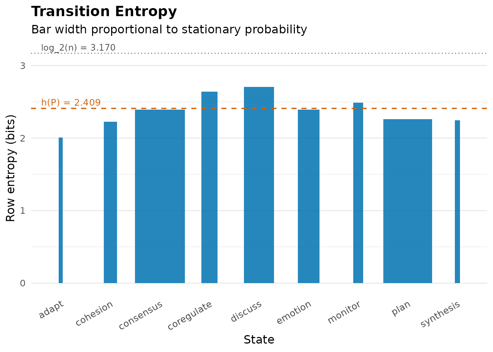
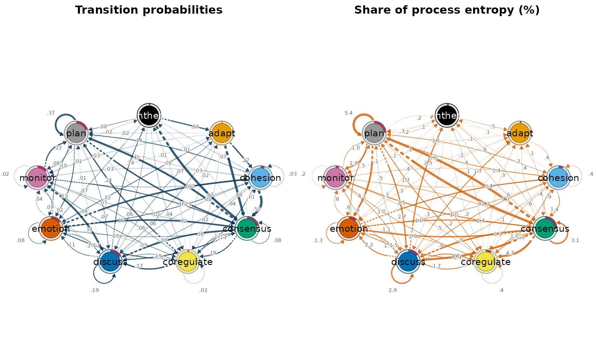
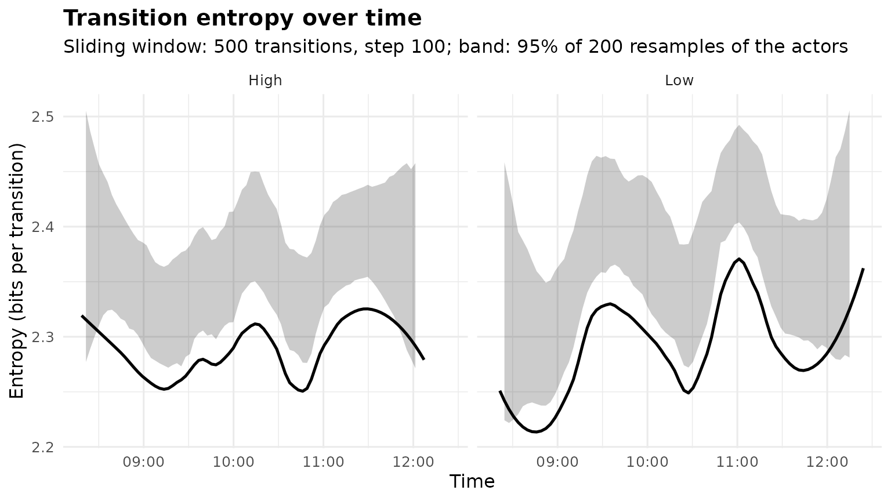
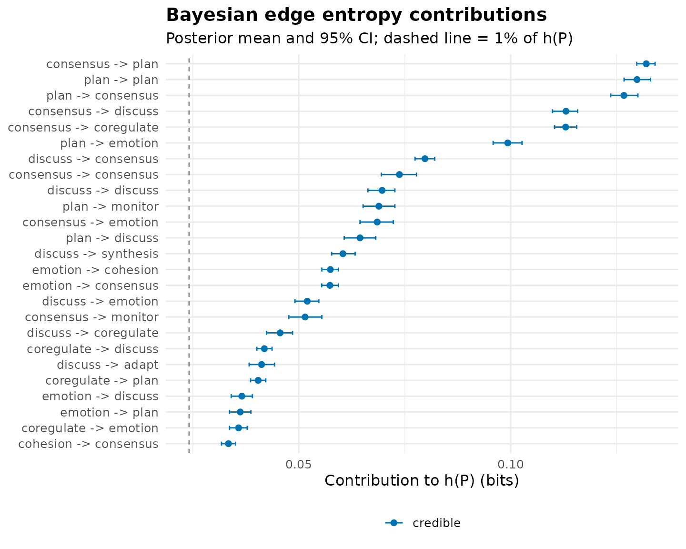

# Transition Matrix Entropy

How predictable is a sequential process? The entropy rate of its
transition matrix answers with a single number: the average uncertainty,
in bits, about the next state given the current one (Shannon, 1948;
Cover & Thomas, 2006, ch. 4),

``` math
H = -\sum_i \pi_i \sum_j P_{ij} \log_2 P_{ij},
```

where $`P`$ is the transition matrix and $`\pi`$ its stationary
distribution (the eigenvector of $`P^\top`$ at $`\lambda = 1`$; Kemeny &
Snell, 1976). This is the quantity Krejtz et al. (2015) introduced to
behavioral research as gaze transition entropy and Krejtz et al. (2025)
track in real time as mobile transition matrix entropy. Nestimate (Saqr
et al., 2026) computes it for any transition network (Saqr et al.,
2025a, 2025b), decomposes it per state and per edge, tracks it over
time, and estimates it with Bayesian credible intervals.

Throughout we use the bundled `group_regulation_long` data: 27,533
timestamped regulation actions by students collaborating in groups,
coded into nine states, synthetically generated from the
`group_regulation` dataset of the tna package (Tikka et al., 2025).

## The entropy of a transition network

[`transition_entropy()`](https://pak.dynasite.org/Nestimate/reference/transition_entropy.md)
accepts a fitted network, a transition matrix, or sequence data.

``` r

library(Nestimate)
net <- build_network(group_regulation_long, method = "relative",
                     actor = "Actor", action = "Action", time = "Time")
te <- transition_entropy(net)
te
#> Transition Entropy (9 states, bits; ceiling = 3.170)
#> 
#>                           raw            normalised
#>   Entropy rate    h(P)  = 2.409 bits    0.760
#>   Stationary    H(pi)  = 2.782 bits    0.878
#>   Redundancy   H(pi)-h = 0.373 bits    0.134
#> 
#> Normalised: h(P) and H(pi) are raw / log_2(n_states) (0 = deterministic, 1 = uniform);
#>   redundancy is the relative redundancy (H(pi) - h(P)) / H(pi), not raw / log_2(n_states).
```

The call computes the entropy rate $`H`$, the stationary entropy
$`H(\pi)`$ (the ceiling that would apply if consecutive actions were
independent), and their difference, the redundancy. The process runs at
2.41 bits per step against a ceiling of $`\log_2 9 = 3.17`$; the
normalized entropy 0.76 is the scale-free version Krejtz et al. (2025)
report. Regulation is far from scripted, but knowing the current action
removes 13% of the uncertainty about the next one (relative redundancy
0.134, that is 0.373 of the 2.78 bits of $`H(\pi)`$): sequence carries
real information, which is the empirical justification for modeling
transitions rather than activity frequencies alone.

### Which states are decision points?

$`H`$ is the stationary-weighted sum of per-state branching entropies
$`H(P_{i\cdot})`$. The summary and plot display those terms.

``` r

summary(te)
#>        state stationary row_entropy row_entropy_norm contribution
#> 1  consensus 0.24958879    2.392758        0.7548312   0.59720568
#> 2       plan 0.24486443    2.260687        0.7131673   0.55356184
#> 3    discuss 0.15179366    2.706071        0.8536704   0.41076445
#> 4    emotion 0.10912423    2.390486        0.7541145   0.26085998
#> 5 coregulate 0.08189694    2.639990        0.8328240   0.21620706
#> 6   cohesion 0.06666042    2.224856        0.7018641   0.14830987
#> 7    monitor 0.04864371    2.487425        0.7846952   0.12099758
#> 8  synthesis 0.02659239    2.248109        0.7091995   0.05978260
#> 9      adapt 0.02083543    2.005698        0.6327271   0.04178956
#>   contribution_pct
#> 1        24.785681
#> 2        22.974341
#> 3        17.047856
#> 4        10.826408
#> 5         8.973189
#> 6         6.155268
#> 7         5.021733
#> 8         2.481142
#> 9         1.734382
plot(te)
```



Tall bars are decision points: states whose continuation is genuinely
open. Short bars are scripted states whose next step is nearly
determined. Bar width is the stationary probability $`\pi_i`$, so bar
area is the state’s additive contribution $`\pi_i H(P_{i\cdot})`$ to the
process entropy.

## The entropy network

$`H`$ is a sum over transitions: edge $`i \to j`$ contributes exactly
$`\pi_i P_{ij} \log_2(1/P_{ij})`$.
[`entropy_network()`](https://pak.dynasite.org/Nestimate/reference/entropy_network.md)
returns the fitted network with those terms as edge weights — the same
object class as
[`build_network()`](https://pak.dynasite.org/Nestimate/reference/build_network.md),
so it prints, summarises, and plots identically. With
`scaling = "share"` the weights become percentages of $`H`$ and sum to
100.

``` r

ent <- entropy_network(net, scaling = "share")
ent
#> Network (method: entropy) [directed]
#>   Weights: [0.069, 5.482]  |  mean: 1.282
#> 
#>   Strongest edges (10 of 78):
#>    from      to         weight
#>    consensus plan       5.482 
#>    plan      plan       5.393 
#>    plan      consensus  5.265 
#>    consensus discuss    4.696 
#>    consensus coregulate 4.693 
#>    plan      emotion    4.130 
#>    discuss   consensus  3.315 
#>    consensus consensus  3.065 
#>    discuss   discuss    2.897 
#>    plan      monitor    2.860  
#> 
#>   extract_edges(include_self = TRUE) lists every edge; extract_transition_matrix() gives the weight matrix;
#>   extract_initial_probs() the initial probabilities.
#> 
#>   Scaling: share
```

``` r

op <- par(mfrow = c(1, 2))
cograph::splot(net, minimum = 0, title = "Transition probabilities",
               edge_label_digits = 2)
cograph::splot(ent, title = "Share of process entropy (%)")
```



``` r

par(op)
```

The two panels separate structure from uncertainty. The probability
panel shows where the process goes; the entropy panel shows where it is
unpredictable. High-probability routine transitions shrink in the
entropy view — observing the near-inevitable carries little information
— while the thick entropy edges mark frequent transitions whose outcome
is genuinely open. No new quantity is estimated: the entropy network
displays the summands of the equation above, so every number inherits
the defensibility of $`H`$ itself.

## Entropy over time

A single $`H`$ summarises the whole observation period. Sliding a window
across the transition stream — the design of Krejtz et al. (2025), who
use 30-second windows over gaze transitions — turns entropy into a
process measure.
[`entropy_trajectory()`](https://pak.dynasite.org/Nestimate/reference/entropy_trajectory.md)
builds transitions within each actor’s sequence, orders them in time,
and computes one entropy value per window.

``` r

tr <- entropy_trajectory(group_regulation_long,
                         action = "Action", actor = "Actor", time = "Time",
                         group = "Achiever", window = 500, step = 100)
summary(tr)
#>   group windows     mean         sd      min      max    first     last
#> 1  High     123 2.285872 0.04313978 2.175275 2.394429 2.309764 2.301800
#> 2   Low     124 2.294082 0.05803398 2.142537 2.436502 2.233659 2.347734
#>         change
#> 1 -0.007963838
#> 2  0.114074796
plot(tr, seed = 1)
```



The entropy is computed in windows of 500 transitions stepped by 100;
the curve is the loess trend of those windows (Cleveland, 1979) per
achievement group, and the band its 95% interval from 200 resamples of
the actors. Declining entropy is routinization — the group settling into
predictable regulation; rising entropy is exploration; a level shift
marks a phase change. The `change` column of the summary (last window
minus first) gives each group’s net trend. Within a window the chain is
routinely non-ergodic, so the per-window estimator weights rows by
observed occupancy rather than the eigenvector stationary distribution;
over long stationary stretches the two coincide.

## Bayesian estimation

Plug-in entropy is biased in small samples (Paninski, 2003) and treats
an edge observed three times exactly like one observed three thousand
times.
[`entropy_bayes()`](https://pak.dynasite.org/Nestimate/reference/entropy_bayes.md)
places an independent Dirichlet posterior on each row of the transition
matrix (the Jeffreys (1946) prior, 0.5, by default) and pushes Monte
Carlo draws through the entropy formula, so every quantity — the entropy
rate, each state’s branching entropy, each edge’s contribution — arrives
with a credible interval that reflects how much data supports it.

``` r

eb <- entropy_bayes(net, draws = 1000, seed = 1)
eb
#> Bayesian Transition Entropy (9 states, bits; Dirichlet prior 0.5, 1000 draws)
#> 
#>   entropy_rate:       2.411 [2.396, 2.425]
#>   stationary_entropy: 2.783 [2.771, 2.796]
#>   redundancy:         0.373 [0.361, 0.384]
#> 
#> Edges: 78 observed; 31 credible (share of h(P) credibly > 1%).
#> Use summary() for the edge table and plot() for the posterior.
```

The posterior mean (2.411 bits) sits next to the plug-in estimate
(2.409): with 27,533 actions every row of the matrix is well populated,
so the posterior adds little beyond the interval, which quantifies how
firmly the data pin down the process entropy. On sparse data the two
move apart, because the posterior integrates over count uncertainty
instead of taking the point estimate at face value. An edge is flagged
`credible` when its share of $`H`$ credibly exceeds `min_share` (1% by
default). The result also carries the entropy network with all other
edges zeroed — the stable entropy skeleton, safe to display without
overreading thin cells.

``` r

plot(eb)
```



Blue intervals are stable estimates; grey intervals rest on too few
observations to distinguish their entropy share from noise at the 95%
level.

## When to use which

- **One process, one number** —
  [`transition_entropy()`](https://pak.dynasite.org/Nestimate/reference/transition_entropy.md):
  how predictable is the process; is sequence informative at all
  (redundancy).
- **Where the uncertainty sits** — `plot(transition_entropy())` for
  states,
  [`entropy_network()`](https://pak.dynasite.org/Nestimate/reference/entropy_network.md)
  for transitions. Both display terms of the same equation; use
  `scaling = "share"` for percentage labels.
- **Change over time** —
  [`entropy_trajectory()`](https://pak.dynasite.org/Nestimate/reference/entropy_trajectory.md):
  routinization, exploration, phase shifts. Report the window size and
  step.
- **Sparse data or formal comparison** —
  [`entropy_bayes()`](https://pak.dynasite.org/Nestimate/reference/entropy_bayes.md):
  credible intervals for $`H`$, per-state and per-edge; group
  differences via the posterior draws; its pruned entropy network for a
  display without unstable edges.

## How to cite this article

Saqr, M. (2026). *Transition matrix entropy*. Nestimate.
[HTML](https://pak.dynasite.org/Nestimate/articles/transition-entropy.html)
· [PDF](https://pak.dynasite.org/Nestimate/pdf/transition-entropy.pdf)

## References

Cleveland, W. S. (1979). Robust locally weighted regression and
smoothing scatterplots. *Journal of the American Statistical
Association*, 74(368), 829–836.
<https://doi.org/10.1080/01621459.1979.10481038>

Cover, T. M., & Thomas, J. A. (2006). *Elements of information theory*
(2nd ed.). Wiley. <https://doi.org/10.1002/047174882X>

Jeffreys, H. (1946). An invariant form for the prior probability in
estimation problems. *Proceedings of the Royal Society of London. Series
A. Mathematical and Physical Sciences*, 186(1007), 453–461.
<https://doi.org/10.1098/rspa.1946.0056>

Kemeny, J. G., & Snell, J. L. (1976). *Finite Markov chains*. Springer.

Krejtz, K., Duchowski, A., Szmidt, T., Krejtz, I., González Perilli, F.,
Pires, A., Vilaró, A., & Villalobos, N. (2015). Gaze transition entropy.
*ACM Transactions on Applied Perception*, 13(1), 1–20.
<https://doi.org/10.1145/2834121>

Krejtz, K., Hughes, C. J., Stasiak, I., Duchowski, A., & Krejtz, I.
(2025). Real-time mobile transition matrix entropy based on eye and head
movements. In *Proceedings of the 2025 Symposium on Eye Tracking
Research and Applications (ETRA ’25)* (pp. 1–8). ACM.
<https://doi.org/10.1145/3715669.3723128>

Paninski, L. (2003). Estimation of entropy and mutual information.
*Neural Computation*, 15(6), 1191–1253.
<https://doi.org/10.1162/089976603321780272>

Saqr, M., López-Pernas, S., & Misiejuk, K. (2026). Nestimate: An R
package for dynamic, probabilistic, and high order network analysis.
*Applied Psychological Measurement*.
<https://doi.org/10.1177/01466216261472019>

Saqr, M., López-Pernas, S., & Tikka, S. (2025a). Mapping relational
dynamics with transition network analysis: A primer and tutorial. In M.
Saqr & S. López-Pernas (Eds.), *Advanced learning analytics methods: AI,
precision and complexity* (pp. 371–411). Springer.
<https://doi.org/10.1007/978-3-031-95365-1_15>

Saqr, M., López-Pernas, S., Törmänen, T., Kaliisa, R., Misiejuk, K., &
Tikka, S. (2025b). Transition network analysis: A novel framework for
modeling, visualizing, and identifying the temporal patterns of learners
and learning processes. In *Proceedings of the 15th International
Learning Analytics and Knowledge Conference (LAK25)* (pp. 351–361). ACM.
<https://doi.org/10.1145/3706468.3706513>

Shannon, C. E. (1948). A mathematical theory of communication. *Bell
System Technical Journal*, 27(3), 379–423.
<https://doi.org/10.1002/j.1538-7305.1948.tb01338.x>

Tikka, S., López-Pernas, S., & Saqr, M. (2025). tna: An R package for
transition network analysis. *Applied Psychological Measurement*, 49(6),
326–328. <https://doi.org/10.1177/01466216251348840>
