# Model Assessment for Transition Networks

## Introduction

A transition network summarises many sequences in one matrix of
transition probabilities (Saqr et al., 2025; Saqr, López-Pernas, &
Tikka, 2025a; Tikka, López-Pernas, & Saqr, 2025). Whether a centrality
ranking, a path or a group difference read from that matrix holds beyond
the sample depends on how much the matrix changes when the data change,
and on whether the model’s assumptions hold (Saqr, López-Pernas, &
Misiejuk, 2026a; Misiejuk et al., 2026). Nestimate (Saqr, López-Pernas,
& Misiejuk, 2026b) assesses a network in eight ways, and cograph draws
the networks.

| Question | Function |
|----|----|
| How precisely is each edge estimated when sequences are resampled? | [`bootstrap_network()`](https://pak.dynasite.org/Nestimate/reference/bootstrap_network.md) |
| How precisely do the observed counts determine each edge? | [`certainty()`](https://pak.dynasite.org/Nestimate/reference/certainty.md) |
| Which edges remain when the uncertain ones are removed? | [`net_prune()`](https://pak.dynasite.org/Nestimate/reference/net_prune.md) |
| Do two random halves of the data give the same network? | [`network_reliability()`](https://pak.dynasite.org/Nestimate/reference/network_reliability.md) |
| Do the edge weights hold when sequences are dropped? | [`casedrop_reliability()`](https://pak.dynasite.org/Nestimate/reference/casedrop_reliability.md) |
| Does the centrality ranking hold when sequences are dropped? | [`centrality_stability()`](https://pak.dynasite.org/Nestimate/reference/centrality_stability.md) |
| Does the next state depend only on the current one? | [`markov_order_test()`](https://pak.dynasite.org/Nestimate/reference/markov_order_test.md) |
| Which edges are large as probabilities but small as counts? | [`magnitude_difference()`](https://pak.dynasite.org/Nestimate/reference/magnitude_difference.md) |

## Data

`ai_long` holds the coded AI turns of 428 human-AI pair-programming
(“vibe coding”) sessions, one row per action: 8,551 actions, each coded
as one of eight AI actions. Vibe coding, programming by conversation
with an AI assistant (Sarkar & Drosos, 2025), has been studied with
transition networks, which describe what the student and the AI do in
turn (Saqr, Misiejuk, & López-Pernas, 2026). The network holds one
sequence per session, ordered by `order_in_session`.

``` r

library(Nestimate)
library(cograph)
net <- build_network(ai_long, method = "relative", action = "code",
                     actor = "session_id", time = "order_in_session")
state_frequencies(net)
```

            state count proportion
    1     Execute  3258     0.3810
    2 Investigate  2317     0.2710
    3        Plan  1620     0.1895
    4     Explain   524     0.0613
    5    Delegate   295     0.0345
    6      Repair   257     0.0301
    7      Report   181     0.0212
    8         Ask    99     0.0116

`Execute` (38%), `Investigate` (27%) and `Plan` (19%) make up most of
the actions; `Ask` (1.2%), `Report` (2.1%) and `Repair` (3.0%) are rare.
An edge leaving a rare action is estimated from few transitions.

``` r

net
```

    Transition Network (relative probabilities) [directed]
      Weights: [0.004, 0.621]  |  mean: 0.125

      Strongest edges (10 of 64):
       from        to          weight
       Delegate    Plan        0.621
       Execute     Execute     0.510
       Ask         Explain     0.484
       Repair      Execute     0.474
       Plan        Execute     0.470
       Investigate Plan        0.437
       Report      Execute     0.377
       Explain     Investigate 0.313
       Plan        Investigate 0.303
       Ask         Execute     0.286

      extract_edges(include_self = TRUE) lists every edge; extract_transition_matrix() gives the weight matrix;
      extract_initial_probs() the initial probabilities.

``` r

extract_initial_probs(net)
```

            Ask    Delegate     Execute     Explain Investigate        Plan
    0.004672897 0.184579439 0.058411215 0.002336449 0.714953271 0.035046729
         Repair      Report
    0.000000000 0.000000000 

The strongest transitions are from `Delegate` to `Plan` (0.62) and from
`Execute` to itself (0.51). Most sessions open with `Investigate` (72%).

``` r

splot(net)
```

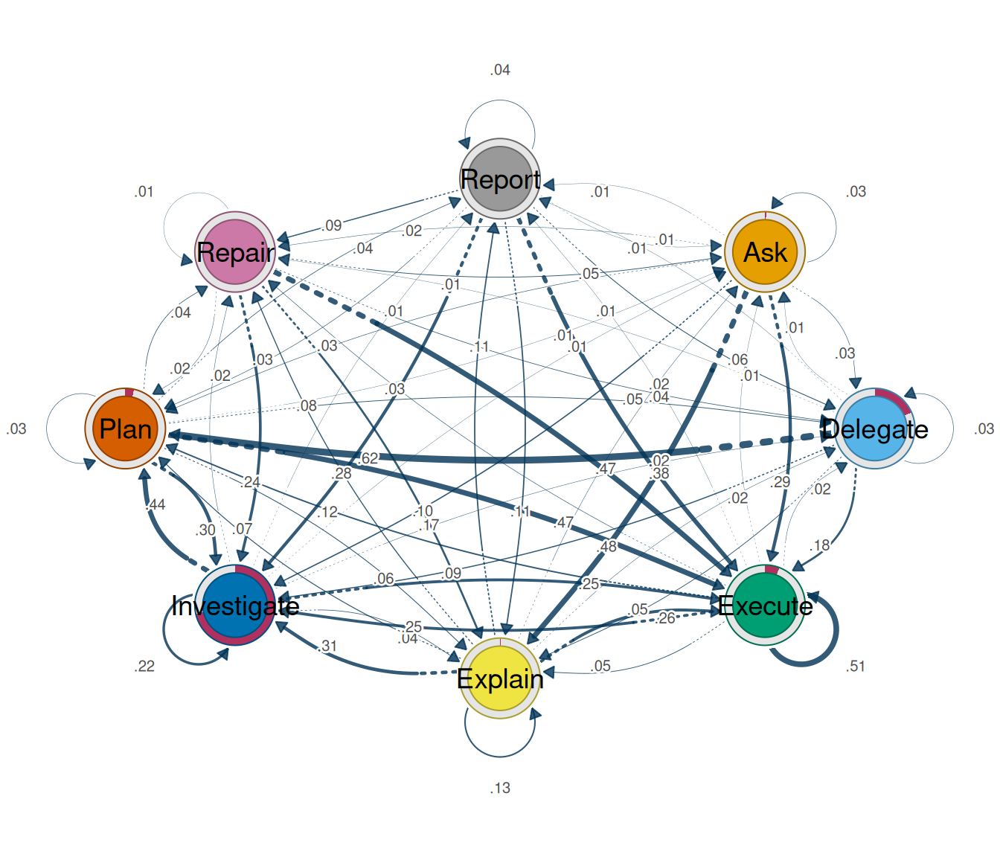

## Bootstrap

[`bootstrap_network()`](https://pak.dynasite.org/Nestimate/reference/bootstrap_network.md)
resamples the sessions with replacement, re-estimates the network in
each resample, and reports for each edge its mean, its 95% percentile
interval and a p-value (Efron, 1979; Saqr et al., 2025). With the
default `inference = "stability"`, the p-value is the share of resamples
in which the edge falls outside 0.75 to 1.25 times its estimate, so a
significant edge keeps its size; with `inference = "threshold"` it is
the share in which the edge falls below `edge_threshold`, so a
significant edge is present.

``` r

boot <- bootstrap_network(net, iter = 1000, seed = 1)
boot
```

      Edge                   Mean     95% CI          p
      -----------------------------------------------
      Delegate → Plan        0.623  [0.567, 0.680]  ***
      Execute → Execute      0.509  [0.484, 0.533]  ***
      Ask → Explain          0.485  [0.380, 0.603]  *
      Repair → Execute       0.472  [0.404, 0.538]  ***
      Plan → Execute         0.470  [0.442, 0.499]  ***
      ... and 16 more significant edges

    Bootstrap Network  [Transition Network (relative) | directed]
      Iterations : 1000  |  Nodes : 8
      Edges      : 21 significant / 64 total
      CI         : 95%  |  Inference: stability  |  CR [0.75, 1.25]

``` r

head(summary(boot), 8)
```

      from          to     weight       mean         sd    p_value   sig   ci_lower
    1  Ask         Ask 0.03296703 0.03217708 0.02332667 0.75424575 FALSE 0.00000000
    2  Ask    Delegate 0.03296703 0.03241495 0.01880458 0.69130869 FALSE 0.00000000
    3  Ask     Execute 0.28571429 0.28578342 0.05152216 0.17382617 FALSE 0.18478261
    4  Ask     Explain 0.48351648 0.48450615 0.05758930 0.03696304  TRUE 0.38028169
    5  Ask Investigate 0.09890110 0.09855244 0.03088833 0.41458541 FALSE 0.03895789
    6  Ask        Plan 0.03296703 0.03351226 0.02052768 0.72927073 FALSE 0.00000000
    7  Ask      Repair 0.02197802 0.02193807 0.01614619 0.76223776 FALSE 0.00000000
    8  Ask      Report 0.01098901 0.01111563 0.01139034 0.64835165 FALSE 0.00000000
        ci_upper    cr_lower   cr_upper
    1 0.08511287 0.024725275 0.04120879
    2 0.07318357 0.024725275 0.04120879
    3 0.38673684 0.214285714 0.35714286
    4 0.60319940 0.362637363 0.60439560
    5 0.16304348 0.074175824 0.12362637
    6 0.08108108 0.024725275 0.04120879
    7 0.05940889 0.016483516 0.02747253
    8 0.03896104 0.008241758 0.01373626

21 of the 64 edges keep their size in 95% of the resamples. The
strongest edges are estimated precisely: `Execute` to `Execute` has a
95% interval of \[0.48, 0.53\]. Edges from rare actions are wider: `Ask`
to `Explain`, estimated from the 99 transitions out of `Ask`, has an
interval of \[0.38, 0.60\] and is significant only at the 5% level.

[`splot()`](https://sonsoles.me/cograph/reference/splot.html) draws the
significant edges solid and the others dashed; the forest plot shows
every edge’s estimate and interval, ordered by size, with the
significant edges marked.

``` r

splot(boot)
```

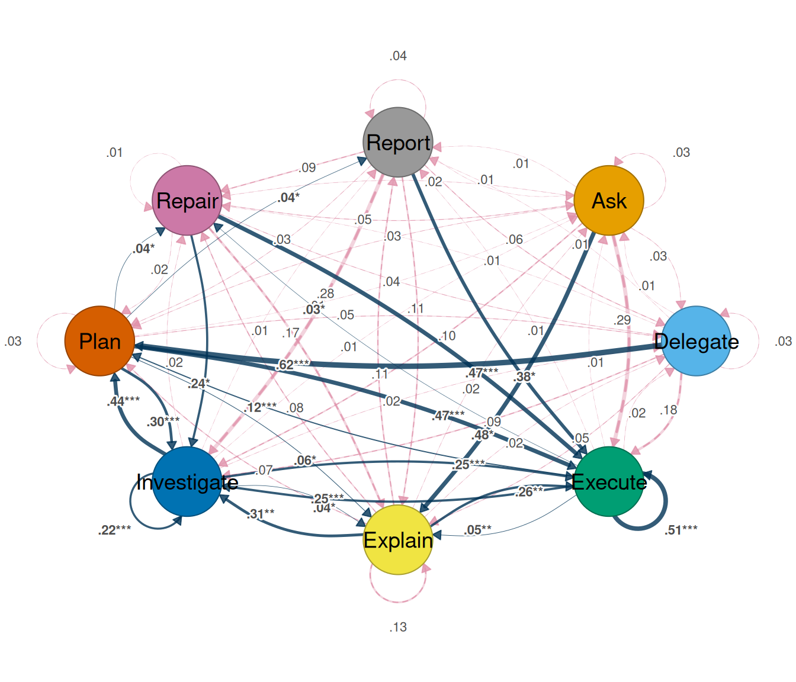

``` r

plot_bootstrap_forest(boot, show_ci = TRUE)
```

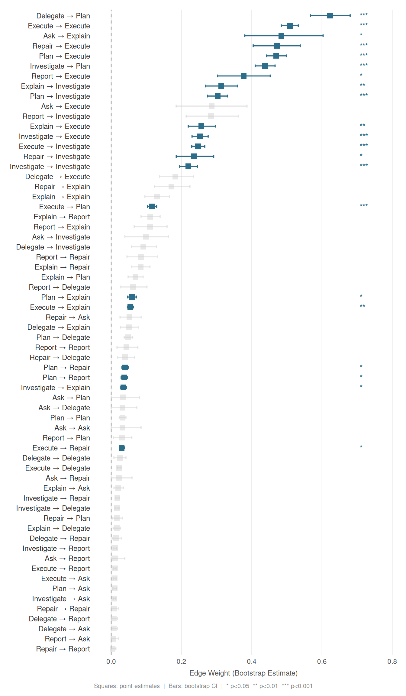

The width of an interval follows how often its source action occurs: the
median width is 0.08 for the edges leaving `Ask` and `Report`, the two
rarest actions, against 0.015 for `Execute` and 0.014 for `Investigate`,
the two most frequent.

``` r

bootstrap_network(net, iter = 1000, seed = 1, inference = "threshold",
                  edge_threshold = 0.05)
```

      Edge                   Mean     95% CI          p
      -----------------------------------------------
      Delegate → Plan        0.623  [0.567, 0.680]  ***
      Execute → Execute      0.509  [0.484, 0.533]  ***
      Ask → Explain          0.485  [0.380, 0.603]  ***
      Repair → Execute       0.472  [0.404, 0.538]  ***
      Plan → Execute         0.470  [0.442, 0.499]  ***
      ... and 21 more significant edges

    Bootstrap Network  [Transition Network (relative) | directed]
      Iterations : 1000  |  Nodes : 8
      Edges      : 26 significant / 64 total
      CI         : 95%  |  Inference: threshold  |  Threshold: 0.05

26 edges stay above 0.05 in 95% of the resamples. The two rules answer
different questions: whether an edge exists, and whether its size is
estimated precisely.

## Bayesian certainty

[`certainty()`](https://pak.dynasite.org/Nestimate/reference/certainty.md)
gives each edge a posterior distribution instead of resampling. The
transitions out of each action are modelled as a Dirichlet-multinomial
process: with a Dirichlet prior added to the counts, each edge
probability has a Beta posterior, so its mean, standard deviation and
credible interval are computed exactly (Johnston & Jendoubi, 2026). The
default prior, 0.5 added to every cell, is the Jeffreys prior (Jeffreys,
1946). An edge is certain under the same two rules as in the bootstrap,
with the posterior mass in place of the share of resamples.

``` r

edge_certainty <- certainty(net)
edge_certainty
```

      Edge                   Mean     95% CI          p
      -----------------------------------------------
      Delegate → Plan        0.614  [0.557, 0.670]  ***
      Execute → Execute      0.509  [0.492, 0.527]  ***
      Repair → Execute       0.469  [0.408, 0.530]  ***
      Plan → Execute         0.469  [0.444, 0.494]  ***
      Ask → Explain          0.468  [0.369, 0.569]  *
      ... and 21 more certain edges

    Certainty (Dirichlet)  [Transition Network (relative) | directed]
      Prior      : Dirichlet(0.50)  |  Nodes : 8
      Edges      : 26 certain / 64 total
      CI         : 95%  |  Inference: stability  |  CR [0.75, 1.25]

``` r

head(summary(edge_certainty), 8)
```

      from          to     weight       mean         sd    p_value   sig
    1  Ask         Ask 0.03296703 0.03684211 0.01922584 0.64672727 FALSE
    2  Ask    Delegate 0.03296703 0.03684211 0.01922584 0.64672727 FALSE
    3  Ask     Execute 0.28571429 0.27894737 0.04577296 0.12309999 FALSE
    4  Ask     Explain 0.48351648 0.46842105 0.05092916 0.02163817  TRUE
    5  Ask Investigate 0.09890110 0.10000000 0.03061862 0.41548285 FALSE
    6  Ask        Plan 0.03296703 0.03684211 0.01922584 0.64672727 FALSE
    7  Ask      Repair 0.02197802 0.02631579 0.01633735 0.70791671 FALSE
    8  Ask      Report 0.01098901 0.01578947 0.01272308 0.78826586 FALSE
         ci_lower   ci_upper    cr_lower   cr_upper
    1 0.009069023 0.08271334 0.024725275 0.04120879
    2 0.009069023 0.08271334 0.024725275 0.04120879
    3 0.193922801 0.37278541 0.214285714 0.35714286
    4 0.369459492 0.56864263 0.362637363 0.60439560
    5 0.048438672 0.16743036 0.074175824 0.12362637
    6 0.009069023 0.08271334 0.024725275 0.04120879
    7 0.004447106 0.06649773 0.016483516 0.02747253
    8 0.001150253 0.04863644 0.008241758 0.01373626

26 edges are certain against 21 significant in the bootstrap; the two
agree on 57 of the 64 edges. The credible intervals are narrower than
the bootstrap intervals (median width 0.043 against 0.048), because the
posterior treats every transition as independent, while the bootstrap
resamples whole sessions and so includes the differences between them.
The more the sessions differ from each other, the wider the bootstrap
intervals are relative to the credible intervals.

[`certainty()`](https://pak.dynasite.org/Nestimate/reference/certainty.md)
returns the same layout as
[`bootstrap_network()`](https://pak.dynasite.org/Nestimate/reference/bootstrap_network.md),
so the same plots draw it.

``` r

splot(edge_certainty)
```

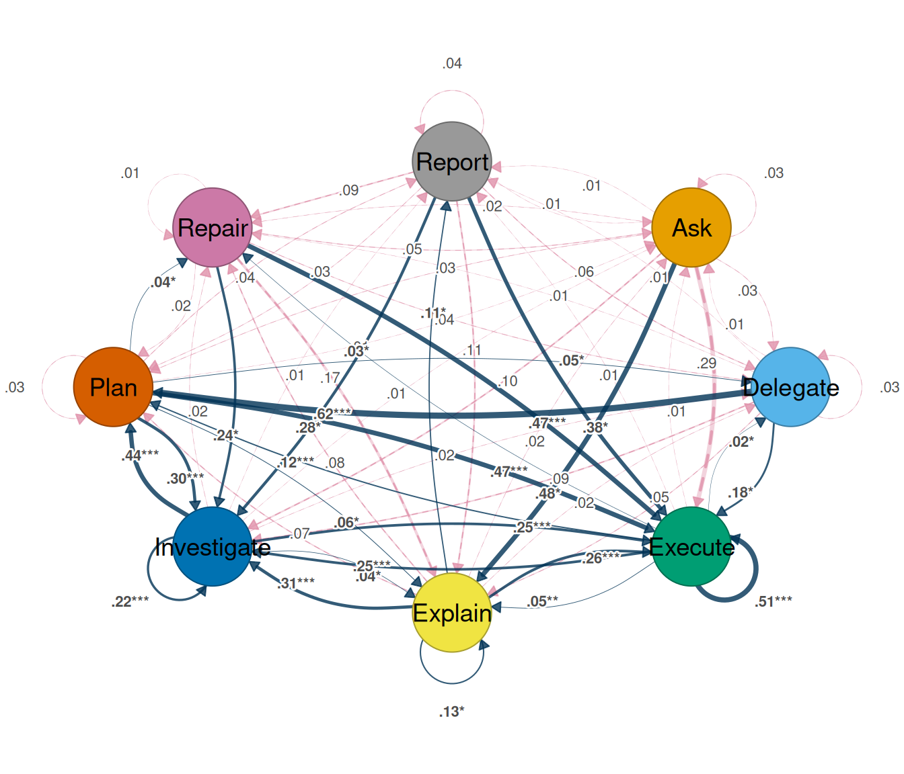

``` r

plot_bootstrap_forest(edge_certainty, show_ci = TRUE)
```

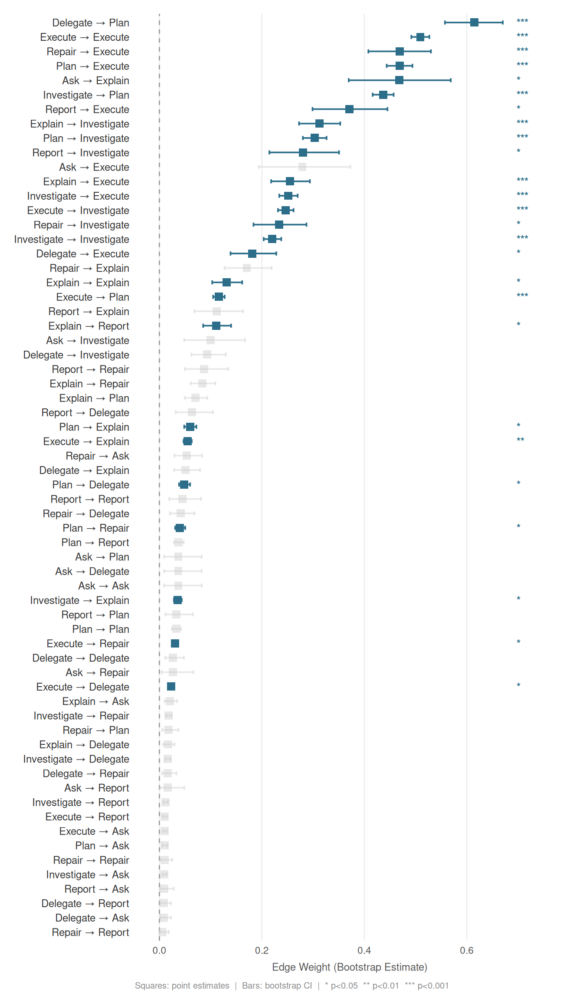

## Pruning

[`net_prune()`](https://pak.dynasite.org/Nestimate/reference/net_prune.md)
removes edges from the network. `method = "bootstrap"` removes the edges
the bootstrap finds non-significant; `"disparity"` keeps the edges that
carry a larger share of their state’s outgoing weight than expected when
the weight is spread at random over the state’s edges (Serrano, Boguñá,
& Vespignani, 2009); `"threshold"` removes the edges below a fixed
weight. Self-loops are never removed.

``` r

pruned <- net_prune(net, method = "bootstrap", boot = boot)
summary(pruned)
```

    Network metrics:
                          metric  value
                      Node Count      8
                      Edge Count     27
                 Network Density 0.4821
                   Mean Distance 0.4244
               Mean Out-Strength 0.7305
                 SD Out-Strength 0.2044
                Mean In-Strength 0.7305
                  SD In-Strength 0.8444
                 Mean Out-Degree  3.375
                   SD Out-Degree  1.506
     Centralization (Out-Degree) 0.4286
      Centralization (In-Degree) 0.4286
                     Reciprocity 0.6316

``` r

summary(net_prune(net, method = "disparity", level = 0.05))
```

    Network metrics:
                          metric  value
                      Node Count      8
                      Edge Count     16
                 Network Density 0.2857
                   Mean Distance 0.5505
               Mean Out-Strength 0.5035
                 SD Out-Strength 0.1313
                Mean In-Strength 0.5035
                  SD In-Strength 0.6512
                 Mean Out-Degree      2
                   SD Out-Degree 0.5345
     Centralization (Out-Degree) 0.1633
      Centralization (In-Degree) 0.3265
                     Reciprocity      0

The bootstrap keeps 27 of the 64 edges: the 19 significant edges between
different actions and the 8 self-loops. The disparity filter at the 5%
level keeps 16, the edges that take a large share of their row.

``` r

splot(pruned)
```

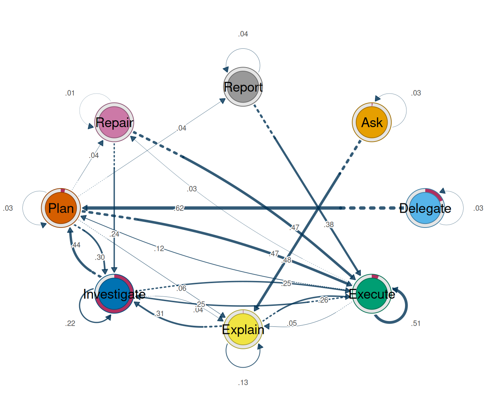

## Split-half reliability

[`network_reliability()`](https://pak.dynasite.org/Nestimate/reference/network_reliability.md)
splits the sessions at random into two halves, estimates the network in
each, and compares the two weight matrices: the mean, median and largest
absolute difference between corresponding edges, and the correlation of
the edge weights.

``` r

reliability <- network_reliability(net, iter = 500, seed = 1)
reliability
```

    Split-Half Reliability (500 iterations, split = 50%)
      Mean Abs. Diff.     mean = 0.0232  sd = 0.0033
      Median Abs. Diff.   mean = 0.0137  sd = 0.0020
      Pearson             mean = 0.9721  sd = 0.0110
      Max Abs. Diff.      mean = 0.1433  sd = 0.0484

``` r

plot(reliability)
```

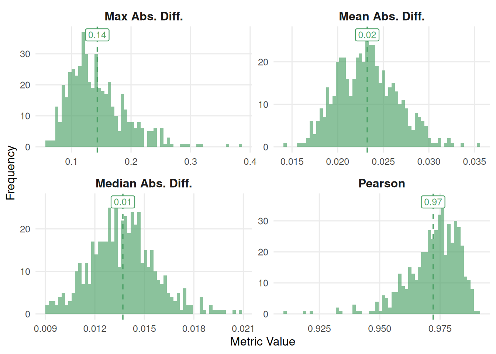

Over 500 splits, the edge weights of the two halves correlate at 0.97 on
average (SD 0.01), and corresponding edges differ by 0.023 on average.
The largest difference in a split averages 0.14. The histograms show the
distribution of each measure over the splits.

## Edge stability under case-dropping

[`casedrop_reliability()`](https://pak.dynasite.org/Nestimate/reference/casedrop_reliability.md)
drops increasing proportions of the sessions, re-estimates the network,
and correlates its edge weights with those of the full data. The
CS-coefficient is the largest proportion that can be dropped while the
correlation stays above 0.7 in 95% of the resamples (Epskamp, Borsboom,
& Fried, 2018).

``` r

edge_stability <- casedrop_reliability(net, iter = 200, seed = 1)
edge_stability
```

    Edge-weight Case-dropping Stability
      Cases (resampled)     : 428
      Edges assessed        : 56 (diagonal excluded)
      Iterations / prop     : 200
      Correlation method    : spearman
      CS-coefficient (r)    : 0.90  (threshold=0.70, certainty=0.95)

    Model-level reliability across iterations (mean +/- sd per drop):
      drop_prop      p=0.1        p=0.2        p=0.3        p=0.4        p=0.5        p=0.6        p=0.7        p=0.8        p=0.9
      mean|diff|      0.004+- 0.001   0.006+- 0.001   0.008+- 0.001   0.010+- 0.002   0.012+- 0.002   0.015+- 0.003   0.018+- 0.003   0.024+- 0.004   0.036+- 0.007
      median|diff|    0.002+- 0.000   0.003+- 0.001   0.004+- 0.001   0.005+- 0.001   0.007+- 0.001   0.008+- 0.001   0.010+- 0.002   0.013+- 0.003   0.019+- 0.004
      cor             0.996+- 0.002   0.992+- 0.003   0.987+- 0.006   0.981+- 0.008   0.973+- 0.010   0.963+- 0.013   0.947+- 0.017   0.917+- 0.025   0.846+- 0.051
      max|diff|       0.025+- 0.009   0.039+- 0.016   0.047+- 0.018   0.058+- 0.021   0.072+- 0.026   0.090+- 0.032   0.106+- 0.036   0.149+- 0.053   0.233+- 0.096

``` r

plot(edge_stability)
```

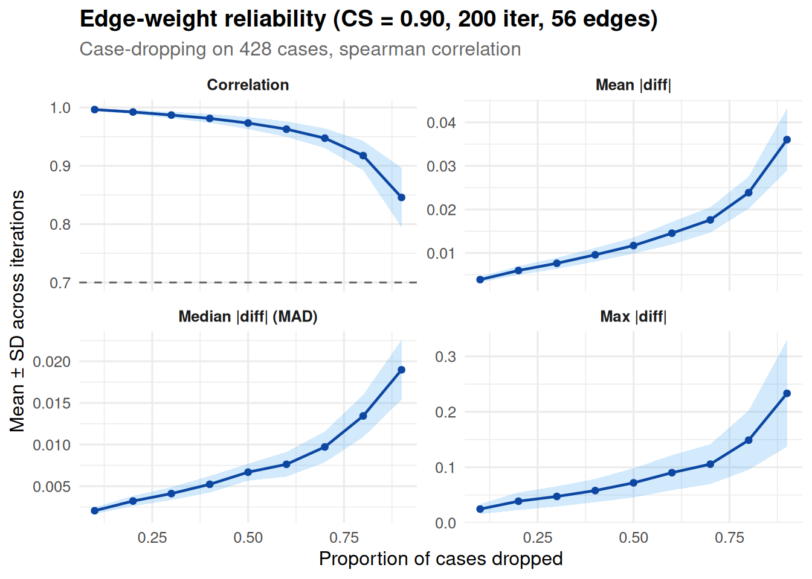

The CS-coefficient is 0.90, the largest proportion tested: with 90% of
the sessions removed, the edge weights still correlate at 0.85 on
average with those of the full data.
[`summary()`](https://rdrr.io/r/base/summary.html) returns the same
measures per drop proportion with their quantiles.

``` r

head(summary(edge_stability), 9)
```

            metric drop_prop        mean           sd      median          mad
    1 mean_abs_dev       0.1 0.003872951 0.0006614753 0.003816820 0.0005309776
    2 mean_abs_dev       0.2 0.005969644 0.0010099633 0.005845239 0.0009138482
    3 mean_abs_dev       0.3 0.007624020 0.0012674941 0.007564104 0.0011949467
    4 mean_abs_dev       0.4 0.009572238 0.0015787013 0.009532167 0.0015135834
    5 mean_abs_dev       0.5 0.011692573 0.0018487013 0.011475656 0.0016278104
    6 mean_abs_dev       0.6 0.014534806 0.0025980540 0.014208373 0.0025668616
    7 mean_abs_dev       0.7 0.017586556 0.0029170347 0.017467549 0.0030037354
    8 mean_abs_dev       0.8 0.023841961 0.0036797137 0.023516649 0.0038884127
    9 mean_abs_dev       0.9 0.036021862 0.0071699229 0.035419402 0.0061424998
             q025        q975
    1 0.002714190 0.005392140
    2 0.004323086 0.008290455
    3 0.005435935 0.010519492
    4 0.006682479 0.012945860
    5 0.008664289 0.016001903
    6 0.010698359 0.019718571
    7 0.012721217 0.023876236
    8 0.017427338 0.031269116
    9 0.025383639 0.050844619

## Centrality stability under case-dropping

[`centrality_stability()`](https://pak.dynasite.org/Nestimate/reference/centrality_stability.md)
drops sessions in the same way and correlates the centralities of the
reduced data with those of the full data, one CS-coefficient per
measure. Epskamp et al. (2018) suggest that the CS-coefficient should
not be below 0.25 and preferably above 0.5.

``` r

centrality <- centrality_stability(net, measures = c("InStrength",
                                                     "OutStrength",
                                                     "Betweenness"),
                                   iter = 200, seed = 1)
centrality
```

    Centrality Stability (200 iterations, threshold = 0.7)
      Drop proportions: 0.1, 0.2, 0.3, 0.4, 0.5, 0.6, 0.7, 0.8, 0.9

      CS-coefficients:
        InStrength       0.90
        OutStrength      0.90
        Betweenness      0.70

``` r

plot(centrality)
```

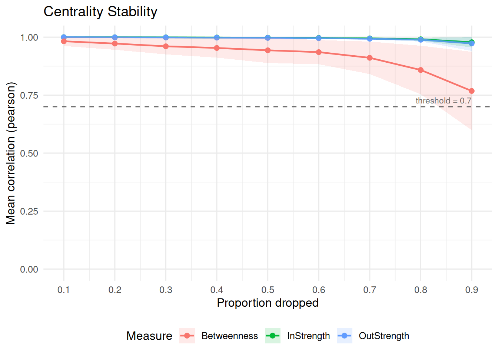

In-strength and out-strength reach 0.90 and betweenness 0.70: the
rankings by strength hold with 90% of the sessions removed, the ranking
by betweenness with 70%. Betweenness depends on which shortest paths
exist and changes more when a few edges change.

## Markov order

A transition network is a first-order Markov model: it assumes the next
action depends only on the current one.
[`markov_order_test()`](https://pak.dynasite.org/Nestimate/reference/markov_order_test.md)
tests at each order *k* whether order *k* describes the sequences better
than order *k* − 1. The statistic is a likelihood ratio $`G^2`$; its
null distribution comes from permuting the next action within each
context of the preceding *k* − 1 actions. The permutation is conditional
rather than exact, because the overlapping windows of one sequence are
not independent (Besag & Mondal, 2013).

``` r

markov_order <- markov_order_test(net, max_order = 3, n_perm = 200, seed = 1)
markov_order
```

    Markov Order Test  [within-w permutation, n_perm = 200, alpha = 0.050]
      425 sequences / 8548 observations / 8 states

      Selected order  BIC: 1   AIC: 1   permutation-LRT: 3

     order    loglik      AIC      BIC   df      g2 p_permutation p_asymptotic
         0 -13355.99 26725.99 26775.36   NA      NA            NA           NA
         1 -12249.83 24625.66 25070.02   49 2168.08   0.004975124 0.000000e+00
         2 -11963.73 24949.47 28553.78  392  544.55   0.004975124 5.001998e-07
         3 -11206.18 30602.37 59486.26 1470 1490.32   0.004975124 3.499674e-01
     significant
              NA
            TRUE
            TRUE
            TRUE

``` r

plot(markov_order)
```

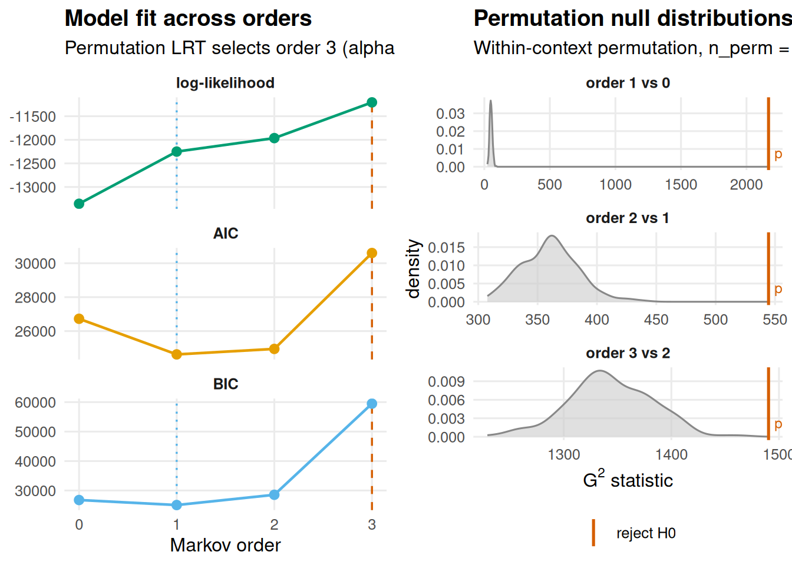

The AIC and the BIC both select order 1. The permutation test rejects
every order up to 3: each observed $`G^2`$ lies above all 200 permuted
values (p = 0.005, the smallest possible with 200 permutations), so it
selects order 3. At order 3 the asymptotic chi-square p-value is 0.35,
because most of the 1,470 degrees of freedom belong to contexts that
occur a few times; the permutation null does not rely on that
approximation. The previous action carries most of the information, and
longer histories add some that the criteria judge not worth their
parameters.

## Counts and probabilities

The network gives each edge as a probability, the share of a state’s
transitions that go to another state. A frequency network gives it as a
count (Saqr, López-Pernas, & Tikka, 2025b). An edge leaving a rare state
can be a large probability and a small count.
[`magnitude_difference()`](https://pak.dynasite.org/Nestimate/reference/magnitude_difference.md)
estimates both networks, rescales the counts to the range of the
probabilities, and returns the difference per edge.

``` r

magnitude <- magnitude_difference(ai_long, action = "code",
                                  actor = "session_id",
                                  time = "order_in_session")
magnitude
```

    magnitude_difference object
      metric: abs_diff   scale: tna_range
      states (8):  Ask, Delegate, Execute, Explain, Investigate, Plan, Repair, Report
      edges: 64
      magnitude-difference summary (abs_diff):
        Min.  1st Qu.   Median     Mean  3rd Qu.     Max.
    0.000000 0.009138 0.028184 0.079384 0.093949 0.549581 

``` r

summary(magnitude, n = 8)
```

          from          to       ftna       tna    signed     value
    1 Delegate        Plan 0.07184804 0.6214286 0.5495805 0.5495805
    2      Ask     Explain 0.02085199 0.4835165 0.4626645 0.4626645
    3   Repair     Execute 0.05027279 0.4741036 0.4238308 0.4238308
    4   Report     Execute 0.02752070 0.3765432 0.3490225 0.3490225
    5      Ask     Execute 0.01379100 0.2857143 0.2719233 0.2719233
    6   Report Investigate 0.02163654 0.2839506 0.2623141 0.2623141
    7  Explain Investigate 0.06557160 0.3134921 0.2479205 0.2479205
    8   Repair Investigate 0.02673615 0.2350598 0.2083236 0.2083236

The median difference is 0.03, and 9 of the 64 edges differ by more than
0.2. The largest differences all leave rare actions: `Delegate` to
`Plan` is a probability of 0.62 but 0.07 on the count scale, `Ask` to
`Explain` 0.48 against 0.02, and `Repair` to `Execute` 0.47 against
0.05.

``` r

plot(magnitude)
```

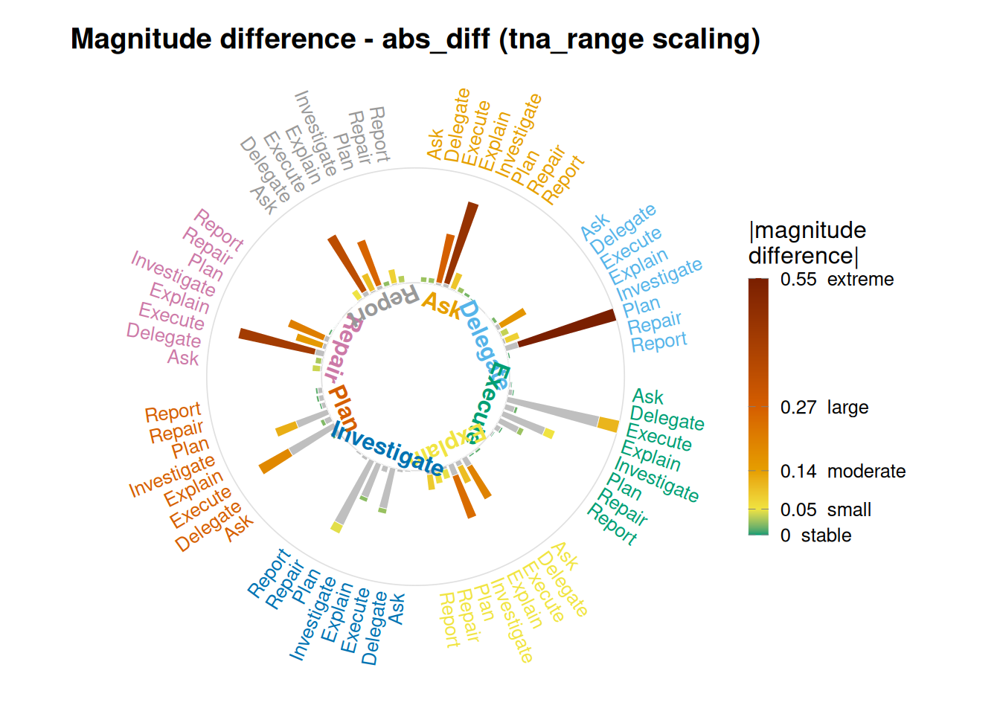

Each sector is one source action. The grey part of a wedge is the value
both views share, and the coloured tip the difference.

## Summary

| Assessment | Result for `ai_long` |
|----|----|
| Bootstrap, edges keeping their size | 21 of 64 |
| Bayesian certainty, certain edges | 26 of 64; agrees with the bootstrap on 57 |
| Edges kept by bootstrap pruning | 27 (19 between actions, 8 self-loops) |
| Split-half correlation of the edge weights | 0.97 |
| Edge CS-coefficient | 0.90 |
| Centrality CS-coefficients | in-strength 0.90, out-strength 0.90, betweenness 0.70 |
| Markov order | AIC and BIC: 1; permutation test: 3 |
| Edges differing by more than 0.2 between counts and probabilities | 9 of 64, all from rare actions |

## How to cite this article

Saqr, M., López-Pernas, S., & Misiejuk, K. (2026). *Model assessment for
transition networks*. Nestimate.
[HTML](https://pak.dynasite.org/Nestimate/articles/tutorial_model_assessment.html)
·
[PDF](https://pak.dynasite.org/Nestimate/pdf/tutorial_model_assessment.pdf)

## References

Besag, J., & Mondal, D. (2013). Exact goodness-of-fit tests for Markov
chains. *Biometrics*, 69(2), 488–496. https://doi.org/10.1111/biom.12009

Efron, B. (1979). Bootstrap methods: Another look at the jackknife. *The
Annals of Statistics*, 7(1), 1–26.
https://doi.org/10.1214/aos/1176344552

Epskamp, S., Borsboom, D., & Fried, E. I. (2018). Estimating
psychological networks and their accuracy: A tutorial paper. *Behavior
Research Methods*, 50(1), 195–212.
https://doi.org/10.3758/s13428-017-0862-1

Jeffreys, H. (1946). An invariant form for the prior probability in
estimation problems. *Proceedings of the Royal Society of London. Series
A*, 186(1007), 453–461. https://doi.org/10.1098/rspa.1946.0056

Johnston, L., & Jendoubi, T. (2026). How delivery mode reshapes resource
engagement: A Bayesian differential network analysis. *TNA Workshop
2026*.

Misiejuk, K., López-Pernas, S., Araujo Oliveira, E., & Saqr, M. (2026).
Modeling dynamics of learning and learners with the transition network
analysis toolkit. In *Artificial intelligence in education. Late
breaking results* (pp. 9–15). Springer.
https://doi.org/10.1007/978-3-032-29794-5_2

Saqr, M., López-Pernas, S., & Misiejuk, K. (2026a). Dynalytics: The
birth of a framework for rigorous analytics of dynamical systems. In M.
Saqr, K. Misiejuk, & S. López-Pernas (Eds.), *Innovations in analytics
of learning dynamics* (pp. 3–17). Springer.
https://doi.org/10.1007/978-3-032-34157-0_1

Saqr, M., López-Pernas, S., & Misiejuk, K. (2026b). Nestimate: An R
package for dynamic, probabilistic, and high order network analysis.
*Applied Psychological Measurement*.
https://doi.org/10.1177/01466216261472019

Saqr, M., López-Pernas, S., & Tikka, S. (2025a). Mapping relational
dynamics with transition network analysis: A primer and tutorial. In M.
Saqr & S. López-Pernas (Eds.), *Advanced learning analytics methods: AI,
precision and complexity* (pp. 371–411). Springer.
https://doi.org/10.1007/978-3-031-95365-1_15

Saqr, M., López-Pernas, S., & Tikka, S. (2025b). Capturing the breadth
and dynamics of the temporal processes with frequency transition network
analysis: A primer and tutorial. In M. Saqr & S. López-Pernas (Eds.),
*Advanced learning analytics methods: AI, precision and complexity*
(pp. 413–446). Springer. https://doi.org/10.1007/978-3-031-95365-1_16

Saqr, M., López-Pernas, S., Törmänen, T., Kaliisa, R., Misiejuk, K., &
Tikka, S. (2025). Transition network analysis: A novel framework for
modeling, visualizing, and identifying the temporal patterns of learners
and learning processes. In *Proceedings of the 15th International
Learning Analytics and Knowledge Conference (LAK25)* (pp. 351–361). ACM.
https://doi.org/10.1145/3706468.3706513

Saqr, M., Misiejuk, K., & López-Pernas, S. (2026). Human-AI
collaboration or obedient and often clueless AI in instruct, serve,
repeat dynamics? *The Internet and Higher Education*, 70, 101087.
https://doi.org/10.1016/j.iheduc.2026.101087

Sarkar, A., & Drosos, I. (2025). Vibe coding: Programming through
conversation with artificial intelligence. In *Proceedings of the 36th
Annual Conference of the Psychology of Programming Interest Group (PPIG
2025)*. https://doi.org/10.48550/arXiv.2506.23253

Serrano, M. Á., Boguñá, M., & Vespignani, A. (2009). Extracting the
multiscale backbone of complex weighted networks. *Proceedings of the
National Academy of Sciences*, 106(16), 6483–6488.
https://doi.org/10.1073/pnas.0808904106

Tikka, S., López-Pernas, S., & Saqr, M. (2025). tna: An R package for
transition network analysis. *Applied Psychological Measurement*, 49(6),
326–328. https://doi.org/10.1177/01466216251348840
